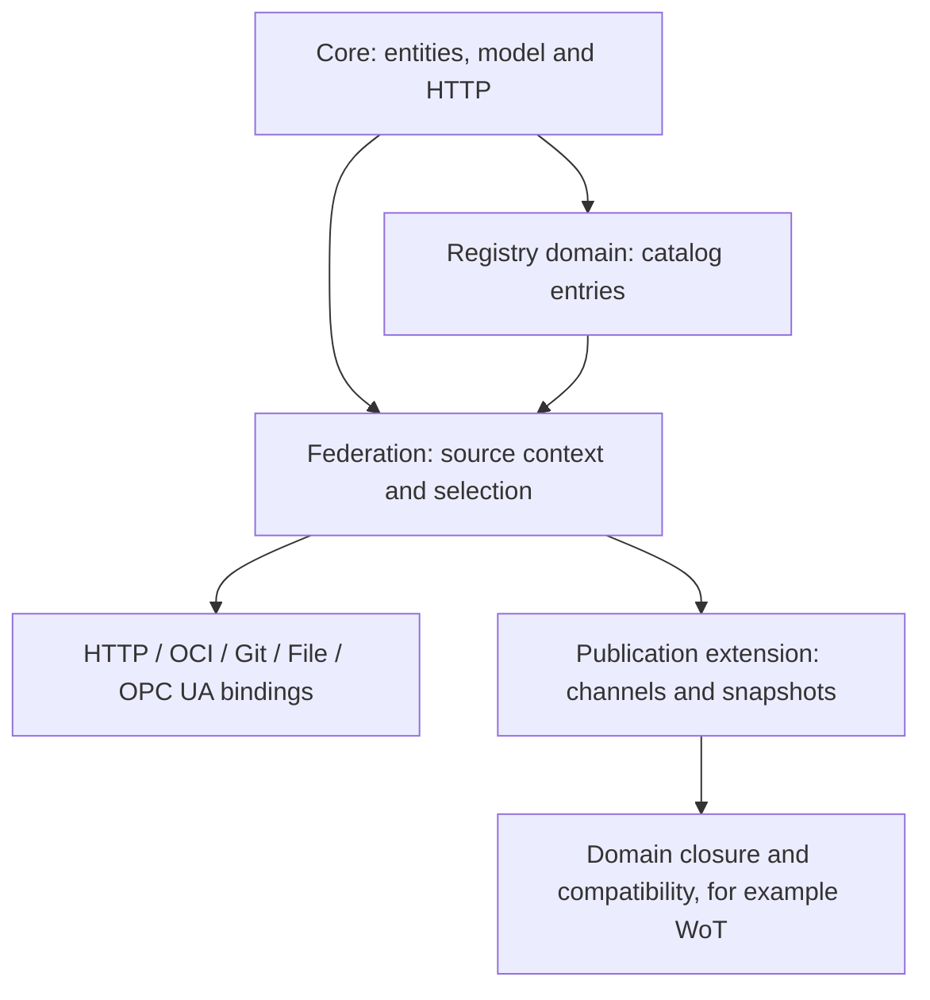

# Working Drafts

<!-- words: opc opcua OpenUSD pytest readme ua workingdrafts -->
<!-- words: namespace validators -->
<!-- words: usd MaterialX plugins federatable -->
<!-- words: exampleformat jsonschema ORAS powershell py reparse -->
<!-- words: dockerfile resolvedmodelsource symlink walkthrough -->

These specifications are working drafts for discussion and review, not part
of a released xRegistry specification. They can change independently of
released specifications.

## Federation Specification Family

The federation drafts define read-only resolution across independently
administered Registries.

Start with the domain specification to understand catalog entries. Then read
the federation specification to learn how it handles hosting and selects
sources. Use the comparison below to choose a binding. Its reference sections
define the implementation rules.

The arrows below indicate specification dependencies, not network requests.
Core supplies the entities and interpretation rules. The other drafts add
catalog discovery, access methods or publication context.



Choose a reading route for the operation you want to implement:

- **Discover and read:** [catalog selection](models/registry/spec.md#6-discovery-and-selection),
  then [federation reads](federation/spec.md#read-operations) and the chosen
  binding below.
- **Publish and promote:** [channel updates](publication/spec.md#publishing-and-opening-a-channel),
  then the [publication examples](publication/samples/README.md).
- **Capture and replay:** [snapshot completeness](federation/spec.md#snapshots-and-completeness),
  then [offline publication access](publication/spec.md#export-federation-and-binding-equivalence).

| Specification | Scope |
| --- | --- |
| [Registry of Registries](models/registry/spec.md) | Hub-compatible catalog model, advertisements and relationships. |
| [Federation](federation/spec.md) | Registry contexts, selection, references, representations and conformance. |
| [Directory mapping](bindings/mapping.md) | Map existing directory contents to a Registry through Git or File. |
| [OCI](bindings/oci.md) | Bounded descriptor graphs, publication and native snapshot resolution. |
| [HTTP federation](bindings/http-federation.md) | Federation using the existing xRegistry HTTP API. |
| [Git](bindings/git.md) | Commit-pinned document-tree access. |
| [File](bindings/file.md) | Local document-tree and OCI-layout access. |
| [OPC UA](bindings/opcua.md) | Native OPC UA API and federation integration. |

### Choosing a Binding

| Binding | Service and storage preparation | Revision and consistency | Implementation prerequisites |
| --- | --- | --- | --- |
| HTTP | An existing xRegistry HTTP endpoint. No new storage format is needed. | Reads usually observe live state. Per-response validators do not provide a Registry-wide snapshot. | Core HTTP requests, pagination and authentication. |
| OCI | An OCI artifact service, or a local layout. Package the Registry as the specified descriptor graph. | Resolve a tag once and retain the root digest. Descendant digests identify the selected bytes. | An artifact client supporting nested indexes, the format's roles and digest checks. A container runtime alone is insufficient. |
| Git | A repository containing a directory mapping. Remote acquisition uses HTTPS. | Resolve a ref or annotated tag once and retain the commit. Read Git objects rather than checkout files. | Git object access and the directory mapping reader. |
| File | No xRegistry service. Use local storage or an OS-mounted file share containing a directory mapping or OCI layout. | Root hashes and descriptors detect inconsistent content. A mutable directory is not automatically an immutable snapshot. | Filesystem access, containment checks and the reader for the chosen format. |
| OPC UA | An OPC UA server exposing the Registry nodes and document access described by the binding. | Reads usually observe live state. Session handles and per-node timestamps are not snapshot identifiers. | OPC UA Services, Registry-root selection and namespace remapping. Check the binding's explicit domain-mapping and companion-draft dependencies. |

These choices describe access to a source Registry. A consumer-facing API
server can use a different binding to read that source. For example, it can
serve HTTP clients from a local File mapping or an OCI snapshot.

The [resolution-owner capability](federation/spec.md#signaling-who-performs-resolution)
distinguishes views combined by their producer from views that consumers
combine themselves. The default is `consumer`. With `producer`, the consumer
reads the supplied view without repeating its catalog traversal.

The [Registry model artifacts](models/registry/README.md) and
[shared examples](#generating-and-reading-examples) accompany these drafts.
Core `xref` remains a same-Registry, same-Resource-model-type mechanism.
Federation does not redefine it as a remote URL.

### Generating and Reading Examples

[examples.json](federation/examples.json) is the single Registry-content
source for the federation and binding examples. Select one named example
and generate a File mapping, a local Git repository or a native OCI artifact
with [generate_examples.py](federation/tools/generate_examples.py). The
generator does not start an HTTP or OPC UA server. Publication and domain
model samples remain separate.

| Example | Content |
| --- | --- |
| `walkthrough` | One `widget` Resource and its exact 18-byte document, using the project paths taught by the [mapping walkthrough](bindings/mapping.md#worked-example-map-one-existing-file). |
| `portable` | Typed collections, explicit defaults, local aliases, a metadata-only catalog, binary content and an empty document. |
| `offline` | Complete `dirs` / `files` Registry with imported types, aliases and locally captured documents. |
| `linked` | A separate Registry context whose non-default `v2` document remains an external URL. |
| `first` | The Registry used by the HTTP and UA examples, including default `v1`, explicit Versions and metadata-only catalog entries. |
| `second` | An independent Registry with a colliding asset XID and different bytes. |

These names select source examples, not Registry IDs or revision pins. Every
example can be generated in all three formats. A linked document URL remains
a URL. Generation never retrieves its content.

Run the commands from the repository root with Python 3.10 or later and the
existing `jsonschema` dependency in [tools/requirements.txt](../tools/requirements.txt).
Git is needed only for Git output. ORAS 1.3.0 is needed only for explicit OCI
copying or publication, not for offline generation. The tests use `pytest`.

First validate all named examples without creating output:

```powershell
python -B -m workingdrafts.federation.tools.generate_examples validate
```

Use output paths outside the source checkout, each either new or an empty
directory. The generator rejects nonempty destinations, filesystem
roots and symlink/reparse escapes. It does not overwrite an existing project.
Use different empty destinations to repeat the examples:

```powershell
python -B -m workingdrafts.federation.tools.generate_examples file --example walkthrough --output D:\temp\xregistry-file
python -B -m workingdrafts.federation.tools.generate_examples git --example walkthrough --output D:\temp\xregistry-git
python -B -m workingdrafts.federation.tools.generate_examples oci --example offline --output D:\temp\xregistry-oci --reference offline --page-size 2
```

On Linux, use an absolute output directory outside the checkout. For example,
the same commands can use new directories under `$HOME/xregistry-examples`:

```sh
python -B -m workingdrafts.federation.tools.generate_examples file --example walkthrough --output "$HOME/xregistry-examples/file"
python -B -m workingdrafts.federation.tools.generate_examples git --example walkthrough --output "$HOME/xregistry-examples/git"
python -B -m workingdrafts.federation.tools.generate_examples oci --example offline --output "$HOME/xregistry-examples/oci" --reference offline --page-size 2
```

Each command reports its generated root and binding-specific pin as JSON.
Git output is a bare repository containing the mapping under `xregistry`,
with a deterministic commit at `refs/heads/main` and an annotated
`refs/tags/snapshot`. No remote is configured, and no Git push occurs.
OCI defaults to `--reference snapshot` and `--page-size 256`. The smaller
page size above reproduces the existing sharded `offline` graph and digest.

File and Git output put each record and index in its own file. Add
`--inline` to embed all of them in `registry.json` instead. The
`walkthrough` example always uses its inline project layout. OCI
generation does not accept `--inline`.

Read the generated outputs with the existing binding helpers:

```powershell
python -B -m workingdrafts.bindings.tools.mapping_examples entity D:\temp\xregistry-file /documents/main/assets/widget/versions/v1
python -B -m workingdrafts.bindings.tools.mapping_examples document --git-dir D:\temp\xregistry-git --revision refs/tags/snapshot --path xregistry --target /documents/main/assets/widget/versions/v1
python -B -m workingdrafts.bindings.tools.oci_examples lookup D:\temp\xregistry-oci /dirs/main/files/sample/versions/v2 --reference offline --operation document
```

For Linux, substitute the corresponding absolute output paths in these
reader commands. Metadata and document operations remain distinct. A Git
commit, an OCI root digest and a Core Version ID are not interchangeable.
The [File](bindings/file.md#motivation-and-example),
[Git](bindings/git.md#conformance) and
[OCI](bindings/oci.md#9-conformance-and-executable-examples) sections
describe validation and selective reads.

OCI publication is opt-in. Adding
`--push registry.example.org/team/catalog:example` to OCI generation copies
the generated native descriptor graph to that destination. The
[publication procedure](bindings/oci.md#publish-or-retry-an-oci-artifact)
describes login, direct `oras cp`, retries and digest-pinned retrieval.
Neither a Dockerfile nor a container-image tar wrapper is involved.

The source envelope has `exampleformat: 1` and an `examples` map. Each
example contains neutral `records` with `kind` and `entity`, a `snapshot`
class, available `resolvedmodelsource`, and `documents` keyed by full
Version XID. Each document supplies exactly one of `text`, `base64`, `url`
or `none: true`, with `origin` and `base` where applicable. Text is encoded
as UTF-8 without adding a newline. Base64 preserves exact binary and empty
bytes. This is example-generator input, not a new Core response, mapping
extension or normative interchange format. `--input PATH` selects another
source document using the same example notation.

Protocol observations and expected errors live in the
[HTTP tests](bindings/tools/test_http_examples.py),
[UA tests](bindings/tools/test_opcua_examples.py) and
[shared selection tests](federation/tools/test_federation_examples.py).
They use synthetic exchanges, not deployed traffic. The
[generator tests](federation/tools/test_generate_examples.py) check generated
outputs across bindings. Run the offline suites from the repository root:

```powershell
python -B -m pytest workingdrafts\bindings\tools workingdrafts\federation\tools -q
```

Tests distinguish exact document bytes, selected Version identity, complete
graph validation and selective fetch traces. None alone establishes the
others. The [source-resolution helper](federation/tools/federation_resolution_examples.py)
also checks local shadows and ordered source misses through in-memory reads.
For a channel moving while a reader stays pinned, see the separate
[publication walkthrough](publication/samples/README.md#promotion-rollback-and-an-already-open-reader).

## Publication Extension

[Channels and snapshots](publication/spec.md) separate a mutable publication
channel from the captured state it selects. A channel's conditional head
selects an immutable manifest over the Registry state defined by federation.
Channel selection does not establish domain compatibility, and neither a
channel nor a snapshot is represented by a Group.

The extension includes a reusable [model](publication/model.json),
[schemas](publication/schemas/publication.json) and
[executable examples](publication/samples/README.md). Publication owns
conditional writes and retention. Federation remains read-only. Its HTTP
open context provides a concrete snapshot pin without changing ordinary
HTTP advertisements. Cross-binding equivalence requires a checked mapping,
not equality of Registry IDs.

The [WoT publication companion](models/wot/publication-design.md) supplies
the domain-specific closure design, schema, shape example and checks.
The [WoT versioning design](models/wot/versioning-design.md) and its
[overview](models/wot/versioning-design-summary.md) explain how to assign
document revisions, check compatibility, and select live references.

## OpenUSD Artifact Registry

The OpenUSD draft is a domain model rather than a federation binding. The draft
defines how an xRegistry stores and describes artifacts in an
[OpenUSD](https://openusd.org) scene. These artifacts include:

- Layers
- Packages
- Textures
- MaterialX documents
- Volumes
- Schema plugins

| Specification | Scope |
| --- | --- |
| [OpenUSD Artifact Registry](models/openusd/spec.md) | Asset containers, artifact Resources, identifiers and the dependency closure. |
| [Model artifacts](models/openusd/README.md) | The authoritative model and its identifier tests. |

A stage opens against one root layer and pulls in other artifacts through
composition arcs. That transitive set is the **dependency closure**. A Consumer
missing any member cannot compose the scene correctly. The draft defines how
to describe the closure, verify its members through per-Version digests, and
apply Core versioning and federation across registries.

Because the registry is an xRegistry document store, an existing USD asset
resolver can retrieve an artifact by URL without any xRegistry awareness. The
draft is also the wire-format peer of an externally defined OPC UA projection
of the same model. Both use the same collection names, attribute names, and
identifier rules. The draft does not depend on the projection.

Cross-references to the xRegistry [Schema](../schema/spec.md) and
[Endpoint](../endpoint/spec.md) registries are informative. An implementation
MAY validate them, but the draft does not require that every referent
resolves.

## WoT Registry

See the [WoT Registry working draft](models/wot/README.md).
