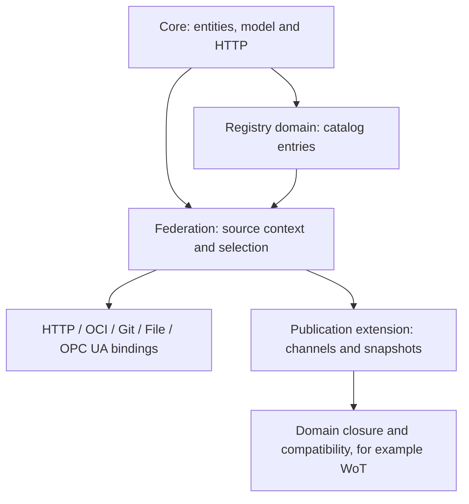

# Working Drafts

<!-- words: opc opcua OpenUSD pytest readme ua workingdrafts -->
<!-- words: namespace validators -->
<!-- words: usd MaterialX plugins federatable -->

These specifications are working drafts for discussion and review, not part
of a released xRegistry specification. They can change independently of
released specifications.

## Federation Specification Family

The federation drafts define read-only resolution across independently
administered Registries.

Start with the domain specification for catalog entries, then read the
federation specification for hosting and source selection. Use the comparison
below to choose a binding; its reference sections define the implementation
rules.

The arrows below indicate specification dependencies, not network requests.
Core supplies the entities and interpretation rules; the other drafts add
catalog discovery, access methods or publication context.

Choose a reading route by the operation being implemented:

- **Discover and read:** [catalog selection](models/registry/spec.md#6-discovery-and-selection),
  then [federation reads](federation/spec.md#read-operations) and the chosen
  binding below.
- **Publish and promote:** [channel updates](publication/spec.md#publishing-and-opening-a-channel),
  then the [publication examples](publication/samples/README.md).
- **Capture and replay:** [snapshot completeness](federation/spec.md#snapshots-and-completeness),
  then [offline publication access](publication/spec.md#export-federation-and-binding-equivalence).

| Specification | Scope |
| --- | --- |
| [Registry of Registries](models/registry/spec.md) | Hub-compatible catalog model, advertisements and relationships. |
| [Federation](federation/spec.md) | Registry contexts, selection, references, representations and conformance. |
| [Directory mapping](bindings/mapping.md) | Map existing directory contents to a Registry through Git or File. |
| [OCI](bindings/oci.md) | Bounded descriptor graphs, publication and native snapshot resolution. |
| [HTTP federation](bindings/http-federation.md) | Federation using the existing xRegistry HTTP API. |
| [Git](bindings/git.md) | Commit-pinned document-tree access. |
| [File](bindings/file.md) | Local document-tree and OCI-layout access. |
| [OPC UA](bindings/opcua.md) | Native OPC UA API and federation integration. |

### Choosing a Binding

| Binding | Service and storage preparation | Revision and consistency | Implementation prerequisites |
| --- | --- | --- | --- |
| HTTP | An existing xRegistry HTTP endpoint. No new storage format is needed. | Reads usually observe live state. Per-response validators do not provide a Registry-wide snapshot. | Core HTTP requests, pagination and authentication. |
| OCI | An OCI artifact service, or a local layout. Package the Registry as the specified descriptor graph. | Resolve a tag once and retain the root digest. Descendant digests identify the selected bytes. | An artifact client supporting nested indexes, the format's roles and digest checks. A container runtime alone is insufficient. |
| Git | A repository containing a directory mapping. Remote acquisition uses HTTPS. | Resolve a ref or annotated tag once and retain the commit. Read Git objects rather than checkout files. | Git object access and the directory mapping reader. |
| File | No xRegistry service. Use local storage or an OS-mounted file share containing a directory mapping or OCI layout. | Root hashes and descriptors detect inconsistent content. A mutable directory is not automatically an immutable snapshot. | Filesystem access, containment checks and the reader for the chosen format. |
| OPC UA | An OPC UA server exposing the Registry nodes and document access described by the binding. | Reads usually observe live state. Session handles and per-node timestamps are not snapshot identifiers. | OPC UA Services, Registry-root selection and namespace remapping. Check the binding's explicit domain-mapping and companion-draft dependencies. |

These choices describe access to a source Registry. A consumer-facing API
server can use a different binding to read that source. For example, it can
serve HTTP clients from a local File mapping or an OCI snapshot.

The [resolution-owner capability](federation/spec.md#signaling-who-performs-resolution)
distinguishes views combined by their producer from views that consumers
combine themselves. The default is `consumer`. With `producer`, the consumer
reads the supplied view without repeating its catalog traversal.

The [Registry model artifacts](models/registry/README.md) and
[conformance examples](federation/samples/README.md) accompany these drafts.
Core `xref` remains a same-Registry, same-Resource-model-type mechanism.
Federation does not redefine it as a remote URL.

## Publication Extension

[Channels and snapshots](publication/spec.md) separate a mutable publication
stream from the captured state it selects. A channel's conditional head
selects an immutable manifest over the Registry state defined by federation.
Channel selection does not establish domain compatibility, and neither a
channel nor a snapshot is represented by a Group.

The extension includes a reusable [model](publication/model.json),
[schemas](publication/schemas/publication.json) and
[executable examples](publication/samples/README.md). Publication owns
conditional writes and retention; federation remains read-only. Its HTTP
open context provides a concrete snapshot pin without changing ordinary
HTTP advertisements. Cross-binding equivalence requires a checked mapping,
not equality of Registry IDs.

The [WoT publication companion](models/wot/publication-design.md) supplies
the domain-specific closure design, schema, shape example and checks.
The [WoT versioning design](models/wot/versioning-design.md) and its
[overview](models/wot/versioning-design-summary.md) describe document
revision assignment, compatibility and live reference selection.

## OpenUSD Artifact Registry

The OpenUSD draft is a domain model rather than a federation binding. It
defines how an xRegistry stores and describes the artifacts that make up an
[OpenUSD](https://openusd.org) scene: layers, packages, textures, MaterialX
documents, volumes and schema plugins.

| Specification | Scope |
| --- | --- |
| [OpenUSD Artifact Registry](models/openusd/spec.md) | Asset containers, artifact Resources, identifiers and the dependency closure. |
| [Model artifacts](models/openusd/README.md) | The authoritative model and its identifier tests. |

A stage opens against one root layer and pulls in other artifacts through
composition arcs. That transitive set is the **dependency closure**. A Consumer
missing any member cannot compose the scene correctly. The draft defines how
to describe the closure, verify its members through per-Version digests, and
apply Core versioning and federation across registries.

Because the registry is an xRegistry document store, an existing USD asset
resolver can retrieve an artifact by URL without any xRegistry awareness. The
draft also acts as the wire-format peer of an OPC UA projection of the same
model, with which it shares collection names, attribute names and identifier
rules. That projection is defined externally, and this draft does not depend
on it.

Cross-references to the xRegistry [Schema](../schema/spec.md) and
[Endpoint](../endpoint/spec.md) registries are informative. An implementation
MAY validate them, but the draft does not require that every referent
resolves.

## WoT Registry

See the [WoT Registry working draft](models/wot/README.md).
