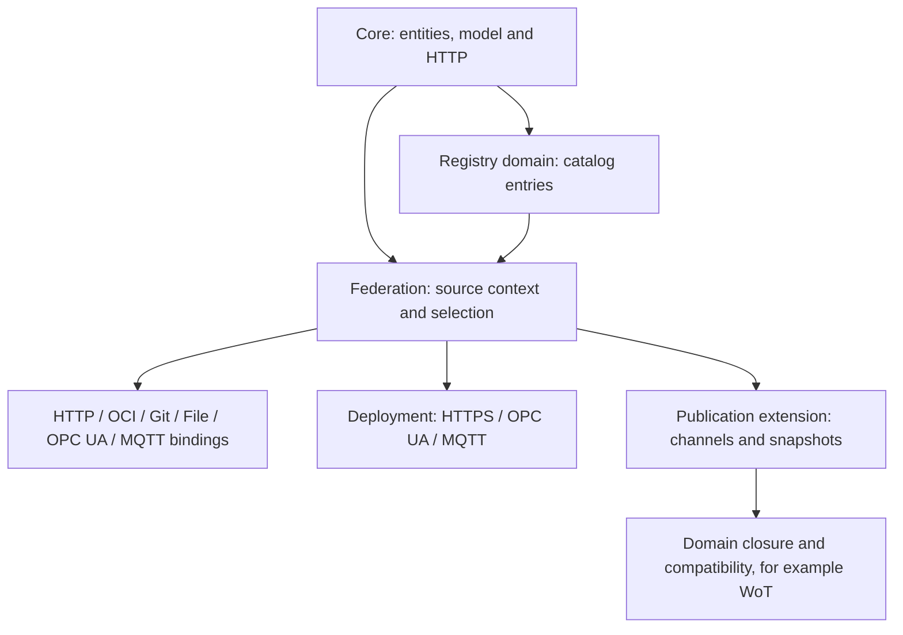

# Working Drafts

<!-- words: opc opcua OpenUSD pytest readme ua workingdrafts -->
<!-- words: namespace validators -->
<!-- words: usd MaterialX plugin plugins federatable -->
<!-- words: exampleformat jsonschema ORAS powershell py reparse -->
<!-- words: dockerfile resolvedmodelsource symlink walkthrough -->

This directory contains working drafts for discussion and review. They are
not part of a released xRegistry specification and can change independently
of released specifications.

## Federation Specification Family

The federation drafts define read-only resolution across independently
administered Registries and opt-in deployment to configured destinations.

The [Registry domain](models/registry/spec.md) defines catalog entries. The
[Federation design guide](federation/design/design.md) explains how clients
select and read sources and how senders deploy to downstream Registries.
The [Federation specification](federation/spec.md) defines the contract.
The binding comparison lists the available access methods.

The arrows below indicate specification dependencies, not network requests.
Core supplies the entities and interpretation rules. The other drafts add
catalog discovery, access methods, downstream deployment, or publication
context.



- **Discover and read:** [catalog selection](models/registry/spec.md#6-discovery-and-selection),
  then [federation reads](federation/spec.md#read-operations) and the chosen
  binding below.
- **Deploy downstream:** [shared deployment rules and protocol profiles](federation/spec.md#downstream-deployment).
  The [deployment design](federation/design/design.md#downstream-deployment)
  explains policy and recovery.
- **Publish and promote:** [channel updates](publication/spec.md#publishing-and-opening-a-channel),
  then the [publication examples](publication/samples/README.md).
- **Capture and replay:** [snapshot completeness](federation/spec.md#snapshots-and-completeness),
  then [offline publication access](publication/spec.md#export-federation-and-binding-equivalence).

| Specification | Scope |
| --- | --- |
| [Registry of Registries](models/registry/spec.md) | Catalog model with the xRegistry Hub's category and registry hierarchy, advertisements and relationships. |
| [Federation](federation/spec.md) | Registry contexts, selection, references, representations, and downstream deployment. |
| [Downstream deployment](federation/spec.md#downstream-deployment) | Shared staging and commit rules, with separate API profiles for HTTPS, OPC UA, and MQTT. |
| [Directory mapping](bindings/mapping.md) | Map existing directory contents to a Registry through Git or File. |
| [OCI](bindings/oci.md) | Bounded descriptor graphs, publication and native snapshot resolution. |
| [HTTP federation](bindings/http-federation.md) | Federation using the existing xRegistry HTTP API. |
| [Git](bindings/git.md) | Commit-pinned document-tree access. |
| [File](bindings/file.md) | Local document-tree and OCI-layout access. |
| [OPC UA](bindings/opcua.md) | Native OPC UA API and federation integration. |
| [MQTT 5.0 RPC](bindings/mqtt.md) | Native xRegistry API and Federation reads over single-packet MQTT request and reply publications. |

The [WoT generator](bindings/tools/generate_wot.py) turns repository
`model.json` files into the proposed MQTT Thing Models and JSON Schemas.
`python -m workingdrafts.bindings.tools.generate_wot <output-dir>`
writes the bundle to a dedicated directory. A `.zip` output path packages
only the generated files under `xregistry-wot/`.
The same command with `--check` reports missing, changed, or stale output
without writing. The bundle includes `XRegistry.TM.json`, the domain models
that extend it, and shared RPC schemas. The `xreg:types` link in each model
points to its generated metadata types; `xreg:facets` and
`xreg:ifvalues` preserve Core aspects that require model-aware interpretation.
Action forms use the [WoT MQTT binding draft][wot-mqtt-binding] terms
`mqv:controlPacket`, `mqv:qos`, and `mqv:retain` to describe the publish
step. `xreg:topic` remains a template, not a concrete `mqv:topic`.
The xRegistry binding specifies the full RPC exchange, including exact
QoS 1; `mqv:qos` describes a minimum. An SDK generator must support the
xRegistry binding to produce compatible client or server code.
The generator tests in `bindings/tools/test_generate_wot.py` are included
in the repository's `testpython` target through pytest discovery.

[wot-mqtt-binding]: https://w3c.github.io/wot-binding-templates/bindings/protocols/mqtt/#form-terms

### Choosing a Binding

| Binding | Service and storage preparation | Revision and consistency | Implementation prerequisites |
| --- | --- | --- | --- |
| HTTP | An existing xRegistry HTTP endpoint. No new storage format is needed. | Reads usually observe live state. Per-response validators do not provide a Registry-wide snapshot. | Core HTTP requests, pagination and authentication. |
| OCI | An OCI artifact service, or a local layout. Package the Registry as the specified descriptor graph. | Resolve a tag once and retain the root digest. Descendant digests identify the selected bytes. | An artifact client supporting nested indexes, the format's roles and digest checks. A container runtime alone is insufficient. |
| Git | A repository containing a directory mapping. Remote acquisition uses HTTPS. | Resolve a ref or annotated tag once and retain the commit. Read Git objects rather than checkout files. | Git object access and the directory mapping reader. |
| File | No xRegistry service. Use local storage or an OS-mounted file share containing a directory mapping or OCI layout. | Verify bytes against the selected root and its descriptors. A mutable directory has no implicit immutable pin. | Filesystem access, containment checks and the reader for the chosen format. |
| OPC UA | An OPC UA server exposing the Registry nodes and document access described by the binding. | Reads usually observe live state. Session handles and per-node timestamps are not snapshot identifiers. | OPC UA Services, Registry-root selection and namespace remapping. Check the binding's explicit domain-mapping and companion-draft dependencies. |
| MQTT | A TLS-enabled MQTT 5.0 broker and a serving Registry with a topic base for its exposed view. | Correlation and expiry do not pin a revision. | Action-and-target request topics and single-packet JSON payloads. |

The binding used to access a source Registry need not be the binding exposed
to consumers. For example, an API server can serve HTTP clients from a local
File mapping or an OCI snapshot.

The [resolution-owner capability](federation/spec.md#signaling-who-performs-resolution)
distinguishes views combined by their producer from views that consumers
combine themselves. The default is `consumer`. With `producer`, the consumer
reads the supplied view without repeating its catalog traversal.

The [Registry model artifacts](models/registry/README.md) and
[shared examples](#generating-and-reading-examples) accompany these drafts.
Core `xref` remains a same-Registry, same-Resource-model-type mechanism.
Federation does not redefine it as a remote URL.

### Generating and Reading Examples

[examples.json](federation/samples/examples.json) supplies the Registry content
shared by the federation and binding examples. Use
[generate_examples.py](federation/tools/generate_examples.py) to select a
named example and generate a File mapping, a local Git repository or a
native OCI artifact. The generator does not start HTTP or OPC UA servers.
Publication and domain models have separate sample directories.

| Example | Content |
| --- | --- |
| `walkthrough` | One `widget` Resource and its exact 18-byte document, using the project paths in the [mapping walkthrough](bindings/mapping.md#worked-example-map-one-existing-file). |
| `portable` | Typed collections, explicit defaults, local aliases, a metadata-only catalog, binary content and an empty document. |
| `offline` | Complete `dirs` / `files` Registry with imported types, aliases and locally captured documents. |
| `linked` | A separate Registry context whose non-default `v2` document remains an external URL. |
| `first` | The Registry used by the HTTP and UA examples, including default `v1`, explicit Versions and metadata-only catalog entries. |
| `second` | An independent Registry with a colliding asset XID and different bytes. |

An example name selects source content, not a Registry ID or revision pin.
Every example can be generated in all three formats. The generator retains
linked document URLs without retrieving their content.

Run the commands from the repository root with Python 3.10 or later and the
existing `jsonschema` dependency in [tools/requirements.txt](../tools/requirements.txt).
Git is needed only for Git output. ORAS 1.3.0 is needed only for explicit OCI
copying or publication, not for offline generation. The tests use `pytest`.

First validate all named examples without creating output:

```powershell
python -B -m workingdrafts.federation.tools.generate_examples validate
```

Choose output paths outside the source checkout, using a new path or an
empty directory for each output. The generator rejects nonempty destinations,
filesystem roots and symlink/reparse escapes rather than overwriting an
existing project. To repeat an example, choose another empty destination:

```powershell
python -B -m workingdrafts.federation.tools.generate_examples file --example walkthrough --output D:\temp\xregistry-file
python -B -m workingdrafts.federation.tools.generate_examples git --example walkthrough --output D:\temp\xregistry-git
python -B -m workingdrafts.federation.tools.generate_examples oci --example offline --output D:\temp\xregistry-oci --reference offline --page-size 2
```

On Linux, use an absolute output directory outside the checkout. For
example, the same commands can write to new directories under
`$HOME/xregistry-examples`:

```sh
python -B -m workingdrafts.federation.tools.generate_examples file --example walkthrough --output "$HOME/xregistry-examples/file"
python -B -m workingdrafts.federation.tools.generate_examples git --example walkthrough --output "$HOME/xregistry-examples/git"
python -B -m workingdrafts.federation.tools.generate_examples oci --example offline --output "$HOME/xregistry-examples/oci" --reference offline --page-size 2
```

Each command reports its generated root and a `pin` field as JSON. For File
this is the captured root record's SHA-256, not a guarantee of filesystem
immutability. Git returns a commit ID and OCI returns the root digest.
Git output is a bare repository containing the mapping under `xregistry`,
with a deterministic commit at `refs/heads/main` and an annotated
`refs/tags/snapshot`. No remote is configured, and no Git push occurs.
OCI defaults to `--reference snapshot` and `--page-size 256`. The smaller
page size above controls the builder's index layout and produces the
sharded `offline` fixture, not a page limit for reads. Compare the reported
pin with the [OCI example's expected digest](bindings/oci.md#example-inventory-and-pins).

By default, File and Git output store each record and index in a separate
file. Add `--inline` to embed them all in `registry.json`. The `walkthrough`
example always uses its inline project layout. OCI generation does not
accept `--inline`.

Read the generated outputs with the existing binding helpers:

```powershell
python -B -m workingdrafts.bindings.tools.mapping_examples entity D:\temp\xregistry-file /documents/main/assets/widget/versions/v1
python -B -m workingdrafts.bindings.tools.mapping_examples document --git-dir D:\temp\xregistry-git --revision refs/tags/snapshot --path xregistry --target /documents/main/assets/widget/versions/v1
python -B -m workingdrafts.bindings.tools.oci_examples lookup D:\temp\xregistry-oci /dirs/main/files/sample/versions/v2 --reference offline --operation document
```

On Linux, substitute the corresponding absolute output paths in these
reader commands. The readers distinguish metadata from document operations,
and a Git commit or OCI root digest does not replace a Core Version ID.
See the [File commands](bindings/file.md#motivation-and-example),
[Git commands](bindings/git.md#conformance), and
[OCI commands](bindings/oci.md#generate-and-read-a-layout) for full
validation and selective read examples.

OCI publication is opt-in. Adding
`--push registry.example.org/team/catalog:example` to OCI generation copies
the generated native descriptor graph to that destination. The
[publication procedure](bindings/oci.md#publish-or-retry-an-oci-artifact)
describes login, direct `oras cp`, retries and digest-pinned retrieval.
Neither a Dockerfile nor a container-image tar wrapper is involved.

The generator's source envelope contains `exampleformat: 1` and an `examples`
map. Each example contains neutral `records` with `kind` and `entity`, a
`snapshot` class (`linked` or `offline-complete`), a `resolvedmodelsource`
when supplied, and `documents`
keyed by full Version XID. Each `documents` entry declares exactly one of
`text` for text bytes, `base64` for encoded bytes, `url` for an external
locator, or `none: true` for a metadata-only Version. Only a captured `text`
or `base64` document can include `origin` or `base`; both are absolute URIs
when supplied. See the [input checks](federation/tools/federation_examples.py).
The generator encodes text as UTF-8 without adding a newline. Base64
preserves binary and empty content byte for byte. This notation is input
to the example generator, not a Core response, mapping extension or
normative interchange format.
`--input PATH` selects another source document using the same notation.

The [HTTP tests](bindings/tools/test_http_examples.py),
[UA tests](bindings/tools/test_opcua_examples.py) and
[shared selection tests](federation/tools/test_spec_examples.py)
check protocol behavior and expected errors using synthetic exchanges,
not deployed traffic.
The [generator tests](federation/tools/test_generate_examples.py) check
representative generated outputs across bindings, not every
example/binding pair.
The [WoT cases](models/wot/tests/resolution/README.md) run through pytest too.
Run the offline suites from the repository root:

```powershell
python -B -m pytest workingdrafts\bindings\tools workingdrafts\federation\tools workingdrafts\models\wot\tests -q
```

The tests check exact document bytes, selected Version identity, complete
graph validation and selective fetch traces separately; a check of one does
not establish the others. They cover representative specification examples
rather than exhaustive helper regressions, omitting many filesystem races,
URI variants, graph-budget boundaries and protocol error permutations.
The [source-resolution helper](federation/tools/federation_resolution_examples.py)
also checks local shadows and ordered source misses through in-memory reads.
For an example in which a channel moves while a reader stays pinned, see the
[publication walkthrough](publication/samples/README.md#promotion-rollback-and-an-already-open-reader).

## Publication Extension

[Channels and snapshots](publication/spec.md) let a publisher move a channel
to a new captured state while existing readers retain their selected state.
A channel's `head` selects an immutable manifest for the captured Registry
view. A publisher can replace the head only through a conditional update.
Selecting a channel does not establish domain compatibility. A Group
represents neither a channel nor a snapshot.

The extension includes a reusable [model](publication/model.json),
[schemas](publication/schemas/publication.json) and
[executable examples](publication/samples/README.md). Publication defines
conditional channel writes and retention. Federation resolution remains
read-only, and deployment does not move a Publication channel. The
manifest, captured Registry JSON and domain bytes are xRegistry Version
documents selected through a binding-aware reference. Native UA reads do not
need an HTTP facade. The caller-visible open record retains the selection.
A snapshot-specific HTTP root links to that record without adding a field
or parameter to ordinary HTTP catalog advertisements.
Cross-binding equivalence requires a checked mapping; equal Registry IDs
alone do not establish it.

The [WoT publication and versioning design](publication/design/design.md)
supplies the domain-specific closure design, schema, shape example, checks
and version-selection rules. Its
[overview](publication/design/design.md#wot-versioning-design-overview)
explains how to assign document revisions, check compatibility and select
live references.

## OpenUSD Artifact Registry

The OpenUSD draft is a domain model, not a federation binding. It defines
how an xRegistry stores and describes artifacts in an
[OpenUSD](https://openusd.org) scene. These artifacts include:

- Layers
- Packages
- Textures
- MaterialX documents
- Volumes
- Schema plugins

| Specification | Scope |
| --- | --- |
| [OpenUSD Artifact Registry](models/openusd/spec.md) | Asset containers, artifact Resources, identifiers and the dependency closure. |
| [Model artifacts](models/openusd/README.md) | The authoritative model and its identifier tests. |

A stage is the composed scene. It opens against one root layer and follows
references to other layers and artifacts. This transitive set is the
dependency closure. A Consumer that lacks a member cannot compose the
scene correctly. The draft defines how to describe the closure, verify its
members through per-Version digests, and apply Core versioning and
federation across Registries.

An existing USD asset resolver that supports a Version's document URL can
retrieve the artifact without xRegistry-specific lookup. A resolver plugin
can also look up authored names in the selected container. An externally
defined OPC UA projection represents the same model. The two use the same collection names,
attribute names and identifier rules, but the draft does not depend on
the projection.

Cross-references to the xRegistry [Schema](../schema/spec.md) and
[Endpoint](../endpoint/spec.md) registries are informative. An implementation
MAY validate them, but the draft does not require that every referent
resolves.

## WoT Registry

See the [WoT Registry working draft](models/wot/README.md).
