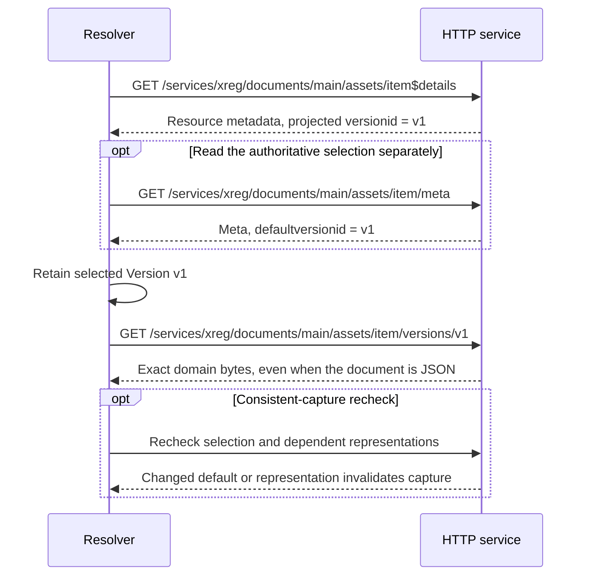

# xRegistry HTTP Federation

<!-- words: federationprofiles modelsource weburl xregurl xid xids -->
<!-- words: revalidation revalidate revalidated etag etags nfc -->
<!-- words: readme reparsing uncacheable validators website -->
<!-- words: workingdrafts -->
<!-- words: sequencediagram -->
<!-- words: powershell py pytest -->
<!-- words: federationerror revalidates -->

## Abstract

This specification defines how a federation resolver uses the existing
[xRegistry HTTP binding](../../core/http.md) to perform
[xRegistry Federation](../federation/spec.md) reads. It specifies catalog
bootstrap, binding selection and capture requirements without introducing
another HTTP API.

**Status:** Unreleased working draft, using xRegistry Core Version 1.0-rc4.
Neither this document nor a catalog advertisement asserts compatibility
with an earlier release candidate.

## Table of Contents

- [Notations and Scope](#notations-and-scope)
- [Motivation and Example](#motivation-and-example)
- [Advertisement and Bootstrap](#advertisement-and-bootstrap)
- [Registry Root and Version Discovery](#registry-root-and-version-discovery)
- [Native Read Mapping](#native-read-mapping)
- [Metadata, Documents and Versions](#metadata-documents-and-versions)
- [Literal Label Selection](#literal-label-selection)
- [Pagination and No-Filter Fallback](#pagination-and-no-filter-fallback)
- [HTTP Validators and Partial Content](#http-validators-and-partial-content)
- [Redirects and Authorization Boundaries](#redirects-and-authorization-boundaries)
- [Live Capture and Errors](#live-capture-and-errors)
- [Conformance and Offline Examples](#conformance-and-offline-examples)
  - [Concrete Read Sequences](#concrete-read-sequences)
  - [Running the Offline Checks](#running-the-offline-checks)
- [References](#references)

## Notations and Scope

The key words "MUST", "MUST NOT", "REQUIRED", "SHALL", "SHALL NOT",
"SHOULD", "SHOULD NOT", "RECOMMENDED", "MAY", and "OPTIONAL" are to be
interpreted as described in [RFC2119][rfc2119].

Core defines entity types, IDs, labels and
[default Versions](../../core/spec.md#default-version-of-a-resource).
It also defines [`xref`](../../core/spec.md#cross-referencing-resources),
[document view](../../core/spec.md#doc-flag), errors and request flags.
The [HTTP binding](../../core/http.md#resource-metadata-vs-resource-document)
defines methods, paths, `$details`, HTTP metadata headers and the wire
representation of flags. [HTTP Semantics][http] and [HTTP Caching][cache]
define HTTP processing. This document's requirements apply to federation
resolvers; they neither require servers to implement an OPTIONAL Core API
nor redefine CRUD operations.

In the tables, `B` is the selected Registry root URL, `G` is
`/<GROUPS>/<GID>`, `R` is `G/<RESOURCES>/<RID>`, and `V` is
`R/versions/<VID>`. Collection names come from the selected model.
`B + path` means append below the Registry base path, with one separating
slash. It does not mean resolve a leading-slash URI against the host.

## Motivation and Example

An existing xRegistry HTTP service can serve as a federation source through
its current API. A consumer-side resolver can select the service through its
catalog entry, or a federating API server can read the service on behalf of
its HTTP clients.

For example, a source advertised at
`https://first.example.com/services/xreg/` can supply
`/documents/main/assets/item`. The resolver reads metadata from that
Resource's `$details` URL, obtains the explicit default Version choice and
reads the selected document through its Version URL. The server hosting
the consumer-visible Registry can perform those steps after a local Resource
miss. A local shadow Resource takes precedence as described by the
[shared resolution model](../federation/spec.md#design-resolving-a-consumer-request).

A catalog advertisement describes how to access the source; it does not
establish that live reads form an immutable snapshot or that the source
honors unsupported query flags. The resolver uses the source's HTTP
capabilities, pagination and conditional requests while preserving its
authorization boundaries.

## Advertisement and Bootstrap

An HTTP advertisement has `name: "http"`, an absolute HTTP(S) Registry-root
`endpoint`, and no parameters in this version. Its endpoint MUST NOT have
embedded credentials, a query or a fragment. Unknown parameters on the
selected advertisement MUST produce `unsupported_operation`.

```json
{
  "name": "http",
  "endpoint": "https://first.example.com/services/xreg/",
  "priority": 0
}
```

Selection, priorities, ties and implicit `xregurl` handling follow
[Federation discovery](../federation/spec.md#discovery-and-binding-selection).
If explicit HTTP advertisements coexist with `xregurl`, one endpoint MUST
match `xregurl` exactly. `weburl` is a website, not an API fallback.

A resolver bootstrapping from a catalog MUST read its model before
interpreting the `categories` / `registries` collections. These catalog
Resources have `hasdocument: false`: `xregurl`, `weburl` and any
`federationprofiles` belong to their Version metadata. They are not a
domain document to download.

If the caller selects an explicit catalog-description Version, the resolver
uses that Version. Otherwise, it uses the catalog Resource's Core default
Version. The described Registry's `registryid` need not equal the catalog
entry ID.

The chosen advertisement establishes a new Registry context. The resolver
MUST discover the target's version, model and capabilities independently
of the catalog. The resolver MUST NOT transfer catalog credentials,
compatibility assumptions or label requirements to that target.

## Registry Root and Version Discovery

The advertised root can have an arbitrary base path. For example, XID
`/documents/main/assets/item` at
`https://first.example.com/services/xreg/` is below
`/services/xreg/documents/main/assets/item`, not `/documents/main/assets/item`.
The root request uses the advertised root itself. Descendant construction
MUST retain its complete base path, preserve case-sensitive Core IDs and
encode URI path segments without double encoding. A resolver MUST NOT
derive global entity identity by splitting an arbitrary URL.

The HTTP binding's
[`Link` with `rel=xregistry-root`](../../core/http.md#xregistry-root-http-header)
identifies the serving
Registry root when provided. A resolver MUST interpret it in the response
context and apply the same locator policy as for other links. A relocated
root does not silently authorize access to a different origin.

Before interpreting model-dependent entities, the resolver MUST obtain
`specversion` from the Registry representation. The version needs to be
known and explicitly supported; successful JSON parsing does not establish
compatibility. An unsupported version MUST produce `unsupported_version`.
Where supported, Core's
[`specversion` flag](../../core/spec.md#specversion-flag) requests a compatible
representation. The resolver MUST verify the returned version and MUST NOT
treat a silently ignored query parameter as successful negotiation.

`GET B/model` retrieves the interpreted model. When available,
`GET B/modelsource` retrieves the client-provided source, preserving
information such as shared Resource type definitions. The resolver keeps
these documents distinct: a missing source is not an empty effective model,
and `{}` returned by a supported `/modelsource` retains its Core meaning.

`GET B/capabilities` retrieves
[enabled capabilities](../../core/spec.md#registry-capabilities).
A resolver MAY use already inlined capabilities or request supported
inlining. It MUST NOT assume that `filter`, `inline`, pagination, `/export`
or writes are enabled.

Before composing the selected view, the resolver MUST apply the shared
[resolution-owner signal](../federation/spec.md#signaling-who-performs-resolution).
`federation.resolution: "producer"` means read the view directly without
traversing its catalog. An absent signal defaults to consumer resolution.

An absent capabilities API, an absent flag, or `flags: null` provides no
positive evidence for that flag.

[`/capabilitiesoffered`](../../core/spec.md#offered-capabilities) describes
choices that can be enabled. It does not report the currently enabled
capabilities.

When an OPTIONAL read API is unavailable, a resolver MAY use an equivalent
already obtained representation, a supported inline request, or an
advertised Core `/export` document. It MUST preserve the requested view
and completeness. If no equivalent read exists, it MUST return
`unsupported_operation`, not an invented empty entity or collection.

## Native Read Mapping

The following table maps the common abstract requests to existing HTTP
requests. It does not define request envelopes sent to the server. The
abstract target of `model` and `capabilities` is `/`; the `/model` and
`/capabilities` paths below are HTTP API paths rather than entity XIDs.

| Abstract operation and target | Native HTTP request | Result |
| --- | --- | --- |
| `entity`, `/` | `GET B` | Registry metadata. |
| `collection`, `/<GROUPS>` | `GET B/<GROUPS>` | Map keyed by Group ID. |
| `entity`, `G` | `GET B + G` | Group metadata. |
| `collection`, `G/<RESOURCES>` | `GET B + G/<RESOURCES>` | Map keyed by Resource ID, containing Resource metadata. |
| `entity`, `R`, document-bearing type | `GET B + R$details` | Resource metadata, including the default Version projection in API view. |
| `entity`, `R`, metadata-only type | `GET B + R` | Resource metadata. `$details` is also accepted by Core but is unnecessary. |
| `entity`, `R/meta` | `GET B + R/meta` | Resource Meta entity, not default Version metadata. |
| `collection`, `R/versions` | `GET B + R/versions` | Map keyed by Version ID, containing Version metadata. |
| `entity`, `V`, document-bearing type | `GET B + V$details` | That Version's metadata. |
| `entity`, `V`, metadata-only type | `GET B + V` | That Version's metadata. |
| `document`, `R`, document-bearing type | `GET B + R` | Default Version document or Core external-document redirect. |
| `document`, `V`, document-bearing type | `GET B + V` | Explicit Version document or Core external-document redirect. |
| `document`, metadata-only `R` or `V` | No document request | `unsupported_operation`. The unsuffixed URL would return metadata. |
| `model`, `/` | `GET B/model`. `GET B/modelsource` when available | Effective model and available source, kept distinct. |
| `capabilities`, `/` | `GET B/capabilities` or equivalent enabled map | Enabled capabilities for this endpoint and caller. |

Collection, Meta, Group and Registry URLs do not take `$details`.
`Accept: application/json` cannot replace `$details`, because a domain
document can itself be JSON.

The existing `GET B/export` convenience path, if supported, is precisely
`GET B?doc&inline=*,capabilities,modelsource` with Core's flag semantics.
It is not a federation-specific snapshot API. A resolver consuming an
export MUST resolve document-local pointers within that returned document.

## Metadata, Documents and Versions

Resource metadata, the Meta entity and Version metadata serve different
purposes. A Resource's API-view `versionid` projects the default Version;
[`meta.defaultversionid`](../../core/spec.md#defaultversionid-attribute)
records which Version was selected. A resolver MUST NOT substitute lexical
order, modification time, enumeration order or the greatest Version
identifier for that default choice.

An explicit Version target MUST select that exact, case-sensitive Version.

When a multi-request operation needs both default metadata and bytes, the
resolver SHOULD record the selected default Version ID and use its explicit
Version URLs for subsequent requests.

When claiming a consistent capture, the resolver MUST detect changes to the
selection. A live Version can change without its Version ID changing.

The following partial exchange uses the non-root base from the advertisement.
Model, Core version and enabled-capability discovery precede these reads.
The paths use the existing `item` example. Response labels show only the
values needed to explain selection, not complete HTTP or JSON messages.



Figure 1 (informative): metadata selects the Version. Its explicit URL reads
the document without resolving the default again. Version metadata instead
uses that Version URL with `$details`, not another mandatory request in this
sequence.

A metadata-only type has no document request. If the selection changes
during capture, the operation produces `inconsistent_snapshot` rather than
continuing with newer bytes. See
[Live Capture and Errors](#live-capture-and-errors) and the checked
[concrete read sequences](#concrete-read-sequences).

For document-bearing types, body `self` links to Resource/Version metadata
include `$details` in API view, as specified by Core HTTP. Metadata-only
types' `self` links MUST NOT include it. In document view, pointers are
relative to the returned JSON and never include `$details`. The resolver
MUST preserve Core navigation semantics rather than replace `self` with an
endpoint label.

Raw document reads use the domain media type and bytes. Core's
`xRegistry-` headers carry accompanying metadata. `Content-Location`, when
present on a default read, identifies the default Version as Core specifies.
A zero-byte document is a successful empty byte sequence, not a missing
document. Absent content and metadata-only types MUST remain distinguishable.

For byte-preserving capture, raw Version reads or supported Core `binary`
serialization are appropriate. Reparsing and pretty-printing JSON is not
byte preservation.

Core `meta.xref` remains same-Registry, same Resource model type and one hop.
Source IDs and navigation remain source-relative. A dangling target or a
target that is itself an alias keeps Core's minimal source serialization.
Document view MUST NOT expand an alias. Document-view requests below its
`versions` preserve `cannot_doc_xref`. Federation MUST NOT reinterpret an
absolute remote URL as `xref`.

A Version's `<RESOURCE>url` identifies domain content, not a remote
metadata alias. Following it does not merge remote Versions, rewrite source
IDs or change the selected Registry context.

## Literal Label Selection

The common selector looks up an exact label key and compares its string
value using Core's case-insensitive comparison. Labels are OPTIONAL, and
their values can be empty. An absent label does not match an empty value.
The resolver
MUST NOT require a language label, impose NFC normalization, infer a locale
from a category, or interpret the caller's `*` as a wildcard.

A supported [HTTP filter](../../core/spec.md#filter-flag) can reduce the
candidate set. The resolver MUST construct
[Core dot notation](../../core/spec.md#dot-notation-in-filters) relative to
the requested collection while preserving the selector's literal meaning.
It MUST escape a literal wildcard using Core's backslash escape
before URI encoding. It MUST quote label keys containing dot-notation
operators using Core bracket notation. For example:

| Selector | Core expression before URI encoding |
| --- | --- |
| `{"label":"stage","value":"PRODUCTION"}` | `labels.stage=PRODUCTION` |
| `{"label":"note","value":""}` | `labels.note=` |
| `{"label":"note","value":"A*B"}` | `labels.note=A\*B` |
| `{"label":"release.channel","value":"stable"}` | `labels['release.channel']=stable` |

One encoded literal-wildcard request is:

```http
GET /services/xreg/documents/main/assets?filter=labels.note%3DA%5C%2AB HTTP/1.1
Host: first.example.com
```

The common selector is narrower than Core's filter language. For example,
the literal string `null` is not Core's missing-attribute expression.
If literal commas, quotes, backslashes or other syntax cannot be represented
unambiguously by a supported filter, the resolver MUST use local selection
over an unfiltered collection rather than invent an escaping extension.
URI encoding alone does not escape Core expression syntax.

Even after requesting a filter, the resolver MUST apply the same literal
comparison to the returned candidates. Core permits a server to ignore
unsupported query flags, so a nonempty response does not establish that the
server applied the filter.

## Pagination and No-Filter Fallback

A resolver MUST process collection pages according to the
[pagination specification](../../pagination/spec.md). It MUST follow each
necessary `Link` with `rel=next`, resolve a relative link against the
response request URL, and then use that link without editing its query.
The resolver MUST NOT synthesize page numbers, reattach the original filter,
or add `limit` to subsequent links. Pagination links are subject to the same
credential and locator policy checks as redirects.

To establish a unique label match, the resolver needs the complete relevant
candidate set. A first-page match alone is insufficient. Complete enumeration
with no match yields `not_found`; a second match yields `ambiguous`.
An unavailable later page or a traversal limit MUST NOT become either a
unique result or `not_found`. The resolver MUST report conflicting
duplicates, changed declared totals or an incomplete capture, and MUST NOT
silently merge them.

If filtering is unavailable, the resolver MUST enumerate the relevant
unfiltered collection and apply the common selector locally. This applies
to no-code endpoints as well as API servers. It SHOULD use metadata already
present in collection responses and avoid unrelated document downloads.
Neither filtering nor inlining is a prerequisite for HTTP federation.

An endpoint that advertises `pagination: false` normally supplies its
complete collection in one response. If a next link is nevertheless
returned, the resolver MUST NOT claim completeness until it has handled
that link or reported the conflicting behavior. A collection `count` alone
is not a replacement for the members or next links.

## HTTP Validators and Partial Content

An ETag validates one representation. It is opaque and supplies neither an
XID, a Core epoch, a global content digest nor a Registry-wide revision pin.
Metadata and document URLs, query variants and content codings can have
different validators.
The resolver MUST use the selected representation's validator with that
representation, respecting `Vary`, cache directives and authorization scope.

Conditional `GET` with `If-None-Match` uses HTTP's weak comparison to
revalidate a cached response. A `304 Not Modified` response supplies no
replacement body. The resolver MUST use an applicable stored response and
update it according to RFC 9111 section 4.3.4. If no such response is
available, the resolver needs an unconditional read or an explicit failure.
`If-Modified-Since` and `Last-Modified` follow HTTP semantics and precedence,
independently of Core timestamp semantics.

`If-Match` uses strong comparison. A resolver MUST NOT use a weak ETag where
a strong validator is needed.

A resolver assembling partial bytes MUST apply
RFC 9110 sections 13.1.5 and 14, validate `Content-Range` and representation
identity, and account for every byte.

A weak ETag is not valid for
`If-Range`. An HTTP-date is usable there only under HTTP's strong-validator
conditions. If an `If-Range` request returns a complete `200` response,
the resolver MUST replace, not append to, its partial bytes.

A `206` response is not a complete document merely because the transfer
ended successfully. Missing ranges, truncation, changed validators or
unverified joins MUST NOT produce a complete snapshot. A failed conditional
read used to hold a capture stable, including `412`, yields
`inconsistent_snapshot`.

If a gateway transforms a representation, it MUST NOT forward the upstream
strong ETag unchanged as the validator for different bytes. The gateway
either preserves HTTP validator semantics for its own representation or
omits that validator. Federation does not require preservation of the
upstream ETag.

## Redirects and Authorization Boundaries

Redirect processing follows RFC 9110 section 15.4 and Core HTTP. In
particular, a Core external document can yield `303 See Other` with an
empty body and `Location` matching `<RESOURCE>url`. The destination is
domain content, not another Registry root. Other redirects can relocate
an endpoint or representation. The resolver MUST distinguish these cases.

Every redirect, advertised endpoint, next link and external document URL
MUST pass caller policy. That policy includes scheme, destination, network
access and redirect limits.

The resolver MUST reject embedded credentials and MUST NOT automatically
forward Authorization, cookies, client credentials or origin-specific
conditional headers across a trust boundary.

Destination credentials require independent authorization. HTTPS downgrade and
access to restricted network locations require explicit policy, not an implicit
fallback.

`401` and `403` MUST NOT cause silent retries against another advertisement,
a public mirror, or a weaker authentication mode. Redirect loops and
bounded traversal exhaustion produce `limit_exceeded`. Trust rejection
produces `policy_denied`.

Redirect caching follows HTTP cache rules. A temporary redirect is not
categorically uncacheable: applicable cache controls determine reuse.
Cached redirects do not waive target-policy checks. Shared caching of
authenticated responses remains subject to RFC 9111 section 3.5.

## Live Capture and Errors

A source implementing the OPTIONAL
[publication extension](../publication/spec.md#context-and-http-discovery)
exposes a snapshot-specific Core root and an HTTP `Link` to its open-context
record. Its absolute relation URI is
`https://xregistry.io/workingdrafts/publication/context`. A pin-aware resolver
MUST validate that record and its manifest, and keep subsequent URLs/pages
in the same selected view. The extension does not add HTTP advertisement
parameters or change the ordinary root/version discovery rules.

For example, a selected root can return:

```http
Link: <https://publisher.example.test/contexts/s12.json>; rel="https://xregistry.io/workingdrafts/publication/context"
```

That target returns the publication schema's `xregistry-open/1` record.
Following it remains subject to redirect, destination and credential policy.
The record identifies the exact manifest/Registry bytes. It is not an ETag
for every API serialization.

A context link identifies the snapshot but does not prove that API responses
match it. A conforming producer MUST serve the checked graph, and a consumer
claiming verified equivalence MUST check that correspondence.

Without this extension or another explicit snapshot guarantee, the resolver
reports live access. It MUST NOT interpret an absent link as a frozen
Registry.

A live endpoint can change between requests. Its root epoch or ETag need
not cover descendants, and equal modification times do not establish that
a subtree is unchanged. Successful revalidation of individual representations
also does not establish a transaction spanning multiple URLs.

A capture MUST record the following separately from Core IDs:

- Its selected root.
- The actual Core version.
- Selected Version IDs.
- Retrieval scope.
- Available validators.
- The absence of an immutable pin.

It MUST distinguish a live, best-effort observation from a
producer-guaranteed snapshot.

A resolver requiring a stronger guarantee MUST fail explicitly when the endpoint
cannot provide it. If the necessary capture operation is unsupported, the outcome
is `unsupported_operation`. If an attempted capture is inconsistent or
incomplete, the outcome is `inconsistent_snapshot`.

For a multi-request capture, the resolver SHOULD recheck the default
selection and the representations on which the capture depends.

If a default or representation changes, membership conflicts, or a page/byte
sequence is interrupted, the capture can no longer be claimed as consistent.
The resolver MUST report `inconsistent_snapshot` and discard that claim.
It MAY start a new, separately identified operation; that fresh capture does
not continue the previous operation with mixed old and new state.

Common errors are resolver outcomes, not additional Core HTTP errors:

| Observed condition | Resolver outcome |
| --- | --- |
| No executable HTTP advertisement | `unsupported_binding` |
| Incompatible returned `specversion` or Core `unsupported_specversion` | `unsupported_version` |
| Unsupported selected parameter, unavailable API, or document of a metadata-only type | `unsupported_operation` |
| Missing requested entity or complete selector with no match | `not_found` |
| More than one matching entity | `ambiguous` |
| Authentication, authorization or destination policy prevents the read | `policy_denied` |
| A promised digest or representation-integrity check fails | `integrity_error` |
| Malformed metadata, wrong XID/model type or invalid advertisement | `invalid_package` |
| Conflicting or incomplete multi-read capture | `inconsistent_snapshot` |
| Page, byte or redirect budget exhausted | `limit_exceeded` |
| Transport failure, rate limit or transient server failure outside a completed capture | `unavailable` |

The resolver MUST retain the HTTP status and any Core error detail.
`api_not_found` is not an absent entity. The resolver MUST NOT use a generic
`404` without enough context to invent an empty collection.

Failure of a previously identified member during capture is also evidence of
incomplete capture, not proof of a consistent deletion history.

## Conformance and Offline Examples

A conforming resolver implements the applicable native mappings and Core
views, checks versions, applies literal selectors and follows every necessary
page. It falls back to local selection when filtering is unavailable and
applies the HTTP validator and security rules. Live reads alone do not
justify an immutable-snapshot claim. Servers remain subject to Core HTTP
conformance, and this document does not require query support from a no-code
server.

The [HTTP tests](tools/test_http_examples.py) contain representative request
mappings and synthetic transcripts for:

- A full API.
- A no-code catalog.
- A non-root base path.
- Later-page ambiguity.
- Literal labels.
- Validators.
- Document redirects.
- Inconsistent captures.

The Registry content comes from the `first` example in
[examples.json](../federation/samples/examples.json). Protocol observations and
expected outcomes remain in the tests. These cases do not contact the public
hub or establish runtime interoperability. The shared
[generator](../README.md#generating-and-reading-examples) can export that
Registry through File, Git or OCI without starting an HTTP service.

The examples cover read-only capabilities but omit older-release and many
error permutations. These are synthetic inputs, not captured public-endpoint
behavior. A saved model-file hash is not an observed HTTP ETag.

### Concrete Read Sequences

The `no-filter-catalog` case reads enabled capabilities containing
`flags: null`, then the complete unfiltered catalog collection:

```http
GET /catalog/capabilities HTTP/1.1
Host: catalog.example.com

HTTP/1.1 200 OK
Content-Type: application/json

{"flags":null,"mutable":[],"pagination":false,"specversions":["1.0-rc4"]}
```

```http
GET /catalog/categories/dev/registries HTTP/1.1
Host: catalog.example.com
```

The test supplies the complete second response. Its literal selector
`stage=PRODUCTION` selects `bridge`, whose label value is `production`.
`website` has no matching label and supplies a `weburl`. No `filter` or
`inline` request is sent, and no domain document is read.

To inspect the result independently of the case's `expected` field, execute
this Python block from the repository root with the test dependencies
available:

```python
from workingdrafts.bindings.tools.http_examples import interpret_transcript
from workingdrafts.bindings.tools.test_http_examples import TRANSCRIPTS

result = interpret_transcript(TRANSCRIPTS["no-filter-catalog"])
value = result["value"]
print(value["registryid"], result["pages"], len(result["trace"]))
```

```text
bridge 1 2
```

The two requests obtain one complete collection page. The
`later-page-ambiguity` case instead shows how a subsequent page can invalidate
an earlier unique match. An initial match does not remove the need for
complete selection.

The `document-revalidation` case preserves cached document bytes across this
conditional request:

```http
GET /services/xreg/documents/main/assets/item/versions/v1 HTTP/1.1
Host: first.example.com
If-None-Match: "document-v1"

HTTP/1.1 304 Not Modified
ETag: "document-v1"
Cache-Control: private, max-age=0
```

The applicable cached `200` is supplied by the test. The helper returns
`cache_reused: true`, two traced requests and the cached bytes
`b'{"type":"string"}'`. The `304` is not an empty replacement document.
An actual `200` with `Content-Length: 0` would instead represent an empty
document. Neither response establishes a Registry-wide snapshot.

The redirect case uses a synthetic, non-secret Authorization value. Its
destination request carries neither that header nor the source's conditional
validator, preserving the credential and representation boundaries.

### Running the Offline Checks

Run the protocol tests from the repository root:

```powershell
python -B -m pytest workingdrafts\bindings\tools\test_http_examples.py -q
```

[`http_examples.py`](tools/http_examples.py) supplies `request_url`,
`literal_filter` and `interpret_transcript`. The interpreter returns actual
values and request traces without consulting expected outcomes. It assembles
contiguous ranges and revalidates cached content for the same URL, but it is
not a complete HTTP cache and performs no network I/O. Failed reads raise
the shared `FederationError`, retaining specific resolver outcomes.

The [shared helper](../federation/tools/federation_examples.py) provides
profile and literal-label selection. Its `execute_selected` invokes one
supplied read function. It does not catch a failure and try another
advertisement. The tests separately assert errors, cleanup where applicable,
returned bytes and request traces.

## References

- [xRegistry Core](../../core/spec.md).
- [xRegistry HTTP](../../core/http.md).
- [xRegistry Pagination](../../pagination/spec.md).
- [xRegistry Federation](../federation/spec.md).
- [RFC 9110, HTTP Semantics][http], particularly sections 8.8, 13.1, 14 and 15.4.
- [RFC 9111, HTTP Caching][cache], particularly sections 3, 3.5, 4 and 4.3.4.

[rfc2119]: https://www.rfc-editor.org/rfc/rfc2119
[http]: https://www.rfc-editor.org/rfc/rfc9110
[cache]: https://www.rfc-editor.org/rfc/rfc9111
