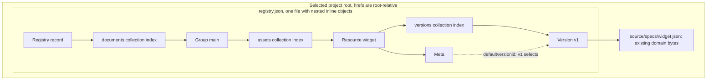

# xRegistry Directory Mapping Format

<!-- words: modelbase resolvedmodelsource sha256 symlinks reparse xids -->
<!-- words: modelsource hasdocument defaultversionid defaultversionsticky -->
<!-- words: documenttree -->
<!-- words: ancestorid isdefault formatversion href readonly ximportresources -->
<!-- words: casefold subtrees filesystem filenames bytecode smudge -->
<!-- words: federationerror namespace namespaces py reserialized reserialize -->
<!-- words: standalone workingdrafts -->
<!-- words: gitattributes checkout -->
<!-- words: formatvalidated compatibilityvalidated -->
<!-- words: filesystems readme -->
<!-- words: assetid documentid walkthrough -->
<!-- words: hrefs -->

## Abstract

This specification maps an existing directory to a read-only xRegistry for
the [Git](git.md) and [File](file.md) federation bindings. Add `registry.json`
without reorganizing the directory's existing files. It can embed all
metadata inline or reference further metadata files. Versions reference the
existing files through paths inside the selected root. Storage paths are not
entity identifiers.

**Status:** Unreleased working draft, format version `1`. This document is
not part of a released xRegistry specification.

## Table of Contents

- [Scope and Conventions](#scope-and-conventions)
- [Motivation and Use](#motivation-and-use)
- [Worked Example: Map One Existing File](#worked-example-map-one-existing-file)
- [Root and Storage Paths](#root-and-storage-paths)
- [Record and Index Documents](#record-and-index-documents)
- [Model and Capabilities](#model-and-capabilities)
- [Documents](#documents)
- [Reads and Core Document View](#reads-and-core-document-view)
- [Completeness and Integrity](#completeness-and-integrity)
- [Security and Conformance](#security-and-conformance)
- [Executable Example](#executable-example)
- [References](#references)

## Scope and Conventions

The key words "MUST", "MUST NOT", "REQUIRED", "SHALL", "SHALL NOT",
"SHOULD", "SHOULD NOT", "RECOMMENDED", "MAY", and "OPTIONAL" in this
document are to be interpreted as described in
[RFC2119](https://www.rfc-editor.org/rfc/rfc2119).

[Core 1.0-rc4](../../core/spec.md), its
[model language](../../core/model.md) and [federation](../federation/spec.md) define entity
semantics, selection and errors. This format does not define a server,
write-through interface, global identifier or synchronization protocol.
Normative schemas describe storage, not another domain model:

- [Entity record schema](schemas/document-record.schema.json).
- [Collection index schema](schemas/document-index.schema.json).

Both schemas use JSON Schema Draft 2020-12. Their URNs identify this draft's
schemas. They are not network retrieval endpoints. Producers and consumers
MUST also implement the semantic constraints below. Schema validity alone
does not establish Core model compliance or graph completeness.

## Motivation and Use

This format stores the snapshots read by the Git and File bindings. A
publisher can capture a Registry in one directory tree and make that tree
available in a Git commit, an offline bundle or a local filesystem. A consumer
or federating API server reads the selected metadata and document bytes from
that tree.

Core already defines [single-document](../../core/spec.md#single-document-view)
and [multiple-document](../../core/spec.md#multiple-document-view) views.
An ordinary Core JSON export is appropriate when one document is sufficient.
A [no-code HTTP server](../../core/http.md#no-code-servers) can serve files
whose paths implement the HTTP binding. Neither requires this format.

The mapping adds complete typed collection indexes and exact size/digest
references. These permit selective reads and integrity checks while leaving
existing file names and directory structure unchanged. Stored records are
not Core API responses. The reader assembles them into the Core document
view defined below.

For example, a project can already contain `source/specs/widget.json`,
`engineering/assets/image.dat`, its application code and a README. Adding
the mapping can produce:

```text
project/
  registry.json
  source/
    main.py
    specs/
      widget.json
  engineering/
    assets/
      image.dat
  README.md
```

`registry.json` identifies the Registry and its modeled collections. Its
collection indexes and entity records associate
`/documents/main/assets/item` with its Meta and Versions. Here they are
embedded inline in `registry.json`. A Version record can contain a local
document descriptor whose `href` is `source/specs/widget.json`. This path is
relative to the selected root, not to the file holding the Version record.
Its `size` and `sha256` describe the existing file's exact bytes. Neither
`widget.json` nor `image.dat` needs to move or change.

The mapping does not prescribe inline storage. A publisher can instead
store any record or index in a separate metadata file, beside the described
files or in a separate directory, and choose the directory names of such
files. Unreferenced files such as `source/main.py` and the README do not
become Resources automatically and are not part of the Registry's declared
content closure.

The [worked example](#worked-example-map-one-existing-file) below shows
every file needed to map one existing document and the resulting reads.
The `portable` example in the [shared source](../federation/examples.json)
demonstrates multiple Resource types, aliases and binary content.

Git chooses the directory through `parameters.path` and pins its commit.
File selects that same directory through a file URI. The shared
[hosting and resolution model](../federation/spec.md#design-hosting-models)
determines whether the consumer or an API server performs these reads.

## Worked Example: Map One Existing File

<!-- mapping-walkthrough:start -->

This example maps one existing file to Resource
`/documents/main/assets/widget`, with default Version `v1`.
The selected root is the `project` directory. No file outside that
directory is read.

You can save the JSON block below directly. Use UTF-8, two-space
indentation, LF line endings and one final newline. The size and digest
values describe those exact bytes. If you change the document, recalculate
its size and digest in the Version's document descriptor inside
`registry.json`.

To generate this project instead, select `walkthrough` from the
[shared examples](../README.md#generating-and-reading-examples):

```text
python -B -m workingdrafts.federation.tools.generate_examples file --example walkthrough --output D:\temp\xregistry-walkthrough
```

The generator writes the unchanged document, an inline `registry.json` and
a `.gitattributes` file that disables text conversion for the document. Its
Registry root also contains the full captured Core model from the shared
source. The `registry.json` below omits that `model` attribute and keeps only
`modelsource`, so the generated root has a different size and digest. The
[walkthrough tests](tools/test_mapping_spec_examples.py) check that removing
the model reproduces the bytes below exactly.

### 1. Keep the Existing Document

`source/specs/widget.json` already contains:

```json
{"type":"string"}
```

It is 18 bytes, including the final newline. Its SHA-256 is
`85803e087e684bdab3e5d6c2dd1af627da83382db625be9a42aea3d4d06539be`.
Leave this file unchanged.

### 2. Add the Mapping File

Add the following `registry.json`. It embeds every collection index and
entity record as an inline reference, so the mapping adds one file to the
project. The file is 6131 bytes with SHA-256
`cf679704edd89c2364b3163c063d9d8f6a5361e0cf54acf2ae0bd90987fa3ccb`.



Figure 1 (informative): reference edges in the two-file example. Each solid
edge inside `registry.json` is an inline reference. The edge to
`source/specs/widget.json` is the Version's document descriptor, which
carries `href`, `size` and `sha256`. The dashed edge selects a Version and
is not a reference. Unreferenced project files are outside this graph. The
[read rules](#reads-and-core-document-view) assemble metadata from these
records without treating storage paths or nesting as entity navigation.

**`registry.json`**

```json
{
  "format": "xregistry-document-tree",
  "formatversion": "1",
  "kind": "registry",
  "entity": {
    "xid": "/",
    "registryid": "workshop",
    "specversion": "1.0-rc4",
    "epoch": 1,
    "createdat": "2026-01-01T00:00:00Z",
    "modifiedat": "2026-01-01T00:00:00Z",
    "modelsource": {
      "groups": {
        "documents": {
          "singular": "document",
          "resources": {
            "assets": {
              "singular": "asset"
            }
          }
        }
      }
    },
    "capabilities": {
      "available": {
        "capabilities": {
          "mutable": false
        },
        "entities": {
          "mutable": false
        },
        "model": {
          "mutable": false
        },
        "modelsource": {
          "mutable": false
        }
      },
      "flags": [
        "doc",
        "inline"
      ],
      "pagination": false
    }
  },
  "snapshot": {
    "scope": "/",
    "completeness": "offline-complete"
  },
  "collections": [
    {
      "kind": "collection",
      "xid": "/documents",
      "inline": {
        "format": "xregistry-document-tree",
        "formatversion": "1",
        "kind": "collection",
        "xid": "/documents",
        "count": 1,
        "entries": [
          {
            "kind": "group",
            "xid": "/documents/main",
            "inline": {
              "format": "xregistry-document-tree",
              "formatversion": "1",
              "kind": "group",
              "entity": {
                "xid": "/documents/main",
                "documentid": "main",
                "epoch": 1,
                "createdat": "2026-01-01T00:00:00Z",
                "modifiedat": "2026-01-01T00:00:00Z"
              },
              "collections": [
                {
                  "kind": "collection",
                  "xid": "/documents/main/assets",
                  "inline": {
                    "format": "xregistry-document-tree",
                    "formatversion": "1",
                    "kind": "collection",
                    "xid": "/documents/main/assets",
                    "count": 1,
                    "entries": [
                      {
                        "kind": "resource",
                        "xid": "/documents/main/assets/widget",
                        "inline": {
                          "format": "xregistry-document-tree",
                          "formatversion": "1",
                          "kind": "resource",
                          "entity": {
                            "xid": "/documents/main/assets/widget",
                            "assetid": "widget"
                          },
                          "meta": {
                            "kind": "meta",
                            "xid": "/documents/main/assets/widget/meta",
                            "inline": {
                              "format": "xregistry-document-tree",
                              "formatversion": "1",
                              "kind": "meta",
                              "entity": {
                                "xid": "/documents/main/assets/widget/meta",
                                "assetid": "widget",
                                "epoch": 1,
                                "createdat": "2026-01-01T00:00:00Z",
                                "modifiedat": "2026-01-01T00:00:00Z",
                                "readonly": true,
                                "defaultversionid": "v1",
                                "defaultversionsticky": true
                              }
                            }
                          },
                          "collections": [
                            {
                              "kind": "collection",
                              "xid": "/documents/main/assets/widget/versions",
                              "inline": {
                                "format": "xregistry-document-tree",
                                "formatversion": "1",
                                "kind": "collection",
                                "xid": "/documents/main/assets/widget/versions",
                                "count": 1,
                                "entries": [
                                  {
                                    "kind": "version",
                                    "xid": "/documents/main/assets/widget/versions/v1",
                                    "inline": {
                                      "format": "xregistry-document-tree",
                                      "formatversion": "1",
                                      "kind": "version",
                                      "entity": {
                                        "xid": "/documents/main/assets/widget/versions/v1",
                                        "assetid": "widget",
                                        "versionid": "v1",
                                        "epoch": 1,
                                        "createdat": "2026-01-01T00:00:00Z",
                                        "modifiedat": "2026-01-01T00:00:00Z",
                                        "ancestorid": "v1",
                                        "isdefault": true,
                                        "contenttype": "application/schema+json"
                                      },
                                      "document": {
                                        "kind": "local",
                                        "href": "source/specs/widget.json",
                                        "size": 18,
                                        "sha256": "85803e087e684bdab3e5d6c2dd1af627da83382db625be9a42aea3d4d06539be"
                                      }
                                    }
                                  }
                                ]
                              }
                            }
                          ]
                        }
                      }
                    ]
                  }
                }
              ]
            }
          }
        ]
      }
    }
  ]
}
```

The root declares the model and holds the `documents` collection inline.
That collection holds Group `main`, then its `assets` collection, Resource
`widget`, the Resource's Meta and its Versions. Each inline reference keeps
its `kind` and `xid` and carries the complete record or index, with its own
`format` and `formatversion`, in `inline`. The Meta names `v1` as the
default. The Version record points to the unchanged file.

### 3. Read Metadata or Document Bytes

The abstract operation `entity` with target
`/documents/main/assets/widget/versions/v1` returns the following native
metadata envelope. Its local pointer selects the entity in this response,
not a file on disk:

```json
{
  "kind": "version",
  "entity": {
    "xid": "/documents/main/assets/widget/versions/v1",
    "assetid": "widget",
    "versionid": "v1",
    "epoch": 1,
    "createdat": "2026-01-01T00:00:00Z",
    "modifiedat": "2026-01-01T00:00:00Z",
    "ancestorid": "v1",
    "isdefault": true,
    "contenttype": "application/schema+json",
    "self": "#/entity"
  }
}
```

The `document` operation on that Version returns the original 18-byte
body, with the media type recorded by `contenttype`:

```json
{"type":"string"}
```

A `document` request to `/documents/main/assets/widget` returns the same
bytes because its Meta selects `v1`. These are read-operation concepts,
not additional HTTP routes. A server exposing this mapping uses its
consumer-facing binding to deliver the corresponding response.

`registry.json` and the document form the complete declared Registry in
this example. Other project files are unaffected. If `widget.json` later
changes, its old size/digest no longer matches and the reader reports
`integrity_error` until the mapping is updated.

### 4. Store One Collection in a Separate File

Inline and external references can be mixed. To keep the Version
collection in its own file, replace the inline `versions` reference in the
Resource record with an external reference:

```json
{
  "kind": "collection",
  "xid": "/documents/main/assets/widget/versions",
  "href": "registry-metadata/versions.json",
  "size": 992,
  "sha256": "bf7cbc89663f43fad90dbc8b6695b8de658c1adf79d5335afded0fce19bae1d4"
}
```

`registry-metadata/versions.json` then contains the complete index, with
the Version record still inline. It is 992 bytes with SHA-256
`bf7cbc89663f43fad90dbc8b6695b8de658c1adf79d5335afded0fce19bae1d4`:

```json
{
  "format": "xregistry-document-tree",
  "formatversion": "1",
  "kind": "collection",
  "xid": "/documents/main/assets/widget/versions",
  "count": 1,
  "entries": [
    {
      "kind": "version",
      "xid": "/documents/main/assets/widget/versions/v1",
      "inline": {
        "format": "xregistry-document-tree",
        "formatversion": "1",
        "kind": "version",
        "entity": {
          "xid": "/documents/main/assets/widget/versions/v1",
          "assetid": "widget",
          "versionid": "v1",
          "epoch": 1,
          "createdat": "2026-01-01T00:00:00Z",
          "modifiedat": "2026-01-01T00:00:00Z",
          "ancestorid": "v1",
          "isdefault": true,
          "contenttype": "application/schema+json"
        },
        "document": {
          "kind": "local",
          "href": "source/specs/widget.json",
          "size": 18,
          "sha256": "85803e087e684bdab3e5d6c2dd1af627da83382db625be9a42aea3d4d06539be"
        }
      }
    }
  ]
}
```

The changed `registry.json` is 4302 bytes with SHA-256
`002d2a3bd4abbe0e2822e829925346bc4380a4c7380848a9bc2494c74026bfea`.
Reads return the same metadata and document bytes. A reader opens
`registry-metadata/versions.json` only when a request reaches the Version
collection. Storing every record and index in its own file, the split form,
is equally valid. It produces eight metadata files for this example,
including `registry.json`.

<!-- mapping-walkthrough:end -->

## Root and Storage Paths

The selected directory MUST contain `registry.json`. Its record MUST have
`kind: "registry"` and `entity.xid: "/"`. Git's `parameters.path` and File's
endpoint select this same directory. Neither adds an implicit extra directory.

Every internal `href` is relative to that selected root, including references
in nested records and inline objects. It is NOT relative to the referring
file. The `/` separator
in these serialized storage names is a format separator. Filesystem bindings
translate it to their native separator without URI decoding.

Apart from the entry-point filename, this format prescribes no directory
names, file extensions or correspondence between physical and Registry
hierarchies. The `href` of an external record or index reference identifies
the complete metadata JSON document at that location. An inline reference
has no `href` and allocates no file. Each local Version document `href`
identifies a regular file anywhere within the selected root, regardless of
its extension or domain format.

Paths MUST be nonempty, normalized root-relative strings with `/` separators.
They MUST NOT be absolute, contain empty components, `.` or `..` components,
backslashes, NUL/control characters or surrogate code points. A consumer
MUST NOT apply URI decoding. It MUST reject percent encodings that could be
interpreted as separators or parent-path components, such as `%2f`, `%5c`
and `%2e%2e`, as described in
[Security and Conformance](#security-and-conformance).
Portable paths MUST NOT contain `<>:"|?*`, end a component with a space or
period, or use Windows device names such as `CON` and `NUL`.
Other Unicode names and spaces within components are permitted. Platform
path-length and access limits produce explicit errors.

Only external references allocate paths. An inline object occupies no path
of its own. Metadata files describing different records or indexes MUST have
distinct paths. Paths whose spellings differ only by case MUST NOT
designate different mapping objects, because such mappings are ambiguous on
case-insensitive filesystems. Several Versions MAY reference the same local
document file using the same path and identical size/digest values. A
producer MUST NOT also allocate a document path to a metadata record or
index.

An index maps a full, case-sensitive [XID](../../core/spec.md#xid-attribute)
to a storage path or an inline object. A storage path is not
derived from the entity ID. The mapping therefore supports all Core-valid
[IDs](../../core/spec.md#singularid-id-attribute), including IDs that are not
portable filesystem names. The same local ID
in different typed collections remains distinct.

Core's case-insensitive uniqueness within a parent and case-sensitive lookup
still apply. A pair differing only in case in the same collection is invalid
Core data, not a filesystem collision to repair.

An ID MUST match the entire string against
`[A-Za-z0-9_](?:[A-Za-z0-9_.~:@-]){0,127}`. Whitespace and trailing
line terminators are not part of an ID. This grammar is independent of native
filename rules.

An implementation unable to represent the total path length or object count MUST report
`limit_exceeded`. It MUST NOT truncate, normalize or replace an entity ID.

By default, the example generator writes every record and index to its own
file. It uses `records/`, `indexes/` and `documents/` directories, with
opaque hexadecimal allocations such as `records/n1a.json`. This avoids name
collisions when generating a new tree. When the generator embeds a target
inline, it allocates no file for it. The `walkthrough` example instead keeps
its project layout: one inline `registry.json` beside the existing document
path. These are producer conventions, not restrictions on existing files or
on other conforming mappings.

## Record and Index Documents

All record and index documents MUST be UTF-8 JSON objects without a byte order
mark, duplicate keys or non-JSON numbers. An inline record or index is part of
its containing file and follows that file's JSON rules. Each record and index
has `format: "xregistry-document-tree"` and `formatversion: "1"`, including
an inline one.
An unknown version MUST produce `unsupported_version`.

An entity record contains `kind` and `entity`. `entity` is a storage fragment
of Core metadata, with full `xid` and explicit model-named identifiers.
These records store metadata without API navigation fields. A reader adds
the navigation links when it assembles a Core response, as described in
[Reads and Core Document View](#reads-and-core-document-view).

| Kind | REQUIRED metadata in `entity`, in addition to `xid` |
| --- | --- |
| `registry` | `registryid`, `specversion`, `epoch`, `createdat`, `modifiedat`, `modelsource`, `capabilities`. |
| `group` | `<GROUP>id`, `epoch`, `createdat`, `modifiedat`. |
| `resource` | `<RESOURCE>id`. No inherited default-Version attributes. |
| `meta`, ordinary | `<RESOURCE>id`, `epoch`, `createdat`, `modifiedat`, `readonly`, `defaultversionid`, `defaultversionsticky`. |
| `meta`, alias | Only `<RESOURCE>id`, `xid`, `xref`. |
| `version` | `<RESOURCE>id`, `versionid`, `epoch`, `createdat`, `modifiedat`, `ancestorid`, `isdefault`. |

All identifiers MUST agree with the full typed XID and model singular names.
For example, `/documents/main/assets/item/versions/v1` identifies Version
`v1` of asset `item`, not a Version globally named `v1`. `meta` and `versions`
are literal Core path components. Group and Resource type names MUST be
validated against the captured model. Resource and Version extension metadata
MUST stay on the entity to which the model assigns it.

Storage metadata MUST omit `self`, `shortself`, `metaurl` and
`defaultversionurl`. It MUST also omit collection navigation/counts, nested
entity collections, and Version `formatvalidated`, `compatibilityvalidated`,
and their reason attributes.
For a Resource model with `hasdocument: true`, it MUST NOT contain inlined
`<RESOURCE>` or `<RESOURCE>base64` document content.

These omissions do not permit dropping other Core or extension data. In
particular, an ordinary
model-admitted attribute of a metadata-only Resource is not document content
merely because its name uses one of these spellings.

Registry and Group records have a `collections` array containing exactly one
reference for every modeled child collection, even an empty one.

An ordinary Resource record has exactly one reference in its `collections`
array, to its `versions` collection. It also has a `meta` reference to its Meta
record.

An alias Resource has a `meta` reference but an empty `collections` array: it
owns no local Versions.

Meta and Version records have no `collections` or `meta` reference.

Each reference has `kind` and `xid`, plus the fields of exactly one form.
An external reference stores its target in a separate file. An inline
reference embeds its target:

| Field | Form | Meaning |
| --- | --- | --- |
| `kind` | Both | `collection`, `group`, `resource`, `meta` or `version`. |
| `xid` | Both | Full entity XID, or full typed collection path. |
| `href` | External | Normalized path relative to the selected directory root. |
| `size` | External | Nonnegative integer count of exact encoded file bytes. |
| `sha256` | External | 64 lowercase hexadecimal digits hashing those exact bytes. |
| `inline` | Inline | The complete referenced record or index object. |

An external reference has exactly `kind`, `xid`, `href`, `size` and
`sha256`. An inline reference has exactly `kind`, `xid` and `inline`.
A reference MUST use exactly one form. A reference that mixes fields of both
forms, or an external reference that lacks `href`, `size` or `sha256`, is
`invalid_package`. The external form names a file inside the selected root.
It is unrelated to the `external` document descriptor kind.

The reference's kind and XID MUST equal the referenced object's kind and XID.
Its role comes from this metadata, not its directory name, file extension or
nesting position. In the external form, both `size` and `sha256` are
REQUIRED, including for zero-byte content.

An inline target is a complete record or index document. It MUST have the
same `format` and `formatversion` as the object that contains it. A mismatch
is `invalid_package`. Inline references nest: an inline record or index can
itself contain inline or external references. The root of this nesting is
always the Registry record in `registry.json`, which is never an inline
object. A complete Registry can therefore be stored in `registry.json`
alone. Neither form can point outside the selected root. A metadata or
collection reference has no URI form.

A collection index has:

- `kind: "collection"`.
- Its full collection `xid`.
- `count`.
- `entries`, an array of entity references.

`count` MUST equal the array length. An empty collection has `count: 0` and
`entries: []`.

Each entry MUST name an immediate member of this collection with the correct
kind. References in both `entries` and `collections` MUST be strictly sorted
by unsigned UTF-8 bytes of the full XID. Duplicate XIDs, case-insensitive
sibling ID collisions and conflicting metadata storage allocations are invalid.
These rules apply to inline and external references alike.

For example, this complete empty index is valid:

```json
{
  "format": "xregistry-document-tree",
  "formatversion": "1",
  "kind": "collection",
  "xid": "/independent/MAIN/assets",
  "count": 0,
  "entries": []
}
```

Version indexes MUST include all locally owned Versions. An ordinary Resource
MUST have at least one Version. Exactly one MUST have `isdefault: true`,
matching its Meta's `defaultversionid`. Ancestors MUST exist in that same
index and MUST NOT form cycles other than a root's self-reference.
An alias MUST NOT own a Version index, including a fabricated empty index.

## Model and Capabilities

The Registry's `entity.modelsource` MUST preserve the captured source,
including `ximportresources` provenance. `entity.model`, when supplied, MUST
be the actual full Core model, not a compact source relabeled as a full model.
It MUST agree with the source, its resolved includes and the captured data.

If the source contains
[`$include` or `$includes`](../../core/model.md#includes-in-the-xregistry-model-data),
the Registry record MUST
also contain `resolvedmodelsource`. That object is the compact source after
those includes were evaluated at capture time, but before implicit Core
definitions and `ximportresources` expansion.

This object MUST be self-contained and preserve
[Resource type sharing](../../core/model.md#reuse-of-resource-definitions).
`modelbase` MUST record the absolute base of the
original source. Consumers MUST NOT re-fetch mutable includes during a read.

The producer MUST establish equivalence of the captured source, resolved
source and full model, when present. The original include directives remain
available through
[`entity.modelsource`](../../core/spec.md#modelsource-attribute).
The resolved copy is storage context,
not a second authoritative domain model.

When includes are absent, `resolvedmodelsource` is OPTIONAL and, if present,
MUST equal `entity.modelsource`. Model reads expose the original source,
available resolved source and available full model.

Interpreting a compact source MUST apply Core defaults. It MUST NOT silently infer type sharing
from structural similarity.

Model results MUST preserve `modelbase` when present. Registry metadata
envelopes retain `snapshot` and available `source` outside `entity`. These
are capture context, not new Core attributes.

`entity.capabilities` MUST describe access to this snapshot, not copy claims
of upstream writes or filtering that the selected binding cannot implement.
It MUST include Core's `available` map. The bindings are read-only.

It also carries the [resolution-owner signal](../federation/spec.md#signaling-who-performs-resolution).
A stored combined view declares `federation.resolution: "producer"`, so a
consumer does not repeat its catalog resolution. Absence retains consumer
resolution. This signal is independent of linked/offline completeness.

Captured source information MAY appear in the Registry record's `source`
object with an absolute, credential-free `uri` and OPTIONAL `revision`.
This is provenance, not the operation's Git pin, an entity XID, or an implicit
base for document links.

## Documents

Each Version record MUST have exactly one `document` descriptor:

| `document.kind` | REQUIRED fields | Meaning |
| --- | --- | --- |
| `local` | `href`, `size`, `sha256` | Exact bytes in an existing or newly stored file inside the selected root. |
| `external` | `uri` | Explicit external domain-document reference. |
| `none` | No others | The Resource model has `hasdocument: false`. |

For a local document, OPTIONAL `base` supplies the base URI used to resolve
relative links inside that document. If the file was copied from an external
location, OPTIONAL `origin` records that original location. The copied
Version no longer has a `<RESOURCE>url`, because its document is now local.

Both `base` and `origin`, when present, MUST be absolute URIs without embedded
credentials.

For `external`, `uri` MUST equal the Version's `<RESOURCE>url` exactly.
A relative URI MUST have an explicit absolute `base` on this descriptor.
Neither the containing file, catalog URL, Git repository URL nor `source.uri`
is an implicit base.

Known integrity is represented by OPTIONAL paired
`size` and `sha256` fields. Consumers MUST check both if they retrieve content
with these fields. An external locator is not a metadata alias.

A Version referencing a document MUST identify either local bytes or an
explicit external location. A missing referenced local file is an
`invalid_package` error, not an empty document.

A zero-byte local document MUST reference an actual zero-byte file, with
`size: 0` and SHA-256
`e3b0c44298fc1c149afbf4c8996fb92427ae41e4649b934ca495991b7852b855`.

Consumers MUST NOT decode, reserialize, newline-convert or replace binary
and JSON bytes with an empty JSON wrapper. The Version's `contenttype`,
if present, describes the bytes independently of the file's extension.

For `hasdocument: false`, `document.kind` MUST be `none`. The Core document
attributes do not apply. Consumers MUST preserve and validate ordinary
model-admitted metadata named `<RESOURCE>`, `<RESOURCE>base64` or
`<RESOURCE>url` as metadata. Consumers MUST NOT decode or dereference it as
document content.

A document request MUST produce `unsupported_operation`. This is distinct from a present
zero-byte document.

## Reads and Core Document View

Core's [`doc` flag](../../core/spec.md#doc-flag) defines document-view
metadata. The `document` operation below instead retrieves domain bytes.

An exact read walks the Registry record, the necessary typed collection
indexes and selected child records. A Version read MUST NOT require reading
unrelated domain bytes. A consumer MAY scan a collection index in memory.
The format defines one complete index per collection and no pagination.
An inline object arrives with its containing file and costs no further file
read. Following an external reference reads its file once.

If a configured limit prevents a consumer from reading the complete index
or the records needed for its request, the consumer MUST return
`limit_exceeded`. It MUST NOT return the subset already read as a complete
collection or use that subset to claim a unique match. The inline nesting
depth within one file and the cumulative number of decoded metadata objects
are such limits, in addition to file count and byte limits.

The following materialization defines the metadata result envelope. The
envelope is not a new wire API. It keeps storage and transport context outside
Core metadata:

| Operation | Envelope and materialization |
| --- | --- |
| `entity` | `kind` and `entity`. Recursively inline descendant metadata, never domain bytes. |
| `collection` | `kind: "collection"`, `xid`, `complete: true`, and `entities`, a Core collection map. |
| `model` | Original `modelsource`, available `resolvedmodelsource`, and available full `model`. |
| `capabilities` | The captured snapshot access capabilities. |
| `document` | Exact bytes, or an explicit external descriptor subject to caller policy. |

Every materialized entity's `self` MUST be a JSON Pointer fragment locating
that entity in the returned envelope. For example, a standalone Version
has `self: "#/entity"`. Collection members begin at `#/entities/<ID>`.
JSON Pointer tokens MUST escape `~` as `~0` and `/` as `~1`. URI-fragment
encoding also applies. XIDs are not rewritten.

Navigation MUST use a `#` JSON Pointer if and only if the referenced entity
or collection is included in the output. A pointer into another record file
is not document-local navigation.

Registry and Group results inline all child metadata. Ordinary Resource
results inline `meta` and all Version metadata. `metaurl`, `versionsurl`,
and the Meta's `defaultversionurl` MUST point at those actual objects.
Collection URLs and counts, when included, MUST describe the materialized
maps, including empty maps. A producer MUST NOT also copy Default-Version
attributes onto the Resource. No response in this format invents an API
`self`.

A standalone ordinary Meta result includes its selected default Version
metadata in an envelope sibling, `related.defaultversion`. Its
`defaultversionurl` MUST be `#/related/defaultversion`, and that Version's
`self` MUST locate the same object. This explicit navigation closure avoids
an absolute URL to an undefined native API or a dangling local pointer.
An alias Meta has no such sibling and no default-Version attributes.

Core [`xref`](../../core/spec.md#cross-referencing-resources) remains
one-hop, same-Registry and same-Resource-model-type.
Document-view Resource and Meta reads MUST leave aliases unexpanded,
including dangling aliases and aliases whose targets are themselves aliases.
Document-view alias Versions and alias Version collections MUST produce
`unsupported_operation`, retaining Core's `cannot_doc_xref` diagnostic.
No materialized target metadata can replace the source IDs.

A logical document request to an alias MAY read the one-hop target's selected
document, independently of document-view metadata. It MUST NOT follow a
second alias. If no one-hop target document exists, the document request
returns `not_found`. That does not make the source's minimal metadata invalid.

Resource document requests use `meta.defaultversionid`. Explicit Version
requests use exactly the requested Version ID. A snapshot revision, index
position or highest Version string MUST NOT override the Core default.

The `portable` example in the [shared source](../federation/examples.json)
exercises the following alias boundary. These are operation outcomes, not
additional stored records:

| Request to an alias | Result |
| --- | --- |
| `entity` on the Resource or its Meta | Minimal source identity. The Resource's Meta retains `xref`, not target metadata. |
| `collection` on its `versions` | `unsupported_operation`, retaining Core [`cannot_doc_xref`](../../core/spec.md#cannot_doc_xref). |
| `document` on the logical Resource | The one-hop target's selected bytes, when available. |
| `document` when the target is absent or itself an alias | `not_found`. The source metadata still exists. |

Resource label selection uses effective default-Version metadata, applying
one-hop alias semantics where applicable. It does not inspect only the reduced
storage Resource object. Selection MUST use the common literal comparator and
complete collection, and return `not_found` or `ambiguous` as appropriate.
The selected metadata result still obeys document-view alias suppression.

## Completeness and Integrity

The root's `snapshot` object MUST contain `scope: "/"` and `completeness`,
either `linked` or `offline-complete`. Both classes MUST contain the complete
internal record/index/document graph. An `offline-complete` snapshot MUST NOT
contain external-only domain documents. Captured resolved model material MUST
permit offline interpretation in both classes.

The shared [snapshot classes](../federation/spec.md#snapshots-and-completeness)
describe these completeness claims independently of selective retrieval.

Here `scope: "/"` denotes the modeled Registry, not every file physically
present in the selected directory. Only files reached through the mapping's
references participate in its completeness and integrity checks. Existing
unreferenced project files remain outside that graph.

Only the mapping's external record and index references and its
local-document descriptors identify files that belong to its stored Registry
graph. Together with inline references, which stay inside their containing
file, they are the graph's containment edges. For example, `registry.json`
links to a collection index, and a Version record links to its local
document file.

External catalog advertisements, provenance URLs and links embedded inside
domain bytes are not such references. Offline completeness does not require
copying every Registry mentioned by a catalog or following links inside
domain documents.

An OPTIONAL full-graph validator checks every referenced object. A selective
read validates its visited path but MUST NOT claim to have independently
audited unvisited graph closure.

Consumers MUST verify length and SHA-256 before parsing or returning each
internally referenced file. An inline object has no separate size or digest.
The bytes of its containing file cover it. Root bytes are captured once per
operation.
Their SHA-256 identifies that root serialization, not universal semantic
identity or publisher authenticity.

Every external descendant is pinned transitively by its parent's
reference, and every inline descendant by its containing file. Newly
published states MUST be complete without
replaying a prior snapshot. Shared content reuse does not relax closure.

Missing indexed objects, invalid kinds, invalid model types and inconsistent
defaults are `invalid_package`. A requested absent XID is `not_found`.
Descriptor mismatch is `integrity_error`. Observed mutation during a File
read or loss of already selected Git objects is `inconsistent_snapshot`.
Consumers MUST NOT return empty collections or retry another profile to hide
these failures.

## Security and Conformance

All data in a [package](../federation/spec.md#notations-and-terminology), the
stored mapping and its referenced documents, is untrusted.

Producers MUST use regular files and real directories. They MUST NOT use
symlinks, reparse
points, parent paths, device names, alternate
data streams or OS aliases.

Consumers MUST enforce selected-root containment before reading bytes.

Dot segments, empty components, backslashes, absolute
paths are not valid `href` syntax. Percent encodings that could be interpreted
as separators or parent-path components, such as `%2f`, `%5c` and `%2e%2e`,
are also rejected. The reader does not decode an `href` as a URI.

Bindings define access to the selected root and race protection. Consumers
MUST impose explicit file, byte and traversal limits. Traversal limits cover
inline nesting depth, counted within each containing file, and the cumulative
number of decoded metadata objects. Integrity checks do not
ensure authorized filesystem access or establish publisher trust. Before
retrieving an external URI, the consumer MUST check that destination against
its access policy and use only credentials authorized for that destination.

A producer conforms by emitting schema-valid records and indexes satisfying
all semantic, byte and closure rules. A consumer conforms by implementing
the common read semantics and its selected binding's safety rules. The
offline-complete class adds local declared document content. There is no
requirement to implement a server or an API-view facade.

## Executable Example

The `portable` example in [examples.json](../federation/examples.json)
contains:

- Typed collections.
- Explicit defaults.
- JSON, empty and binary documents.
- A metadata-only catalog entry.
- A Windows-reserved ID.
- Type-sharing aliases.
- A dangling alias.
- An alias chain.

An empty independent collection
demonstrates a distinct Resource model type.

The generated `.gitattributes` retains LF for JSON records and disables text
conversion for exact-byte domain files, including documents whose extension
is `.json`. This is repository integration, not a containment edge or
permission for Git readers to apply attributes. Existing projects do not need
to replace their `.gitattributes` to add a mapping. Git readers obtain stored
object bytes without checkout conversion.

[`mapping_examples.py`](tools/mapping_examples.py) provides
offline parsing, schema/semantic validation, selective reads, document-view
assembly and an OPTIONAL local Git object-store reader. It uses the common
`FederationError`, XID validation, label selection and Resource type helper.
It does not fetch repositories or external documents.

Run from the repository root, selecting a new or empty output directory
outside the checkout:

```text
python -B -m workingdrafts.federation.tools.generate_examples file --example portable --output D:\temp\xregistry-portable
python -B -m workingdrafts.bindings.tools.mapping_examples validate D:\temp\xregistry-portable
python -B -m workingdrafts.bindings.tools.mapping_examples entity D:\temp\xregistry-portable /documents/main/assets/item/versions/v1
python -B -m workingdrafts.bindings.tools.mapping_examples document D:\temp\xregistry-portable /documents/main/assets/item/versions/v1
```

The [shared instructions](../README.md#generating-and-reading-examples) list
prerequisites, the other named examples and equivalent Linux paths. The
[mapping walkthrough tests](tools/test_mapping_spec_examples.py) show
how metadata can be added around existing project files without moving or
changing them. The new generator itself writes only to an empty destination.

`read_record` exposes a storage fragment, not a Core response. `metadata`
and `collection` return the materialized envelopes above. `document` returns
`bytes`, including `b""`. `document_descriptor` exposes an external locator
without fetching it. `reads` exposes storage-file reads so tests can
distinguish full validation from selective retrieval. CLI JSON metadata
includes this trace outside `entity`, without moving the pointer root.

`DocumentTree(store, max_inline_depth=8, max_objects=65536)` bounds each
reader. The depth limit applies within each containing file. The object
limit counts every decoded record and index, cumulatively across files.
`reader.objects` reports that count. Exceeding either limit raises
`limit_exceeded`. The reader then returns no partial result. The store
separately bounds file count and bytes. Reading a metadata file checks every
inline object it contains before any of them is used.

`encode_tree` selects the stored form:

```python
encode_tree(records, documents, inline=False, paths=None,
            document_paths=None, gitattributes=...)
```

| Option | Effect |
| --- | --- |
| `inline=False` | Split form. Every record and index is a separate file. |
| `inline=True` | Every record and index is embedded in `registry.json`. |
| `inline` set of XIDs | Only the listed records and collections are embedded. The Registry XID `/` is not accepted. |
| `inline` predicate | A `(kind, xid)` function returns `True` to embed a target. |
| `paths` | Storage names for external records and indexes, by XID. |
| `document_paths` | Storage names for local documents, by Version XID, such as an existing file. |
| `gitattributes=None` | Omits the generated `.gitattributes` file. |

The encoder rejects unknown XIDs, unused path overrides and colliding paths
with `invalid_package`. The
[walkthrough tests](tools/test_mapping_spec_examples.py) use these options
to compare split, inline and mixed forms of the sample mapping and read
the separate inline project walkthrough.

The generator writes the `portable` example in the split form, with every
record and index in its own file. With `--inline`, the `file` and `git`
commands write the same Registry as a single `registry.json`, plus
`.gitattributes` and the document files:

```text
python -B -m workingdrafts.federation.tools.generate_examples file --example portable --output D:\temp\xregistry-portable-inline --inline
```

The helper checks the storage schemas and relevant Core semantics, not every
extension constraint in an arbitrary domain model. Full model validation
remains a separate producer/consumer responsibility. The shared generator
uses `encode_tree` to construct deterministic mapping bytes from the neutral
source. The reader and validation interfaces remain available independently
of generation.

The filesystem example detects ordinary concurrent modification and rejects
static symlinks/reparse points. It is not a hardened boundary against hostile
processes racing pathname lookup. Such use requires OS handle-relative,
no-follow traversal or a private immutable snapshot as described by the File
binding. This limitation is not a claim of production resolver conformance.

## References

- [xRegistry Core 1.0-rc4](../../core/spec.md).
- [xRegistry Model 1.0-rc4](../../core/model.md).
- [xRegistry HTTP document/metadata distinction](../../core/http.md#resource-metadata-vs-resource-document).
- [Shared federation contract](../federation/spec.md).
- [JSON Pointer, RFC6901](https://www.rfc-editor.org/rfc/rfc6901).
- [JSON Schema Draft 2020-12](https://json-schema.org/draft/2020-12/json-schema-core).
