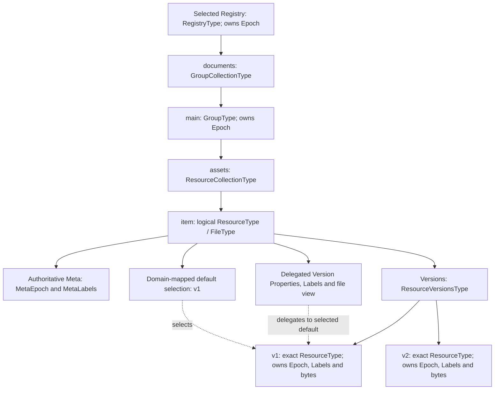

# xRegistry OPC UA API - Version 1.0-rc4

<!-- words: bytestrings compatibilityvalidated firstregistry formatvalidated identifiertype methodid modellingrules namespaces namespaceversion objectid qualifiedname readme referencetype reserializing standalone -->

<!-- words: xregistry addressspace browsename browsenames browsepath -->
<!-- words: browsepaths nodeid nodeids nodeclass typedefinition opc ua -->
<!-- words: filetransfer versionid versionids groupid resourceid registryid -->
<!-- words: xid xids epoch labels createdat modifiedat defaultversionid -->
<!-- words: specversion capabilitiesinfo contenttype mimetype resourceurl -->
<!-- words: hasdocument modelsource capabilitiesoffered statuscode -->
<!-- words: statuscodes attributestype propertytype foldertype filetype -->
<!-- words: registrytype grouptype resourcetype expandednodeid namespaceuri -->
<!-- words: accesslevel addattribute breaklock browsenameduplicated -->
<!-- words: browsenameinvalid browsenext bytestring communicationerror -->
<!-- words: continuationpointinvalid creategroup createresource -->
<!-- words: diagnosticinfo displayname encodinglimitsexceeded -->
<!-- words: enforcecompatibility exitlock expectedepoch externalreference -->
<!-- words: filehandle filternotallowed getorcreategroup getorcreateresource -->
<!-- words: getposition groupnodeid identitychangenotsupported indexrange -->
<!-- words: initlock invalidargument invalidstate lastmodifiedtime -->
<!-- words: callmethodresult lockingservicestype marcschier methodinvalid namespace -->
<!-- words: nodeidexists nodeidunknown nodeset notfound notreadable -->
<!-- words: notsupported notwritable opcfoundation opcua outofmemory -->
<!-- words: outofrange registrycapabilitiesdatatype removeattribute -->
<!-- words: renewlock requestfileopen resourcenodeid resourceunavailable -->
<!-- words: securitychecksfailed serveruri serveruriinvalid setposition -->
<!-- words: stickyversions toomanyoperations translatebrowsepathstonodeids -->
<!-- words: typedefinitions typemismatch useraccessdenied useraccesslevel -->
<!-- words: userwritable eventsourceurl correlationid metaepoch -->
<!-- words: eventnotifier eventtype eventtypes generatesEvent republish -->
<!-- words: monitoreditems modelsource undeprecated reconciliation -->
<!-- words: baseeventtype capabilitiesupdatedeventtype contentfilter -->
<!-- words: createmonitoreditems createsubscription deletemonitoreditems -->
<!-- words: deletesubscriptions eventfilter eventid greaterthan hasnotifier -->
<!-- words: groupcreatedeventtype groupdeletedeventtype -->
<!-- words: groupdeprecatedeventtype groupundeprecatedeventtype -->
<!-- words: groupupdatedeventtype modelsourceupdatedeventtype -->
<!-- words: modelupdatedeventtype monitoreditem oftype -->
<!-- words: registrycreatedeventtype registrydeletedeventtype -->
<!-- words: registryupdatedeventtype resourcecreatedeventtype -->
<!-- words: resourcedeletedeventtype resourcedeprecatedeventtype -->
<!-- words: resourceundeprecatedeventtype resourceupdatedeventtype -->
<!-- words: sourcename sourcenode sourceurl subscribetoevents -->
<!-- words: versioncreatedeventtype versiondeletedeventtype -->
<!-- words: versionupdatedeventtype resourceversionstype -->
<!-- words: assignedversionid incarnation -->
<!-- words: metalabels metacreatedat metamodifiedat -->
<!-- words: opcf eraseexisting monitoringmode -->
<!-- words: userwritable -->
<!-- words: applicationuri applicationuris serverindex serverarray -->
<!-- words: namespacearray namespaceindex namespaceuris registryroot -->
<!-- words: transportprofileuri federationprofiles uatcp uasc uabinary -->
<!-- words: addressspacefiletype namespacemetadatatype namespacefile -->
<!-- words: exportnamespace nsu svu svr remapping reindexed uint int nfc -->
<!-- words: maxbytestringlength sessionclosed sessionidinvalid timeout -->
<!-- words: href -->
<!-- words: powershell py pytest workingdrafts -->
<!-- words: datavalue endpointdescription federationerror methodids sdk selectedxid -->
<!-- words: abi additionalfields argumentsmissing baseobjecttype collectionname -->
<!-- words: documentkind groupcollectiontype groupfederation groupurl -->
<!-- words: messagesecuritymode metadataresourcetype nocontinuationpoints -->
<!-- words: originuri presentfields registryepoch registrymetadatadatatype -->
<!-- words: registrynodeid registrynumbervaluedatatype registryorigindatatype -->
<!-- words: registryreadrequestdatatype registryreadresultdatatype securechannel -->
<!-- words: signandencrypt snapshotid snapshotlimits targetepoch targetxid -->
<!-- words: typedaccess unauthored xrefs resourcecollectiontype -->
<!-- words: browsable filetypes hascomponent -->

## Abstract

This specification defines a native OPC Unified Architecture (OPC UA) binding
for the xRegistry document format and API [specification][xRegistry Core].
Clients use OPC UA operations to discover, read, create, update, delete,
export and federate Registries and their Groups, Resources, Versions,
documents and attributes. Servers report changes as native OPC UA Events.
The binding is a peer of the [HTTP binding][xRegistry HTTP]; it does not
tunnel HTTP or CloudEvents payloads over OPC UA.

**Status:** Unreleased working draft. The xRegistry Core, Events and OPC UA
API dependencies use the `v1.0-rc4` baseline. The OPC UA binding is governed
by OPC 30460-1, Version 1.0.0 Release Candidate 2 (RC2), an unpublished draft.
Neither draft status constitutes OPC Foundation publication or endorsement.
Section 10 defines federation behavior without overriding xRegistry Core or
the OPC UA Parts.

## Table of Contents

- [Abstract](#abstract)
- [Table of Contents](#table-of-contents)
- [1. Scope](#1-scope)
  - [1.1. Motivation and Example](#11-motivation-and-example)
- [2. Normative references](#2-normative-references)
- [3. Terms and conventions](#3-terms-and-conventions)
- [4. The OPC UA API access model](#4-the-opc-ua-api-access-model)
  - [4.1. AddressSpace root and service model](#41-addressspace-root-and-service-model)
  - [4.2. Resolving xRegistry `xid`s to OPC UA nodes](#42-resolving-xregistry-xids-to-opc-ua-nodes)
  - [4.3. Entity processing rules](#43-entity-processing-rules)
  - [4.4. OPC UA-specific attribute processing](#44-opc-ua-specific-attribute-processing)
  - [4.5. Method signatures and argument mapping](#45-method-signatures-and-argument-mapping)
    - [4.5.1. Concurrency and locking](#451-concurrency-and-locking)
  - [4.6. Attribute mapping](#46-attribute-mapping)
  - [4.7. Supported operations discovery and pagination](#47-supported-operations-discovery-and-pagination)
- [5. Registry operations](#5-registry-operations)
  - [5.1. Reading the registry](#51-reading-the-registry)
  - [5.2. Creating and updating the registry](#52-creating-and-updating-the-registry)
  - [5.3. Exporting the registry](#53-exporting-the-registry)
  - [5.4. Reading capabilities and model documents](#54-reading-capabilities-and-model-documents)
  - [5.5. Updating capabilities and model-source information](#55-updating-capabilities-and-model-source-information)
  - [5.6. Listing group collections](#56-listing-group-collections)
  - [5.7. Creating and updating groups](#57-creating-and-updating-groups)
  - [5.8. Reading a group](#58-reading-a-group)
  - [5.9. Deleting groups](#59-deleting-groups)
  - [5.10. Resource metadata and resource documents](#510-resource-metadata-and-resource-documents)
  - [5.11. Listing resource collections](#511-listing-resource-collections)
  - [5.12. Creating and updating resources](#512-creating-and-updating-resources)
  - [5.13. Reading a resource document](#513-reading-a-resource-document)
    - [5.13.1. FileTransfer read lifecycle](#5131-filetransfer-read-lifecycle)
  - [5.14. Reading and updating resource metadata](#514-reading-and-updating-resource-metadata)
  - [5.15. Replacing a resource document](#515-replacing-a-resource-document)
  - [5.16. Deleting resources](#516-deleting-resources)
  - [5.17. Listing versions](#517-listing-versions)
  - [5.18. Creating and updating versions](#518-creating-and-updating-versions)
  - [5.19. Reading a version](#519-reading-a-version)
  - [5.20. Replacing a version document](#520-replacing-a-version-document)
  - [5.21. Deleting versions](#521-deleting-versions)
- [6. Request flags](#6-request-flags)
  - [6.1. Filtering](#61-filtering)
  - [6.2. Ignore processing](#62-ignore-processing)
  - [6.3. Inlining](#63-inlining)
  - [6.4. Sorting](#64-sorting)
  - [6.5. Document and metadata modes](#65-document-and-metadata-modes)
  - [6.6. Pagination and ranges](#66-pagination-and-ranges)
- [7. Value encoding](#7-value-encoding)
- [8. Serialization / export-import](#8-serialization--export-import)
    - [8.1. Native metadata and navigation](#81-native-metadata-and-navigation)
    - [8.2. Core document-view export](#82-core-document-view-export)
  - [9. Events](#9-events)
    - [9.1. Native event model and canonical types](#91-native-event-model-and-canonical-types)
    - [9.2. Event field mapping](#92-event-field-mapping)
    - [9.3. Event source URL](#93-event-source-url)
    - [9.4. Interaction and emission rules](#94-interaction-and-emission-rules)
    - [9.5. Event notification topology](#95-event-notification-topology)
    - [9.6. Subscription, discovery and filtering](#96-subscription-discovery-and-filtering)
    - [9.7. Delivery lifetime and replay](#97-delivery-lifetime-and-replay)
  - [10. Federation](#10-federation)
    - [10.1. Advertisement and Registry selection](#101-advertisement-and-registry-selection)
    - [10.2. Structured reference resolution](#102-structured-reference-resolution)
    - [10.3. Three distinct reference mechanisms](#103-three-distinct-reference-mechanisms)
    - [10.4. Trust and live consistency](#104-trust-and-live-consistency)
    - [10.5. Namespace export is separate](#105-namespace-export-is-separate)
    - [10.6. OPC UA model alignment](#106-opc-ua-model-alignment)
  - [11. Error handling](#11-error-handling)
    - [11.1. Federation resolver outcomes](#111-federation-resolver-outcomes)
  - [12. Conformance](#12-conformance)
    - [12.1. Offline Read and Reference Examples](#121-offline-read-and-reference-examples)
- [Annex A — Correspondence to the xRegistry HTTP binding (informative)](#annex-a--correspondence-to-the-xregistry-http-binding-informative)

## 1. Scope

This draft describes an informative source for the xRegistry OPC UA binding.
OPC 30460-1 governs the OPC UA mapping; xRegistry Core and Events remain
normative for xRegistry requirements and event definitions. This draft also
documents federation and publication behavior beyond that binding, without
changing those authorities. The API exposes Registries, Groups, Resources,
Versions, documents and attributes through OPC UA Services, AddressSpace nodes
and FileTransfer.

The information model distinguishes the following entities:

- A Registry is a `RegistryType` folder, a subtype of `FolderType`.
- A Group is a `GroupType` folder, also a subtype of `FolderType`.
- A logical Resource and each of its exact Versions are distinct
  `ResourceType` files, a subtype of `FileType`.
- A logical Resource owns a typed `ResourceVersionsType` component named
  `Versions`, which contains its exact Version Objects.

These file roles apply to locally stored, document-backed Resources.
OPC 30460-1's OPTIONAL `MetadataResourceType` is instead a
`BaseObjectType` subtype for a metadata-only Resource with
`hasdocument: false` and `maxversions: 1`. It has no domain file interface.
An unresolved local `xref` or an unmaterialized remote proxy does not
require local Version Objects. Sections 5.10 and 10 describe these cases.

The hierarchy permanently distinguishes a logical Resource from an exact
Version, even when both use `ResourceType` or the same domain file subtype.
Document-bearing Resources expose their bytes through the file interface.
Metadata-only Resources expose metadata without a fabricated domain document.

Clients access these nodes through Browse, BrowseNext, Read, Write, Call,
TranslateBrowsePathsToNodeIds and the FileTransfer Methods inherited by
`ResourceType`. To delete an entity, a client calls the xRegistry
`Delete(ExpectedEpoch)` Method on that entity's `GroupType` or
`ResourceType` node. Section 10.6 identifies the model surfaces used
by this binding.

> Annex A provides an informative correspondence with sibling protocol
> bindings. Section 10 defines federation, including references to Registries
> hosted behind other APIs.

This binding is independent of any domain registry. Domain companion
specifications define subtypes of `RegistryType`, `GroupType` and
`ResourceType` and constrain Group and Resource names. They MAY add domain
Properties or Methods. These specializations do not change the OPC UA API
patterns defined here.

### 1.1. Motivation and Example

A device or industrial service can expose metadata and files in its OPC UA
AddressSpace. An xRegistry consumer can use that interface through this
binding; the device does not need to host an HTTP facade.

For example, a catalog entry can advertise `opc.tcp://ua.example.com:4840`
and Registry root `nsu=urn:example:registry;s=FirstRegistry`.
The resolver selects that application and root, reads the model, and maps
`/documents/main/assets/item/versions/v1` to the corresponding Version node.
It reads metadata through Properties and document bytes through the
FileType Open/Read/Close lifecycle.

The resolver runs either in the consumer or in an API server exposing a
consumer-facing Registry. When the server performs resolution, its local
shadow Resource takes precedence over the UA source. The shared
[hosting models](../federation/spec.md#design-hosting-models) define these
responsibilities. Resolution keeps the endpoint, namespace index, Registry
root and XID distinct. OPC 30460-1 and the native mappings
in Sections 4 and 5 determine which operations an implementation can provide.

For native reads, start with
[addressing](#41-addressspace-root-and-service-model),
[model/capabilities](#54-reading-capabilities-and-model-documents),
[Resource ownership](#510-resource-metadata-and-resource-documents) and the
[file lifecycle](#5131-filetransfer-read-lifecycle).
[Federation](#10-federation) adds remote selection and trust.
[Mutation](#451-concurrency-and-locking) and [events](#9-events) are separate
capability paths.

## 2. Normative references

- [xRegistry Core specification, `v1.0-rc4`](https://github.com/xregistry/spec/blob/v1.0-rc4/core/spec.md) — the registry, group, resource, version, document, attribute, request-flag, operation-processing and error model.
- [xRegistry Events specification, `v1.0-rc4`](https://github.com/xregistry/spec/blob/v1.0-rc4/core/events.md) — canonical xRegistry event types, fields and emission rules, interpreted with the binding corrections in §9.1.
- [xRegistry primer, `v1.0-rc4`](https://github.com/xregistry/spec/blob/v1.0-rc4/core/primer.md) — xRegistry concepts, representations, request-shaping concepts and federation model.
- OPC 30460-1, *OPC UA — xRegistry*, Version 1.0.0 Release Candidate 2
  (RC2), unpublished draft. This is the governing source for the OPC UA
  binding; no public link is available.
- [xRegistry Federation](../federation/spec.md) — common read resolution, advertisements, selectors, identity and resolver errors.
- [xRegistry Publication](../publication/spec.md) — OPTIONAL retained-publication behavior used by §10.4.
- [OPC 10000-3, v1.05.06](https://reference.opcfoundation.org/specs/OPC-10000-3/v1.05.06/) — Address Space Model, including URI identities, NodeIds, References and TypeDefinitions.
- [OPC 10000-4, v1.05.07](https://reference.opcfoundation.org/specs/OPC-10000-4/v1.05.07/) — Services, including Browse, BrowseNext, Read, Write, Call, TranslateBrowsePathsToNodeIds, `ExpandedNodeId` and StatusCodes.
- [OPC 10000-5, v1.05.06](https://reference.opcfoundation.org/specs/OPC-10000-5/v1.05.06/) — Base Information Model, including namespace metadata and address-space files.
- [OPC 10000-6, v1.05.07](https://reference.opcfoundation.org/specs/OPC-10000-6/v1.05.07/5.1.12) — portable QualifiedName, NodeId and ExpandedNodeId string encodings.
- [OPC 10000-20, v1.05.06](https://reference.opcfoundation.org/specs/OPC-10000-20/v1.05.06/4.2) — File Transfer, including `FileType` and its `Open` / `Read` / `Write` / `Close` Methods.

xRegistry Core and Events remain authoritative for xRegistry-specific
requirements. OPC 30460-1 governs their OPC UA representation and processing.
This working draft is informative and does not change either source. Section
9.1 records the draft's mapping of xRegistry Core `deprecated` events to
distinct OPC UA state-transition EventTypes.

## 3. Terms and conventions

The key words "MUST", "MUST NOT", "REQUIRED", "SHALL", "SHALL NOT", "SHOULD",
"SHOULD NOT", "RECOMMENDED", "MAY", and "OPTIONAL" in this document are to be
interpreted as described in [RFC 2119](https://tools.ietf.org/html/rfc2119).

The xRegistry Core specification and Primer define Registry, Group,
Resource, Version, document, attributes, collection, `xid`, `self`, `epoch`,
`labels`, model, capabilities, request flags, representation and federation.
An `xid` identifies an entity relative to its Registry, for example
`/schemagroups/g1/schemas/s1`. It is not a protocol URL. Clients resolve it
against the selected `RegistryType` root.

OPC UA type and member names follow the OPC UA naming conventions. This
document uses the names defined by Annex A of *OPC UA — xRegistry* and its
NodeSet: `RegistryType`, `GroupType`,
`ResourceType`, `ResourceVersionsType`, `MetadataResourceType`,
`GroupCollectionType`, `ResourceCollectionType`, `AttributesType`,
`RegistryCapabilitiesDataType`,
`RegistryId`, `SpecVersion`, `Capabilities`, `CapabilitiesSnapshot`,
`CapabilitiesInfo`, `RegistryCapabilitiesSnapshotDataType`, `Model`,
`GroupId`, `ResourceId`, `VersionId`, `Format`, `ContentType`,
`ExternalReference`, `OriginRegistry`, `ResourceUrl`, `Xid`, `Epoch`, `Name`,
`Description`, `Documentation`, `Labels`, `<Attribute>`, `CreatedAt`,
`ModifiedAt`, `MetaEpoch`, `MetaLabels`, `MetaCreatedAt`, `MetaModifiedAt`,
`MetaXref`, `MetaDefaultVersionSticky`, `MetaReadonly`, `MetaCompatibility`,
`MetaDeprecated`, `DeprecationDataType`, `Versions`, `AssignedVersionId`,
`CreateGroup`, `GetOrCreateGroup`, `CreateResource`, `GetOrCreateResource`,
`AddAttribute`, `RemoveAttribute`, `Delete` and `ExpectedEpoch`.
The event model additionally defines `EventSourceUrl`, `SourceUrl`, `Subject`,
`Changed` and `CorrelationId`, and the concrete EventTypes listed in §9.1.

This API uses the following OPC UA Services:

- Browse, for collection enumeration.
- BrowseNext, for continuation points.
- Read, for Properties and node metadata.
- Write, for writable Properties.
- Call, for FileTransfer and xRegistry Methods including `Delete`.
- TranslateBrowsePathsToNodeIds, for path resolution.
- The FileTransfer Methods inherited from `FileType` by `ResourceType`.

Pseudo-signatures identify FileTransfer Methods by BrowseName, not numeric
NodeId. A server can expose those Methods on domain subtypes of `ResourceType`.

## 4. The OPC UA API access model

### 4.1. AddressSpace root and service model

The API operates on an AddressSpace subtree rooted at a selected
`RegistryType` domain subtype instance. That root represents one xRegistry
Registry. Its `GroupCollectionType` folders organize `GroupType` entries.
Each Group owns `ResourceCollectionType` folders that organize logical
`ResourceType` or `MetadataResourceType` entries. The Resource's
`ResourceVersionsType` component named `Versions` contains separate
`ResourceType` children for its exact Versions. A logical Resource and its
Versions use the same domain resource file subtype. Their hierarchy,
BrowseName and `Xid` permanently distinguish their roles.

These collection entry points are REQUIRED even for a single collection
or an empty collection. Section 4.2 defines their placement and §5.10
defines metadata-only reads. Local xrefs and unmaterialized proxies
follow §10 rather than implying locally stored Versions.

String-valued Property Variables under `Labels` represent labels for
Registries, Groups and exact Versions. Resource Meta labels use `MetaLabels`
on the logical Resource. Typed extension attributes use the native-document
capability or a domain mapping.

The logical Resource provides two views with different owners. Its
`FileType` interface, normal Version Properties and `Labels` delegate to the
selected default Version. Its Resource Meta Properties and `MetaLabels`
are authoritative on the logical Resource itself. A default-Version change
therefore changes the delegated values and the target of future file opens,
but no NodeId, `Xid` or deletion role changes.



Figure 1 (informative) shows ownership and delegation for `item`. The Meta
and selection boxes are state on the logical Resource, not additional
Objects or mandatory base Properties. The model defines no separate `Meta`
Object or base `DefaultVersionId` Property. The collection folders carry
the model's plural keys in `CollectionName`; their BrowseNames can differ.
Changing the default affects future
logical opens; already-open handles remain pinned to their exact Version.

This separates xRegistry Core's [Meta entity](https://github.com/xregistry/spec/blob/v1.0-rc4/core/spec.md#meta-entity) and
[default Version](https://github.com/xregistry/spec/blob/v1.0-rc4/core/spec.md#default-version-of-a-resource) from
the UA file view. [§5.14](#514-reading-and-updating-resource-metadata)
describes updates to each owner. [§10.6](#106-opc-ua-model-alignment)
identifies the versioned domain mappings used here.

xRegistry Core [document-view export](https://github.com/xregistry/spec/blob/v1.0-rc4/core/spec.md#doc-flag) serializes this
state without the Resource's delegated Version projection.

A server MAY expose multiple Registries. Before applying this API, a client
selects a Registry root by NodeId, BrowsePath, discovery metadata or domain
convention. A federation advertisement supplies the portable `registryroot`
NodeId specified in §10.1. Selecting an endpoint alone does not select a
Registry.

All operations that create, modify or delete registry content or metadata
MUST use a SecureChannel with `MessageSecurityMode` `SignAndEncrypt`.
This includes get-or-create Calls, file write Opens, Writes and committing
Closes, label and native-document mutations, deletion and domain Methods
that change registry state. Roles and Permissions apply independently.
Registry reads SHOULD use a secured channel. A deployment policy MAY permit
read-only Browse, Read and FileType `Open`, `Read` and `Close` operations over
`MessageSecurityMode` `None`. A client using such an endpoint MUST NOT infer
authenticity, integrity or confidentiality for returned metadata or document
bytes. Roles and Permissions apply independently and MAY impose stricter
authorization. Event subscriptions follow the same deployment policy as
registry reads.

The selected root is the API authority for the operation sequence; native
OPC UA access does not use a URL authority. The role-specific identifiers
and `Xid` carry entity identity. The OPC UA Session, endpoint
and NodeIds identify where the entities are currently served. Group,
logical Resource and exact Version identifiers are carried by their
qualified BrowseNames as specified in §4.2, not separate identifier
Properties.

The baseline operation model is:

- Browse a folder to enumerate a collection.
- Select entities from the Browse result by BrowseName, NodeClass,
  TypeDefinition and target NodeId.
- Read Properties and the applicable `Labels` or `MetaLabels` container's
  `<Attribute>` Property Variables to obtain attributes that are not already
  in the Browse result.
- Write writable Properties to change fixed mutable attributes.
- Call `Open`, `Read`, and `Close` to read document bytes. Call `Open`,
  `Write`, and `Close` to replace them.
- Call `CreateGroup`, `GetOrCreateGroup`, `CreateResource` or
  `GetOrCreateResource` to create entities.
- Call the entity's `Delete(ExpectedEpoch)` Method to delete it and everything
  it contains.
- Call `AddAttribute` or `RemoveAttribute` on `Labels` or `MetaLabels` for
  supported string labels.
- Use `NativeRegistryAccessType` or a domain mapping for typed extension
  attributes.

If an xRegistry function is not supported for an otherwise supported
node, the server MUST return `Bad_NotSupported`, `Bad_UserAccessDenied`,
`Bad_NotWritable`, `Bad_MethodInvalid` or `Bad_InvalidArgument` as appropriate.
If the requested node or Property cannot be resolved, the server MUST return an
appropriate StatusCode such as `Bad_NodeIdUnknown`, `Bad_BrowseNameInvalid` or
`Bad_NotFound` where available.

### 4.2. Resolving xRegistry `xid`s to OPC UA nodes

Clients resolve an entity `xid` from the selected `RegistryType` root using
Browse, TranslateBrowsePathsToNodeIds, qualified BrowseNames and model
metadata. The table maps those identifiers and operation concepts to native
OPC UA targets.

The `capabilities`, `model`, and export rows describe operations, not entity
XIDs. Common federation requests for `model` and `capabilities` target `/`.
Metadata mode selects an operation rather than another identity. The HTTP
`$details` suffix is not part of an OPC UA NodeId, BrowseName or XID.

| xRegistry target or operation | OPC UA target | Primary OPC UA operation |
|---|---|---|
| `/` | selected `RegistryType` root node | Read registry Properties and Browse Group collection folders |
| Capabilities | Mandatory `RegistryType.Capabilities` `FileType` component Object and, when supported by the claimed conformance unit, `CapabilitiesSnapshot` Variable | Use `Open`/`Read`/`Close` for the authoritative complete JSON document. Read `CapabilitiesSnapshot` for the canonical typed standard fields; `CapabilitiesInfo` is only a partial convenience view |
| Offered capabilities | offered-capabilities structure exposed by the server, if any | Read a domain Property or an offered section inside the `Capabilities` JSON document |
| Model | Mandatory `RegistryType.Model` `FileType` component Object | Use `Open`/`Read`/`Close` for the JSON bytes. When writable as model source, `Open(mode = 6)`/`Write`/`Close` replaces the document |
| Model source | server-specific model-source Property or operation, if exposed | Read or Write the domain-defined model-source target, or reject as unsupported |
| Export | selected `RegistryType` subtree serialized as an xRegistry document | Browse and Read the subtree, or use a domain export Method or Property if advertised |
| `/<GROUPS>` | `GroupCollectionType` folder whose `CollectionName` is `<GROUPS>` | Browse its Group entries; creation follows §5.7 |
| `/<GROUPS>/<GID>` | `GroupType` entry in that collection whose qualified BrowseName has Name `<GID>` | Read/Write mutable Properties, Browse Resource collections, or Call `Delete(ExpectedEpoch)` on the Group |
| `/<GROUPS>/<GID>/<RESOURCES>` | `ResourceCollectionType` folder under the Group whose `CollectionName` is `<RESOURCES>` | Browse `ResourceType` or `MetadataResourceType` entries; creation follows the domain's document-backed or metadata-only contract |
| `/<GROUPS>/<GID>/<RESOURCES>/<RID>` | logical `ResourceType` or `MetadataResourceType` whose qualified BrowseName has Name `<RID>` | For document-backed Resources, read Resource Meta or use the delegated default-Version view. For metadata-only Resources, use §5.10. Call the entity's `Delete` |
| `/<GROUPS>/<GID>/<RESOURCES>/<RID>$details` | flattened Resource view on the logical `ResourceType` | Read/Write delegated default-Version Properties/`Labels` and authoritative Resource Meta Properties/`MetaLabels` |
| `/<GROUPS>/<GID>/<RESOURCES>/<RID>/meta` | Resource Meta and default-version selection state on the logical `ResourceType` | Read `MetaEpoch`, `MetaCreatedAt` and `MetaModifiedAt`; mutate only writable Meta state, including `MetaLabels` and domain meta Properties |
| `/<GROUPS>/<GID>/<RESOURCES>/<RID>/versions` | logical Resource's `ResourceVersionsType` component named `Versions` | Browse exact Version children |
| `/<GROUPS>/<GID>/<RESOURCES>/<RID>/versions/<VID>` | exact Version `ResourceType` under `Versions`, whose qualified BrowseName has Name `<VID>` | `Open`/`Read` document bytes, Read metadata Properties or Call Version `Delete` |
| `/<GROUPS>/<GID>/<RESOURCES>/<RID>/versions/<VID>$details` | exact Version metadata view | Read/Write Properties and optionally `Labels.AddAttribute`/`Labels.RemoveAttribute` |

The delegated `$details`, Meta and `Versions` rows describe document-backed
Resources. Metadata-only domains use their declared metadata and sole-Version
projection under §5.10; proxies and local xrefs follow §10.

The effective model declares the collection keys `<GROUPS>` and
`<RESOURCES>`. A server MUST expose a `GroupCollectionType` folder per
supported Group collection and a `ResourceCollectionType` folder per
supported Resource collection of each Group, including empty collections.
Each folder's `CollectionName` MUST equal its exact plural model key.
Its declared or discovered qualified BrowseName selects the UA folder;
it need not have the same spelling as that key. Clients MUST resolve the
namespace URI through the Session's `NamespaceArray` before using it.

The owner uses `Organizes` or the domain's declared forward hierarchical
Reference to the collection folder; the folder uses `Organizes` to its
entries. Direct hierarchical shortcuts from owner to entry are not allowed.
An authorized identity read MUST have a browsable owning route and readable
`CollectionName`. Policy MAY hide a collection with no visible entries.

Within those collections:

- Each concrete Group instance MUST be a `GroupType` or subtype.
- Each logical Resource and exact Version MUST be a `ResourceType` or the
  same domain subtype when it uses the document-backed contract.
- A locally stored, non-xref document Resource MUST own a
  `ResourceVersionsType` component with BrowseName `Versions`.
- Collection-qualified identity MUST preserve the collection key and
  entry identifier as a pair. `CollectionName` is on the folder, not its
  entries. A collection folder is not an entity and has no XID or epoch.
- A domain using `XREG-MetadataResource` MUST use `MetadataResourceType`
  or a subtype under the selected Group. Its read-only `Metadata` file
  represents metadata, not domain document bytes.

A server MUST set each Group's, logical Resource's and exact Version's
BrowseName Name component to its identifier: `GroupId`, `ResourceId` or
`VersionId`, respectively, in the xRegistry namespace defined by OPC 30460-1.
These are not separate Properties. The logical Resource's `VersionId`
Property instead selects its default Version. A metadata-only Resource
retains its declared `ResourceId` and OPTIONAL `VersionId` Properties.
To obtain a document-backed Resource ID from an exact Version, a client
follows inverse `Organizes` to `Versions`, then inverse `HasComponent` to
the logical Resource, and reads its qualified BrowseName. It MUST verify
the xRegistry namespace URI before interpreting either identifier.
`Name` is OPTIONAL. When it is present, the Server sets
`DisplayName` to `Name`; when absent, it sets `DisplayName` to the same
role-specific identifier used by `BrowseName`.

A `groupid` or `resourceid` is a symbolic identifier constructed from the
entity's domain source identity, never from a document. OPC 30460-1 specifies
the entity-identifier construction that makes these identifiers readable and
safe in a URL, on a command line and as a file name.

A Browse result includes BrowseName, DisplayName, NodeClass, TypeDefinition
and the target NodeId. A client can select and filter entities by identity
and collection and render a readable list directly from those results,
without a Read for each candidate. Filters on a dynamic label value or
another attribute absent from the result require reads of the applicable
`Labels` or `MetaLabels` container or Properties.

The base model does not require an OPC UA Property for xRegistry `self`.
Serialization derives it from the entity's position in the returned document
or a defined Core API URL under §8.1. A Registry-root NodeId plus `Xid`
selects a native entity; that pair is not itself a Core `self` URL.

`Xid` MUST always be the structural relative xRegistry path of the registry,
group, Resource or Version. The logical Resource `Xid` is its resource path.
Each exact Version `Xid` is that Resource `Xid` followed by
`/versions/<VID>`. An `Xid` MUST NOT be a content fingerprint, digest or other
document-derived identifier. A server MAY use content identity for internal
lookup, caching or deduplication, but that optimization MUST NOT change `Xid`,
`Subject`, `ResourceId`, `VersionId` or AddressSpace placement.

Resource denotes the generic xRegistry entity kind. Each domain model
declares its own `<RESOURCES>` collection and `<RESOURCE>` singular names.
This binding does not require a literal `resources` path segment.

Document-backed servers MUST preserve the distinct Resource/Version
hierarchy. A missing `Versions` component MUST NOT cause a client to treat
Group children as exact Versions. The client instead applies the declared
metadata-only, local-xref or remote-proxy contract, or reports an unsupported
mapping. It MUST NOT guess a different hierarchy from missing nodes.

### 4.3. Entity processing rules

The read operation depends on the selected view:

- For a collection, Browse its folder.
- For entity metadata, Read the entity Properties. If labels are needed,
  Browse/Read its `Labels` `AttributesType` container. Resource Meta instead
  uses `MetaLabels` on the logical Resource.
- For a Resource document, use `Open`, `Read`, and `Close` on the delegated
  default-Version view.
- For an exact Version document, use the exact Version `ResourceType`.

Core's [Resource processing](https://github.com/xregistry/spec/blob/v1.0-rc4/core/spec.md#resource-processing-algorithm)
governs full replacement and partial updates. A full replacement targets the
entity node or its creation parent. The server updates an existing entity.
For an absent entity, it creates a `GroupType` folder or atomically creates
a logical Resource and its first exact Version.

For omitted mutable Properties, `Labels` entries and Resource Meta
`MetaLabels` entries, the server MUST delete, reset to default or leave
unchanged only as xRegistry Core or server-managed semantics specify.

Partial updates change only explicitly named mutable attributes. A null value
requests removal or the attribute-specific reset defined by xRegistry Core. Clients
Write writable Properties and use `Labels.AddAttribute` or
`Labels.RemoveAttribute` only for string-valued labels. Resource Meta labels
use the corresponding Methods on `MetaLabels` with `ExpectedEpoch` matched
against `MetaEpoch`. Typed extension values use `NativeRegistryAccessType`
or a domain mapping; they do not pass through `AttributesType`. Success or
failure is conveyed by the Service StatusCode or the Method result
StatusCode, as described in §4.5.

Partial update MUST
NOT patch arbitrary bytes inside a Resource document. Document changes
replace the complete byte stream.

Collection processing creates or updates child entities under the collection's
parent. The preferred client sequence is:

1. Create or resolve Groups with `GetOrCreateGroup` on `RegistryType`,
   and Resources or Versions with `GetOrCreateResource` on `GroupType`.
   Use `CreateGroup` and `CreateResource` for strict creation, when an
   existing entity is an error.
2. Retain the exact Version NodeId, `AssignedVersionId` and any requested
   handle returned by the Resource Methods. Discover the logical Resource
   separately under the Group.
3. Write mandatory and mutable Properties, update the applicable `Labels`
   or `MetaLabels` container, and write any supplied document bytes.

A server MUST apply xRegistry Core's entity-level atomicity rule. A native
`WriteDocument` or `ApplyChanges` validates the complete resulting entity
before committing it. A sequence of separate create, Property Write and
file Calls is a sequence of interactions, not one atomic replacement.
If an implementation cannot provide the requested atomic entity operation,
it MUST reject it rather than advertise a weaker equivalent. Atomicity
across separate entities follows xRegistry Core and the declared batch contract.

[Nested collection processing](https://github.com/xregistry/spec/blob/v1.0-rc4/core/spec.md#updating-nested-registry-collections)
MUST process only the nested collection entries. It MUST NOT modify the
owning entity's Properties. For example, processing Resources under a
selected Group creates or updates `ResourceType` children without changing
that Group's Properties.

To [delete an entity](https://github.com/xregistry/spec/blob/v1.0-rc4/core/spec.md#deleting-entities), the client calls
`Delete(ExpectedEpoch: UInt32)` on its `GroupType`, `ResourceType` or
`MetadataResourceType` node:

- Group deletion checks `ExpectedEpoch` against `Epoch`.
- Logical Resource deletion checks against `MetaEpoch` and removes the
  Resource, its `Versions` container and all exact Versions.
- Exact Version deletion checks against that Version's `Epoch` and removes
  only that Version.
- Metadata Resource deletion checks against its metadata `Epoch` and removes
  that Resource atomically.

To delete a collection subset, the client uses a sequence or server-defined
batch of `Delete(ExpectedEpoch)` Calls on the selected children.

Unless otherwise stated, the server MUST ignore an update to a read-only
Property only when xRegistry defines that behavior for the attribute.
Otherwise it MUST reject the Write with `Bad_NotWritable` or
`Bad_UserAccessDenied`. If a supplied identifier
(`RegistryId`, `GroupId`, `ResourceId` or `VersionId`) conflicts
with the target entity, the request MUST fail with `Bad_InvalidArgument` or
`Bad_IdentityChangeNotSupported`.

Each successful update increments the affected entity's epoch once, even
when the supplied values equal the committed values or no attributes are
supplied. An `ApplyChanges` Call with an empty `Changes` array is an update.
A lookup that returns an existing entity without updating it, including an
unchanged get-or-create result, does not increment an epoch.

Adding or removing a child entity increments its direct parent's `Epoch` and
updates that parent's `ModifiedAt`. Adding or removing a Version instead
changes the Resource's Version collection, increments its `MetaEpoch` and
updates its `MetaModifiedAt`. Updating an existing child alone does not
update its parent. An atomic operation that changes several direct children
increments the existing owner's applicable counter once, not once per child.
If that same committed update also changes the parent's own attributes,
the counter still increments once. Separate committed updates increment it
separately, even when their events coalesce in one interaction. A domain
supporting multiple successful Write entries for one entity MUST document
their grouping into committed updates; the event boundary alone does not
determine the counter advance. Updating an existing Version alone does not
change Resource Meta. A Version update increments that Version's `Epoch`
and updates its `ModifiedAt`; a Resource Meta update increments `MetaEpoch`
and updates `MetaModifiedAt`, without changing a Version's counters.
Changing only the selected default updates Resource Meta and leaves both
Version counters unchanged.

Before committing an update to an existing entity, the Server MUST compare
a supplied non-null document `epoch` with that entity's committed epoch,
unless the operation supports and applies xRegistry Core's `ignore=epoch`
option. When ignored, the field is neither validated as an epoch nor
compared, without bypassing decoding, other validation or `ExpectedEpoch`.
Otherwise its exact mathematical value MUST be an integer in the UInt32
range equal to the committed epoch; `1`, `1.0` and `1e0` compare equally.
An invalid value or checked mismatch rejects the operation without changing
state.
An absent or null document `epoch` supplies no precondition, and a document
`epoch` supplied when creating an entity is ignored. This check is independent
of an operation's `ExpectedEpoch` argument: `ExpectedEpoch = 0` disables that
comparison, while a document `epoch` of zero is compared as a value.

When the supported representation accepts `createdat`, a supplied value
replaces the existing value; a supplied null selects the request's current
time. If `createdat` is absent, an update retains its value and creation uses
the request's current time. A supplied `modifiedat` selects the request's
current time when it is null or equals the existing value; a different
supplied value is used. An absent `modifiedat` also selects the current
time. All entities assigned the current time during one atomic request MUST
use the same time. Returned timestamps MUST represent UTC. The Server MAY
reject a timestamp outside its documented limits, but MUST NOT silently
round a supplied value. This specification defines no ordering between
`createdat` and `modifiedat`; the current time MAY equal or precede the
previous `modifiedat`.

On creation, the Server MUST initialize the applicable `CreatedAt`,
`ModifiedAt`, `Epoch`, `MetaCreatedAt`, `MetaModifiedAt`, `MetaEpoch`, `Xid`
and role-specific identifiers under xRegistry Core and OPC 30460-1.

### 4.4. OPC UA-specific attribute processing

OPC UA represents fixed metadata as typed Property Values: strings use
`String`, timestamps use `DateTime`, `ExternalReference` uses
`ExpandedNodeId`, and `Epoch` and `MetaEpoch` use `UInt32`. The xRegistry
`labels` are string-valued Property Variables under `Labels`, or under
`MetaLabels` for Resource Meta. Extension attributes are not labels: a native
document view preserves their JSON kinds and values through
`RegistryValueDataType` subtypes, while a domain mapping uses its declared UA
DataTypes. Neither representation MAY stringify typed values to fit an
`AttributesType` container.

An xRegistry `epoch` is an unsigned integer in the range 0 through
4,294,967,295. Before a mutation increments one or more `Epoch` or `MetaEpoch`
values, the Server MUST check every affected counter. If any counter is at
the maximum, the operation MUST fail with `Bad_OutOfRange`, make no state
change and emit no event. This check is atomic across all affected entities;
A counter MUST NOT wrap, reset or saturate.

For a Resource document read, clients obtain accompanying metadata from the
logical Resource's delegated Version Properties and authoritative Resource
Meta Properties. For an exact Version, they read that Version Object's
metadata. A server MAY combine these reads in a domain Method. The
interoperable baseline uses separate `Open`, `Read`, and `Close` operations
for document bytes and Browse and Read operations for metadata.

To select a Resource or Version metadata view, a client Reads or Writes
Properties instead of file content. This choice does not merge the distinct
Resource and Version NodeIds.

The xRegistry `contenttype` attribute maps to `ContentType`, not `MimeType`.
The inherited `FileType` Property `MimeType` MAY mirror `ContentType` for
generic FileTransfer clients. If both are present, `ContentType` represents
the xRegistry attribute; `MimeType` is the FileTransfer media hint.

### 4.5. Method signatures and argument mapping

The creation and mutation Method signatures used by this API are:

- The domain-named `CreateGroup`, `GetOrCreateGroup`, `CreateResource` and
  `GetOrCreateResource` Methods defined by the xRegistry base model.
- The `Delete` Method on `GroupType` and `ResourceType`.
- The `AddAttribute` and `RemoveAttribute` Methods on `AttributesType`.
- The OPTIONAL native-document Methods on `NativeRegistryAccessType` as
  defined by OPC 30460-1.
- The inherited `Open` / `Read` / `Write` / `Close` Methods of `ResourceType`,
  whose exact argument definitions are normative in OPC 10000-20.

| xRegistry action | OPC UA Method or Service | Argument mapping |
|---|---|---|
| Create group | `RegistryType.CreateGroup(GroupId) -> (GroupNodeId)` | `GroupId` is the groupid of the `GroupType` (or subtype) to create. The server creates the group folder and bootstraps its xRegistry attributes. The call fails if the group already exists. |
| Get or create group | `RegistryType.GetOrCreateGroup(GroupId) -> (GroupNodeId, Created)` | `GroupId` is the groupid to resolve. The server returns the existing group with `Created = false` or creates, bootstraps and returns a new group with `Created = true`. |
| Create Resource or Version | `GroupType.CreateResource(ResourceId, VersionId, RequestFileOpen) -> (ResourceNodeId, AssignedVersionId, FileHandle)` | A Version is identified by `(ResourceId, VersionId)`. A new `ResourceId` atomically creates the logical Resource, `Versions` container and first exact Version, while an existing `ResourceId` with a new `VersionId` creates only an exact Version under `Versions`. An empty input `VersionId` lets the server assign `AssignedVersionId`. Despite its retained output name, `ResourceNodeId` is the exact Version NodeId. Setting `RequestFileOpen = true` returns a write handle for that Version. The call fails with `Bad_NodeIdExists` if that exact pair already exists. |
| Get or create Resource or Version | `GroupType.GetOrCreateResource(ResourceId, VersionId, RequestFileOpen) -> (ResourceNodeId, AssignedVersionId, FileHandle, Created)` | Resolves the exact `(ResourceId, VersionId)` Version. An empty input `VersionId` selects the existing default Version or creates the first Version for a new Resource. The retained `ResourceNodeId` output is the exact Version NodeId, `AssignedVersionId` is the assigned Version identifier, and `RequestFileOpen = true` returns a write handle for that Version. |
| Delete group, Resource or Version | `Delete(ExpectedEpoch: UInt32)` on the selected entity | Supply `0` to disable the check. A Group, exact Version or Metadata Resource matches against `Epoch`, while a document-backed logical Resource matches against `MetaEpoch`. A mismatch fails with `Bad_InvalidState` and deletes nothing. The Method has no output arguments. |
| Read document | `ResourceType.Open(mode)` -> `Read(fileHandle, length)` -> `Close(fileHandle)` | The `mode` is read-only. `Size` bounds `length` and repeated Reads. |
| Replace document | `ResourceType.Open(mode = 6)` -> `Write(fileHandle, data)` -> `Close(fileHandle)` | Write or EraseExisting stages a complete replacement, including truncation. A successful `Close` after either action updates Version `ModifiedAt` and increments `Epoch` once, even when the final bytes are unchanged. |
| Read metadata | Read Service on Properties | Property BrowseNames map to xRegistry attribute names by the tables in this document and the domain model |
| Replace scalar metadata | Write Service on Properties | Value DataTypes are those in Annex A of the base model |
| Add/update registry, group or version label | `Labels.AddAttribute(Key: String, Value: String, ExpectedEpoch: UInt32)` | `Labels` is the entity or version's `AttributesType` object. `ExpectedEpoch` is matched against its `Epoch`. Success increments `Epoch` and updates `ModifiedAt`. |
| Remove registry, group or version label | `Labels.RemoveAttribute(Key: String, ExpectedEpoch: UInt32)` | `Labels` is the entity or version's `AttributesType` object. `ExpectedEpoch` is matched against its `Epoch`. Success increments `Epoch` and updates `ModifiedAt`. |
| Add/update Resource Meta label | `MetaLabels.AddAttribute(Key: String, Value: String, ExpectedEpoch: UInt32)` | `MetaLabels` is on the logical Resource. `ExpectedEpoch` is matched against `MetaEpoch`. Success increments `MetaEpoch` and updates `MetaModifiedAt`. |
| Remove Resource Meta label | `MetaLabels.RemoveAttribute(Key: String, ExpectedEpoch: UInt32)` | `MetaLabels` is on the logical Resource. `ExpectedEpoch` is matched against `MetaEpoch`. Success increments `MetaEpoch` and updates `MetaModifiedAt`. |
| Read or mutate typed extension attributes | `NativeRegistryAccessType.ReadDocument`, `WriteDocument` or `ApplyChanges` | OPTIONAL native-document capability. Values retain their RegistryValueDataType subtype and do not pass through string-valued `AttributesType` labels. |

A new Resource and its first Version are created in the same xRegistry
operation, never independently. Before returning, `CreateResource` and
`GetOrCreateResource` with `Created = true` commit both structural
identities, the `Versions` container, their `Xid` values, initial epochs
and timestamps.

The returned NodeId identifies the exact Version, not the logical Resource.
The client discovers the logical Resource separately by its `ResourceId`
BrowseName under the domain resource collection. A writable `FileHandle`
does not defer this structural commit or merge it with a later file write.

The base model places `CreateGroup` and `GetOrCreateGroup` on `RegistryType`
and `CreateResource` and `GetOrCreateResource` on `GroupType`. These are the
base API's create operations. It defines `AddAttribute` / `RemoveAttribute`
on `AttributesType`.

Registries, Groups and exact Versions MAY expose `Labels`. Resource Meta
owns `MetaLabels`, which is authoritative on the logical Resource. Clients
call attribute Methods on the container that owns the attribute.

The OPTIONAL native-document capability is separate from label Methods.
`ReadDocument` returns a typed native view; `WriteDocument` and
`ApplyChanges` update typed values through the same validation, authorization,
precondition, update and failure-atomicity rules as raw compatibility
operations. The Server MUST validate the full resulting state before commit.
`OpenDocument`,
`ReadDocumentPart` and `CloseDocument` provide a pinned bounded view when
`XREG-NativeSnapshots` is supported. These Methods do not replace the raw
`Capabilities` or `Model` FileType interfaces.

The owning Registry exposes this capability as `TypedAccess`.
`ReadDocument` takes one `RegistryReadRequestDataType` and returns one
`RegistryReadResultDataType`. `TargetXid` selects the entity, `DocumentKind`
selects metadata, model or capabilities, and `View` selects the complete
generic value (`0`) or named fields (`1`). A client MUST check the returned
`StatusCode` and `Issues` as well as the Call result. Metadata reads return
the selected entity's epoch; Registry, model and capability reads return
the Registry epoch. Missing entity revision information MUST NOT be replaced
by the Registry epoch.

Native records preserve authored presence through `PresentFields`, and
unknown members through `AdditionalFields`. An absent member differs from
explicit null, false or an empty collection. Generic numbers retain their
exact coefficient and exponent rather than rounding through Double.
`ApplyChanges` uses native member/array path elements, not JSON Pointer
strings. A missing parent path is an error. Native identity comparison
protects exact values and detects the fields whose values differ, but does
not suppress a successful update or its epoch increment. The Server MAY
retain an unchanged raw representation when document values have not
changed. An empty `ApplyChanges` array is still an update.
Raw FileType access preserves committed document bytes, and native reads
MUST NOT rewrite raw documents.

Native continuation tokens bind the selection, retained document state and
authorization view. That retained state is distinct from an exposed entity
epoch: updating an existing child can change an aggregate document without
incrementing its parent epoch. A client MUST NOT treat a partial named record
as a complete document.
For documents that cannot fit in one response, including one oversized
nested value, complete native access uses `OpenDocument`,
`ReadDocumentPart` and `CloseDocument`. A successful Open returns a
Session-bound `SnapshotId`, `TargetEpoch` and `RegistryEpoch`.
`ReadDocumentPart` traverses native fields or array indexes and reads bounded
leaf ranges under `SnapshotLimits`; it does not require reconstructing JSON.
Clients MUST check each result, use positive item/byte limits and release
the snapshot when finished. Authorization changes invalidate snapshots.
An invalid handle or token fails with `Bad_InvalidState`; capacity and
encoding failures remain explicit. This pinned native view is not a retained
publication or a snapshot of remote providers or domain file bytes.

The Client MUST check the Call result before reading a Method's operation
result. A Good Call means that the Server invoked the Method and returned its
declared outputs; it does not mean that the registry operation succeeded.
For a Method whose output is a Structure containing `StatusCode` and `Issues`,
the Client MUST also check the embedded `StatusCode` before using result data.
After a structured-result Method accepts a well-typed invocation, document
selection, authorization, validation, revision and retained-handle failures
MUST be reported in `Result.StatusCode`, with the Call's
`CallMethodResult.StatusCode` set to Good. An invalid combination of decoded
selectors is an operation error, not an input-argument type error. A failed
result MUST contain at least one issue, and its first issue MUST have the
same StatusCode as the result. A Bad mutation result guarantees that no state
change was committed.

Failure to receive a usable response does not establish that a dispatched
mutation failed before commit. Before repeating a non-idempotent request
after a communication or response-encoding failure, the Client MUST
reconcile the committed state.

Every `ExpectedEpoch` argument in the declared label and Delete signatures
is REQUIRED. A client supplies `0` when it does not request the comparison;
xRegistry Core's omission of an epoch precondition does not omit a UA Method
argument.

The base API does not define move or copy. Where permitted, an
implementation can model them by re-creating an entity and deleting the
original.

#### 4.5.1. Concurrency and locking

FileTransfer controls concurrent document access at the exact Version.
Opening an exact Version for write reserves that Version incarnation.
Opening a logical Resource for write selects its current default Version
and acquires the same reservation as an exact-node open. While that Version
is open for writing, a second write `Open` through either path returns
`Bad_NotWritable` and a read `Open` returns `Bad_NotReadable`. Content
concurrency observations use the exact Version's `Epoch`.

To mutate Registry, Group or Version labels through `Labels.AddAttribute`
and `Labels.RemoveAttribute`, the client supplies that entity's current
`Epoch` as `ExpectedEpoch`, under the
[Core epoch precondition](https://github.com/xregistry/spec/blob/v1.0-rc4/core/spec.md#epoch-flag).
If the supplied value is non-zero and unequal, the Method MUST fail with
`Bad_InvalidState` and make no change. On success, `Epoch` increments and
`ModifiedAt` is updated.

To mutate Resource Meta labels through `MetaLabels.AddAttribute` and
`MetaLabels.RemoveAttribute`, the client supplies the current `MetaEpoch`
as `ExpectedEpoch`. If the supplied value is non-zero and unequal, the
Method MUST fail with
`Bad_InvalidState` and make no change. On success, `MetaEpoch` increments and
`MetaModifiedAt` is updated. For either container, `ExpectedEpoch = 0`
disables the check.

For document replacement, exclusive `Open(write)` serializes file writers,
but FileType has no `ExpectedEpoch` argument. Separate epoch Reads and an
Open/Write/Close sequence do not establish an atomic epoch precondition,
particularly when metadata can change independently. A client requiring
that precondition MUST use a documented operation or lock that enforces it
at commit, or report the requested operation as unsupported. It MUST NOT
present an unchecked file replacement as an epoch-matched one.

`Write` and `EraseExisting` stage bytes without committing them. One
successful `Close` after either action commits the staged content and
increments the exact Version's `Epoch` once, updating `ModifiedAt` even when
the resulting bytes equal the committed bytes. A `Close` without a write or
truncation action, a rejected `Close`, or an abandoned handle makes no
committed change. If a dispatched `Close` has no usable response, its outcome
is uncertain; the Client MUST reconcile committed state before repeating a
non-idempotent request.

Every logical Resource handle MUST remain pinned to the exact Version selected
at `Open`. A later default-Version switch affects only later opens. Logical and
exact opens MUST share the same exact-Version writer reservation and an
incarnation safeguard, so deletion and recreation of the same Version identity
cannot let a stale handle commit into the replacement Object.

For deletion, a client passes the current group or exact Version `Epoch`, or
the current logical Resource `MetaEpoch`, as `ExpectedEpoch`. If a non-zero
value does not equal the applicable value, the Method Call MUST fail with
`Bad_InvalidState`, delete nothing and produce no partial effects.
An `ExpectedEpoch` of `0` disables the check. Deletion
is therefore an atomic epoch-matched Method call rather than a
read-then-delete sequence.

A server MAY expose coarser-grained exclusive access through the standard
OPC UA locking mechanism, a `LockingServicesType` component
(`InitLock` / `RenewLock` / `ExitLock` / `BreakLock`, OPC 10000-5) on the
Registry root, a Group or a Resource. This lets a client hold an explicit
exclusive lock across a multi-step create/update sequence. This API does not
require locking. Without it, clients rely on FileTransfer `Open`
exclusivity and `Epoch` preconditions.

The [outcomes in §5.14](#514-reading-and-updating-resource-metadata)
distinguish Meta changes, byte commits and default switches.

### 4.6. Attribute mapping

The base model Properties map to xRegistry attributes as follows.

| xRegistry attribute | OPC UA Property or Object | Applies to |
|---|---|---|
| `registryid` | `RegistryId` | `RegistryType` |
| `specversion` | `SpecVersion` | `RegistryType` |
| `capabilities` | Mandatory `Capabilities` Object (`FileType`) for the complete authoritative JSON document; `CapabilitiesSnapshot` (`RegistryCapabilitiesSnapshotDataType`) is the canonical typed view for standard fields, while `CapabilitiesInfo` is a partial convenience view | `RegistryType` |
| `model` | Mandatory `Model` Object (`FileType`) for the JSON document; `NativeRegistryAccessType` MAY additionally expose its typed native document view | `RegistryType` |
| `<GROUP>id` | Name component of the xRegistry-qualified BrowseName | `GroupType` |
| `<RESOURCE>id` | Name component of the logical Resource's xRegistry-qualified BrowseName; `ResourceId` Property for a metadata-only Resource | logical Resource or `MetadataResourceType` |
| `versionid` | Name component of the exact Version's xRegistry-qualified BrowseName; `VersionId` Property for a metadata-only Resource | exact Version or `MetadataResourceType` |
| `format` | `Format` | `ResourceType` |
| `contenttype` | `ContentType` | `ResourceType` |
| `<RESOURCE>url` | `ResourceUrl` | `ResourceType` |
| federation target | `ExternalReference` | `ResourceType` |
| `xid` | `Xid`. A Version uses the Resource `Xid` plus `/versions/<VID>`, and Resource Meta uses the Resource `Xid` plus `/meta` | `RegistryType`, `GroupType`, Resource, Version and Resource Meta entities |
| `epoch` | delegated `Epoch` for a Resource representation, exact `Epoch` for a Version and `MetaEpoch` for Resource Meta | `RegistryType`, `GroupType`, Resource, Version and Resource Meta entities |
| `name` | `Name` | all base entity types |
| `description` | `Description` | all base entity types |
| `documentation` | `Documentation` | all base entity types |
| `labels` | delegated `Labels` object (`AttributesType`) for a Resource representation, exact `Labels` for a Version and `MetaLabels` for Resource Meta; string values only | `RegistryType`, `GroupType`, Resource, Version and Resource Meta entities |
| `createdat` | delegated `CreatedAt` for a Resource representation, exact `CreatedAt` for a Version and `MetaCreatedAt` for Resource Meta | `RegistryType`, `GroupType`, Resource, Version and Resource Meta entities |
| `modifiedat` | delegated `ModifiedAt` for a Resource representation, exact `ModifiedAt` for a Version and `MetaModifiedAt` for Resource Meta | `RegistryType`, `GroupType`, Resource, Version and Resource Meta entities |
| `xref` | `MetaXref`, the case-sensitive Xid of a same-typed Resource in the same Registry | Resource Meta |
| `defaultversionid` | `VersionId` on the logical Resource selects the default exact Version; an exact Version has no `VersionId` Property | Resource Meta |
| `defaultversionsticky` | `MetaDefaultVersionSticky` (`Boolean`); absence means Core's default `false` | Resource Meta |
| `readonly` | `MetaReadonly` (`Boolean`); Core's default is `false` | Resource Meta |
| `compatibility` | `MetaCompatibility` (`String`) | Resource Meta |
| `deprecated` | `MetaDeprecated` (`DeprecationDataType`) with typed OPTIONAL fields | Resource Meta |
| event `source` URL | `EventSourceUrl` | `RegistryType`, REQUIRED only for event-capable server conformance (§9.3) |

The table in §4.6 is authoritative for fixed and system Properties. A client
mapping a model-defined Property BrowseName to an xRegistry attribute name
MUST convert only ASCII uppercase letters (`A` through `Z`) to their
lowercase counterparts. For a Resource Meta Property, the client MUST first
remove the exact, case-sensitive `Meta` prefix. A client mapping a field of a
structured `ExtensionObject` to an xRegistry attribute MUST apply the same
ASCII conversion to the field name; it MUST NOT remove a `Meta` prefix from
the field name. No other character is changed, and Unicode case folding MUST
NOT be applied. The resulting attribute name MUST satisfy Core's
attribute-name grammar.

If two distinct Properties on the same entity map to the same xRegistry
attribute path in the selected representation, including a collision with a
mapping in the §4.6 table, the client's read MUST fail as ambiguous. It
MUST NOT select a Property by Browse order or another tie-breaker.

Resource Meta is an xRegistry entity in its own right, not a Version
attribute or a nested implementation object. On the logical Resource, the
`Meta` prefix distinguishes its OPC UA BrowseNames from delegated Version
Properties. Dotted names such as `meta.epoch` apply only when xRegistry
represents Resource and Meta attributes in one document, or in an event
`Changed` path.

The xRegistry attributes `self`, collection `url` attributes, collection
`count` attributes, `metaurl`, `versionsurl`, `versionscount`,
`defaultversionurl`, `isdefault`, `ancestorid`, `<RESOURCE>` and
`<RESOURCE>base64` are serialization artifacts or domain/model attributes rather
than mandatory base Properties. A server MAY expose them as domain Properties,
but a client MUST only derive them when the selected mapping supplies the
necessary state. It MUST NOT infer ancestry or default selection from Browse
order. Serialized URLs and local pointers follow §8.

Registry, Group, Version and Resource Meta labels are enumerated by Browsing
`Labels` or `MetaLabels` and Reading each `<Attribute>` Property Variable.
Clients change these string labels by calling the owning container's
`AddAttribute` or `RemoveAttribute` Method with the epoch described in §4.5.1.
Typed extension attributes use the native document or domain mapping; they
MUST NOT be coerced into label strings. Both label containers are deleted
with their owning entity.

### 4.7. Supported operations discovery and pagination

A client discovers supported operations from the target node and Registry
capabilities. It browses for Methods and checks their executable and
user-executable bits. It reads FileType `Writable` and `UserWritable`
Properties, Variable AccessLevel and UserAccessLevel Attributes, and the
typed `CapabilitiesSnapshot`
or raw `Capabilities` `FileType` content. `CapabilitiesInfo` is not a
substitute for a missing canonical field.

A server MUST NOT require a side-effecting operation for discovery. If a
FileTransfer Method, `CreateGroup`, `GetOrCreateGroup`, `CreateResource`,
`GetOrCreateResource`, an applicable `Labels` or `MetaLabels` object, or its
`AddAttribute` /`RemoveAttribute` Method is absent, non-executable or rejected
with `Bad_UserAccessDenied`, the corresponding xRegistry write capability is
not available to that client.

Browse uses continuation points and `BrowseNext` to paginate large child
sets. To obtain a page of collection entries, a client calls Browse with a
requested maximum reference count, then `BrowseNext` until that page is
complete or no continuation point remains.

For file bytes, a client paginates through `Read(fileHandle, length)` and MAY
use `GetPosition` and `SetPosition` to implement random access. For labels, a
client browses `Labels` or `MetaLabels` and pages with normal Browse
continuation points where needed.

A federation selector needs every necessary Browse page, not just a
client-selected page. A client MUST call `BrowseNext` until no continuation
point remains before claiming no match or a unique match. On early
termination it MUST release outstanding continuation points when the Session
is usable. A failed or expired continuation point MUST NOT yield a complete
collection.

## 5. Registry operations

The following operations define successful native OPC UA interactions with
xRegistry entities. Creation and file-write procedures describe the
document-backed contract. Metadata-only domains use their declared atomic
registration or native-write operations, not document-producing
`CreateResource` Calls. Collection views follow the selected domain layout
in §4.2. Section 11 defines error mappings.

### 5.1. Reading the registry

A client reads the selected `RegistryType` root by:

- Reading its Properties.
- Reading `CapabilitiesSnapshot` when a typed standard-capabilities view is
  requested, or `CapabilitiesInfo` only when its partial application-supplied
  view is specifically needed.
- Browsing its `Labels` object where labels are requested.
- Browsing its `Capabilities` and `Model` `FileType` component Objects when
  those JSON documents are requested.
- Browsing its Group collection folders and their Group entries.

The base Properties include `RegistryId`, `SpecVersion`, `CapabilitiesSnapshot`,
`CapabilitiesInfo`, `Xid`, `Epoch`, OPTIONAL `Name`, `Description`,
`Documentation`, `CreatedAt` and `ModifiedAt`. `Capabilities` is a Mandatory
`FileType` component Object, as is the effective `Model`. Both MUST expose
all Mandatory FileType children and be readable to an authorized user,
even when the Registry has no entries. `Labels` is an
`AttributesType` Object. `CapabilitiesSnapshot` is REQUIRED only for the
corresponding OPC 30460-1 conformance unit; `CapabilitiesInfo` remains an
OPTIONAL partial convenience view.

To serialize the Registry, the client applies §8. Collection counts require
complete Browse results; document-local navigation needs no fabricated API
URL. The domain Group subtypes and `Model` JSON document determine which
xRegistry collection contains each browsed Group.

### 5.2. Creating and updating the registry

A full Registry replacement writes the complete set of replacement mutable
`RegistryType` Properties. Core rules determine which omitted mutable
attributes are removed or reset. The `Capabilities` and `Model` components
are Mandatory `FileType` Objects. Omitting their documents from an update
MUST NOT require a change. If supplied,
the server MUST write each as a complete replacement document through
`Open(write)` /`Write`/`Close`, unless it supports finer-grained updates.
When raw `Capabilities` JSON changes, the Server MUST publish any typed
capabilities view from the same committed revision and authorization view.
It MUST NOT use `CapabilitiesInfo` to replace fields absent from that
partial view.

A partial Registry update writes only included Properties. Included label
changes use `Labels.AddAttribute` or `Labels.RemoveAttribute`; typed extension
changes use `NativeRegistryAccessType.ApplyChanges` or the domain mapping.
For null and removal, the Server applies Core's attribute-specific deletion
or reset semantics. It removes a label with `Labels.RemoveAttribute` or a
typed extension with a native `Remove` change. It MUST fail with
`Bad_NotSupported` if the attribute is mandatory or cannot be removed.
A native `Set` change containing `RegistryNullValueDataType` stores an
explicit null member, while a native `Remove` deletes it. A native `Set`
MUST NOT reinterpret that value as xRegistry Core's removal request.

The base `RegistryType` does not directly define `AddAttribute` or
`RemoveAttribute`. Clients call those Methods on the Registry's `Labels`
object of type `AttributesType`. They apply to string labels only; typed
extension attributes use the native document or domain mapping.

For nested Group collections in a Registry operation, each entry is resolved
by BrowseName. If absent, the server uses `GetOrCreateGroup(GroupId)` or
strict `CreateGroup(GroupId)` on the Registry root to create a `GroupType`
or domain subtype instance in the selected collection. It assigns the
Group's qualified BrowseName from `GroupId` and initializes `Xid`, `Epoch`,
`CreatedAt` and `ModifiedAt`, then applies the supplied Group Properties and
nested Resource collections.

When the requested operation is explicitly limited to group collection
processing, registry-level attributes MUST be rejected with
`Bad_InvalidArgument`, corresponding to xRegistry `groups_only`.

### 5.3. Exporting the registry

Export serializes the selected `RegistryType` subtree into Core JSON
document view. The baseline algorithm browses the subtree, reads mapped
Properties and requested model/capabilities, and uses Open/Read/Close for
each included, document-bearing Version under §5.13.1. The exporter MUST NOT
read fabricated documents for metadata-only Resources or expand local
`xref` targets. Section 8 defines serialization and capture limitations.

A server MAY expose a domain Method or Property to optimize export. Its
output MUST have the same document shape as the baseline algorithm.
Implementations import through normal create/update operations or a
domain-defined import Method.

### 5.4. Reading capabilities and model documents

The `RegistryType.Capabilities` `FileType` component Object is the
authoritative source for the complete capabilities JSON document. The client
calls `Open` for read, repeats `Read` until it has the complete byte stream,
then calls `Close`. `CapabilitiesSnapshot`, when present, is the companion's
canonical typed view of standard Core fields; it preserves field presence and
values without coercion and is read as one `RegistryCapabilitiesSnapshotDataType`
Variant. Vendor and extension keys remain available only in the raw document
or the native generic view.

`CapabilitiesInfo` retains its existing `RegistryCapabilitiesDataType` layout
as an OPTIONAL, application-supplied partial convenience view. It is not a
mapping of Core's canonical capabilities schema. A resolver MUST NOT infer
an enabled capability from an old field name or treat an absent convenience
field as a Core default. It MUST use `CapabilitiesSnapshot` for the canonical
typed standard fields and the raw document for fields the typed view does not
represent. Every FileType read in this section follows §5.13.1.

Raw and typed observations MUST describe the same committed revision and
authorization view when presented as a matching pair. A raw capabilities
Open pins that revision and view for the handle. Independently sampled
reads do not prove correspondence. If a consistent typed observation is
unavailable, the server MUST report that explicitly. It MUST NOT fill absent
standard fields with defaults, truncate an oversized typed value or make
the raw file unreadable because the typed value exceeds an encoding limit.

The [resolution-owner signal](../federation/spec.md#signaling-who-performs-resolution)
is an extension in enabled capabilities. A consumer reads it before
traversing the catalog. If `CapabilitiesSnapshot` does not represent it, the
consumer reads raw `Capabilities` JSON or the generic native document view,
rather than discarding the field and treating it as absent.

A view declaring `federation.resolution: "producer"` supplies the combined
view. Consumers read it directly, without repeating catalog resolution or
using that catalog as fallback for a failed read. An absent signal defaults
to consumer resolution.

The base model defines no separate `CapabilitiesOffered` Property. A server
supporting mutable capabilities MUST expose offered-capabilities information
inside `Capabilities` JSON, in a domain subtype Property, or through domain
documentation referenced by `Model`. Without an exposed target, an
offered-capabilities read MUST fail with `Bad_NodeIdUnknown` or
`Bad_NotSupported`; it does not invent an unmapped base node.

A client reads the full xRegistry model definition through the
`RegistryType.Model` `FileType` component Object. It calls `Open` for read,
repeats `Read` until it has the complete JSON byte stream, then calls
`Close`. Before browsing entities, clients MAY use this definition to map
domain collection names to `GroupType` and `ResourceType` subtype
BrowseNames. OPC 30460-1 also defines typed named and generic native-document
views through `NativeRegistryAccessType`; those views complement rather than
replace the raw FileType document.

The base model defines no distinct `ModelSource` Property. If a server
distinguishes the effective model from the client-provided source, it MUST
expose that source in a domain subtype Property or a documented shape inside
`Model` JSON. If a model-source target exists but its source has never been
set, the server MUST return an empty JSON object (`{}`) as its JSON content,
under xRegistry semantics.

### 5.5. Updating capabilities and model-source information

The presence of the FileType `Write` Method does not grant write access to
`Capabilities` or `Model`. The `Writable` and `UserWritable` Properties
report each file's capabilities and the current user's access. If
`RegistryType.Capabilities` is writable for the current user, a client updates
that `FileType` component Object through
`Open(mode = 6)`/`Write`/`Close`. Full replacement writes the complete
capabilities JSON byte stream and truncates previous content. FileTransfer
does not define a JSON patch operation. Partial capability updates need a
supported native `ApplyChanges` or documented domain operation. Otherwise,
the client uses read-modify-write of the complete document, subject to the
concurrency limitation in §4.5.1, or reports the partial operation as
unsupported.

Unsupported capability changes MUST fail with `Bad_InvalidArgument` or
`Bad_NotSupported`. File writes stage changes until a successful committing
`Close`; the capabilities governing an interaction MUST NOT change while
that interaction is being processed.

Model-source updates need a domain-defined target or operation; the base API
defines no writable `ModelSource` node. A server accepting these updates
through its `RegistryType.Model` `FileType` component Object MUST document
that `Model` serves as model source. It MUST apply xRegistry full-replacement
rules through `Open(mode = 6)`/`Write`/`Close`. If it exposes only effective
`Model`, an attempt to write model source MUST fail with `Bad_NotWritable`
or `Bad_NotSupported`.

### 5.6. Listing group collections

To list a Group collection, a client selects the `GroupCollectionType`
folder under the Registry whose `CollectionName` equals the plural model
key, then browses its `GroupType` entries.
The client keeps Groups with the
same ID in different collections distinct. Group collections are unordered
maps keyed by identifier. Browse returns children
in server-defined order; the client MUST NOT infer collection order from
Browse position.

The client filters results by NodeClass, TypeDefinition (`GroupType` or
subtype), collection metadata in `Model` JSON, domain subtype and BrowseName.
Each Group's BrowseName is its `groupid`, so it supplies the serialized
collection key without a `GroupId` read for every candidate.

### 5.7. Creating and updating groups

Groups are `GroupType` entries in the selected Group collection. For an
unambiguous single-collection operation, the base creation sequence follows.
For each Group key, the preferred one-shot operation is
`GetOrCreateGroup(GroupId)` on `RegistryType`. It returns an existing Group
with `Created = false` or
creates one with `Created = true`. When an existing Group MUST cause
failure, the client uses strict `CreateGroup(GroupId)`.

The base Methods carry no collection-name argument. A multi-collection
domain that supports creation MUST define an unambiguous
collection-qualified creation operation or use its native registration
mapping. A client MUST NOT select a collection by guessing which existing
Group shares the supplied ID.

The client then writes Group Properties and updates the Group's `Labels`
container. Partial updates write only named attributes. Full representations
reset or remove omitted mutable attributes under xRegistry rules.

Reading back only the groups processed, not the entire group collection,
produces the response representation.

If a group does not exist and the operation permits creation, the server creates
it with `GetOrCreateGroup` or strict `CreateGroup` on the registry root. The
supplied group identifier MUST match `GroupId`. A mismatch fails with
`Bad_InvalidArgument`.

Nested Resource collection processing creates or updates collections under
the selected Group without changing that Group's Properties or `Labels`.
The request maps Resource collection names to Resource maps. For each entry,
the preferred client sequence is to call `GetOrCreateResource`, write any
supplied document, write exact Version Properties or `Labels`, and write
Resource Meta Properties or `MetaLabels` on the logical Resource, under the
nested operation semantics. Strict creation uses `CreateResource`.

If an operation attempts to update group-level attributes while it is explicitly
limited to nested resource collection processing, the server MUST reject it with
`Bad_InvalidArgument`, corresponding to xRegistry `resources_only`.

### 5.8. Reading a group

To read a Group, a client resolves the `GroupType` child within the selected
collection whose BrowseName matches the requested `groupid`.
It reads the Group's Properties and browses
its Resource children as needed.

The Group identifier is its qualified BrowseName's Name component, not a
`GroupId` Property. The standard base Properties are `Xid`, `Epoch`, `Name`,
`Description`, `Documentation`, `CreatedAt` and `ModifiedAt`. `Labels` is an
`AttributesType` Object. Domain group subtypes MAY add mandatory
group-key Properties and extension metadata.

### 5.9. Deleting groups

To delete a Group, the client calls its `Delete(ExpectedEpoch: UInt32)`
Method. Supplying `0` disables the check. The
Method deletes the Group and all its contents: logical Resources, their
`Versions` containers, exact Versions, `Labels` and `MetaLabels`. For a
collection subset, the client uses a sequence or server-defined batch of
`Delete(ExpectedEpoch)` Calls, one per selected Group child.

If an entity-specific `epoch` precondition is supplied for deletion, the client
MUST pass it as `ExpectedEpoch`. If `ExpectedEpoch` is non-zero and does not
equal the group's current `Epoch`, the Call MUST fail with `Bad_InvalidState`
and delete nothing. `ExpectedEpoch = 0` disables the check.

### 5.10. Resource metadata and resource documents

Each document-backed Resource collection entry is a logical `ResourceType`
with delegated Version state and authoritative Resource Meta, as shown in the
[ownership diagram in §4.1](#41-addressspace-root-and-service-model).
Its normal Version Properties, `Labels` and inherited FileTransfer Methods
delegate to the selected default Version under `Versions`. Its `MetaEpoch`,
`MetaCreatedAt`, `MetaModifiedAt`, domain meta Properties and `MetaLabels`
belong to Resource Meta and do not delegate.

An exact Version is a separate `ResourceType` under `Versions`. A client
reads its identifiers through its own and its logical Resource's qualified
BrowseNames, and its metadata from `Format`, `ContentType`, domain Properties,
`Xid`, `Epoch`, `Name`, `Description`, `Documentation`, `CreatedAt`,
`ModifiedAt`, domain Version Properties and `Labels`. Writes target only
mutable attributes, not the exact Version's immutable identifiers.
To access its document,
the client uses `Open`, `Read` and `Close`, optionally `GetPosition` and
`SetPosition`, and `Write` for document replacement.

On the logical Resource, these FileTransfer Methods select the current
default Version at `Open`. The handle stays pinned to that exact Version
until `Close`, even if the default changes.

If the Resource type's xRegistry model declares `hasdocument = false`,
document access MUST fail with `Bad_NotReadable`, `Bad_InvalidState` or
`Bad_NotSupported`. Metadata remains the normal entity representation. A
federation resolver reports `unsupported_operation` for that model-level
condition before attempting FileTransfer.

For a domain using `MetadataResourceType`, clients Browse and Read metadata
Properties or open its read-only `Metadata` FileType for the JSON metadata
representation. They MUST NOT Open the Resource Object itself as a file.
`HasDocument` is false and `MaxVersions` is 1. Its sole metadata Version
can be selected using the observed `VersionId`; selection of a different
Version MUST fail rather than substitute the current value. If the server
assigns that sole identifier, it MUST NOT add an unauthored `versionid` to
retained raw metadata or native `PresentFields`.

The `Metadata` handle pins a committed revision and authorization view.
Typed Properties are read-only projections, not a separate mutation path.
They and native documents MUST preserve the admitted metadata's
exact values and presence, including unknown extensions, array order and
numeric precision. Raw-originated metadata retains its bytes;
native-originated metadata uses deterministic compatibility serialization.
The server MUST reject malformed UTF-8, duplicate JSON member names and
non-finite numbers rather than coerce them into another admitted value.
An oversized typed read MUST fail explicitly without making raw metadata
unavailable. The same representation rules apply to Group metadata in
that domain.

A domain mapping that instead uses `ResourceType` for metadata-only state
MUST document its representation. Inherited FileType members still follow
their OPC UA ModellingRules, but
their presence does not establish that a domain document exists. A `Size`
value of zero alone MUST
NOT turn a metadata-only Resource into an empty document. This rule includes
the `categories` / `registries` catalog model.

When a Resource or Version is serialized as its domain-specific document, the
bytes returned by `Read(fileHandle, length)` are the exact document bytes. If
the document is empty, `Read` returns zero bytes at end-of-file.

Clients obtain Resource metadata by reading file Properties before or after
the document bytes, not through transport headers. Servers SHOULD keep
`ContentType` consistent with the inherited `MimeType` so generic
FileTransfer clients can identify the media type.

If an explicitly mapped `ResourceUrl` or draft `ExternalReference` supplies
the document, `Open` MAY fail with `Bad_NotReadable` or MAY return a local
cached representation, as advertised by the implementation. These mechanisms
remain distinct as specified in §10.3. A generic `Bad_NotReadable` without
such a declaration is not a redirect instruction.

### 5.11. Listing resource collections

To list a Resource collection, the client selects the
`ResourceCollectionType` folder under its Group whose `CollectionName`
equals the requested plural model key, then browses logical `ResourceType`
or `MetadataResourceType` entries. Exact
Version Objects are not Group children and MUST NOT appear in this Browse.
Resource collections are unordered maps keyed by identifier. Since Browse
returns children in server-defined order, a client MUST NOT infer collection
order from Browse position.

Each logical Resource BrowseName supplies its `ResourceId` as the serialized
collection key. For locally stored document Resources, the client derives
`versionscount` by completely browsing `Versions`. Metadata Resources use
their sole-Version contract. Unmaterialized proxies and local xrefs follow
§10 rather than implying empty local Version storage. Navigation follows
§8.1; an `Xid` alone does not establish a retrievable URL.

### 5.12. Creating and updating resources

The owning `GroupType` provides Resource creation and update. For each
Resource key, the preferred one-shot operation is
`GetOrCreateResource(ResourceId, VersionId, RequestFileOpen)` on `GroupType`.
It returns the exact Version NodeId and `AssignedVersionId`, with
`Created = false` for an existing Version or `Created = true` for a new one.
If `RequestFileOpen = true`, the returned write handle is pinned to that
exact Version and MAY be used immediately.

These base Calls are valid only when exactly one Resource collection
supports the operation. If several do, the domain MUST provide documented
collection-qualified equivalents. An ambiguous unqualified Call MUST fail
with `Bad_InvalidArgument`; the server MUST NOT infer the collection from
the supplied Resource ID or the caller's visibility.

For a new Resource, the logical Resource, `Versions` component and first
Version commit atomically in one xRegistry operation. To create a Version
of an existing Resource, the client supplies its `ResourceId` and a new or
server-assigned `VersionId`. When an existing `(ResourceId, VersionId)` MUST
cause failure, the client uses strict
`CreateResource(ResourceId, VersionId, RequestFileOpen)`.

The retained `ResourceNodeId` output name denotes the exact Version NodeId. It
does not identify the logical Resource. `AssignedVersionId` is paired with that
NodeId and the requested `FileHandle`. A client discovers the logical Resource
separately by Browsing the domain resource collection for the child whose
BrowseName is `ResourceId`.

If an otherwise valid and authorized get-or-create Call uses an empty
`VersionId` for an existing Resource with no usable default, it MUST fail
with `Bad_NotFound`, returning no usable Version outputs or file handle
and making no change. It MUST NOT select or create another Version.

For mutable default-Version metadata updates, the client MAY use the logical
Resource's delegated Properties and `Labels` or target the selected exact
Version directly. Both paths update the exact Version against its `Epoch`.
Resource Meta updates instead write Resource Meta Properties and call
`MetaLabels.AddAttribute` /`MetaLabels.RemoveAttribute` on the logical
Resource against `MetaEpoch`.

To create or replace a document, the client writes its complete byte stream
and sets `ContentType`, `Format`, `ResourceUrl` and `ExternalReference` on
the exact Version as applicable.

If the supplied `ResourceId` conflicts with the selected resource identifier,
the operation MUST fail with `Bad_InvalidArgument`. If supplied `VersionId`
creates a new version rather than replacing the default version, the operation
MUST follow §5.18.

### 5.13. Reading a resource document

To read a Resource's default document, the client resolves the logical
`ResourceType` for `ResourceId`, calls `Open` for read, repeats `Read`,
then calls `Close`. At `Open`, the server pins the handle to the current
default exact Version; a later default switch does not redirect it.

If that Resource still exposes its file but has no usable default Version,
an otherwise valid and authorized `Open` MUST return `Bad_NotFound` without
a usable handle. It MUST NOT select or create another Version.

The client MAY reproduce Resource response metadata by reading the logical
Resource's delegated `Size`, `Writable`, `MimeType`, `LastModifiedTime`,
`ContentType`, `VersionId` and `Epoch`, with the Resource identifier from its
qualified BrowseName. It reads Resource Meta
from the logical Resource's `MetaEpoch`, `MetaLabels`, `MetaCreatedAt`,
`MetaModifiedAt` and domain meta Properties.

If `ResourceUrl` or `ExternalReference` identifies external content, the
server MAY serve cached bytes from the local file or redirect through
metadata. For the latter, it returns readable `ResourceUrl`
/`ExternalReference` and fails `Open` with a suitable StatusCode. The server
MUST document its choice in `Capabilities`.

#### 5.13.1. FileTransfer read lifecycle

The baseline read uses the [FileType Methods][ua-filetype] on the selected
file Object. A Method's ObjectId and MethodId MUST identify that Object and
its actual Method node. A BrowseName shown here is not a numeric MethodId.
This procedure also applies to `Model`, `Capabilities` and a namespace file.

1. Establish the selected file, Version and Session. Read available metadata
   needed by the operation, including `Size` and relevant change indicators.
   Check Service, per-node and per-Call StatusCodes. `Bad_NotSupported` on
   `Size` means unknown size, as Part 20 permits. It does not mean zero.
2. Call `Open(mode = 1)` for read only. The other mode bits remain clear.
   Retain a successful `fileHandle` only for this Object and Session.
3. Call `Read(fileHandle, length)` with a positive Int32 length bounded by
   server limits, including applicable `MaxByteStringLength`, and by the
   caller's byte budget. Concatenate returned ByteStrings without decoding
   or transforming domain content.
4. Continue after a short, nonempty Read. Part 20 permits fewer bytes than
   requested. An empty ByteString indicates end-of-file. A known, reliable
   `Size` can also establish the total, but a premature end or a size change
   MUST invalidate a complete-capture claim. Unknown size requires an
   end-of-file observation. A successful zero-byte file still has an
   Open/Read/Close lifecycle.
5. Call `Close(fileHandle)` when finished. After every successful Open, the
   client MUST attempt Close on success, error, cancellation or limit
   exhaustion while the Session is usable. A failed Open does not allocate
   a handle to close. Session loss invalidates the handle. Reconnecting
   requires a new Open, not reuse of that handle or file position.
6. Recheck available Version/default selection and change indicators when
   the operation claims a consistent capture. Changed observations produce
   `inconsistent_snapshot`. An unchanged epoch is not a Registry-wide
   transaction or immutable revision pin.

The client MUST NOT use a handle on another Object, in another Session or
after Close. It MUST retain the original read error if cleanup also fails
and report the cleanup failure as additional diagnostic information.
A client MUST NOT report unsuccessful cleanup as an entirely successful
sequence.
A range read via `SetPosition` is not a complete export unless every needed
byte has been accounted for. [§11](#11-error-handling) maps StatusCodes and
[§11.1](#111-federation-resolver-outcomes) maps resolver outcomes without
treating a denied, locked or interrupted file as an absent or empty document.

The checked `default-v1-short-chunks` fixture requests 64 bytes per Read:

| Successful step | Observation |
| --- | --- |
| `Open(mode=1)` | Allocates a handle for the selected `v1`. |
| First `Read`, then second `Read` | Returns 8 bytes, then 9 bytes. Neither short chunk is EOF. |
| Third `Read`, then `Close` | Returns an empty ByteString marking EOF. Close releases the handle. |

The resulting 17-byte document is complete in that transcript. On a Read
failure, the cleanup rule still attempts Close while the Session is usable.
The [actual result and transcript notation](#121-offline-read-and-reference-examples)
retain the distinction between matching observations and an immutable pin.

### 5.14. Reading and updating resource metadata

The logical Resource supplies both parts of a Resource representation.
Delegated normal Properties and `Labels` supply Version attributes.
Authoritative `MetaEpoch`, `MetaCreatedAt`, `MetaModifiedAt`, `MetaLabels`
and domain meta Properties supply Resource Meta. Neither requires file bytes.

To update default-Version attributes, the client writes Version Properties
and calls `Labels.AddAttribute` or `Labels.RemoveAttribute` against the
Version's `Epoch`. To update Resource Meta attributes, it writes meta
Properties and calls the corresponding Method on `MetaLabels` against
`MetaEpoch`. A Resource Meta label change MUST increment `MetaEpoch` and
update `MetaModifiedAt`. It MUST NOT change Version `Epoch` or `ModifiedAt`
unless the interaction also changes Version attributes.

Updating an existing Version's Properties, `Labels` or document bytes does not
update Resource Meta. Resource Meta changes only when its own attributes change,
when a Version is added or removed, or when default-Version state changes.

The meta view serializes authoritative Properties on the logical Resource,
not a separate `Meta` Object. The base model uses `MetaEpoch`,
`MetaCreatedAt`, `MetaModifiedAt` and `MetaLabels` to distinguish Resource
Meta from delegated Version `Epoch`, `CreatedAt`, `ModifiedAt` and `Labels`.

Base Properties such as `Epoch`, `CreatedAt`, `ModifiedAt`, `MetaEpoch`,
`MetaCreatedAt` and `MetaModifiedAt` are normally server-managed and MUST NOT be
directly writable unless the server explicitly allows administrative writes.

To change the default Version, the client uses the domain Property or Method
mapped to xRegistry `defaultversionid`. The base mapping is the logical
Resource's `VersionId`; it does not define a separate `DefaultVersionId`
Property. A successful change MUST increment `MetaEpoch` and update
`MetaModifiedAt`. It changes
the delegated normal Properties and the target of future logical Resource
opens. The change MUST NOT alter the logical Resource NodeId or `Xid`, any
exact Version NodeId or `Xid`, or any node's deletion role.

`MetaDefaultVersionSticky` maps Core `defaultversionsticky`. When true,
creating or removing another Version does not automatically replace the
selected default; when false or absent, the Core `versionmode` rule selects
the default. Core rejects a true value when the Resource type sets
`maxversions` to `1`; the OPC UA Property does not weaken that constraint.
If a sticky selected Version is deleted, the Server selects the newest
remaining Version as REQUIRED by OPC 30460-1. A default change
updates Resource Meta only, not either Version's `Epoch`.

`MetaReadonly` maps Core `readonly`, whose default is false. It is read-only
to non-admin clients; the binding does not define how a Server identifies an
admin client. `MetaCompatibility` maps the OPTIONAL Core `compatibility`
value. `MetaDeprecated` maps the OPTIONAL Core `deprecated` object using
`DeprecationDataType`: `Effective` and `Removal` are `DateTime`, and
`Alternative` and `Documentation` are `UriString`. The Server MUST preserve
these field types and presence; it MUST NOT encode the object as a String or
as an `AttributesType` label.

Deleting the meta view is not supported. The server MUST reject attempts to
delete the meta view with `Bad_NotSupported` or `Bad_InvalidArgument`.
Individual mutable meta attributes, including entries in `MetaLabels`, MAY be
reset through update processing if the domain model supports them.

The informative outcomes in the following table apply the ownership rules in
§5.14 and the [event rules in §9.4](#94-interaction-and-emission-rules).
Event outcomes apply only to event-capable implementations.

| Interaction | Committed result |
| --- | --- |
| Changed `MetaLabels.AddAttribute` with matching `MetaEpoch` | `MetaEpoch` increases. Exact Version `Epoch` is unchanged. The Resource updated event carries both final epochs. |
| The same call with a stale nonzero expected epoch | Fails with `Bad_InvalidState`, with no state change or event. |
| Open, write bytes, write the original bytes back, Close | The staged bytes equal the bytes at Open, but the successful Close still commits the write intent, increments the exact Version `Epoch` once and emits its update event. |
| Successful Close after Write or EraseExisting on the currently selected default Version | Exact Version `Epoch` increases once. `VersionUpdatedEventType` occurs, with `ResourceUpdatedEventType` also occurring because the Version is the default. No created events repeat. Resource `MetaEpoch` is unchanged unless Meta also changes. |
| Switch the default from existing `v1` to existing `v2` | `MetaEpoch` increases. Delegated values and future opens use `v2`. Exact Version epochs, node identities and already-open handle targets do not change. |

### 5.15. Replacing a resource document

Resource document replacement creates the Resource if needed, then replaces
the selected default Version's complete document. For an absent logical
Resource, the client preferably calls `GetOrCreateResource` on the parent
Group. Strict `CreateResource` rejects an existing exact
`(ResourceId, VersionId)` pair; it does not reject every existing logical
Resource, because a new Version can be added to one.
It then opens the logical Resource or returned exact Version for writing,
uses Write plus EraseExisting to stage a complete replacement, writes the
complete new byte stream and closes the handle. It writes or validates exact
Version metadata Properties. Complete replacement MUST truncate any previous
content:
`Open(mode = 6)` combines Write and EraseExisting. Merely setting the file
position to zero does not remove a longer previous suffix. For replacement,
the client can request no creation-time handle and then Open with mode 6.
If it already holds a creation-time write handle without documented
truncation semantics, it closes that handle without changes and reopens
with mode 6.

Partial patching of document bytes is not defined. A client that wants to change
document content MUST provide a complete replacement document.

The FileTransfer `Write` Calls and `EraseExisting` open mode only stage the
replacement. The logical handle pins the default Version selected at `Open` and
uses that exact Version's writer reservation and incarnation safeguard.

A successful `Close` after `Write` or `EraseExisting` commits once, even when
the final staged bytes equal the committed bytes at `Open`. It increments
that Version's `Epoch` and updates its `ModifiedAt`. A `Close` without either
action, a rejected `Close` or an abandoned handle makes no committed change.

### 5.16. Deleting resources

To delete a document-backed Resource, the client calls its
`Delete(ExpectedEpoch: UInt32)` Method. Supplying
`0` disables the check. A non-zero `ExpectedEpoch` MUST equal the logical
Resource's current `MetaEpoch`, not its delegated Version `Epoch`.

The Method deletes the Resource and all its contents, including exact
Versions and owned `Labels` and `MetaLabels`, depending on the server's
Version representation and xRegistry model configuration. A Resource
collection subset uses a sequence or server-defined batch of
`Delete(ExpectedEpoch)` Calls, one per selected logical Resource.

For `MetadataResourceType`, `Delete(ExpectedEpoch)` compares a nonzero
argument against its metadata `Epoch`, not a delegated Version counter.
It deletes the metadata Resource atomically. It neither terminates a
native Session nor revokes credentials.

Each `Delete(ExpectedEpoch)` Call targets one selected logical Resource.
A server MUST NOT retain any exact Version from a deleted Resource as a
detached or group-level alias.

### 5.17. Listing versions

To list Versions, the client resolves the logical Resource's
`ResourceVersionsType` component named `Versions` and browses its exact
`ResourceType` children. Version collections are unordered maps keyed by
`VersionId`; each exact Version's qualified BrowseName supplies its identifier
the serialized key. Browse order is server-defined. Version order comes from
attributes such as `ancestorid`, `createdat` and `defaultversionid`, not
container position.

This Browse procedure applies to locally stored document Versions.
Metadata Resources use §5.10's sole-Version selection. For a proxy with
no local Versions, the client uses the verified remote hierarchy under §10.

### 5.18. Creating and updating versions

To create or update a Version, the client resolves its exact `ResourceType`
under the logical Resource's `Versions` component. If absent and creation
is allowed, the client calls `GetOrCreateResource` on the Group with the
Resource and Version identifiers, or `CreateResource` for strict creation.
The returned `ResourceNodeId` identifies the exact Version;
`AssignedVersionId` supplies its assigned identifier. That Version's
BrowseName MUST be its `versionid`.

For partial metadata updates, only named version attributes are written. For
full version representations, omitted mutable attributes are reset or removed
according to xRegistry rules. String labels on `ResourceType` MAY be managed through `Labels.AddAttribute`
and `Labels.RemoveAttribute` on the exact Version's `Labels` `AttributesType`
object where supported. Typed extension attributes use
`NativeRegistryAccessType` or a domain mapping.

For document-bearing Versions, the client writes the Version document if
supplied and validates the Resource and Version identities from their
qualified BrowseNames. The server updates
default-version state according to xRegistry rules and domain model
capabilities.

Adding a Version to an existing Resource MUST increment the Resource's
`MetaEpoch` and update `MetaModifiedAt`, whether or not the new Version becomes
the default. Modifying an existing Version updates that Version's `Epoch` and
`ModifiedAt` but MUST NOT by itself change the Resource's `MetaEpoch` or
`MetaModifiedAt`. If the same interaction also changes Resource Meta or the
default Version, those Resource Meta changes follow §5.14.

If an empty version map is supplied for a non-existent resource, the server MUST
reject it with `Bad_InvalidArgument`, corresponding to xRegistry
`missing_versions`.

To obtain the response representation, the client reads back the created
or updated exact Version's Properties and, for document mode, its file
bytes if needed.

### 5.19. Reading a version

A client reads a Version document with `Open`, `Read`, and `Close` on the exact
`ResourceType` under the logical Resource's `Versions` component whose
qualified BrowseName has the selected version identifier as its Name
component. The exact Version has no `VersionId` Property.

A client reads Version metadata by Reading that exact Version's Properties. Its
`Xid` MUST be the logical Resource `Xid` plus `/versions/<VID>`.

### 5.20. Replacing a version document

Version document replacement creates the Version if needed, then replaces
its complete byte stream. The operation uses `GetOrCreateResource` or
strict `CreateResource`, followed by `Open(mode = 6)`, `Write` and
`Close`.

Partial patching of version document bytes is not defined.

The FileTransfer `Write` Calls and `EraseExisting` open mode only stage the
replacement. Exact and logical opens share the same writer reservation and
incarnation safeguard for this Version. A successful `Close` after either
action commits once, even when the final staged bytes equal the committed
bytes at `Open`. It increments that Version's `Epoch` and updates its
`ModifiedAt`. A `Close` without either action, a rejected `Close` or an
abandoned handle makes no committed change.

### 5.21. Deleting versions

To delete a Version, the client calls the exact Version Object's
`Delete(ExpectedEpoch: UInt32)` Method. Supplying
`0` disables the check. A non-zero value MUST equal that Version's `Epoch`.
Only that exact Version is removed. To delete a Versions collection subset,
the client uses a sequence or server-defined batch of `Delete(ExpectedEpoch)`
Calls targeting exact Versions selected by `VersionId`.

A Server MUST reject deletion of an exact Version if removal would leave its
Resource with no Version. If the Version is the default, the Server MUST
either select a new default according to xRegistry Core in the same operation
or return `Bad_InvalidState` without deleting it.

Removing a Version from a surviving Resource MUST increment the Resource's
`MetaEpoch` and update `MetaModifiedAt`. This applies whether or not deletion
selects a new default Version. It does not increment any surviving Version's
`Epoch` unless that Version's own attributes are also modified.

## 6. Request flags

Core and the Primer define request flags as protocol-independent processing
and representation controls. This binding maps them to operation choice,
Service parameters, Browse-result processing, continuation points, Read
`IndexRange`, Write options or server capabilities, not transport-specific
request parameters.

When xRegistry defines a flag as a response-shaping hint, a server SHOULD
ignore it if unknown or unsupported. If the flag is needed for safe write
semantics, the server MUST reject an unknown or unsupported value with
`Bad_NotSupported` or `Bad_InvalidArgument`.

| xRegistry flag | OPC UA realization |
|---|---|
| [`inline`](https://github.com/xregistry/spec/blob/v1.0-rc4/core/spec.md#inline-flag) | Browse and Read the named child collections or Properties in the same client operation sequence. A domain export MAY inline server-side |
| [`filter`](https://github.com/xregistry/spec/blob/v1.0-rc4/core/spec.md#filter-flag) | Filter collection Browse results by BrowseName, NodeClass, TypeDefinition and target NodeId. Read Properties or `Labels` only for predicates on values not present in the Browse result |
| [`sort`](https://github.com/xregistry/spec/blob/v1.0-rc4/core/spec.md#sort-flag) | Client-side ordering of Browse results by a chosen attribute such as BrowseName or `CreatedAt`, plus any additional Properties used as sort keys. OPC UA collection nodes remain unordered |
| pagination | Browse continuation points, `BrowseNext`, file `Read` length, and Read `IndexRange` |
| [`doc`](https://github.com/xregistry/spec/blob/v1.0-rc4/core/spec.md#doc-flag) | Serialize using document shape, omitting redundant URL/count metadata as defined by xRegistry |
| `meta` | Read metadata Properties rather than document bytes. Equivalent to metadata operation mode for resources and versions |
| `export` | Serialize the selected subtree as an xRegistry document |
| [`epoch`](https://github.com/xregistry/spec/blob/v1.0-rc4/core/spec.md#epoch-flag) | Pass `ExpectedEpoch` to label Methods, native mutations or `Delete` against the selected entity's counter. File replacement requires the commit-time guarantee in §4.5.1, not a read-then-write substitute. |
| [`ignore`](https://github.com/xregistry/spec/blob/v1.0-rc4/core/spec.md#ignore-flag) | Server-side write processing option advertised in `Capabilities`. Unsupported ignore values fail with `Bad_NotSupported` or `Bad_InvalidArgument`. |
| [`setdefaultversionid`](https://github.com/xregistry/spec/blob/v1.0-rc4/core/spec.md#setdefaultversionid-flag) | Domain-defined default-version update, normally a meta Property or Method |
| [`specversion`](https://github.com/xregistry/spec/blob/v1.0-rc4/core/spec.md#specversion-flag) | Compare requested version against `SpecVersion` and `Capabilities`. Reject incompatible processing with `Bad_InvalidArgument` |
| [`binary`](https://github.com/xregistry/spec/blob/v1.0-rc4/core/spec.md#binary-flag) | Prefer raw `Open`/`Read` bytes for documents. Metadata remains OPC UA typed Properties |
| `collections` | Include or omit collection members by Browse depth and serialization rules |

### 6.1. Filtering

A client applies `filter` by browsing the collection folder and evaluating
predicates against the results where possible. If the documented mapping
identifies the relevant type and identifier, identity and collection
predicates can use BrowseName, NodeClass, TypeDefinition and target NodeId.
Otherwise the client reads the missing identifier Properties. For example,
a Version's BrowseName alone need not identify its owning Resource.

Additional Reads are needed only for dynamic label values or other
attributes absent from Browse results. For a label-value predicate, the
client browses the candidate's applicable `Labels` or `MetaLabels`
`AttributesType` object and reads only the matching `<Attribute>` Property
Variable, if present. For predicates on fixed or domain Properties such as
`Name`, `CreatedAt` or `ModifiedAt`, it reads those Properties on the
remaining candidates and evaluates the predicate locally.

The common federation selector looks up label keys as Core map keys and
compares values as Core case-insensitive strings. Requested values are
literal, including `*` and the empty string; an absent label does not match.
The client MUST NOT impose NFC normalization or mandatory language labels.
Before claiming unique selection, it needs every necessary Browse page and
Property read. BrowseName namespace indexes and Browse order do not supply
label values.

### 6.2. Ignore processing

The server advertises `ignore` behavior in `Capabilities` and applies it
during Write, Call and FileTransfer processing.

When an operation supports and applies `ignore=epoch`, it suppresses only the
document `epoch` precondition in §4.3. It does not waive a nonzero UA
`ExpectedEpoch` comparison.

Standard Write and Call requests carry no arbitrary xRegistry option map.
A generic client needing `ignore` semantics MUST use a server-defined
operation accepting write options, or MUST omit the ignored attributes from
the representation before issuing standard Writes and Calls.

Unsupported ignore requirements MUST fail with
`Bad_NotSupported` or `Bad_InvalidArgument`.

### 6.3. Inlining

The `inline` flag controls Browse depth and Property/document retrieval.
For `inline=*`, the client recursively browses the selected subtree, reads
each entity's Properties and retrieves document bytes where the document
shape calls for them.

Inlining `capabilities` and `model` means reading the `Capabilities` and `Model`
`FileType` content on the registry root. Inlining nested collections means
browsing the Group and Resource collection folders, their entries and exact
Versions under each `Versions` component, then serializing them into the parent
entity representation.

### 6.4. Sorting

Clients sort entries locally. Group, Resource and Version collections are
unordered maps keyed by identifier; OPC UA defines no ordered-collection
interface. A key present in Browse results, such as BrowseName or
DisplayName, needs no per-result Read. A key based on fixed Properties such
as `CreatedAt`, domain Properties or labels requires reading
the corresponding values on candidate entries.

Browse order alone MUST NOT be assumed to be xRegistry sort order unless the
server explicitly documents that behavior in `Capabilities`. Version order is
conveyed by attributes such as `ancestorid`, `createdat` and `defaultversionid`,
not by container position. A server MAY expose a domain index Property if it
needs deterministic order.

### 6.5. Document and metadata modes

The `doc` flag selects document serialization, including the omission of
derived URL/count attributes where the xRegistry document shape omits them.
It selects a serialization mode, not a different OPC UA node.

The `meta` flag selects Property access for Resources and Versions. The
logical Resource supplies Resource and Resource Meta views; an exact Version
supplies the Version view. A client MUST NOT use metadata mode to attempt
byte-level partial document updates.

### 6.6. Pagination and ranges

Collections use Browse continuation points for pagination. To retrieve
document ranges, clients set the `length` argument of `Read`, repeat reads
from the current position and use `SetPosition` for random access. Label
enumeration browses `Labels` or `MetaLabels`, using continuation points as
needed.

Continuation points are session-scoped OPC UA state and are not serializable as
stable xRegistry identifiers. A protocol bridge MAY translate between another
binding's pagination tokens and OPC UA continuation points internally.

## 7. Value encoding

Native operations exchange typed OPC UA Values and StatusCodes, rather than
requiring transport headers and JSON envelopes. JSON carries xRegistry JSON
document content: `Capabilities`, `Model`, possible model-source or export
payloads, and Resource documents with a JSON domain media type.

Strings MUST be encoded as OPC UA `String`, timestamps as `DateTime`, integer
epochs as `UInt32`, and labels as `String` Property Variables under `Labels` or
Resource Meta `MetaLabels`. Federation targets are `ExpandedNodeId`, and
document bytes are `ByteString` chunks returned by `Read` on `FileType`.
Native-document numeric fields retain their declared exact numeric types.
In particular, an authored epoch in `RegistryMetadataDataType` uses
`RegistryNumberValueDataType`; it MUST be an integer within the UInt32
range before commit. The Property mapping does not change that native ABI.

When serializing a complete entity for export or a protocol bridge, base
Properties use the mappings in §4.6. Model-defined Properties and structured
`ExtensionObject` fields use the domain mapping and name conversion specified
there.

A server MUST preserve unknown typed extension attributes that it accepts in
the native document or a domain mapping. It MUST use `Labels` or `MetaLabels`
only for string-valued labels. If it cannot preserve an accepted extension
attribute, it MUST reject the update rather than silently losing information.

## 8. Serialization / export-import

Serialization uses native Browse/Read and FileTransfer results to construct
the [Core document view](https://github.com/xregistry/spec/blob/v1.0-rc4/core/spec.md#doc-flag) of the selected
AddressSpace subtree. Those native results do not define another JSON schema.

### 8.1. Native metadata and navigation

For a `RegistryType`, the implementation emits `registryid`, `specversion` and
mapped common attributes. It reads requested `capabilities` and effective
`model` from their mapped sources and preserves available `modelsource`
separately: the effective model is not necessarily the original source.
The model supplies Group collection names and singular ID attribute names;
a generic BrowseName guess does not.

For a logical Resource `ResourceType`, the implementation reads delegated
`VersionId`, `Format`, `ContentType`, `Epoch`, `CreatedAt`, `ModifiedAt`,
`Labels` and other
default-Version Properties.
The Resource ID comes from the logical Resource's qualified BrowseName.
`ExternalReference` and `OriginRegistry` are Resource-scoped federation
state, not delegated Version Properties.

It adds authoritative Resource Meta from `MetaEpoch`, `MetaCreatedAt`,
`MetaModifiedAt`, `MetaLabels`, `MetaXref`, `MetaDefaultVersionSticky`,
`MetaReadonly`, `MetaCompatibility`, `MetaDeprecated` and domain meta
Properties on the logical Resource. It browses exact `ResourceType` children
under `Versions` to serialize the Versions collection.

For an exact Version, serialization reads normal Version Properties
directly from that Object. Its qualified BrowseName supplies `versionid`;
the owning logical Resource's BrowseName supplies `<RESOURCE>id`.

For `MetadataResourceType`, serialization reads the declared metadata view
rather than assuming delegated FileType Properties or a `Versions` folder.
It preserves the admitted metadata and any domain-defined Meta projection
without manufacturing document bytes or authored fields.

For a document, the implementation uses FileTransfer on the logical Resource
for the selected default Version or on an exact Version. It places the
bytes in xRegistry `<RESOURCE>` or `<RESOURCE>base64` under the document
rules and selected encoding.

Without a defined retrievable Core API URL, metadata MUST use document-local
navigation. `self` locates the entity within the returned JSON document,
not within the OPC UA AddressSpace. For example, in a whole-Registry export,
an asset's `self` is `#/documents/main/assets/item`. Its Meta `self` is
`#/documents/main/assets/item/meta`. In a standalone Resource result they
are `#` and `#/meta`. Here `#` denotes the empty
[RFC 6901 JSON Pointer][json-pointer] selecting the document root.
The XID remains `/documents/main/assets/item` in either result.

Every emitted local pointer MUST resolve within that returned document.
Use JSON Pointer escaping for path components. Convert `metaurl`,
`defaultversionurl` and collection URLs to local pointers when their
targets are included, and never append `$details`. Core permits collection
URL/count attributes to be omitted in document view. Where a selected Core
shape requires a navigation target, the exporter MUST include that target
or use a defined API URL. If neither is available, it MUST report
`unsupported_operation`, not fabricate an `opc.tcp` URL or dangling pointer.

The native endpoint, Application URI, Registry-root NodeId, table context
and retrieval observations accompany serialized Core identity separately.
They are not components of `xid`. Equal XIDs in independent Registries do
not prove identity, even when two endpoints use the same NodeId identifier
string.

### 8.2. Core document-view export

A whole-Registry export MUST apply the Core `doc` and requested `inline`
semantics, including the following:

- Remove the default Version attribute projection from Resource objects.
  The Version attributes appear on the included Versions, not twice.
- Remove `shortself`, `formatvalidated` and `compatibilityvalidated` where
  Core's `doc` flag requires their removal.
- Preserve each Meta entity's default-Version choice. Do not select the
  greatest Version ID or infer ancestry from Browse order.
- For a Resource with a local `xref`, retain the source ID, XID, self
  reference and `meta.xref`. In document view, exclude the target Resource's
  attributes whether the target is accessible, dangling or itself an alias.
  An alias does not require local Version storage. Requests for an alias's
  Versions or Versions collection in document view retain `cannot_doc_xref`,
  mapped to `unsupported_operation` by a resolver.
- Include the requested collections, including empty maps, after completing
  their Browse continuation sequences. OPTIONAL counts, if emitted, MUST
  describe the included collection.
- Preserve OPTIONAL/empty labels and typed extension attributes. Do not
  coerce a structured catalog advertisement into a label string.

For an included, document-bearing Version, use `<RESOURCE>` or
`<RESOURCE>base64` according to Core. An exact-byte export SHOULD use raw
FileTransfer bytes and `<RESOURCE>base64`, including `""` for a zero-byte
document. JSON domain bytes are not the Resource's metadata. Reserializing
JSON does not preserve its original byte representation. Metadata-only
Versions MUST NOT gain `<RESOURCE>`, `<RESOURCE>base64` or a fake domain
URL.

`ResourceUrl` maps only to Core `<RESOURCE>url` when it actually identifies
the domain document with a defined retrieval mechanism. Preserve external
documents as links when exporting a linked representation. An
offline-complete export MUST obtain and include all declared documents in
its scope under policy. It MUST NOT claim completeness from locators alone.
`ExternalReference` is not a Core JSON attribute. A documented extension can
preserve it as native provenance, or a permitted document read can
materialize its bytes, but it MUST NOT become `meta.xref`.

The baseline export makes multiple calls without an atomic snapshot.
Default selection, membership, Properties or document bytes can change
between calls. If traversal is incomplete or an inconsistency is detected,
the exporter MUST invalidate any complete, consistent-export claim.
Sections 10.4 and 11.1 define the resolver outcome.

[Offline exports and read sequences](#121-offline-read-and-reference-examples)
demonstrate metadata-only catalog entries, three Versions with `v1` selected
despite later Versions, exact JSON/binary/empty bytes, local aliases and
document-local navigation.

Import creates or updates the same subtree in the reverse direction. The
importer creates Group folders, atomically creates each new logical
Resource with its first exact Version, and creates later exact Versions
under `Versions`. It writes document bytes and mapped Properties and
updates exact Version `Labels` and logical Resource `MetaLabels`.

The server auto-bootstraps `Xid`, Version `Epoch` /`CreatedAt` /`ModifiedAt`,
and Resource Meta `MetaEpoch` /`MetaCreatedAt` /`MetaModifiedAt` where those
values are not explicitly supplied or are server-managed.

Serialization MUST preserve the three-representation symmetry defined by
the xRegistry Primer and OPC 30460-1. An entity keeps
the same `Xid` and identity when accessed as a file, through OPC UA Services
or in an exported xRegistry document.

## 9. Events

### 9.1. Native event model and canonical types

An event-capable server reports xRegistry changes through native OPC UA
EventTypes. It MUST NOT encapsulate a CloudEvent or another protocol payload
in the event body. OPC 30460-1 defines the concrete EventTypes and fields
([source and access boundary](#2-normative-references)).
The table maps each canonical xRegistry event `type` to its concrete leaf
EventType:

| Canonical xRegistry type | OPC UA EventType | Additional fields |
|---|---|---|
| `io.xregistry.registry.created` | `RegistryCreatedEventType` | `Epoch` |
| `io.xregistry.registry.updated` | `RegistryUpdatedEventType` | `Epoch`, `Changed` |
| `io.xregistry.registry.deleted` | `RegistryDeletedEventType` | none |
| `io.xregistry.model.updated` | `ModelUpdatedEventType` | none |
| `io.xregistry.modelsource.updated` | `ModelSourceUpdatedEventType` | none |
| `io.xregistry.capabilities.updated` | `CapabilitiesUpdatedEventType` | `Changed` |
| `io.xregistry.group.created` | `GroupCreatedEventType` | `Epoch` |
| `io.xregistry.group.updated` | `GroupUpdatedEventType` | `Epoch`, `Changed` |
| `io.xregistry.group.deprecated` | `GroupDeprecatedEventType` when set or changed; `GroupUndeprecatedEventType` when removed | none |
| `io.xregistry.group.deleted` | `GroupDeletedEventType` | none |
| `io.xregistry.resource.created` | `ResourceCreatedEventType` | `Epoch`, `MetaEpoch` |
| `io.xregistry.resource.updated` | `ResourceUpdatedEventType` | `Epoch`, `MetaEpoch`, `Changed` |
| `io.xregistry.resource.deprecated` | `ResourceDeprecatedEventType` when set or changed; `ResourceUndeprecatedEventType` when removed | none |
| `io.xregistry.resource.deleted` | `ResourceDeletedEventType` | none |
| `io.xregistry.version.created` | `VersionCreatedEventType` | `Epoch` |
| `io.xregistry.version.updated` | `VersionUpdatedEventType` | `Epoch`, `Changed` |
| `io.xregistry.version.deleted` | `VersionDeletedEventType` | none |

The leaf EventType represents the canonical `type` natively. An event
consumer determines that type from `EventType` and the OPC 30460-1 model's
type hierarchy.

xRegistry Core `v1.0-rc4` defines a `deprecated` event when a Group's
`deprecated` object or a Resource's `meta.deprecated` object is set, removed
or updated. OPC 30460-1 maps setting or changing the Group object to
`GroupDeprecatedEventType` and removing it to `GroupUndeprecatedEventType`.
For Resource Meta, the corresponding types are `ResourceDeprecatedEventType`
and `ResourceUndeprecatedEventType`. The selected OPC UA EventType identifies
the transition; the removal transition does not add a separate xRegistry
event type.

`GroupDeprecatedEventType`, `GroupUndeprecatedEventType`,
`ResourceDeprecatedEventType` and `ResourceUndeprecatedEventType` MUST NOT
include `Changed`.

A deprecation transition also generates `GroupUpdatedEventType` or
`ResourceUpdatedEventType`, unless the event precedence rules in §9.4 select
`created` or `deleted` for that subject. The companion updated EventType's
`Changed` field, when present, MUST include `deprecated` or `meta.deprecated`,
respectively. The two transition EventTypes have no `Changed` field. These
are the only precedence rules specific to `GroupDeprecatedEventType`,
`GroupUndeprecatedEventType`, `ResourceDeprecatedEventType` and
`ResourceUndeprecatedEventType`; all other applicable xRegistry Events
requirements remain in force.

A server claiming `XREG-Events` conformance MUST implement every event that
the xRegistry Events specification, with these corrections, says MUST be
generated for each supported mutation.

It SHOULD generate `registry.created` and `registry.deleted` when it exposes
registry lifecycle, and SHOULD generate descendant `deleted` events when an
entire registry is deleted, matching their status in that specification.

For recursive Group or Resource deletion, all REQUIRED descendant Resource
and Version events remain in the applicable MUST event set. A server that
supports only a subset of that MUST event set does not conform to
`XREG-Events`.

### 9.2. Event field mapping

The common event fields map as follows:

| xRegistry event field | OPC UA field | Mapping |
|---|---|---|
| `type` | `EventType` | NodeId of the concrete leaf EventType in §9.1 |
| `id` | `EventId` | The `BaseEventType.EventId`. When serialized as a CloudEvent, encode its bytes using standard Base64 as the CloudEvents string `id`. |
| native source | `SourceNode`, `SourceName` | Deterministic materialized OPC UA entity selected by the rules that follow |
| `source` | `SourceUrl` | REQUIRED absolute xRegistry source URL copied from the registry's `EventSourceUrl` |
| `subject` | `Subject` | The subject entity's xRegistry `xid` |
| `time` | `Time` | `BaseEventType.Time`, shared by every event from one logical interaction |
| `epoch` | `Epoch` | Subject entity's final `epoch` value |
| `meta.epoch` | `MetaEpoch` | Subject resource's final `meta.epoch` value |
| `changed` | `Changed` | One-dimensional OPC UA `String` array |
| `xregcorrelationid` | `CorrelationId` | OPTIONAL interaction identifier, subject to the response rule in §9.2 |

The event carries native AddressSpace provenance in `SourceNode` and
`SourceName`, separately from `SourceUrl` and `Subject`. The native source
is selected as follows:

- Registry, model, modelsource and capabilities events use the registry root.
  `Subject` distinguishes `/`, `/model`, `/modelsource` and `/capabilities`.
- A group event uses the corresponding `GroupType` node.
- A resource event uses the corresponding logical `ResourceType` node.
- A version event uses the corresponding exact Version `ResourceType` node.
- A Resource-created event and its REQUIRED first-Version-created event use the
  same `Time` but distinct `SourceNode`, `SourceName` and `Subject` values.

For a deleted event, `SourceNode` and `SourceName` identify the entity as it
was immediately before commit. The node no longer exists at delivery.
After commit, the server routes the event through the nearest surviving
notifier without changing these source fields.

On `created` and `updated` events for Registries, Groups, Resources and
Versions, `Epoch` MUST be present and MUST contain the subject's value at
the end of the interaction. It MUST be absent from `deleted`, `deprecated`
and `undeprecated` events, and from `model.updated`, `modelsource.updated`
and `capabilities.updated`.

A logical Resource delegates normal Version Properties. On a Resource
event, `Epoch` is therefore the selected default Version's `Epoch`,
including the new default's value after a default-Version switch.

On `resource.created` and `resource.updated`, `MetaEpoch` MUST be present
and MUST contain the distinct Resource Meta `MetaEpoch` at the end of the
interaction. It MUST be absent from all other events. A Resource `created`
or `updated` event contains both `Epoch` and `MetaEpoch`, even when only one
changed. Adding or removing a Version changes `MetaEpoch`; modifying an
existing Version does not, unless the interaction also changes Resource Meta.

Only concrete `updated` EventTypes define `Changed`. If present, it MUST
contain canonical xRegistry attribute names, not OPC UA BrowseNames or
values. It contains the union of attributes updated in the interaction,
including an attribute whose resulting value equals its previous value, and
uses xRegistry dot notation for nested Resource metadata. It MUST NOT be
populated on `model.updated` or `modelsource.updated`. On other updated
events it is OPTIONAL and SHOULD be populated unless disclosure is
inappropriate. Because an attribute name can reveal that the attribute
exists or changed, the Server MUST NOT include a name the subscribing user
cannot read. If any name REQUIRED in the complete list is unreadable, it
MUST omit the whole field for that subscriber, not return a partial list.
For a valid filter selecting `Changed`, omission yields null in the selected
slot. The Server MUST NOT remove the slot, report the omission as access
denied, add a suppression indicator or withhold an otherwise deliverable
notification solely because `Changed` is omitted. A present but inaccessible
field still follows the OPC UA field-status rules.

For document changes, the name is the domain Resource's singular attribute
name, not its `base64` serialization variant. The xRegistry Events
specification defines the `Changed` names that MUST be included, when that
field is present, for Registry model, modelsource and capabilities changes,
parent-collection changes, default-Version changes and `deprecated`
sub-object changes.

Base operation responses have no interaction-correlation field, so their
events' `CorrelationId` MUST be absent. A domain extension MAY populate it
only if it returns the same identifier in the operation response. The
initiating client can then correlate that response with its events.
When present, the identifier MUST be nonempty, case-insensitively unique
within that Registry for its lifetime, and identical on every event from
the interaction.

### 9.3. Event source URL

The `RegistryType` Property `EventSourceUrl` configures the REQUIRED event
`SourceUrl`. Its value MUST be an absolute xRegistry root URL such that
removing a trailing `/` and appending a `Subject` produces that subject's
absolute URL.

`EventSourceUrl` is REQUIRED only when the server claims event-capable server
conformance. It is not REQUIRED for read-only, writable or export-capable
conformance.

It is independent of the OPC UA endpoint URL, `ServerUri`, NodeIds,
BrowsePaths, `ExternalReference`, `ResourceUrl` and all native entity
identity. Changing an endpoint or moving the AddressSpace does not
implicitly change `EventSourceUrl`. Clients MUST NOT use the value to
resolve native OPC UA nodes.

### 9.4. Interaction and emission rules

The [compact mutation outcomes](#514-reading-and-updating-resource-metadata)
show epoch ownership and no-op behavior beside the metadata rules.

A logical interaction is one successful xRegistry domain mutation Method
Call, excluding inherited FileTransfer Methods, or the successful Write
operations in one OPC UA Write Service request. A post-startup reconciliation
batch is one interaction only when performed by one such domain mutation
Method Call.

Individual Write operations in one Service request MAY succeed or fail
independently. Grouping their events does not make the request an atomic
aggregate mutation. All events from one interaction MUST have the same `Time`.

FileTransfer `Write` Calls and Open with `EraseExisting` stage document bytes.
They do not change committed `Epoch`, `ModifiedAt`, document bytes or events.
One successful `Close` after either action is the interaction that commits
them, even when the final bytes are unchanged. It increments the pinned exact
Version's `Epoch` once and updates `ModifiedAt`. A `Close` without write or
truncation intent, a rejected `Close` or an abandoned transfer makes no
committed change and emits no update event. A dispatched `Close` without a
usable response has an uncertain outcome; the Client MUST reconcile committed
state before repeating a non-idempotent request.

A logical Resource handle pins the exact Version selected at `Open`. A later
default-Version switch affects only later opens. Logical and exact paths share
the same writer reservation and Version-incarnation safeguard.

`CreateResource`, or `GetOrCreateResource` with `Created = true`, is the
interaction that atomically commits the logical Resource, `Versions` container
and first exact Version structural identities, `Xid` values, initial epochs and
timestamps. The Resource and Version `created` events have the same `Time` but
their respective logical Resource and exact Version sources and subjects. They
MUST NOT be deferred to, or coalesced with, a later FileTransfer `Close`.

If the Method also returns a writable `FileHandle`, a later successful
`Close` after Write or EraseExisting is a separate interaction. It generates
`VersionUpdatedEventType` and, when the Version is the selected default,
`ResourceUpdatedEventType`. It MUST NOT repeat the earlier `created` events.

Projecting persisted xRegistry state into the AddressSpace at startup emits
no events. A failed operation, an existing entity returned without update, a
FileTransfer `Close` without write or truncation intent, or an abandoned
transfer MUST NOT emit a change event. A successful update MUST emit its
applicable event even if the resulting values equal their previous values.
After startup, reconciliation MUST emit events only for changes committed
by that batch.

Every event in an interaction MUST reflect committed state. Within an
interaction, the Server MUST emit at most one event for each concrete
EventType and `Subject`. For a given `Subject`, it MUST also emit at
most one of `created`, `updated` or `deleted`. If multiple actions occurred,
`deleted` takes precedence over `created`, which takes precedence over
`updated`. Repeated updates contribute their attribute names to one
`Changed` array.

The Server MUST determine the final affected subjects before reporting any
event. A successful Version update emits `VersionUpdatedEventType`; it also
emits `ResourceUpdatedEventType` only when that Version is the default.

Changes to `model`, `modelsource` or `capabilities` MUST also generate
`RegistryUpdatedEventType`, as specified by xRegistry Events. If one
interaction changes more than one of these attributes, one Registry updated
event carries their applicable `Changed` names when that field is present.

A child-collection change MUST also generate the parent's applicable
`updated` event. When `Changed` is present, it MUST contain the names specified by
xRegistry Events: the Registry for a Group change, the Group for a Resource
change, and the Resource for a Version change. If the same interaction
creates or deletes the parent, its `created` or `deleted` event MUST take
precedence over `updated`. Thus, creating
the first Version with a Resource MUST NOT add a Resource updated event, and
deleting a Resource MUST NOT add a Resource updated event for its deleted
Versions.

For recursive deletion, Version events precede Resource events, Resource
events precede Group events, and Group events precede the Registry event.
Events are reported only after the mutation commits, through a notifier that
survives deletion. Event payloads MUST NOT expose an intermediate state.

### 9.5. Event notification topology

An event-capable server MUST set the `SubscribeToEvents` bit in the
`EventNotifier` Attribute of each event-reporting registry, group and
logical Resource and exact Version Object. It MUST expose notifier paths using
`HasNotifier` from the Server Object to each `RegistryType`, from a registry to
its `GroupType` children, from a group to its logical Resource children, and
from a logical Resource to its exact Version children. `Versions` MAY be an
organizational component only and need not be an event notifier or appear in
the notifier chain. Subtypes MAY add intermediate notifier Objects if the
notifier hierarchy preserves the Server-to-Version path.

While the Registry root exists, its applicable descendant events are
available to event MonitoredItems on both the Server Object and that root.
The MonitoredItem's `EventFilter`, MonitoringMode, queue size and discard
policy still apply, as do normal Subscription publishing and lifetime
semantics.

Events caused by deletion of a monitored notifier are reported through the
nearest surviving ancestor notifier: a Version deletion uses its logical
Resource, Resource deletion uses its group, group deletion uses its registry,
and registry deletion uses the Server Object.

For recursive deletion, all deleted events use the nearest notifier
surviving the whole interaction. Because the Registry root does not survive
whole-Registry deletion, a client needing `registry.deleted` or its
descendant `deleted` events MUST monitor the Server Object.

OPC 30460-1 declares the concrete events available from `RegistryType`,
`GroupType` and `ResourceType` through `GeneratesEvent`
References. For each supported mutation, servers MUST preserve those
declarations on domain subtypes. Clients discover event capability by
browsing the notifier hierarchy, reading `EventNotifier`, following
`GeneratesEvent` and resolving concrete EventType NodeIds from the
companion model.

### 9.6. Subscription, discovery and filtering

A client calls `CreateSubscription`, then `CreateMonitoredItems` for the
Server Object, Registry root or a narrower notifier. It monitors the
notifier's `EventNotifier` Attribute in Reporting mode with an `EventFilter`.
The client receives notifications through `Publish` and acknowledges
sequence numbers in later Publish requests. It MAY use `Republish` while
the notification remains in the Subscription retransmission queue.

When finished, the client SHOULD call `DeleteMonitoredItems` and
`DeleteSubscriptions`. Closing the Session performs standard OPC UA cleanup.

An `EventFilter` commonly selects `EventId`, `EventType`, `SourceNode`,
`SourceName`, `Time`, `SourceUrl`, `Subject`, `Epoch`, `MetaEpoch`, `Changed`
and `CorrelationId`. Example where clauses include:

- `OfType(<ResourceUpdatedEventType NodeId>)` for resource updates
- `Equals(Subject, "/dirs/d1/files/f1")` for one xRegistry subject
- `GreaterThan(Epoch, 41)` combined with `OfType` for an EventType that has
  `Epoch`

OPC UA has no portable ContentFilter operator for unordered array
membership. To select a change such as `name`, the client selects `Changed`,
restricts events through `OfType` and other scalar clauses, then tests array
membership locally. A server MAY advertise a server-side membership filter
extension. A conforming client MUST NOT depend on it. Since `Changed` has
no specified order, `IndexRange` is not a portable substitute.

### 9.7. Delivery lifetime and replay

Standard OPC UA Subscription queues, sequence numbers, acknowledgements and
`Republish` govern live event delivery and retransmission. This binding
requires neither event history nor durable replay, nor delivery after
Subscription deletion or expiry. `Republish` does not provide xRegistry
business-event replay.

A server MAY provide Event History through standard OPC UA historical
access or a domain extension. Clients MUST discover and use that
capability separately.

## 10. Federation

The [common federation contract][federation] uses this binding's addressing
and read operations for native federation, without an HTTP facade. OPC
30460-1 defines `OriginRegistry`, `ExternalReference` and
`ResourceUrl` Properties as inputs. The following clauses constrain their
interpretation.

### 10.1. Advertisement and Registry selection

An OPC UA advertisement identifies the binding with `binding: "opcua"` and
supplies a credential-free native UA endpoint URL. Its parameters select
the Registry root and, optionally, the expected application and transport:

| Parameter | Meaning |
| --- | --- |
| `registryroot` | REQUIRED portable NodeId of the selected Registry root. |
| `applicationuri` | OPTIONAL expected OPC UA Application URI, not a transport endpoint. |
| `transportprofileuri` | OPTIONAL expected UA transport profile URI. |

```json
{
  "binding": "opcua",
  "endpoint": "opc.tcp://ua.example.com:4840",
  "parameters": {
    "registryroot": "nsu=urn:example:registry;s=FirstRegistry",
    "applicationuri": "urn:example:ua:first",
    "transportprofileuri": "http://opcfoundation.org/UA-Profile/Transport/uatcp-uasc-uabinary"
  }
}
```

The `registryroot` value MUST use the
[Part 6 portable NodeId string form][ua-string]. Nonstandard namespaces use
`nsu=` rather than a stored `ns=` index; namespace zero uses only the
identifier, such as `i=85`. Namespace URI semicolons MUST be percent encoded
under Part 6. Because application selection is separate, a root NodeId has
no `svr=` or `svu=` prefix. A null NodeId selects no Registry. An unknown
selected parameter yields `unsupported_operation`.

Under caller policy, the resolver MUST select a supported transport and
endpoint, use OPC UA discovery where needed, and validate the application
and security context. If supplied, `applicationuri` MUST match the
discovered and authenticated application identity. If supplied,
`transportprofileuri` MUST match the endpoint's transport profile.
An `https` endpoint alone does not imply an xRegistry HTTP facade.

To address the root, the resolver reads the target Server's
`NamespaceArray`, finds the exact namespace URI and constructs a
Session-local NodeId using its index. It MUST verify that this node is the
selected `RegistryType` or a permitted subtype. It MUST NOT select the
first Registry found at the endpoint.

A BrowsePath supplied by another discovery mechanism needs a defined
starting node, qualified elements and namespace-URI remapping. This version
does not define it as an additional advertisement parameter.

Before interpreting entities, the resolver reads `SpecVersion` and the
necessary model/capabilities. An incompatible Core version yields
`unsupported_version`; a missing usable model or REQUIRED mapping yields
an explicit unsupported operation. The root's `RegistryId`, a catalog
entry's Resource ID and the Application URI identify different scopes.

Section 4.2 maps common `entity`, `collection`, `model`, `capabilities` and
`document` requests. Resource document reads select the documented Core
default Version; Version reads select the exact Version. Catalog reads for
`categories` / `registries` use metadata Properties, including typed
Version extensions, not fabricated files.

### 10.2. Structured reference resolution

For a logical proxy or mirror claiming `XREG-Federation`, the resolver first
reads the logical Resource's read-only `OriginRegistry`. Its
`RegistryOriginDataType` has three scalar fields in order: `OriginUri`
(`UriString`), `ServerUri` (`UriString`) and `RegistryNodeId`
(`ExpandedNodeId`). Exactly one form MUST be authoritative:

- A nonempty configured or verified stable `OriginUri`, with empty
  `ServerUri` and null `RegistryNodeId`.
- Empty `OriginUri`, with a trusted logical Application URI in `ServerUri`
  and a non-null portable Registry-root NodeId in `RegistryNodeId`.

The root MUST identify a `RegistryType` Object or subtype, not a Resource
or endpoint. Unresolved Session-local namespace or server indexes are
insufficient. A non-OPC-UA provider MUST use the stable `OriginUri` form;
it MUST NOT manufacture an application/root pair from a URL.
The resolver MUST validate the claim against its configured or verified
provider binding before selecting a locator. The claim does not establish
its own trust. URI comparison is exact, with no case folding, trimming,
percent decoding or other URI normalization.

An `ExpandedNodeId` identifies a Node, not an endpoint. As defined in
[Part 4 section 7.16][ua-expanded], it contains `serverIndex`,
`namespaceUri` or `namespaceIndex`, `identifierType` and `identifier`.
It has no `ServerUri` member containing an `opc.tcp` endpoint URL.

For an `ExpandedNodeId` received from a source Server, a resolver MUST:

1. Resolve `serverIndex` against the **source Server's** `ServerArray`.
   Index zero identifies that source Server. A nonzero index identifies a
   remote application. Reject an out-of-range or missing table context.
2. Obtain the namespace URI from `namespaceUri`, or from the namespace
   table belonging to the encoded value's context when only a
   `namespaceIndex` is present. An explicit `namespaceUri` makes the
   numeric namespace index inapplicable. Part 4 specifies zero for that
   ignored field. Do not transfer an unqualified source index to a target.
3. Treat the application identity from the server table as an opaque,
   case-sensitive [Application URI][ua-uris]. Use discovery or configured,
   policy-approved endpoint information for that application. Do not
   connect to the Application URI as though it were an endpoint URL.
4. Validate the target application's identity and security context against
   the trusted provider binding. Read
   its `NamespaceArray`, find the exact namespace URI, and construct the
   target-local NodeId while preserving the identifier type and value.
5. Before reading the target as a Registry entity, verify its Registry root,
   model, Core version, NodeClass, TypeDefinition ancestry, structural role
   and origin-relative XID. A logical `ExternalReference` MUST identify the
   remote logical Resource Object of FileType or a subtype, not a folder,
   exact Version or content-digest Variable. Exact Version selection uses
   that Resource's verified `Versions` hierarchy or an explicitly
   exact-Version reference. A same-application target still needs the
   correct Registry-root check. Read file bytes with a new target-local
   handle under §5.13.1 only after these checks succeed.

A table index has meaning only in its captured context. The resolver remaps
indexes after reconnecting or selecting another Server. A missing namespace
produces a specific failure, never a substitution of namespace zero.
For storage without table context, Part 6 provides `nsu=` and, for an
application-specific reference, `svu=`. The `svu=` value is an Application
URI, not a connectable endpoint. Namespace and Application URIs MUST be
compared as exact opaque strings, without URL normalization.

For example, source `ServerArray[2] = "urn:example:ua:remote"` and source
`NamespaceArray[3] = "urn:example:registry"` can identify
`svu=urn:example:ua:remote;nsu=urn:example:registry;s=ItemV1`.
One target maps that namespace to index 7, giving `ns=7;s=ItemV1`. Another
deployment maps it to index 2, giving `ns=2;s=ItemV1`. The Application URI,
namespace URI and identifier remain unchanged. The two endpoint URLs and
their namespace indexes are not serialized Core identity.

The [reindexing test](tools/test_opcua_examples.py)
checks this mapping independently of a live connection.

For de-duplication, the source key MUST contain the trusted origin, concrete
origin-relative XID and logical/exact role. The application/root form uses
both values, not Application URI alone. Equal XIDs or document bytes from
independent origins remain separate. An authorized locator change or table
reordering MUST NOT change the pinned origin, XID, role or remote Node
identity. A changed origin, including a switch between authoritative forms,
is a different source, not a reconnect.

### 10.3. Three distinct reference mechanisms

| Mechanism | Scope and semantics |
| --- | --- |
| Core [`meta.xref`](https://github.com/xregistry/spec/blob/v1.0-rc4/core/spec.md#cross-referencing-resources) | Same Registry, same Resource model type, one hop. Maps to `MetaXref`; Core defines target-attribute projection and source-relative identity/navigation. |
| `OriginRegistry` plus `ExternalReference` | Federation context and a remote logical Resource target. `ExternalReference` is an `ExpandedNodeId`; resolve its table context and target FileType under the declared mapping. Neither is a Core metadata alias. |
| `ResourceUrl` Property | A locator interpreted by the declared mapping and policy. It maps to Core `<RESOURCE>url` only when it identifies a Version's domain document. On a federation proxy it can locate an authorized provider, but establishes neither origin nor target identity. |

A local `xref` MUST remain the case-sensitive XID of a same-typed Resource in
the same Registry, represented by `MetaXref`. It MUST NOT be an absolute URI
or remote-node locator. Structurally identical Resource definitions do not
establish a shared type. Imported/shared types follow Core
[`ximportresources`](https://github.com/xregistry/spec/blob/v1.0-rc4/core/model.md#reuse-of-resource-definitions).
When the target is accessible, the Server exposes the Core-derived target
view under the source Resource's identity while retaining the source
`ResourceId`, `Xid`, self reference and `MetaXref`. It MUST NOT follow a
target `xref` transitively. When the target is inaccessible or dangling, the
source identity and `MetaXref` remain readable; the Server is not REQUIRED to
detect the condition or provide local Version storage. The source's minimal
serialization remains valid. `ExternalReference` MUST NOT substitute for
`MetaXref`.

A Resource describing remote bytes retains local metadata. Remote `Xid`,
`ResourceId`, `VersionId`, labels or Meta values MUST NOT silently overwrite
that local describing entity. To read the remote Registry intentionally,
the caller establishes a separate context. A domain can explicitly define
logical-identity relationships; equal XIDs in unrelated Registries do not
establish one.

On a logical proxy or mirror Resource, `OriginRegistry` and
`ExternalReference` are resource-scoped Properties. The first is read-only and
identifies the remote Registry context; the second identifies the remote
logical Resource. Neither is delegated through the default Version.
Reading `ExternalReference` does not import remote metadata or Versions.
`ResourceUrl` is not an encoded NodeId either: this binding defines no generic
`opc.tcp` endpoint-plus-path or fragment syntax for document access.

An unsupported retrieval scheme or undocumented convention MUST fail
explicitly. Implementations MUST NOT assume `ResourceUrl` and
`ExternalReference` are interchangeable spellings of one target. If both
are present, a declared mapping and policy determine their relationship
and selection. Arbitrary precedence does not resolve conflicting or
ambiguous targets.

`XREG-GroupFederation` is a separate OPTIONAL facet. A Group reference owns
read-only `OriginRegistry`, `ExternalReference` and `GroupUrl` Properties.
Its source key includes the trusted origin, collection-qualified Group XID
and Group role.
Selection MUST verify the remote `GroupType` ancestry, REQUIRED domain
subtype, XID and Registry ownership. A Resource, Version or Registry root
MUST NOT substitute for that Group. `GroupUrl` is only an authorized locator.
The referencing server maps the verified remote Application URI through its
own `ServerArray`; setting `ServerIndex` to zero does not make a remote
target local. A native Group metadata identity claim MUST agree with the
independent Group observation. Epoch rollback, or different metadata at an
already observed epoch, MUST fail without replacing the last verified
observation.

### 10.4. Trust and live consistency

Catalog metadata, discovered endpoints and remote references supply
untrusted locators, not trust decisions. A `ResourceUrl`, a `ServerArray`
entry, a matching endpoint path or equal document bytes MUST NOT establish
origin identity or authorize a fetch. The origin binding is configured for
the provider and verified against the remote identity; untrusted reference
metadata establishes neither. The resolver checks destination, transport,
application certificate and authorization at every hop.
Credentials, user identity tokens and file handles MUST NOT be forwarded to
a remote Server by implication. After a policy, integrity or version
failure, the resolver MUST NOT weaken security or silently try another
advertisement.

The server MUST persist immutable origin selection and portable remote
identity with the owning logical Resource's federation record. Restore MUST
validate the exclusive origin form, agreement with its trusted binding,
XID, target role and portable Node identities. It MUST NOT silently repair
contradictory records, persist Session-local indexes as identity pins or
reinterpret an origin change as relocation. Restoring pins does not
authenticate a peer; fresh provider and Session checks precede use.
Group federation records follow the same origin and portable-identity rules.

Browse continuation points and FileTransfer handles belong to a live
Session. They supply neither portable pagination tokens nor immutable
revision identifiers. An `Epoch`, `NamespaceVersion` or publication date
does not pin a Registry snapshot.

A live Browse/Read/FileTransfer capture MUST retain its scope and
observations and disclose that it has no cross-node atomic snapshot
guarantee. A pinned native document view guarantees only the selected
document and authorization view under §4.5, not a transaction over remote
providers or separately opened domain files. If a consistent capture is
requested, changed membership, default selection, table mapping, metadata
or file contents during capture MUST produce `inconsistent_snapshot`.
Per-node timestamps alone cannot establish cross-node atomicity.

The OPTIONAL [publication extension](../publication/spec.md) provides
retained exact Version documents rather than inferring a snapshot from
these live indicators. Its descriptors select Registry access with
`binding: "opcua"`, the endpoint and the parameters in §10.1, followed by an
exact Version XID. Resolve that Version under the selected Registry root
using §4.2, then read its raw document bytes using §5.13.1. This applies to
the manifest and captured Registry JSON as well as domain documents. A
captured Registry JSON Version is not the live multi-read export in §5.3.
No HTTP facade, HTTP GET or standard UA context node is needed.

To open a channel, obtain a coherent `scope`, complete `head` and
`MetaEpoch` from its Resource Meta. Return the checked publication open
record as caller-visible context and retain it across reads. If the
adapter cannot represent the Meta extensions or obtain a coherent head,
it MUST report the operation as unsupported or inconsistent instead of
substituting the default Version or a live view.

Native write support is a separate capability. `head` is a structured Meta
extension, not a string label, so `MetaLabels.AddAttribute` cannot replace it.
An adapter can use a supported native `ApplyChanges` targeting the Meta
entity, or a documented domain operation, only if it atomically replaces
the complete head against the expected `MetaEpoch` and enforces publication
validation, scope, immutability and retention. Ordinary native-write support
alone does not establish those publication guarantees.
A successful multi-Property Write or a client-side
read/write sequence does not prove atomic head replacement. An adapter
without that guarantee MUST NOT advertise writable publication support.
This extension assigns no new standard Method, Property or NodeId under
OPC 30460-1.

### 10.5. Namespace export is separate

[NamespaceMetadataType][ua-namespace] describes a namespace through, among
other members, an OPTIONAL `NamespaceFile` component of type
[AddressSpaceFileType][ua-address-file]. It does not discover arbitrary
Registries, enumerate the catalog domain or resolve an xRegistry XID.

If the OPTIONAL, parameterless `ExportNamespace` Method is available and
permitted, calling it updates the XML file represented by `NamespaceFile`.
The client then uses the inherited FileType Open/Read/Close lifecycle:

```text
Call NamespaceFile.ExportNamespace()     -> status, no document output
Call NamespaceFile.Open(mode=1)          -> fileHandle
Call NamespaceFile.Read(fileHandle, ...) -> XML ByteString chunks
Call NamespaceFile.Close(fileHandle)     -> status
```

The client explicitly requests `ExportNamespace` to refresh the file,
separately from ordinary read-only Registry discovery. If the Method is
unavailable, the client can read only an exposed existing file and MUST NOT
claim a refresh. This type defines neither a standard direct-return
`Export` Method nor a standard `Import` Method. Part 5 describes
vendor-specific import mechanisms. The example introduces no new domain
or gateway.

### 10.6. OPC UA model alignment

This draft uses xRegistry Core and Events Version `v1.0-rc4` as its xRegistry
baseline. OPC 30460-1, Version 1.0.0 RC2, governs the OPC UA binding and
defines the model mappings used here:

| Companion surface | Binding mapping |
| --- | --- |
| Resource Meta | `MetaXref`, `MetaDefaultVersionSticky`, `MetaReadonly`, `MetaCompatibility` and typed `MetaDeprecated`, alongside `MetaEpoch`, `MetaLabels`, `MetaCreatedAt` and `MetaModifiedAt`. |
| Same-Registry `xref` | `MetaXref` holds a case-sensitive same-typed Resource XID; the view derived from xRegistry Core retains the source identity and does not follow aliases transitively. |
| Federation | Resource-scoped `OriginRegistry` and `ExternalReference` identify remote origin context and target; neither substitutes for `MetaXref` or `ResourceUrl`. |
| Collections | Mandatory `GroupCollectionType` and `ResourceCollectionType` entry points carry exact plural model keys in `CollectionName`; entry identity includes its owning collection. |
| Metadata-only Resources | `XREG-MetadataResource` uses `MetadataResourceType`, read-only metadata and a sole Version, without a domain FileType or fabricated Versions hierarchy. |
| Group federation | `XREG-GroupFederation` uses Group-owned reference state and verifies collection-qualified Group identity independently of Resource federation. |
| Names and identity | `Name` is OPTIONAL; the role-specific identifier supplies `DisplayName` when it is absent. |
| Capabilities | Raw `Capabilities` is authoritative; `CapabilitiesSnapshot` is the canonical typed view, while `CapabilitiesInfo` remains a partial convenience view. |
| Labels and extensions | `AttributesType` carries string labels. The generic native view preserves extension JSON kinds and values; domain mappings use their declared UA DataTypes. |
| Native documents | `XREG-NativeDocuments`, `XREG-NativeWrite` and `XREG-NativeSnapshots` separately govern typed reads, writes and bounded snapshots; none replaces FileType access. |
| Events and epochs | xRegistry `deprecated` events map to the OPC UA state-transition EventTypes under §9.1; UInt32 counter exhaustion fails atomically with `Bad_OutOfRange`. |

The xRegistry drafts cited here are unadopted. OPC 30460-1's conformance-unit
requirements govern the members REQUIRED for each claim; this draft adds
operation and transport requirements without making `Name` mandatory or
turning a metadata-only Resource into a fabricated document. Native-document
and snapshot capabilities remain OPTIONAL unless their respective
conformance units are claimed.

A server MAY expose local proxy or mirror Resources. Their local NodeIds,
`Xid`, `ResourceId` and any local `VersionId` remain local identities.
The remote XID and logical/exact role belong to the origin-scoped federation
record; they MUST NOT overwrite local identity to impersonate the origin.
A mirror with locally hosted Versions preserves the distinct local
hierarchy. A proxy that does not materialize Versions omits its local
`Versions` folder, and the client browses at the verified remote logical
target. It MUST NOT fabricate local Version Objects implying locally
authoritative remote state.

## 11. Error handling

The Server reports OPC UA errors as StatusCodes on Service, Operation or
Method Call results, or as individual input/output argument diagnostics.
If an xRegistry error includes structured details, the server SHOULD
include additional information in OPC UA DiagnosticInfo or an available
domain-specific error payload.

The following mapping is normative unless a more specific OPC UA StatusCode
applies.

| xRegistry error condition | OPC UA StatusCode |
|---|---|
| API function or entity target not supported (`api_not_found`) | `Bad_NodeIdUnknown`, `Bad_BrowseNameInvalid` or `Bad_NotSupported` |
| action not supported for an existing node | `Bad_NotSupported` or `Bad_MethodInvalid` |
| entity not found | `Bad_NodeIdUnknown` or `Bad_NotFound` where available |
| method target not found | `Bad_MethodInvalid` |
| invalid relative identifier segment or malformed identifier | `Bad_BrowseNameInvalid` or `Bad_InvalidArgument` |
| mandatory attribute missing | `Bad_InvalidArgument` |
| invalid attribute value | `Bad_InvalidArgument`, `Bad_TypeMismatch` or `Bad_OutOfRange` |
| mismatched `RegistryId`, `GroupId`, `ResourceId` or `VersionId` | `Bad_InvalidArgument` or `Bad_IdentityChangeNotSupported` |
| already exists | `Bad_BrowseNameDuplicated` or `Bad_NodeIdExists` |
| not writable or read-only attribute | `Bad_NotWritable` or `Bad_UserAccessDenied` |
| resource document not readable | `Bad_NotReadable` or `Bad_InvalidState` |
| missing body or missing document bytes | `Bad_InvalidArgument` |
| unsupported metadata mode | `Bad_NotSupported` or `Bad_InvalidArgument` |
| partial update attempted on document bytes | `Bad_NotSupported` |
| unsupported flag or ignore value | `Bad_NotSupported` or `Bad_InvalidArgument` |
| `ExpectedEpoch` does not match `Epoch` for a Group, exact Version, Metadata Resource or `Labels` Method, or does not match `MetaEpoch` for a document-backed logical Resource deletion or `MetaLabels` Method | `Bad_InvalidState` |
| delete would violate version/default-version constraints | `Bad_InvalidState` |
| filter not supported | `Bad_FilterNotAllowed` or `Bad_NotSupported` |
| continuation point invalid or expired | `Bad_ContinuationPointInvalid` |
| native snapshot handle or token invalid, expired or consumed | `Bad_InvalidState` |
| native snapshot capacity or continuation capacity exhausted | `Bad_ResourceUnavailable` or `Bad_NoContinuationPoints`, respectively |
| REQUIRED Method argument absent | `Bad_ArgumentsMissing` |
| FileType file handle invalid or Read length non-positive | `Bad_InvalidArgument` |
| file is locked or concurrently modified | `Bad_InvalidState` or `Bad_ResourceUnavailable` |
| external federation node absent or target communication failed | `Bad_NodeIdUnknown`, `Bad_NotFound` or `Bad_CommunicationError`, distinguishing absence from transport failure |
| server cannot preserve accepted extension attribute | `Bad_NotSupported` |
| operation exceeds server limits | `Bad_TooManyOperations`, `Bad_EncodingLimitsExceeded` or `Bad_OutOfMemory` |

A Bad mutation result guarantees that the operation committed no state
change. For a Write Service request, individual Write operations MAY succeed
or fail independently; grouping their events does not make the request an
atomic aggregate mutation.

Authorization failures MUST use `Bad_UserAccessDenied` or
`Bad_SecurityChecksFailed`. Authentication and secure-channel failures are
governed by OPC 10000-4 and are not redefined by this binding.

### 11.1. Federation resolver outcomes

The table maps native observations to common resolver outcomes; it defines
no new OPC UA StatusCodes. The resolver MUST retain the original
Service/operation/Method StatusCode, argument diagnostics and any cleanup
failure. A successful Service result does not override a failed node read
or Method result.

| Native observation or local condition | Resolver outcome |
| --- | --- |
| Unsupported advertisement or transport | `unsupported_binding` |
| Unsupported returned Core SpecVersion | `unsupported_version` |
| Missing mapping, `Bad_NotSupported` or `Bad_MethodInvalid` for a requested operation | `unsupported_operation` |
| Model has `hasdocument: false` for a document request | `unsupported_operation`, before Open |
| `Bad_NodeIdUnknown` or `Bad_NotFound` for the requested existing-context target | `not_found` |
| Multiple matching roots or selector results | `ambiguous` |
| `Bad_UserAccessDenied`, `Bad_SecurityChecksFailed` or local destination-policy rejection | `policy_denied` |
| Expected application identity or declared document digest mismatch | `integrity_error` |
| Malformed reference, out-of-range source table index, invalid input or `Bad_InvalidArgument` | `invalid_package` |
| Missing target namespace URI | `not_found`. Do not substitute namespace zero |
| `Bad_ContinuationPointInvalid`, changed capture state, premature EOF or incomplete capture | `inconsistent_snapshot` |
| Byte/page budget, `Bad_TooManyOperations` or `Bad_EncodingLimitsExceeded` | `limit_exceeded` |
| `Bad_CommunicationError`, `Bad_Timeout`, `Bad_SessionClosed`, `Bad_SessionIdInvalid` or `Bad_ResourceUnavailable` | `unavailable`, with incomplete-capture context when applicable |
| Locked file `Bad_NotReadable` or file-state `Bad_InvalidState` without a declared external-document mapping | `unavailable`, not an empty document or implicit redirect |

For an unknown bad or uncertain status, the resolver MUST report failure
with the original diagnostic. It MUST NOT treat that status as Good.
A normal dangling local `xref` retains Core serialization; it does not
mean the source Resource is missing. An explicitly requested early stop or
an expired continuation point cannot prove that a label selector has no
match.

## 12. Conformance

A document-backed server conforms to the read-only OPC UA xRegistry API if it:

- Exposes a `RegistryType` root or domain subtype.
- Exposes readable `Capabilities` and effective `Model` FileTypes.
- Exposes supported Group and Resource collection folders under §4.2,
  even when empty, using concrete Group and Resource entry subtypes.
- Exposes each logical Resource as a concrete `ResourceType` domain subtype.
- Exposes its typed `ResourceVersionsType` component named `Versions`, with
  each exact Version in that component an instance of the same Resource subtype.
- Supports Browse and Read sufficient to retrieve the declared metadata and
  collections.

These claims use OPC 30460-1's four baseline units: `XREG-Registry`,
`XREG-Group`, `XREG-Resource` and `XREG-Identity`. The hierarchy bullet
applies to locally stored, non-xref document Resources; local xrefs and
unmaterialized remote proxies use the explicit exceptions in §10.

For document-bearing Resources, read-only conformance also requires
`Open`/`Read`/`Close` sufficient to retrieve the declared documents.
Document-backed servers MUST NOT expose group-level exact-Version aliases.
A metadata-only domain instead declares its applicable units and uses
`MetadataResourceType`, collection-qualified identity, coherent metadata
reads and any REQUIRED native-access facets. It need not expose the
document-backed Resource/Version file hierarchy or fabricate domain bytes.

These requirements define conformance to this working draft. They do not
establish conformance to an adopted OPC UA companion specification.

OPC 30460-1's REQUIRED fields depend on the claimed conformance unit:

| Conformance unit | REQUIRED members relevant to this binding |
| --- | --- |
| `XREG-Registry` | `RegistryId`, `Xid`, `Epoch`, `CreatedAt`, `ModifiedAt`, readable `SpecVersion`, authoritative raw `Capabilities` and effective `Model` FileTypes, and supported Group and Resource collection entry points under §4.2. |
| `XREG-Group` | Qualified BrowseName carrying `GroupId`, `Xid`, `Epoch`, `CreatedAt` and `ModifiedAt`; no separate `GroupId` Property. |
| `XREG-Resource` | For a local document Resource: qualified BrowseName carrying `ResourceId`, `Xid`, selected default `VersionId`, `MetaEpoch`, `MetaReadonly`, `MetaCreatedAt`, `MetaModifiedAt` and a `Versions` folder with at least one Version. Each Version MUST provide its qualified BrowseName carrying `versionid`, `Xid`, `Epoch`, `CreatedAt` and `ModifiedAt`; neither role exposes a separate `ResourceId` Property, and exact Versions have no `VersionId` Property. An xref Resource MUST provide its own identity, `Xid` and `MetaXref`; an accessible target supplies the Core-derived view, including `MetaReadonly`, while a dangling target MAY expose only the source identity and `MetaXref`. |
| `XREG-Identity` | Stable, distinct NodeIds, BrowseNames, XIDs and role-specific identifiers for Groups, logical Resources and exact Versions. |
| `XREG-MetadataResource` | `ResourceId`, `HasDocument = false`, `MaxVersions = 1` and the read-only `Metadata` FileType. |
| `XREG-Collections` | Typed collection views with `CollectionName` on the folder, not the entries; their baseline presence is REQUIRED by `XREG-Registry`. |
| `XREG-Federation` | Immutable logical-Resource `OriginRegistry`, authorized locators and verified logical/exact FileType target roles under §10. |
| `XREG-GroupFederation` | Group-owned origin/reference/locator state and verified collection-qualified Group targets under §10.3. |

`Name`, `Description`, `Documentation` and `Labels` remain OPTIONAL in
these units. `XREG-Identity` does not make `Name` mandatory. A metadata-only
catalog Resource MUST NOT claim `XREG-Resource` without its document-backed
contract. If it claims `XREG-MetadataResource`, it MUST meet that unit's
requirements. A binding-conformance claim does not weaken the requirements
of any companion unit it claims.

`XREG-Registry` MUST expose the readable effective `Model` FileType defined
by OPC 30460-1. `XREG-Capabilities` requires the canonical `CapabilitiesSnapshot`
in addition to the Mandatory raw capabilities FileType. OPC 30460-1's
Writable profile adds
`XREG-Registration`, `XREG-Attributes` and `XREG-Capabilities` to the four
baseline units. Full additionally includes `XREG-Events` and
`XREG-Federation`. Metadata-only, Group-federation and
native-document units are independent additions, not implicit requirements
of those existing profile URIs. Native Registry requires
`XREG-NativeDocuments` and `XREG-NativeSnapshots` with `XREG-Registry` and
`XREG-Identity`; Native Writable Registry also requires `XREG-NativeWrite`.
A profile name alone is not evidence that operations are available or
authorized.

A server conforms to the writable OPC UA xRegistry API if, in addition to
read-only conformance, it supports:

- The applicable creation and mutation operations (`CreateGroup`,
  `GetOrCreateGroup`, `CreateResource`, `GetOrCreateResource`, `Delete`, and
  `AddAttribute` /`RemoveAttribute` with `ExpectedEpoch` on each applicable
  `Labels` or `MetaLabels` container).
- Writable Properties.
- `Open` /`Write`/`Close` on `ResourceType`, `Capabilities` and `Model` where
  document replacement is mutable.

Logical and exact Version opens MUST share exact-Version writer reservations
and incarnation safeguards, and logical handles MUST remain pinned to the
Version selected at `Open`.

All mutating capabilities MUST enforce the `SignAndEncrypt` and
authorization rules in §4.1.

A server conforms to the export-capable OPC UA xRegistry API by implementing
the request-flag mappings advertised in `Capabilities`: Browse continuation
point pagination, Browse-result filtering and Core document-view export.
That export includes correct local pointers, distinct Meta/Version state
and unexpanded local `xref` under §8.

A server claims `XREG-Events` for event-capable OPC UA xRegistry API
conformance. It MUST expose `EventSourceUrl`, the notifier hierarchy and
`GeneratesEvent` declarations. For every supported mutation, it MUST
generate every event that the xRegistry Events specification, with the
§9.1 binding corrections, says MUST be generated. It MUST support standard
OPC UA event subscription and delivery under §9.

The specification's SHOULD events retain that strength, including Registry
lifecycle events and descendants on whole-Registry deletion. REQUIRED
descendants of recursive Group and Resource deletion remain MUST events.
`XREG-Events` is OPTIONAL, not REQUIRED for read-only, writable or
export-capable conformance.

A baseline client conforms if it can:

- Select a `RegistryType` root.
- Resolve xRegistry `xid`s or relative identifiers to AddressSpace nodes.
- Use Browse/Read/FileTransfer operations for reading.
- Use Write/Call operations for advertised write capabilities when it
  implements mutation.
- Interpret StatusCodes according to §11.
- Serialize or consume xRegistry document representations according to §8.

A client MUST follow the advertised document-backed, metadata-only or
proxy mapping. A missing `Versions` folder alone does not identify another
layout.

A client conforms to the event-capable OPC UA xRegistry API if it can:

- Discover an event notifier.
- Create and maintain an event MonitoredItem.
- Resolve all concrete EventTypes in §9.1.
- Interpret the fields and interaction rules in §9.
- Clean up or recover its Subscription using the standard OPC UA Services.

Event-capable client conformance is OPTIONAL and is not REQUIRED for baseline
client conformance.

A federation client MUST additionally implement the portable root and
reference resolution in §10, literal selectors, necessary Browse
continuation sequences, FileTransfer cleanup and explicit resolver errors.
It MUST distinguish Application URI, endpoint, namespace URI, Session-local
NodeId, Registry-root selection and Core XID. It MUST reject unsupported
Core versions and disclose incomplete or non-atomic live captures.

The [offline helper and tests](#121-offline-read-and-reference-examples)
exercise these mappings without a live UA connection; they do not certify
a Server.

A conforming implementation MUST NOT assume additional node or Method names.
The members it needs MUST come from OPC 30460-1, the normative OPC UA Parts in
§2, or an explicitly documented domain mapping.
The standard Server and namespace tables come from Part 5.
Federation introduces no ReferenceType or Registry-discovery Method.

A conforming implementation MUST NOT require a node or Method name absent
from *OPC UA — xRegistry*, OPC 10000-20 or its own domain companion
specification.

### 12.1. Offline Read and Reference Examples

The [UA tests](tools/test_opcua_examples.py) cover representative reference,
Registry-root and read-sequence cases, not every error or indexing variant.
The `first` and `second` examples in
[examples.json](../federation/samples/examples.json) supply shared Registry
content. They keep Registry contexts separate, including equal asset XIDs
with different document bytes.

The [shared generator](../README.md#generating-and-reading-examples) exports
these examples through File, Git or OCI. It neither creates a UA AddressSpace
nor compiles a NodeSet.

Run the offline tests from the repository root:

```powershell
python -B -m pytest workingdrafts\bindings\tools\test_opcua_examples.py -q
```

The [helper](tools/opcua_examples.py) uses Python's standard library and the
shared `FederationError` interfaces. It does not install a UA SDK, discover
endpoints, verify certificates or TypeDefinitions, or connect to a Server.
The structural/event dependency is OPC 30460-1, identified in
[§2](#2-normative-references). Passing these examples does not
establish OPC Foundation adoption or live interoperability.

The `remote-source-tables-to-target-seven` case resolves this portable
reference against the remote application's namespace table:

```text
svu=urn:example:ua:remote;nsu=urn:example:registry;s=ItemV1
```

The target uses `ns=7;s=ItemV1` and identifies application
`urn:example:ua:remote`, not a guessed transport endpoint.
`map_expanded_nodeid` resolves the source
`ServerArray`, obtains the namespace URI from the supplied context and
remaps it against the target `NamespaceArray`. A missing URI never becomes
namespace zero.

For root addressing, `map_registry_root` consumes an already selected
`EndpointDescription`, advertisement and namespace table. Success validates
the address only, not the root's existence, TypeDefinition or membership.
Live clients check those separately under §10.

Read sequences record normalized `Read`, `Browse`, `BrowseNext` and `Call`
observations together with Session identity, owning NodeId and operation
status. Metadata cases check each DataValue status. File cases identify
Methods by BrowseName and argument values, not invented numeric MethodIds.
The `before` and `after` values are separately captured observations, not
FileType Properties. An unknown Size is omitted rather than encoded as zero.

For example, inspect the short-chunk result by executing this Python block
from the repository root with the test dependencies available:

```python
from workingdrafts.bindings.tools.opcua_examples import interpret_read_sequence
from workingdrafts.bindings.tools.test_opcua_examples import SEQ

case = SEQ["default-v1-short-chunks"]
result = interpret_read_sequence(**case["input"])
print(result["size"], result["consistency"], result["selectedXid"])
print(result["trace"])
```

```text
17 observed /documents/main/assets/item/versions/v1
['Open', 'Read', 'Read', 'Read', 'Close']
```

The first two Reads return 8 and 9 bytes. The third returns empty EOF.
The document is `{"type":"string"}` without a final newline. This transcript
subset requires explicit EOF and successful Close, whereas the general
[FileTransfer algorithm](#5131-filetransfer-read-lifecycle) also permits
a reliable Size to establish completion.

The result `consistency: "observed"` means that supplied before/after
values matched; `"unverified"` means that no such check was supplied.
Neither establishes an atomic Registry snapshot. The helper retains native
statuses for failed reads and checks recorded Close cleanup. It does not
turn failure into empty content or a successful trace.

Browse cases consume all necessary continuation points, including a reused
token, before claiming a complete collection. Namespace-file cases keep the
parameterless `ExportNamespace` refresh separate from the inherited file
read. They define neither a generic Registry resolver nor a standard import
Method.

The helper's `validate_fixture` executes an in-memory case set and checks
the expected result or error. Callers can still use the `validate` and
`show` CLI operations with their own transcript files. The repository
stores protocol cases as Python test data, not generated Registry documents.
Byte, event and reference budgets configure helper limits; they introduce
no OPC UA or xRegistry document-size limits.

## Annex A — Correspondence to the xRegistry HTTP binding (informative)

This informative annex maps operation concepts between the peer OPC UA and
xRegistry HTTP bindings. It is intended for readers familiar with the HTTP
binding. The OPC UA API is not derived from the HTTP methods or paths in the
table.

The creation, delegation and Version-file rows describe document-backed
Resources. Metadata-only domains use §5.10's metadata view, sole-Version
selection and declared atomic registration operations; their deletion
checks metadata `Epoch`, not `MetaEpoch`. Group operations always select
the declared collection under §5.7. Neither a sequence of UA Calls nor this
correspondence table establishes atomic HTTP replacement semantics.

| xRegistry operation | OPC UA operation in this document | HTTP binding method and path |
|---|---|---|
| Read registry | Read `RegistryType` Properties and Browse Group collection folders (§5.1) | `GET /` |
| Replace or partially update registry attributes | Write mutable `RegistryType` Properties, call `Labels.AddAttribute`/`Labels.RemoveAttribute` for labels, and process nested groups when supplied (§5.2) | `PUT /`, `PATCH /` |
| Process group collections at the registry root | Resolve or create `GroupType` children with `GetOrCreateGroup` or strict `CreateGroup` and Write Properties (§5.2) | `POST /` |
| Export registry document | Browse/Read the `RegistryType` subtree and serialize it (§5.3, §8) | `GET /export` or `GET /?doc&inline=*,capabilities,modelsource` |
| Read capabilities | Read canonical typed `RegistryType.CapabilitiesSnapshot`, or use `Open`/`Read`/`Close` on complete raw JSON `RegistryType.Capabilities`; `CapabilitiesInfo` is only a partial convenience view (§5.4) | `GET /capabilities` |
| Read offered capabilities | Read a domain offered-capabilities Property or offered section in the `Capabilities` JSON document (§5.4) | `GET /capabilitiesoffered` |
| Replace or partially update capabilities | Replace the complete file with `Open(mode = 6)`/`Write`/`Close`, or use a supported native/domain patch operation (§5.5) | `PUT /capabilities`, `PATCH /capabilities` |
| Read model | `Open`/`Read`/`Close` on `RegistryType.Model` (§5.4) | `GET /model` |
| Read model source | Read a domain model-source target or documented section in the `Model` JSON document (§5.4) | `GET /modelsource` |
| Replace model source | Write the domain model-source target if supported (§5.5) | `PUT /modelsource` |
| List a group collection | Browse `GroupType` entries in the selected `GroupCollectionType` folder (§5.6) | `GET /<GROUPS>` |
| Create or update a group collection subset | Resolve/create `GroupType` children and Write group Properties (§5.7) | `PATCH /<GROUPS>`, `POST /<GROUPS>` |
| Delete a group collection subset | Call `Delete(ExpectedEpoch)` for each selected `GroupType` node (§5.9) | `DELETE /<GROUPS>` |
| Read a group | Resolve the `GroupType` by BrowseName, then Read Properties and Browse resources (§5.8) | `GET /<GROUPS>/<GID>` |
| Replace or partially update a group | Create if needed with `GetOrCreateGroup` or strict `CreateGroup`, then Write mutable group Properties and optionally call `Labels.AddAttribute`/`Labels.RemoveAttribute` (§5.7) | `PUT /<GROUPS>/<GID>`, `PATCH /<GROUPS>/<GID>` |
| Process resource collections under a group | Resolve/create logical Resources and exact Versions, then Write Version documents/Properties/`Labels` or logical Resource Meta Properties/`MetaLabels` (§5.7) | `POST /<GROUPS>/<GID>` |
| Delete a group | Call `Delete(ExpectedEpoch)` on the selected `GroupType` node (§5.9) | `DELETE /<GROUPS>/<GID>` |
| List a resource collection | Browse logical `ResourceType` or `MetadataResourceType` entries in the selected `ResourceCollectionType` folder (§5.11) | `GET /<GROUPS>/<GID>/<RESOURCES>` |
| Create or update a resource collection subset | Use `GetOrCreateResource` or strict `CreateResource`. For a new Resource the logical Resource and first exact Version commit atomically, and the Method returns the exact Version NodeId (§5.12) | `PATCH /<GROUPS>/<GID>/<RESOURCES>`, `POST /<GROUPS>/<GID>/<RESOURCES>` |
| Delete a resource collection subset | Call `Delete(ExpectedEpoch)` with each logical Resource's `MetaEpoch` (§5.16) | `DELETE /<GROUPS>/<GID>/<RESOURCES>` |
| Read a resource document | `Open`/`Read`/`Close` on the logical Resource, which pins and delegates to its selected default Version (§5.13) | `GET /<GROUPS>/<GID>/<RESOURCES>/<RID>` |
| Read resource metadata | Read delegated Version Properties/`Labels` and authoritative Resource Meta Properties/`MetaLabels` from the logical Resource (§5.14) | `GET /<GROUPS>/<GID>/<RESOURCES>/<RID>$details` |
| Replace or partially update resource metadata | Write delegated Version Properties/`Labels` with `Epoch` and logical Resource Meta Properties/`MetaLabels` with `MetaEpoch` (§5.14) | `PUT /<GROUPS>/<GID>/<RESOURCES>/<RID>$details`, `PATCH /<GROUPS>/<GID>/<RESOURCES>/<RID>$details` |
| Replace a resource document | Create if needed, then `Open(mode = 6)`/`Write`/`Close` on the logical Resource or exact Version (§5.15) | `PUT /<GROUPS>/<GID>/<RESOURCES>/<RID>` |
| Create or update a resource version | Create/update an exact Version under the logical Resource's `Versions` component using `GetOrCreateResource` or strict `CreateResource` (§5.18) | `POST /<GROUPS>/<GID>/<RESOURCES>/<RID>` |
| Delete a resource | Call `Delete(ExpectedEpoch)` on the logical Resource using `MetaEpoch`, atomically deleting it and all exact Versions (§5.16) | `DELETE /<GROUPS>/<GID>/<RESOURCES>/<RID>` |
| Read resource meta entity | Read `MetaEpoch`, `MetaCreatedAt`, `MetaModifiedAt`, `MetaLabels` and domain meta Properties on the logical Resource (§5.14) | `GET /<GROUPS>/<GID>/<RESOURCES>/<RID>/meta` |
| Replace or partially update resource meta entity | Write logical Resource meta Properties or `MetaLabels` using `MetaEpoch`, or change domain default-version state (§5.14) | `PUT /<GROUPS>/<GID>/<RESOURCES>/<RID>/meta`, `PATCH /<GROUPS>/<GID>/<RESOURCES>/<RID>/meta` |
| Delete resource meta entity | Reject as unsupported or reset individual mutable meta attributes when domain-defined (§5.14) | `DELETE /<GROUPS>/<GID>/<RESOURCES>/<RID>/meta` |
| List versions | Browse exact Version `ResourceType` children under the Resource's `Versions` component (§5.17) | `GET /<GROUPS>/<GID>/<RESOURCES>/<RID>/versions` |
| Create or update version collection subset | Resolve/create exact Versions with `GetOrCreateResource` or strict `CreateResource`, then Write Version documents, Properties or `Labels` entries (§5.18) | `PATCH /<GROUPS>/<GID>/<RESOURCES>/<RID>/versions`, `POST /<GROUPS>/<GID>/<RESOURCES>/<RID>/versions` |
| Delete version collection subset | Call `Delete(ExpectedEpoch)` with each selected exact Version's `Epoch` (§5.21) | `DELETE /<GROUPS>/<GID>/<RESOURCES>/<RID>/versions` |
| Read a version document | `Open`/`Read`/`Close` on the selected exact Version (§5.19) | `GET /<GROUPS>/<GID>/<RESOURCES>/<RID>/versions/<VID>` |
| Read version metadata | Read Properties of the selected exact Version (§5.19) | `GET /<GROUPS>/<GID>/<RESOURCES>/<RID>/versions/<VID>$details` |
| Replace or partially update version metadata | Write version Properties and optionally call `Labels.AddAttribute`/`Labels.RemoveAttribute` (§5.18) | `PUT /<GROUPS>/<GID>/<RESOURCES>/<RID>/versions/<VID>$details`, `PATCH /<GROUPS>/<GID>/<RESOURCES>/<RID>/versions/<VID>$details` |
| Replace a version document | Create if needed, then `Open(mode = 6)`/`Write`/`Close` on the exact Version (§5.20) | `PUT /<GROUPS>/<GID>/<RESOURCES>/<RID>/versions/<VID>` |
| Delete a version | Call `Delete(ExpectedEpoch)` on the exact Version using its `Epoch` (§5.21) | `DELETE /<GROUPS>/<GID>/<RESOURCES>/<RID>/versions/<VID>` |

[xRegistry Core]: https://github.com/xregistry/spec/blob/v1.0-rc4/core/spec.md
[xRegistry HTTP]: https://github.com/xregistry/spec/blob/v1.0-rc4/core/http.md
[federation]: ../federation/spec.md
[json-pointer]: https://www.rfc-editor.org/rfc/rfc6901
[ua-expanded]: https://reference.opcfoundation.org/specs/OPC-10000-4/v1.05.07/7.16
[ua-uris]: https://reference.opcfoundation.org/specs/OPC-10000-3/v1.05.06/4.2
[ua-string]: https://reference.opcfoundation.org/specs/OPC-10000-6/v1.05.07/5.1.12
[ua-namespace]: https://reference.opcfoundation.org/specs/OPC-10000-5/v1.05.06/6.3.13
[ua-address-file]: https://reference.opcfoundation.org/specs/OPC-10000-5/v1.05.06/6.3.12
[ua-filetype]: https://reference.opcfoundation.org/specs/OPC-10000-20/v1.05.06/4.2
[xRegistry primer]: https://xregistry.io/xreg/xregistryspecs/core-v1/docs/primer.html
