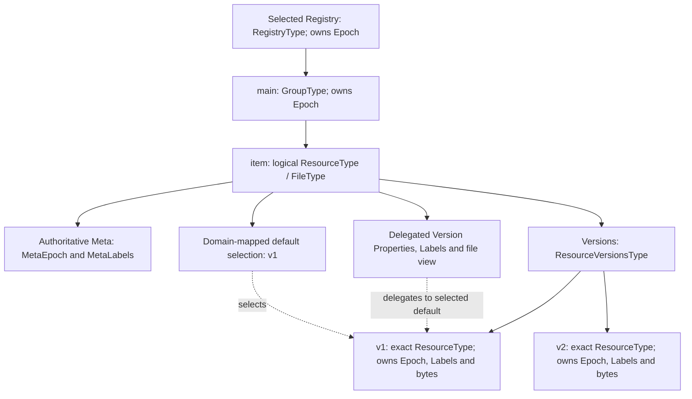

# xRegistry OPC UA API - Version 1.0-rc4

<!-- words: bytestrings compatibilityvalidated firstregistry formatvalidated identifiertype methodid modellingrules namespaces namespaceversion objectid qualifiedname readme referencetype reserializing standalone -->

<!-- words: xregistry addressspace browsename browsenames browsepath -->
<!-- words: browsepaths nodeid nodeids nodeclass typedefinition opc ua -->
<!-- words: filetransfer versionid versionids groupid resourceid registryid -->
<!-- words: xid xids epoch labels createdat modifiedat defaultversionid -->
<!-- words: specversion capabilitiesinfo contenttype mimetype resourceurl -->
<!-- words: hasdocument modelsource capabilitiesoffered statuscode -->
<!-- words: statuscodes attributestype propertytype foldertype filetype -->
<!-- words: registrytype grouptype resourcetype expandednodeid namespaceuri -->
<!-- words: accesslevel addattribute breaklock browsenameduplicated -->
<!-- words: browsenameinvalid browsenext bytestring communicationerror -->
<!-- words: continuationpointinvalid creategroup createresource -->
<!-- words: diagnosticinfo displayname encodinglimitsexceeded -->
<!-- words: enforcecompatibility exitlock expectedepoch externalreference -->
<!-- words: filehandle filternotallowed getorcreategroup getorcreateresource -->
<!-- words: getposition groupnodeid identitychangenotsupported indexrange -->
<!-- words: initlock invalidargument invalidstate lastmodifiedtime -->
<!-- words: lockingservicestype marcschier methodinvalid namespace -->
<!-- words: nodeidexists nodeidunknown nodeset notfound notreadable -->
<!-- words: notsupported notwritable opcfoundation opcua outofmemory -->
<!-- words: outofrange registrycapabilitiesdatatype removeattribute -->
<!-- words: renewlock requestfileopen resourcenodeid resourceunavailable -->
<!-- words: securitychecksfailed serveruri serveruriinvalid setposition -->
<!-- words: stickyversions toomanyoperations translatebrowsepathstonodeids -->
<!-- words: typedefinitions typemismatch useraccessdenied useraccesslevel -->
<!-- words: userwritable eventsourceurl correlationid metaepoch -->
<!-- words: eventnotifier eventtype eventtypes generatesEvent republish -->
<!-- words: monitoreditems modelsource undeprecated reconciliation -->
<!-- words: baseeventtype capabilitiesupdatedeventtype contentfilter -->
<!-- words: createmonitoreditems createsubscription deletemonitoreditems -->
<!-- words: deletesubscriptions eventfilter eventid greaterthan hasnotifier -->
<!-- words: groupcreatedeventtype groupdeletedeventtype -->
<!-- words: groupdeprecatedeventtype groupundeprecatedeventtype -->
<!-- words: groupupdatedeventtype modelsourceupdatedeventtype -->
<!-- words: modelupdatedeventtype monitoreditem oftype -->
<!-- words: registrycreatedeventtype registrydeletedeventtype -->
<!-- words: registryupdatedeventtype resourcecreatedeventtype -->
<!-- words: resourcedeletedeventtype resourcedeprecatedeventtype -->
<!-- words: resourceundeprecatedeventtype resourceupdatedeventtype -->
<!-- words: sourcename sourcenode sourceurl subscribetoevents -->
<!-- words: versioncreatedeventtype versiondeletedeventtype -->
<!-- words: versionupdatedeventtype resourceversionstype -->
<!-- words: assignedversionid incarnation -->
<!-- words: metalabels metacreatedat metamodifiedat -->
<!-- words: opcf eraseexisting monitoringmode -->
<!-- words: userwritable -->
<!-- words: applicationuri applicationuris serverindex serverarray -->
<!-- words: namespacearray namespaceindex namespaceuris registryroot -->
<!-- words: transportprofileuri federationprofiles uatcp uasc uabinary -->
<!-- words: addressspacefiletype namespacemetadatatype namespacefile -->
<!-- words: exportnamespace nsu svu svr remapping reindexed uint int nfc -->
<!-- words: maxbytestringlength sessionclosed sessionidinvalid timeout -->
<!-- words: href -->
<!-- words: powershell py pytest workingdrafts -->
<!-- words: datavalue endpointdescription federationerror methodids sdk selectedxid -->

## Abstract

This specification defines a native OPC Unified Architecture (OPC UA) binding
for the xRegistry document format and API [specification][xRegistry Core].
Clients use OPC UA operations to discover, read, create, update, delete,
export and federate Registries and their Groups, Resources, Versions,
documents and attributes. Servers report changes as native OPC UA Events.
The binding is a peer of the [HTTP binding][xRegistry HTTP]; it does not
tunnel HTTP or CloudEvents payloads over OPC UA.

**Status:** Unreleased working draft. The companion dependencies in
[§2](#2-normative-references) are unadopted drafts. They do not constitute
OPC Foundation standards or endorsements. This binding uses different
revisions for the structural/event model and the older public proposal.
Section 10 specifies the federation corrections and dependency gaps.
Companion claims about remote identity do not override xRegistry Core or
the OPC UA Parts.

## Table of Contents

- [Abstract](#abstract)
- [Table of Contents](#table-of-contents)
- [1. Scope](#1-scope)
  - [1.1. Motivation and Example](#11-motivation-and-example)
- [2. Normative references](#2-normative-references)
- [3. Terms and conventions](#3-terms-and-conventions)
- [4. The OPC UA API access model](#4-the-opc-ua-api-access-model)
  - [4.1. AddressSpace root and service model](#41-addressspace-root-and-service-model)
  - [4.2. Resolving xRegistry `xid`s to OPC UA nodes](#42-resolving-xregistry-xids-to-opc-ua-nodes)
  - [4.3. Entity processing rules](#43-entity-processing-rules)
  - [4.4. OPC UA-specific attribute processing](#44-opc-ua-specific-attribute-processing)
  - [4.5. Method signatures and argument mapping](#45-method-signatures-and-argument-mapping)
    - [4.5.1. Concurrency and locking](#451-concurrency-and-locking)
  - [4.6. Attribute mapping](#46-attribute-mapping)
  - [4.7. Supported operations discovery and pagination](#47-supported-operations-discovery-and-pagination)
- [5. Registry operations](#5-registry-operations)
  - [5.1. Reading the registry](#51-reading-the-registry)
  - [5.2. Creating and updating the registry](#52-creating-and-updating-the-registry)
  - [5.3. Exporting the registry](#53-exporting-the-registry)
  - [5.4. Reading capabilities and model documents](#54-reading-capabilities-and-model-documents)
  - [5.5. Updating capabilities and model-source information](#55-updating-capabilities-and-model-source-information)
  - [5.6. Listing group collections](#56-listing-group-collections)
  - [5.7. Creating and updating groups](#57-creating-and-updating-groups)
  - [5.8. Reading a group](#58-reading-a-group)
  - [5.9. Deleting groups](#59-deleting-groups)
  - [5.10. Resource metadata and resource documents](#510-resource-metadata-and-resource-documents)
  - [5.11. Listing resource collections](#511-listing-resource-collections)
  - [5.12. Creating and updating resources](#512-creating-and-updating-resources)
  - [5.13. Reading a resource document](#513-reading-a-resource-document)
    - [5.13.1. FileTransfer read lifecycle](#5131-filetransfer-read-lifecycle)
  - [5.14. Reading and updating resource metadata](#514-reading-and-updating-resource-metadata)
  - [5.15. Replacing a resource document](#515-replacing-a-resource-document)
  - [5.16. Deleting resources](#516-deleting-resources)
  - [5.17. Listing versions](#517-listing-versions)
  - [5.18. Creating and updating versions](#518-creating-and-updating-versions)
  - [5.19. Reading a version](#519-reading-a-version)
  - [5.20. Replacing a version document](#520-replacing-a-version-document)
  - [5.21. Deleting versions](#521-deleting-versions)
- [6. Request flags](#6-request-flags)
  - [6.1. Filtering](#61-filtering)
  - [6.2. Ignore processing](#62-ignore-processing)
  - [6.3. Inlining](#63-inlining)
  - [6.4. Sorting](#64-sorting)
  - [6.5. Document and metadata modes](#65-document-and-metadata-modes)
  - [6.6. Pagination and ranges](#66-pagination-and-ranges)
- [7. Value encoding](#7-value-encoding)
- [8. Serialization / export-import](#8-serialization--export-import)
    - [8.1. Native metadata and navigation](#81-native-metadata-and-navigation)
    - [8.2. Core document-view export](#82-core-document-view-export)
  - [9. Events](#9-events)
    - [9.1. Native event model and canonical types](#91-native-event-model-and-canonical-types)
    - [9.2. Event field mapping](#92-event-field-mapping)
    - [9.3. Event source URL](#93-event-source-url)
    - [9.4. Interaction and emission rules](#94-interaction-and-emission-rules)
    - [9.5. Event notification topology](#95-event-notification-topology)
    - [9.6. Subscription, discovery and filtering](#96-subscription-discovery-and-filtering)
    - [9.7. Delivery lifetime and replay](#97-delivery-lifetime-and-replay)
  - [10. Federation](#10-federation)
    - [10.1. Advertisement and Registry selection](#101-advertisement-and-registry-selection)
    - [10.2. Structured reference resolution](#102-structured-reference-resolution)
    - [10.3. Three distinct reference mechanisms](#103-three-distinct-reference-mechanisms)
    - [10.4. Trust and live consistency](#104-trust-and-live-consistency)
    - [10.5. Namespace export is separate](#105-namespace-export-is-separate)
    - [10.6. Pinned companion dependency gaps](#106-pinned-companion-dependency-gaps)
  - [11. Error handling](#11-error-handling)
    - [11.1. Federation resolver outcomes](#111-federation-resolver-outcomes)
  - [12. Conformance](#12-conformance)
    - [12.1. Offline Read and Reference Examples](#121-offline-read-and-reference-examples)
- [Annex A — Correspondence to the xRegistry HTTP binding (informative)](#annex-a--correspondence-to-the-xregistry-http-binding-informative)

## 1. Scope

The API maps the [xRegistry](https://github.com/xregistry/spec) Core model
to OPC UA Services, AddressSpace nodes and FileTransfer. It exposes
Registries, Groups, Resources, Versions, documents and attributes using
the Version 0.6.0 companion dependency identified in
[§2](#2-normative-references).

The information model distinguishes the following entities:

- A Registry is a `RegistryType` folder, a subtype of `FolderType`.
- A Group is a `GroupType` folder, also a subtype of `FolderType`.
- A logical Resource and each of its exact Versions are distinct
  `ResourceType` files, a subtype of `FileType`.
- A logical Resource owns a typed `ResourceVersionsType` component named
  `Versions`, which contains its exact Version Objects.

The hierarchy permanently distinguishes a logical Resource from an exact
Version, even when both use `ResourceType` or the same domain file subtype.
Document-bearing Resources expose their bytes through the file interface.
Metadata-only Resources expose metadata without a fabricated domain document.

Clients access these nodes through Browse, BrowseNext, Read, Write, Call,
TranslateBrowsePathsToNodeIds and the FileTransfer Methods inherited by
`ResourceType`. To delete an entity, a client calls the xRegistry
`Delete(ExpectedEpoch)` Method on that entity's `GroupType` or
`ResourceType` node. Section 10.6 identifies the pinned proposal's limitations.

> Annex A provides an informative correspondence with sibling protocol
> bindings. Section 10 defines federation, including references to Registries
> hosted behind other APIs.

This binding is independent of any domain registry. Domain companion
specifications define subtypes of `RegistryType`, `GroupType` and
`ResourceType` and constrain Group and Resource names. They MAY add domain
Properties or Methods. These specializations do not change the OPC UA API
patterns defined here.

### 1.1. Motivation and Example

A device or industrial service can expose metadata and files in its OPC UA
AddressSpace. An xRegistry consumer can use that interface through this
binding; the device does not need to host an HTTP facade.

For example, a catalog entry can advertise `opc.tcp://ua.example.com:4840`
and Registry root `nsu=urn:example:registry;s=FirstRegistry`.
The resolver selects that application and root, reads the model, and maps
`/documents/main/assets/item/versions/v1` to the corresponding Version node.
It reads metadata through Properties and document bytes through the
FileType Open/Read/Close lifecycle.

The resolver runs either in the consumer or in an API server exposing a
consumer-facing Registry. When the server performs resolution, its local
shadow Resource takes precedence over the UA source. The shared
[hosting models](../federation/spec.md#design-hosting-models) define these
responsibilities. Resolution keeps the endpoint, namespace index, Registry
root and XID distinct. The companion dependency and native mappings specified
below determine which operations an implementation can provide.

For native reads, start with
[addressing](#41-addressspace-root-and-service-model),
[model/capabilities](#54-reading-capabilities-and-model-documents),
[Resource ownership](#510-resource-metadata-and-resource-documents) and the
[file lifecycle](#5131-filetransfer-read-lifecycle).
[Federation](#10-federation) adds remote selection and trust.
[Mutation](#451-concurrency-and-locking) and [events](#9-events) are separate
capability paths.

## 2. Normative references

- [xRegistry Core specification](../../core/spec.md) — the registry, group, resource, version, document, attribute, request-flag, operation-processing and error model.
- [xRegistry Events specification](https://github.com/xregistry/spec/blob/66ee31e47fbadff6ab982ae1516f7d9065e46b64/core/events.md) — canonical xRegistry event types, fields and emission rules, interpreted with the binding corrections in §9.1.
- [xRegistry primer](../../core/primer.md) — the xRegistry concepts, representations, request-shaping concepts and federation model.
- <a href="https://github.com/OPCF-Members/spec-drafts/blob/d3399fca025025a73e5a6b599f850a81d985c060/source/core-specs/xregistry/spec.md" data-link-check="authenticated">OPC UA — xRegistry, structural/event source</a> and
  <a href="https://github.com/OPCF-Members/spec-drafts/blob/d3399fca025025a73e5a6b599f850a81d985c060/model/core-specs/xregistry/Opc.Ua.XRegistry.NodeSet2.xml" data-link-check="authenticated">NodeSet</a> — Version 0.6.0, published
  `2026-09-05T00:00:00Z`, at commit
  `d3399fca025025a73e5a6b599f850a81d985c060`. The xRegistry NodeSet SHA-256
  digest of the exact Git blob bytes (LF line endings) is
  `2521088d7980cf9f09615b47323ea56d9c6394f1c082bec6039bdecffd2c3686`.
  This companion information model defines the distinct Resource and Version
  Objects, `ResourceVersionsType`, Resource Meta and the EventTypes used by §9.
- [OPC 10000-3](https://reference.opcfoundation.org/specs/OPC-10000-3/) — Address Space Model, including NodeIds, References, TypeDefinitions and `ExpandedNodeId`.
- [OPC 10000-4](https://reference.opcfoundation.org/specs/OPC-10000-4/) — Services, including Browse, BrowseNext, Read, Write, Call, TranslateBrowsePathsToNodeIds and StatusCodes.
- [OPC 10000-5](https://reference.opcfoundation.org/specs/OPC-10000-5/) — Base Information Model, including `FolderType` and `PropertyType`.
- [OPC 10000-20](https://reference.opcfoundation.org/specs/OPC-10000-20/) — File Transfer, including `FileType` and its `Open` / `Read` / `Write` / `Close` Methods.
- [xRegistry Federation](../federation/spec.md) — common read resolution, advertisements, selectors, identity and resolver errors.
- [OPC UA — xRegistry, older public source][companion-public-source] and
  [NodeSet][companion-public-nodeset] — the public proposal reviewed for
  the federation corrections in §10.6, not the structural/event dependency.
- [OPC 10000-3, v1.05.06](https://reference.opcfoundation.org/specs/OPC-10000-3/v1.05.06/) — Address Space Model, including URI identities, NodeIds, References and TypeDefinitions.
- [OPC 10000-4, v1.05.07](https://reference.opcfoundation.org/specs/OPC-10000-4/v1.05.07/) — Services, including Browse, BrowseNext, Read, Write, Call, TranslateBrowsePathsToNodeIds, `ExpandedNodeId` and StatusCodes.
- [OPC 10000-5, v1.05.06](https://reference.opcfoundation.org/specs/OPC-10000-5/v1.05.06/) — Base Information Model, including namespace metadata and address-space files.
- [OPC 10000-6, v1.05.07](https://reference.opcfoundation.org/specs/OPC-10000-6/v1.05.07/5.1.12) — portable QualifiedName, NodeId and ExpandedNodeId string encodings.
- [OPC 10000-20, v1.05.06](https://reference.opcfoundation.org/specs/OPC-10000-20/v1.05.06/4.2) — File Transfer, including `FileType` and its `Open` / `Read` / `Write` / `Close` Methods.

The structural/event dependency is access-restricted. Its Version 0.6.0
source and NodeSet are in `OPCF-Members/spec-drafts`; the links do not let
readers without repository access inspect them. The public source at
`ff22f224400fc8be813bf0abcbfc3cde52bc7ed3` has NodeSet Version 0.3.0,
published `2026-07-31T00:00:00Z`, with SHA-256
`bbe31c40fa071a2137f7ca269606e3cc4665b90baf2d7a2fcefc6d451a7a1d31`.
That revision supplies neither the distinct `ResourceVersionsType` hierarchy
nor the event model specified here. It cannot substitute for Version 0.6.0.

A CRLF checkout of the Version 0.6.0 NodeSet has SHA-256
`369f5f3f1814b333e4eeb52bfb4b6a730cdff372505a5f91a54c94f0016ac4cf`
because its serialization differs from the exact Git blob bytes. This
citation correction changes neither the dependency revision nor the model
version or behavior. Publication remains limited by the structural/event
dependency's restricted availability. This document asserts no public mirror.

## 3. Terms and conventions

The key words "MUST", "MUST NOT", "REQUIRED", "SHALL", "SHALL NOT", "SHOULD",
"SHOULD NOT", "RECOMMENDED", "MAY", and "OPTIONAL" in this document are to be
interpreted as described in [RFC 2119](https://tools.ietf.org/html/rfc2119).

The xRegistry Core specification and Primer define Registry, Group,
Resource, Version, document, attributes, collection, `xid`, `self`, `epoch`,
`labels`, model, capabilities, request flags, representation and federation.
An `xid` identifies an entity relative to its Registry, for example
`/schemagroups/g1/schemas/s1`. It is not a protocol URL. Clients resolve it
against the selected `RegistryType` root.

OPC UA type and member names follow the OPC UA naming conventions. This
document uses the names defined by Annex A of *OPC UA — xRegistry* and its
NodeSet: `RegistryType`, `GroupType`,
`ResourceType`, `ResourceVersionsType`, `AttributesType`,
`RegistryCapabilitiesDataType`,
`RegistryId`, `SpecVersion`, `Capabilities`, `CapabilitiesInfo`, `Model`,
`GroupId`, `ResourceId`, `VersionId`, `Format`, `ContentType`,
`ExternalReference`, `ResourceUrl`, `Xid`, `Epoch`, `Name`, `Description`,
`Documentation`, `Labels`, `<Attribute>`, `CreatedAt`, `ModifiedAt`,
`MetaEpoch`, `MetaLabels`, `MetaCreatedAt`, `MetaModifiedAt`, `Versions`,
`AssignedVersionId`,
`CreateGroup`, `GetOrCreateGroup`, `CreateResource`, `GetOrCreateResource`,
`AddAttribute`, `RemoveAttribute`, `Delete` and `ExpectedEpoch`.
The event model additionally defines `EventSourceUrl`, `SourceUrl`, `Subject`,
`Changed` and `CorrelationId`, and the concrete EventTypes listed in §9.1.

This API uses the following OPC UA Services:

- Browse, for collection enumeration.
- BrowseNext, for continuation points.
- Read, for Properties and node metadata.
- Write, for writable Properties.
- Call, for FileTransfer and xRegistry Methods including `Delete`.
- TranslateBrowsePathsToNodeIds, for path resolution.
- The FileTransfer Methods inherited from `FileType` by `ResourceType`.

Pseudo-signatures identify FileTransfer Methods by BrowseName, not numeric
NodeId. A server can expose those Methods on domain subtypes of `ResourceType`.

## 4. The OPC UA API access model

### 4.1. AddressSpace root and service model

The API operates on an AddressSpace subtree rooted at a selected
`RegistryType` domain subtype instance. That root represents one xRegistry
Registry. Its `GroupType` children represent Groups; each `ResourceType`
child of a Group represents a logical Resource. The Resource's
`ResourceVersionsType` component named `Versions` contains separate
`ResourceType` children for its exact Versions. A logical Resource and its
Versions use the same domain resource file subtype. Their hierarchy,
BrowseName and `Xid` permanently distinguish their roles.

Property Variables under `Labels` represent labels and extension attributes
for Registries, Groups and exact Versions. Resource Meta uses `MetaLabels`
on the logical Resource.

The logical Resource provides two views with different owners. Its
`FileType` interface, normal Version Properties and `Labels` delegate to the
selected default Version. Its Resource Meta Properties and `MetaLabels`
are authoritative on the logical Resource itself. A default-Version change
therefore changes the delegated values and the target of future file opens,
but no NodeId, `Xid` or deletion role changes.



Figure 1 (informative) shows ownership and delegation for `item`. The Meta
and selection boxes are state on the logical Resource, not additional
Objects or mandatory base Properties. The model defines no separate `Meta`
Object or base `DefaultVersionId` Property. Collection names come from the
model rather than mandatory UA folders. Changing the default affects future
logical opens; already-open handles remain pinned to their exact Version.

This separates Core's [Meta entity](../../core/spec.md#meta-entity) and
[default Version](../../core/spec.md#default-version-of-a-resource) from
the UA file view. [§5.14](#514-reading-and-updating-resource-metadata)
describes updates to each owner. [§10.6](#106-pinned-companion-dependency-gaps)
identifies the domain mappings needed for these reads.

Core [document-view export](../../core/spec.md#doc-flag) serializes this
state without the Resource's delegated Version projection.

A server MAY expose multiple Registries. Before applying this API, a client
selects a Registry root by NodeId, BrowsePath, discovery metadata or domain
convention. A federation advertisement supplies the portable `registryroot`
NodeId specified in §10.1. Selecting an endpoint alone does not select a
Registry.

The selected root is the API authority for the operation sequence; native
OPC UA access does not use a URL authority. The xRegistry identifier
Properties and `Xid` carry entity identity. The OPC UA Session, endpoint
and NodeIds identify where the entities are currently served.

The baseline operation model is:

- Browse a folder to enumerate a collection.
- Select entities from the Browse result by BrowseName, NodeClass,
  TypeDefinition and target NodeId.
- Read Properties and the applicable `Labels` or `MetaLabels` container's
  `<Attribute>` Property Variables to obtain attributes that are not already
  in the Browse result.
- Write writable Properties to change fixed mutable attributes.
- Call `Open` /`Read`/`Write`/`Close` to read or replace document bytes.
- Call `CreateGroup`, `GetOrCreateGroup`, `CreateResource` or
  `GetOrCreateResource` to create entities.
- Call the entity's `Delete(ExpectedEpoch)` Method to delete it and everything
  it contains.
- Call `AddAttribute` or `RemoveAttribute` on `Labels` or `MetaLabels` for
  supported labels and extension attributes.

If an xRegistry function is not supported for an otherwise supported
node, the server MUST return `Bad_NotSupported`, `Bad_UserAccessDenied`,
`Bad_NotWritable`, `Bad_MethodInvalid` or `Bad_InvalidArgument` as appropriate.
If the requested node or Property cannot be resolved, the server MUST return an
appropriate StatusCode such as `Bad_NodeIdUnknown`, `Bad_BrowseNameInvalid` or
`Bad_NotFound` where available.

### 4.2. Resolving xRegistry `xid`s to OPC UA nodes

Clients resolve an entity `xid` from the selected `RegistryType` root using
Browse, TranslateBrowsePathsToNodeIds, identifier-Property matching and model
metadata. The table maps those identifiers and operation concepts to native
OPC UA targets.

In the table, `capabilities`, `model` and export name operations, not entity
XIDs. Common federation `model` and `capabilities` requests target `/`.
Metadata mode selects an operation rather than another identity. The HTTP
`$details` suffix is not part of an OPC UA NodeId, BrowseName or XID.

| xRegistry target or operation | OPC UA target | Primary OPC UA operation |
|---|---|---|
| `/` | selected `RegistryType` root node | Read registry Properties and Browse group children |
| Capabilities | `RegistryType.CapabilitiesInfo` Variable or `RegistryType.Capabilities` `FileType` component Object | Read supported fixed fields from `CapabilitiesInfo`. Use `Open`/`Read`/`Close` on `Capabilities` for raw JSON and fields not faithfully represented by the pinned DataType. When writable, `Open(write)`/`Write`/`Close` replaces the JSON document |
| Offered capabilities | offered-capabilities structure exposed by the server, if any | Read a domain Property or an offered section inside the `Capabilities` JSON document |
| Model | `RegistryType.Model` `FileType` component Object | `Open`/`Read`/`Close` the JSON bytes. When writable as model source, `Open(write)`/`Write`/`Close` replaces the document |
| Model source | server-specific model-source Property or operation, if exposed | Read or Write the domain-defined model-source target, or reject as unsupported |
| Export | selected `RegistryType` subtree serialized as an xRegistry document | Browse and Read the subtree, or use a domain export Method or Property if advertised |
| `/<GROUPS>` | collection of `GroupType` children under the registry whose collection name is `<GROUPS>` | Browse and optionally `CreateGroup` or `GetOrCreateGroup` on the registry |
| `/<GROUPS>/<GID>` | `GroupType` child whose `GroupId` is `<GID>` | Read/Write Properties, Browse resources, or Call `Delete(ExpectedEpoch)` on the group |
| `/<GROUPS>/<GID>/<RESOURCES>` | collection of logical `ResourceType` children under the group whose collection name is `<RESOURCES>` | Browse and optionally `CreateResource` or `GetOrCreateResource` on the group |
| `/<GROUPS>/<GID>/<RESOURCES>/<RID>` | logical `ResourceType` whose BrowseName and `ResourceId` are `<RID>` | Read Resource Meta. Use delegated Version Properties or FileTransfer Methods for the selected default Version. Call Resource `Delete` |
| `/<GROUPS>/<GID>/<RESOURCES>/<RID>$details` | flattened Resource view on the logical `ResourceType` | Read/Write delegated default-Version Properties/`Labels` and authoritative Resource Meta Properties/`MetaLabels` |
| `/<GROUPS>/<GID>/<RESOURCES>/<RID>/meta` | Resource Meta and default-version selection state on the logical `ResourceType` | Read/Write `MetaEpoch`, `MetaCreatedAt`, `MetaModifiedAt`, `MetaLabels` and domain meta Properties |
| `/<GROUPS>/<GID>/<RESOURCES>/<RID>/versions` | logical Resource's `ResourceVersionsType` component named `Versions` | Browse exact Version children |
| `/<GROUPS>/<GID>/<RESOURCES>/<RID>/versions/<VID>` | exact Version `ResourceType` under `Versions`, whose BrowseName and `VersionId` are `<VID>` | `Open`/`Read` document bytes, Read metadata Properties or Call Version `Delete` |
| `/<GROUPS>/<GID>/<RESOURCES>/<RID>/versions/<VID>$details` | exact Version metadata view | Read/Write Properties and optionally `Labels.AddAttribute`/`Labels.RemoveAttribute` |

The model declares the collection names `<GROUPS>` and `<RESOURCES>`; they
are not mandatory OPC UA base nodes. A domain registry MAY represent them
through subtype BrowseNames, domain Properties, folders or model metadata.
Regardless of that representation:

- Each concrete Group instance MUST be a `GroupType` or subtype.
- Each logical Resource and exact Version MUST be a `ResourceType` or the
  same domain subtype.
- The logical Resource MUST own a `ResourceVersionsType` component with
  BrowseName `Versions`.

A server MUST set each group's, logical Resource's and exact Version's
BrowseName to its identifier: `groupid`, `resourceid` or `versionid`,
respectively. A server MUST set each group's and logical Resource's DisplayName
to its `Name`.

A `groupid` or `resourceid` is a symbolic identifier constructed from the
entity's domain source identity, never from a document. The companion's
entity-identifier construction (older
[public source][companion-public-source] §6.9) makes these identifiers readable
and safe in a URL, on a command line and as a file name.

A Browse result includes BrowseName, DisplayName, NodeClass, TypeDefinition
and the target NodeId. A client can select and filter entities by identity
and collection and render a readable list directly from those results,
without a Read for each candidate. Filters on a dynamic label value or
another attribute absent from the result require reads of the applicable
`Labels` or `MetaLabels` container or Properties.

The base model does not require an OPC UA Property for xRegistry `self`.
This API derives it from the selected Registry root and the entity's `Xid`.
A client can reconstruct a canonical self reference from the root NodeId
and relative `Xid`, or use an implementation-defined URL or URN for display.

`Xid` MUST always be the structural relative xRegistry path of the registry,
group, Resource or Version. The logical Resource `Xid` is its resource path.
Each exact Version `Xid` is that Resource `Xid` followed by
`/versions/<VID>`. An `Xid` MUST NOT be a content fingerprint, digest or other
document-derived identifier. A server MAY use content identity as an internal
lookup, cache or deduplication fast path, but that optimization MUST NOT change
`Xid`, `Subject`, `ResourceId`, `VersionId` or AddressSpace placement.

Resource denotes the generic xRegistry entity kind. Each domain model
declares its own `<RESOURCES>` collection and `<RESOURCE>` singular names.
This binding does not require a literal `resources` path segment.

Servers implementing Version 0.6.0 of the companion model MUST expose only
the distinct hierarchy defined here. They MUST NOT expose group-level
legacy aliases for exact Versions. If the advertised companion model lacks
a `Versions` component, updated clients MAY fall back to the prior
Version 0.5 layout. That fallback resolves group-level `ResourceType`
Objects by `ResourceId` and `VersionId` under the Version 0.5 rules.
A client MUST NOT combine flat and distinct discovery within one Registry.

### 4.3. Entity processing rules

The read operation depends on the selected view:

- For a collection, Browse its folder.
- For entity metadata, Read the entity Properties. If labels are needed,
  Browse/Read its `Labels` `AttributesType` container. Resource Meta instead
  uses `MetaLabels` on the logical Resource.
- For a Resource document, use `Open` /`Read`/`Close` on the delegated
  default-Version view.
- For an exact Version document, use the exact Version `ResourceType`.

Core's [Resource processing](../../core/spec.md#resource-processing-algorithm)
governs full replacement and partial updates. A full replacement targets the
entity node or its creation parent. The server updates an existing entity.
For an absent entity, it creates a `GroupType` folder or atomically creates
a logical Resource and its first exact Version.

For omitted mutable Properties, `Labels` entries and Resource Meta
`MetaLabels` entries, the server MUST delete, reset to default or leave
unchanged only as Core or server-managed semantics specify.

Partial updates change only explicitly named mutable attributes. An
explicitly null attribute is removed where removal is supported. Clients
Write writable Properties and mutate extension attributes or labels by
calling
`Labels.AddAttribute(Key: String, Value: String, ExpectedEpoch: UInt32)` or
`Labels.RemoveAttribute(Key: String, ExpectedEpoch: UInt32)` on the entity's
`Labels` `AttributesType` object. Resource Meta labels use the corresponding
Methods on `MetaLabels` with `ExpectedEpoch` matched against `MetaEpoch`.
Success/failure is conveyed by the Method Call StatusCode.

Partial update MUST
NOT patch arbitrary bytes inside a Resource document. Document changes
replace the complete byte stream.

Collection processing creates or updates child entities under the collection's
parent. The preferred client sequence is:

1. Create or resolve Groups with `GetOrCreateGroup` on `RegistryType`,
   and Resources or Versions with `GetOrCreateResource` on `GroupType`.
   Use `CreateGroup` and `CreateResource` for strict creation, when an
   existing entity is an error.
2. Retain the exact Version NodeId, `AssignedVersionId` and any requested
   handle returned by the Resource Methods. Discover the logical Resource
   separately under the Group.
3. Write mandatory and mutable Properties, update the applicable `Labels`
   or `MetaLabels` container, and write any supplied document bytes.

A server MUST apply the xRegistry atomicity rule. If one entity in a
collection operation cannot be processed, the server SHOULD reject the
whole operation without partial effects. If it cannot guarantee multi-node
atomicity, it MUST advertise that limitation in `Capabilities`.

[Nested collection processing](../../core/spec.md#updating-nested-registry-collections)
MUST process only the nested collection entries. It MUST NOT modify the
owning entity's Properties. For example, processing Resources under a
selected Group creates or updates `ResourceType` children without changing
that Group's Properties.

To [delete an entity](../../core/spec.md#deleting-entities), the client calls
`Delete(ExpectedEpoch: UInt32)` on its `GroupType` or `ResourceType` node:

- Group deletion checks `ExpectedEpoch` against `Epoch`.
- Logical Resource deletion checks against `MetaEpoch` and removes the
  Resource, its `Versions` container and all exact Versions.
- Exact Version deletion checks against that Version's `Epoch` and removes
  only that Version.

To delete a collection subset, the client uses a sequence or server-defined
batch of `Delete(ExpectedEpoch)` Calls on the selected children.

Unless otherwise stated, the server MUST ignore an update to a read-only
Property only when xRegistry defines that behavior for the attribute.
Otherwise it MUST reject the Write with `Bad_NotWritable` or
`Bad_UserAccessDenied`. If a supplied identifier Property
(`RegistryId`, `GroupId`, `ResourceId` or `VersionId`) conflicts
with the target entity, the request MUST fail with `Bad_InvalidArgument` or
`Bad_IdentityChangeNotSupported`.

On successful Registry, Group or Version creation or update, the server MUST
update the entity's `ModifiedAt` and increment its `Epoch`. A Resource Meta
update changes `MetaModifiedAt` and increments `MetaEpoch` instead. The
selected default Version's `Epoch` and `ModifiedAt` remain unchanged unless
Version attributes also change.

On creation, the server MUST initialize the applicable `CreatedAt`,
`ModifiedAt`, `Epoch`, `MetaCreatedAt`, `MetaModifiedAt`, `MetaEpoch`, `Xid`
and identifier Properties under Core and the companion's auto-bootstrap
rules (older [public source][companion-public-source] §6.5).

### 4.4. OPC UA-specific attribute processing

OPC UA represents fixed metadata as typed Property Values: strings use
`String`, timestamps use `DateTime`, `ExternalReference` uses
`ExpandedNodeId`, and `Epoch` and `MetaEpoch` use `UInt32`. Labels and
extension attributes are `String` Property Variables under `Labels`, or
under `MetaLabels` for Resource Meta.

For a Resource document read, clients obtain accompanying metadata from the
logical Resource's delegated Version Properties and authoritative Resource
Meta Properties. For an exact Version, they read that Version Object's
metadata. A server MAY combine these reads in a domain Method. The
interoperable baseline uses separate `Open` /`Read`/`Close` operations and
Browse/Read for metadata.

To select a Resource or Version metadata view, a client Reads or Writes
Properties instead of file content. This choice does not merge the distinct
Resource and Version NodeIds.

The xRegistry `contenttype` attribute maps to `ContentType`, not `MimeType`.
The inherited `FileType` Property `MimeType` MAY mirror `ContentType` for
generic FileTransfer clients. If both are present, `ContentType` represents
the xRegistry attribute; `MimeType` is the FileTransfer media hint.

### 4.5. Method signatures and argument mapping

The creation and mutation Method signatures used by this API are:

- The domain-named `CreateGroup`, `GetOrCreateGroup`, `CreateResource` and
  `GetOrCreateResource` Methods defined by the xRegistry base model.
- The `Delete` Method on `GroupType` and `ResourceType`.
- The `AddAttribute` and `RemoveAttribute` Methods on `AttributesType`.
- The inherited `Open` / `Read` / `Write` / `Close` Methods of `ResourceType`,
  whose exact argument definitions are normative in OPC 10000-20.

| xRegistry action | OPC UA Method or Service | Argument mapping |
|---|---|---|
| Create group | `RegistryType.CreateGroup(GroupId) -> (GroupNodeId)` | `GroupId` is the groupid of the `GroupType` (or subtype) to create. The server creates the group folder and bootstraps its xRegistry attributes. The call fails if the group already exists. |
| Get or create group | `RegistryType.GetOrCreateGroup(GroupId) -> (GroupNodeId, Created)` | `GroupId` is the groupid to resolve. The server returns the existing group with `Created = false` or creates, bootstraps and returns a new group with `Created = true`. |
| Create Resource or Version | `GroupType.CreateResource(ResourceId, VersionId, RequestFileOpen) -> (ResourceNodeId, AssignedVersionId, FileHandle)` | A Version is identified by `(ResourceId, VersionId)`. A new `ResourceId` atomically creates the logical Resource, `Versions` container and first exact Version, while an existing `ResourceId` with a new `VersionId` creates only an exact Version under `Versions`. An empty input `VersionId` lets the server assign `AssignedVersionId`. Despite its retained output name, `ResourceNodeId` is the exact Version NodeId. Setting `RequestFileOpen = true` returns a write handle for that Version. The call fails with `Bad_NodeIdExists` if that exact pair already exists. |
| Get or create Resource or Version | `GroupType.GetOrCreateResource(ResourceId, VersionId, RequestFileOpen) -> (ResourceNodeId, AssignedVersionId, FileHandle, Created)` | Resolves the exact `(ResourceId, VersionId)` Version. An empty input `VersionId` selects the existing default Version or creates the first Version for a new Resource. The retained `ResourceNodeId` output is the exact Version NodeId, `AssignedVersionId` is the assigned Version identifier, and `RequestFileOpen = true` returns a write handle for that Version. |
| Delete group, Resource or Version | `Delete(ExpectedEpoch: UInt32)` on the selected `GroupType` or `ResourceType` | An `ExpectedEpoch` of `0` or an omitted value disables the check. A group or exact Version matches against `Epoch`, while a logical Resource matches against `MetaEpoch`. A mismatch fails with `Bad_InvalidState` and deletes nothing. The Method has no output arguments. |
| Read document | `ResourceType.Open(mode)` -> `Read(fileHandle, length)` -> `Close(fileHandle)` | The `mode` is read-only. `Size` bounds `length` and repeated Reads. |
| Replace document | `ResourceType.Open(mode)` -> `SetPosition(fileHandle, 0)` -> `Write(fileHandle, data)` -> `Close(fileHandle)` | The `mode` allows write and stages the complete replacement byte stream. Only a successful dirty `Close` updates Version `ModifiedAt` and `Epoch`. |
| Read metadata | Read Service on Properties | Property BrowseNames map to xRegistry attribute names by the tables in this document and the domain model |
| Replace scalar metadata | Write Service on Properties | Value DataTypes are those in Annex A of the base model |
| Add/update registry, group or version extension attribute or label | `Labels.AddAttribute(Key: String, Value: String, ExpectedEpoch: UInt32)` | `Labels` is the entity or version's `AttributesType` object. `ExpectedEpoch` is matched against its `Epoch`. Success increments `Epoch` and updates `ModifiedAt`. |
| Remove registry, group or version extension attribute or label | `Labels.RemoveAttribute(Key: String, ExpectedEpoch: UInt32)` | `Labels` is the entity or version's `AttributesType` object. `ExpectedEpoch` is matched against its `Epoch`. Success increments `Epoch` and updates `ModifiedAt`. |
| Add/update Resource Meta extension attribute or label | `MetaLabels.AddAttribute(Key: String, Value: String, ExpectedEpoch: UInt32)` | `MetaLabels` is on the logical Resource. `ExpectedEpoch` is matched against `MetaEpoch`. Success increments `MetaEpoch` and updates `MetaModifiedAt`. |
| Remove Resource Meta extension attribute or label | `MetaLabels.RemoveAttribute(Key: String, ExpectedEpoch: UInt32)` | `MetaLabels` is on the logical Resource. `ExpectedEpoch` is matched against `MetaEpoch`. Success increments `MetaEpoch` and updates `MetaModifiedAt`. |

A new Resource and its first Version are created in the same xRegistry
operation, never independently. Before returning, `CreateResource` and
`GetOrCreateResource` with `Created = true` commit both structural
identities, the `Versions` container, their `Xid` values, initial epochs
and timestamps.

The returned NodeId identifies the exact Version, not the logical Resource.
The client discovers the logical Resource separately by its `ResourceId`
BrowseName under the domain resource collection. A writable `FileHandle`
does not defer this structural commit or merge it with a later file write.

The base model places `CreateGroup` and `GetOrCreateGroup` on `RegistryType`
and `CreateResource` and `GetOrCreateResource` on `GroupType`. These are the
base API's create operations. It defines `AddAttribute` / `RemoveAttribute`
on `AttributesType`.

Registries, Groups and exact Versions MAY expose `Labels`. Resource Meta
owns `MetaLabels`, which is authoritative on the logical Resource. Clients
call attribute Methods on the container that owns the attribute.

The base API does not define move or copy. Where permitted, an
implementation can model them by re-creating an entity and deleting the
original.

#### 4.5.1. Concurrency and locking

FileTransfer controls concurrent document access at the exact Version.
Opening an exact Version for write reserves that Version incarnation.
Opening a logical Resource for write selects its current default Version
and acquires the same reservation as an exact-node open. While that Version
is open for writing, a second write `Open` through either path returns
`Bad_NotWritable` and a read `Open` returns `Bad_NotReadable`. Optimistic
concurrency for content uses the exact Version's `Epoch`.

To mutate Registry, Group or Version labels through `Labels.AddAttribute`
and `Labels.RemoveAttribute`, the client supplies that entity's current
`Epoch` as `ExpectedEpoch`, under the
[Core epoch precondition](../../core/spec.md#epoch-flag).
If the supplied value is non-zero and unequal, the Method MUST fail with
`Bad_InvalidState` and make no change. On success, `Epoch` increments and
`ModifiedAt` is updated.

To mutate Resource Meta labels through `MetaLabels.AddAttribute` and
`MetaLabels.RemoveAttribute`, the client supplies the current `MetaEpoch`
as `ExpectedEpoch`. If the supplied value is non-zero and unequal, the
Method MUST fail with
`Bad_InvalidState` and make no change. On success, `MetaEpoch` increments and
`MetaModifiedAt` is updated. For either container, `ExpectedEpoch = 0` or an
omitted argument disables the check.

For document replacement, exclusive `Open(write)` serializes writers. An
epoch-matched replacement sequence is:

1. Read the exact Version `Epoch`.
2. Call `Open(write)` on the exact Version or logical Resource.
3. Verify that the handle pins the intended Version.
4. Re-Read that Version's `Epoch`.
5. Abort the staged replacement if the value changed, otherwise `Write` the
   complete replacement document and `Close`.

`Write` and `EraseExisting` stage bytes without committing them. A successful
`Close` commits once if the final staged bytes differ from the committed
bytes at `Open`. That commit increments the exact Version's `Epoch` and
updates `ModifiedAt`. A clean or rejected `Close`, an abandoned handle, or
a write-back-to-original sequence is silent.

Every logical Resource handle MUST remain pinned to the exact Version selected
at `Open`. A later default-Version switch affects only later opens. Logical and
exact opens MUST share the same exact-Version writer reservation and an
incarnation safeguard, so deletion and recreation of the same Version identity
cannot let a stale handle commit into the replacement Object.

For deletion, a client passes the current group or exact Version `Epoch`, or
the current logical Resource `MetaEpoch`, as `ExpectedEpoch`. If a non-zero
value does not equal the applicable value, the Method Call MUST fail with
`Bad_InvalidState`, delete nothing and produce no partial effects.
An `ExpectedEpoch` of `0` or an omitted value disables the check. Deletion
is therefore an atomic epoch-matched Method call rather than a
read-then-delete sequence.

A server MAY expose coarser-grained exclusive access through the standard
OPC UA locking mechanism, a `LockingServicesType` component
(`InitLock` / `RenewLock` / `ExitLock` / `BreakLock`, OPC 10000-5) on the
Registry root, a Group or a Resource. This lets a client hold an explicit
exclusive lock across a multi-step create/update sequence. This API does not
require locking. Without it, clients rely on FileTransfer `Open`
exclusivity and `Epoch` preconditions.

The [worked outcomes in §5.14](#514-reading-and-updating-resource-metadata)
distinguish Meta changes, byte commits and default switches.

### 4.6. Attribute mapping

The base model Properties map to xRegistry attributes as follows.

| xRegistry attribute | OPC UA Property or Object | Applies to |
|---|---|---|
| `registryid` | `RegistryId` | `RegistryType` |
| `specversion` | `SpecVersion` | `RegistryType` |
| `capabilities` | preferred: `CapabilitiesInfo` Variable (`RegistryCapabilitiesDataType`) for fixed fields. Alternative: `Capabilities` Object (`FileType`) whose content is the raw capabilities JSON | `RegistryType` |
| `model` | `Model` Object (`FileType`) whose content is the model JSON. No structured DataType is defined because the OPC UA AddressSpace type system is the structural equivalent | `RegistryType` |
| `<GROUP>id` | `GroupId` | `GroupType` |
| `<RESOURCE>id` | `ResourceId` | `ResourceType` |
| `versionid` | `VersionId` | `ResourceType` |
| `format` | `Format` | `ResourceType` |
| `contenttype` | `ContentType` | `ResourceType` |
| `<RESOURCE>url` | `ResourceUrl` | `ResourceType` |
| federation target | `ExternalReference` | `ResourceType` |
| `xid` | `Xid`. A Version uses the Resource `Xid` plus `/versions/<VID>`, and Resource Meta uses the Resource `Xid` plus `/meta` | `RegistryType`, `GroupType`, Resource, Version and Resource Meta entities |
| `epoch` | delegated `Epoch` for a Resource representation, exact `Epoch` for a Version and `MetaEpoch` for Resource Meta | `RegistryType`, `GroupType`, Resource, Version and Resource Meta entities |
| `name` | `Name` | all base entity types |
| `description` | `Description` | all base entity types |
| `documentation` | `Documentation` | all base entity types |
| `labels` | delegated `Labels` object (`AttributesType`) for a Resource representation, exact `Labels` for a Version and `MetaLabels` for Resource Meta | `RegistryType`, `GroupType`, Resource, Version and Resource Meta entities |
| `createdat` | delegated `CreatedAt` for a Resource representation, exact `CreatedAt` for a Version and `MetaCreatedAt` for Resource Meta | `RegistryType`, `GroupType`, Resource, Version and Resource Meta entities |
| `modifiedat` | delegated `ModifiedAt` for a Resource representation, exact `ModifiedAt` for a Version and `MetaModifiedAt` for Resource Meta | `RegistryType`, `GroupType`, Resource, Version and Resource Meta entities |
| event `source` URL | `EventSourceUrl` | `RegistryType`, REQUIRED only for event-capable server conformance (§9.3) |

Resource Meta is an xRegistry entity in its own right, not a Version
attribute or a nested implementation object. On the logical Resource, the
`Meta` prefix distinguishes its OPC UA BrowseNames from delegated Version
Properties. Dotted names such as `meta.epoch` apply only when xRegistry
represents Resource and Meta attributes in one document, or in an event
`Changed` path.

The xRegistry attributes `self`, collection `url` attributes, collection
`count` attributes, `metaurl`, `versionsurl`, `versionscount`,
`defaultversionurl`, `isdefault`, `ancestorid`, `<RESOURCE>` and
`<RESOURCE>base64` are serialization artifacts or domain/model attributes rather
than mandatory base Properties. A server MAY expose them as domain Properties,
but a client MUST only derive them when the selected mapping supplies the
necessary state. It MUST NOT infer ancestry or default selection from Browse
order. Serialized URLs and local pointers follow §8.

Registry, group and version labels and extension attributes are enumerated by
Browsing `Labels` and Reading each `<Attribute>` Property Variable. Resource
Meta labels and extension attributes are enumerated through `MetaLabels`.
Clients add, update or remove values by calling the applicable container's
`AddAttribute` or `RemoveAttribute` Method with the epoch described in §4.5.1.
Both containers are deleted with their owning entity.

### 4.7. Supported operations discovery and pagination

A client discovers supported operations from the target node and Registry
capabilities. It browses for Methods and checks their executable and
user-executable bits. It reads `Writable`, `UserWritable`, AccessLevel and
UserAccessLevel attributes of Variables and the typed `CapabilitiesInfo`
Variable or `Capabilities` `FileType` content.

A server MUST NOT require a side-effecting operation for discovery. If a
FileTransfer Method, `CreateGroup`, `GetOrCreateGroup`, `CreateResource`,
`GetOrCreateResource`, an applicable `Labels` or `MetaLabels` object, or its
`AddAttribute` /`RemoveAttribute` Method is absent, non-executable or rejected
with `Bad_UserAccessDenied`, the corresponding xRegistry write capability is
not available to that client.

Browse uses continuation points and `BrowseNext` to paginate large child
sets. To obtain a page of collection entries, a client calls Browse with a
requested maximum reference count, then `BrowseNext` until that page is
complete or no continuation point remains.

For file bytes, a client paginates through `Read(fileHandle, length)` and MAY
use `GetPosition` and `SetPosition` to implement random access. For labels, a
client browses `Labels` or `MetaLabels` and pages with normal Browse
continuation points where needed.

A federation selector needs every necessary Browse page, not just a
client-selected page. A client MUST call `BrowseNext` until no continuation
point remains before claiming no match or a unique match. On early
termination it MUST release outstanding continuation points when the Session
is usable. A failed or expired continuation point MUST NOT yield a complete
collection.

## 5. Registry operations

The following operations define successful native OPC UA interactions with
xRegistry entities. Section 11 defines their error mappings.

### 5.1. Reading the registry

A client reads the selected `RegistryType` root by:

- Reading its Properties.
- Reading the typed `CapabilitiesInfo` Variable when fixed capabilities are
  requested.
- Browsing its `Labels` object where labels are requested.
- Browsing its `Capabilities` and `Model` `FileType` component Objects when
  those JSON documents are requested.
- Browsing its group children.

The base Properties are `RegistryId`, `SpecVersion`, `CapabilitiesInfo`, `Xid`,
`Epoch`, `Name`, `Description`, `Documentation`, `CreatedAt` and
`ModifiedAt` where present. `Capabilities` and `Model` are `FileType`
component Objects, and `Labels` is an `AttributesType` Object.

To serialize the Registry, the client applies §8. Collection counts require
complete Browse results; document-local navigation needs no fabricated API
URL. The domain Group subtypes and `Model` JSON document determine which
xRegistry collection contains each browsed Group.

### 5.2. Creating and updating the registry

A full Registry replacement writes the complete set of replacement mutable
`RegistryType` Properties. Core rules determine which omitted mutable
attributes are removed or reset. The `Capabilities` and `Model` components
are `FileType` Objects. Their absence MUST NOT require a change. If present,
the server MUST write each as a complete replacement document through
`Open(write)` /`Write`/`Close`, unless it supports finer-grained updates.
When raw `Capabilities` JSON changes, the server MUST keep the fixed fields
it exposes through `CapabilitiesInfo` consistent with that JSON.

A partial Registry update writes only included Properties. Included label
and extension-attribute changes use `Labels.AddAttribute` or
`Labels.RemoveAttribute`. For a null attribute, the operation:

- Writes a server-defined null/default value if the DataType permits it.
- Calls `Labels.RemoveAttribute` for a dynamic label or extension attribute.
- Fails with `Bad_NotSupported` if the attribute is mandatory or cannot be
  removed.

The base `RegistryType` does not directly define `AddAttribute` or
`RemoveAttribute`. Clients call those Methods on the Registry's `Labels`
object of type `AttributesType`.

For nested Group collections in a Registry operation, each entry is resolved
by BrowseName. If absent, the server uses `GetOrCreateGroup(GroupId)` or
strict `CreateGroup(GroupId)` on the Registry root to create a `GroupType`
or domain subtype instance. It initializes `GroupId`, `Xid`, `Epoch`,
`CreatedAt` and `ModifiedAt`, then applies the supplied Group Properties and
nested Resource collections.

When the requested operation is explicitly limited to group collection
processing, registry-level attributes MUST be rejected with
`Bad_InvalidArgument`, corresponding to xRegistry `groups_only`.

### 5.3. Exporting the registry

Export serializes the selected `RegistryType` subtree into Core JSON
document view. The baseline algorithm browses the subtree, reads mapped
Properties and requested model/capabilities, and uses Open/Read/Close for
each included, document-bearing Version under §5.13.1. The exporter MUST NOT
read fabricated documents for metadata-only Resources or expand local
`xref` targets. Section 8 defines serialization and capture limitations.

A server MAY expose a domain Method or Property to optimize export. Its
output MUST have the same document shape as the baseline algorithm.
Implementations support import through normal create/update operations or
a domain-defined import Method.

### 5.4. Reading capabilities and model documents

A client reads Registry capabilities from either of two representations:

- The typed `RegistryType.CapabilitiesInfo` Variable returns a single
  `RegistryCapabilitiesDataType` Variant. For fixed fields, clients prefer
  `CapabilitiesInfo` because it needs no JSON parsing.
- The `RegistryType.Capabilities` `FileType` component Object supplies raw
  xRegistry capabilities JSON. The client calls `Open` for read, repeats
  `Read` until it has the complete JSON byte stream, then calls `Close`.
  This `Capabilities` `FileType` representation remains the source for
  vendor and extension keys absent from `RegistryCapabilitiesDataType`.

`RegistryCapabilitiesDataType` contains `Flags: String[]`, `Mutable: String[]`,
`Pagination: Boolean`, `ShortSelf: Boolean`, `SpecVersions: String[]`,
`StickyVersions: Boolean`, `EnforceCompatibility: Boolean`, `Apis: String[]`
and `Schemas: String[]`. These are the pinned proposal's fields; they do not
necessarily match Core 1.0-rc4 capabilities. For a field without a faithful
typed mapping, a resolver MUST read the authoritative raw `Capabilities`
JSON. It MUST NOT infer enabled capabilities from old field names. Every
FileType read in this section follows §5.13.1.

The [resolution-owner signal](../federation/spec.md#signaling-who-performs-resolution)
is an extension in enabled capabilities. A consumer reads it before
traversing the catalog. If `CapabilitiesInfo` cannot represent it, the
consumer reads raw `Capabilities` JSON or a documented equivalent mapping,
rather than discarding the field and treating it as absent.

A view declaring `federation.resolution: "producer"` supplies the combined
view. Consumers read it directly, without repeating catalog resolution or
using that catalog as fallback for a failed read. An absent signal defaults
to consumer resolution.

The base model defines no separate `CapabilitiesOffered` Property. A server
supporting mutable capabilities MUST expose offered-capabilities information
inside `Capabilities` JSON, in a domain subtype Property, or through domain
documentation referenced by `Model`. Without an exposed target, an
offered-capabilities read MUST fail with `Bad_NodeIdUnknown` or
`Bad_NotSupported`; it does not invent an unmapped base node.

A client reads the full xRegistry model definition through the
`RegistryType.Model` `FileType` component Object. It calls `Open` for read,
repeats `Read` until it has the complete JSON byte stream, then calls
`Close`. Before browsing entities, clients MAY use this definition to map
domain collection names to `GroupType` and `ResourceType` subtype
BrowseNames. `Model` uses FileType JSON only. It has no structured DataType
because the OPC UA AddressSpace type system provides the structural
equivalent.

The base model defines no distinct `ModelSource` Property. If a server
distinguishes the effective model from the client-provided source, it MUST
expose that source in a domain subtype Property or a documented shape inside
`Model` JSON. If a model-source target exists but its source has never been
set, the server MUST return an empty JSON object (`{}`) as its JSON content,
under xRegistry semantics.

### 5.5. Updating capabilities and model-source information

If `RegistryType.Capabilities` is writable for the current user, a client
updates that `FileType` component Object through
`Open(write)` /`Write`/`Close`. Full replacement writes the complete
capabilities JSON byte stream. Partial updates write only top-level
capabilities where the server supports patch-level semantics. Otherwise,
the client MUST use read-modify-write, and the server MAY reject partial
writes with `Bad_NotSupported`.

Unsupported capability changes MUST fail with `Bad_InvalidArgument` or
`Bad_NotSupported`, and no capability change MUST take effect before the
current Service operation completes.

Model-source updates need a domain-defined target or operation; the base API
defines no writable `ModelSource` node. A server accepting these updates
through its `RegistryType.Model` `FileType` component Object MUST document
that `Model` serves as model source. It MUST apply xRegistry full-replacement
rules through `Open(write)` /`Write`/`Close`. If it exposes only effective
`Model`, an attempt to write model source MUST fail with `Bad_NotWritable`
or `Bad_NotSupported`.

### 5.6. Listing group collections

To list a Group collection, a client browses the selected `RegistryType`
root for `GroupType` children belonging to that collection. Group
collections are unordered maps keyed by identifier. Browse returns children
in server-defined order; the client MUST NOT infer collection order from
Browse position.

The client filters results by NodeClass, TypeDefinition (`GroupType` or
subtype), collection metadata in `Model` JSON, domain subtype and BrowseName.
Each Group's BrowseName is its `groupid`, so it supplies the serialized
collection key without a `GroupId` read for every candidate.

### 5.7. Creating and updating groups

Groups are `GroupType` children of the Registry root. For each Group key,
the preferred one-shot operation is `GetOrCreateGroup(GroupId)` on
`RegistryType`. It returns an existing Group with `Created = false` or
creates one with `Created = true`. When an existing Group MUST cause
failure, the client uses strict `CreateGroup(GroupId)`.

The client then writes Group Properties and updates the Group's `Labels`
container. Partial updates write only named attributes. Full representations
reset or remove omitted mutable attributes under xRegistry rules.

The response representation is obtained by reading back only the groups
processed, not the entire group collection.

If a group does not exist and the operation permits creation, the server creates
it with `GetOrCreateGroup` or strict `CreateGroup` on the registry root. The
supplied group identifier MUST match `GroupId`. A mismatch fails with
`Bad_InvalidArgument`.

Nested Resource collection processing creates or updates collections under
the selected Group without changing that Group's Properties or `Labels`.
The request maps Resource collection names to Resource maps. For each entry,
the preferred client sequence is to call `GetOrCreateResource`, write any
supplied document, write exact Version Properties or `Labels`, and write
Resource Meta Properties or `MetaLabels` on the logical Resource, under the
nested operation semantics. Strict creation uses `CreateResource`.

If an operation attempts to update group-level attributes while it is explicitly
limited to nested resource collection processing, the server MUST reject it with
`Bad_InvalidArgument`, corresponding to xRegistry `resources_only`.

### 5.8. Reading a group

To read a Group, a client resolves the `GroupType` child whose BrowseName
matches the requested `groupid`. It reads the Group's Properties and browses
its Resource children as needed.

The standard base Properties are `GroupId`, `Xid`, `Epoch`, `Name`,
`Description`, `Documentation`, `CreatedAt` and `ModifiedAt`. `Labels` is an
`AttributesType` Object. Domain group subtypes MAY add mandatory
group-key Properties and extension metadata.

### 5.9. Deleting groups

To delete a Group, the client calls its `Delete(ExpectedEpoch: UInt32)`
Method. Omitting `ExpectedEpoch` or supplying `0` disables the check. The
Method deletes the Group and all its contents: logical Resources, their
`Versions` containers, exact Versions, `Labels` and `MetaLabels`. For a
collection subset, the client uses a sequence or server-defined batch of
`Delete(ExpectedEpoch)` Calls, one per selected Group child.

If an entity-specific `epoch` precondition is supplied for deletion, the client
MUST pass it as `ExpectedEpoch`. If `ExpectedEpoch` is non-zero and does not
equal the group's current `Epoch`, the Call MUST fail with `Bad_InvalidState`
and delete nothing. `ExpectedEpoch = 0` or omission disables the check.

### 5.10. Resource metadata and resource documents

Each Resource collection entry is a logical `ResourceType` with delegated
Version state and authoritative Resource Meta, as shown in the
[ownership diagram in §4.1](#41-addressspace-root-and-service-model).
Its normal Version Properties, `Labels` and inherited FileTransfer Methods
delegate to the selected default Version under `Versions`. Its `MetaEpoch`,
`MetaCreatedAt`, `MetaModifiedAt`, domain meta Properties and `MetaLabels`
belong to Resource Meta and do not delegate.

An exact Version is a separate `ResourceType` under `Versions`. A client
accesses its metadata through Read or Write on `ResourceId`,
`VersionId`, `Format`, `ContentType`, `ExternalReference`, `ResourceUrl`,
`Xid`, `Epoch`, `Name`, `Description`, `Documentation`, `CreatedAt`,
`ModifiedAt`, domain Version Properties and `Labels`. To access its document,
the client uses `Open`, `Read` and `Close`, optionally `GetPosition` and
`SetPosition`, and `Write` for document replacement.

On the logical Resource, these FileTransfer Methods select the current
default Version at `Open`. The handle stays pinned to that exact Version
until `Close`, even if the default changes.

If the Resource type's xRegistry model declares `hasdocument = false`,
document access MUST fail with `Bad_NotReadable`, `Bad_InvalidState` or
`Bad_NotSupported`. Metadata remains the normal entity representation. A
federation resolver reports `unsupported_operation` for that model-level
condition before attempting FileTransfer.

Inherited FileType members still follow their OPC UA ModellingRules, but
their presence does not establish that a domain document exists. A `Size`
value of zero alone MUST
NOT turn a metadata-only Resource into an empty document. This rule includes
the `categories` / `registries` catalog model.

When a Resource or Version is serialized as its domain-specific document, the
bytes returned by `Read(fileHandle, length)` are the exact document bytes. If
the document is empty, `Read` returns zero bytes at end-of-file.

Clients obtain Resource metadata by reading file Properties before or after
the document bytes, not through transport headers. Servers SHOULD keep
`ContentType` consistent with the inherited `MimeType` so generic
FileTransfer clients can identify the media type.

If an explicitly mapped `ResourceUrl` or draft `ExternalReference` supplies
the document, `Open` MAY fail with `Bad_NotReadable` or MAY return a local
cached representation, as advertised by the implementation. These mechanisms
remain distinct as specified in §10.3. A generic `Bad_NotReadable` without
such a declaration is not a redirect instruction.

### 5.11. Listing resource collections

To list a Resource collection, the client browses its `GroupType` folder for
logical `ResourceType` children in the requested domain collection. Exact
Version Objects are not Group children and MUST NOT appear in this Browse.
Resource collections are unordered maps keyed by identifier. Since Browse
returns children in server-defined order, a client MUST NOT infer collection
order from Browse position.

Each logical Resource BrowseName supplies its `ResourceId` as the serialized
collection key. The client derives `versionscount` by browsing the Resource's
`Versions` component, and `metaurl` and `versionsurl` from its `Xid`.

### 5.12. Creating and updating resources

The owning `GroupType` provides Resource creation and update. For each
Resource key, the preferred one-shot operation is
`GetOrCreateResource(ResourceId, VersionId, RequestFileOpen)` on `GroupType`.
It returns the exact Version NodeId and `AssignedVersionId`, with
`Created = false` for an existing Version or `Created = true` for a new one.
If `RequestFileOpen = true`, the returned write handle is pinned to that
exact Version and MAY be used immediately.

For a new Resource, the logical Resource, `Versions` component and first
Version commit atomically in one xRegistry operation. To create a Version
of an existing Resource, the client supplies its `ResourceId` and a new or
server-assigned `VersionId`. When an existing `(ResourceId, VersionId)` MUST
cause failure, the client uses strict
`CreateResource(ResourceId, VersionId, RequestFileOpen)`.

The retained `ResourceNodeId` output name denotes the exact Version NodeId. It
does not identify the logical Resource. `AssignedVersionId` is paired with that
NodeId and the requested `FileHandle`. A client discovers the logical Resource
separately by Browsing the domain resource collection for the child whose
BrowseName is `ResourceId`.

For default-Version metadata updates, the client MAY use the logical
Resource's delegated Properties and `Labels` or target the selected exact
Version directly. Both paths update the exact Version against its `Epoch`.
Resource Meta updates instead write Resource Meta Properties and call
`MetaLabels.AddAttribute` /`MetaLabels.RemoveAttribute` on the logical
Resource against `MetaEpoch`.

To create or replace a document, the client writes its complete byte stream
and sets `ContentType`, `Format`, `ResourceUrl` and `ExternalReference` on
the exact Version as applicable.

If the supplied `ResourceId` conflicts with the selected resource identifier,
the operation MUST fail with `Bad_InvalidArgument`. If supplied `VersionId`
creates a new version rather than replacing the default version, the operation
MUST follow §5.18.

### 5.13. Reading a resource document

To read a Resource's default document, the client resolves the logical
`ResourceType` for `ResourceId`, calls `Open` for read, repeats `Read`,
then calls `Close`. At `Open`, the server pins the handle to the current
default exact Version; a later default switch does not redirect it.

The client MAY reproduce Resource response metadata by reading the logical
Resource's delegated `Size`, `Writable`, `MimeType`, `LastModifiedTime`,
`ContentType`, `ResourceId`, `VersionId` and `Epoch`. It reads Resource Meta
from the logical Resource's `MetaEpoch`, `MetaLabels`, `MetaCreatedAt`,
`MetaModifiedAt` and domain meta Properties.

If `ResourceUrl` or `ExternalReference` identifies external content, the
server MAY serve cached bytes from the local file or redirect through
metadata. For the latter, it returns readable `ResourceUrl`
/`ExternalReference` and fails `Open` with a suitable StatusCode. The server
MUST document its choice in `Capabilities`.

#### 5.13.1. FileTransfer read lifecycle

The baseline read uses the [FileType Methods][ua-filetype] on the selected
file Object. A Method's ObjectId and MethodId MUST identify that Object and
its actual Method node. A BrowseName shown here is not a numeric MethodId.
This procedure also applies to `Model`, `Capabilities` and a namespace file.

1. Establish the selected file, Version and Session. Read available metadata
   needed by the operation, including `Size` and relevant change indicators.
   Check Service, per-node and per-Call StatusCodes. `Bad_NotSupported` on
   `Size` means unknown size, as Part 20 permits. It does not mean zero.
2. Call `Open(mode = 1)` for read only. The other mode bits remain clear.
   Retain a successful `fileHandle` only for this Object and Session.
3. Call `Read(fileHandle, length)` with a positive Int32 length bounded by
   server limits, including applicable `MaxByteStringLength`, and by the
   caller's byte budget. Concatenate returned ByteStrings without decoding
   or transforming domain content.
4. Continue after a short, nonempty Read. Part 20 permits fewer bytes than
   requested. An empty ByteString indicates end-of-file. A known, reliable
   `Size` can also establish the total, but a premature end or a size change
   MUST invalidate a complete-capture claim. Unknown size requires an
   end-of-file observation. A successful zero-byte file still has an
   Open/Read/Close lifecycle.
5. Call `Close(fileHandle)` when finished. After every successful Open, the
   client MUST attempt Close on success, error, cancellation or limit
   exhaustion while the Session is usable. A failed Open does not allocate
   a handle to close. Session loss invalidates the handle. Reconnecting
   requires a new Open, not reuse of that handle or file position.
6. Recheck available Version/default selection and change indicators when
   the operation claims a consistent capture. Changed observations produce
   `inconsistent_snapshot`. An unchanged epoch is not a Registry-wide
   transaction or immutable revision pin.

The client MUST NOT use a handle on another Object, in another Session or
after Close. It MUST retain the original read error if cleanup also fails
and report the cleanup failure as additional diagnostic information.
A client MUST NOT report unsuccessful cleanup as an entirely successful
sequence.
A range read via `SetPosition` is not a complete export unless every needed
byte has been accounted for. [§11](#11-error-handling) maps StatusCodes and
[§11.1](#111-federation-resolver-outcomes) maps resolver outcomes without
treating a denied, locked or interrupted file as an absent or empty document.

The checked `default-v1-short-chunks` fixture requests 64 bytes per Read:

| Successful step | Observation |
| --- | --- |
| `Open(mode=1)` | Allocates a handle for the selected `v1`. |
| First `Read`, then second `Read` | Returns 8 bytes, then 9 bytes. Neither short chunk is EOF. |
| Third `Read`, then `Close` | Returns an empty ByteString marking EOF. Close releases the handle. |

The resulting 17-byte document is complete in that transcript. On a Read
failure, the cleanup rule still attempts Close while the Session is usable.
The [actual result and transcript notation](#121-offline-read-and-reference-examples)
retain the distinction between matching observations and an immutable pin.

### 5.14. Reading and updating resource metadata

The logical Resource supplies both parts of a Resource representation.
Delegated normal Properties and `Labels` supply Version attributes.
Authoritative `MetaEpoch`, `MetaCreatedAt`, `MetaModifiedAt`, `MetaLabels`
and domain meta Properties supply Resource Meta. Neither requires file bytes.

To update default-Version attributes, the client writes Version Properties
and calls `Labels.AddAttribute` or `Labels.RemoveAttribute` against the
Version's `Epoch`. To update Resource Meta attributes, it writes meta
Properties and calls the corresponding Method on `MetaLabels` against
`MetaEpoch`. A Resource Meta label change MUST increment `MetaEpoch` and
update `MetaModifiedAt`. It MUST NOT change Version `Epoch` or `ModifiedAt`
unless the interaction also changes Version attributes.

Updating an existing Version's Properties, `Labels` or document bytes does not
update Resource Meta. Resource Meta changes only when its own attributes change,
when a Version is added or removed, or when default-Version state changes.

The meta view serializes authoritative Properties on the logical Resource,
not a separate `Meta` Object. The base model uses `MetaEpoch`,
`MetaCreatedAt`, `MetaModifiedAt` and `MetaLabels` to distinguish Resource
Meta from delegated Version `Epoch`, `CreatedAt`, `ModifiedAt` and `Labels`.

Base Properties such as `Epoch`, `CreatedAt`, `ModifiedAt`, `MetaEpoch`,
`MetaCreatedAt` and `MetaModifiedAt` are normally server-managed and MUST NOT be
directly writable unless the server explicitly allows administrative writes.

To change the default Version, the client uses the domain Property or Method
mapped to the xRegistry `defaultversionid` meta attribute. A successful
change MUST increment `MetaEpoch` and update `MetaModifiedAt`. It changes
the delegated normal Properties and the target of future logical Resource
opens. The change MUST NOT alter the logical Resource NodeId or `Xid`, any
exact Version NodeId or `Xid`, or any node's deletion role.

Deleting the meta view is not supported. The server MUST reject attempts to
delete the meta view with `Bad_NotSupported` or `Bad_InvalidArgument`.
Individual mutable meta attributes, including entries in `MetaLabels`, MAY be
reset through update processing if the domain model supports them.

The following informative outcomes apply the ownership rules above and the
[event rules in §9.4](#94-interaction-and-emission-rules). Event outcomes
apply only to event-capable implementations.

| Interaction | Committed result |
| --- | --- |
| Changed `MetaLabels.AddAttribute` with matching `MetaEpoch` | `MetaEpoch` increases. Exact Version `Epoch` is unchanged. The Resource updated event carries both final epochs. |
| The same call with a stale nonzero expected epoch | Fails with `Bad_InvalidState`, with no state change or event. |
| Open, write different bytes, write the original bytes back, Close | Final bytes equal the bytes at Open. Close produces no epoch increment or event. |
| Dirty Close on the currently selected default Version | Exact Version `Epoch` increases once. The applicable Version and Resource updated events occur, with no repeated created events. Resource `MetaEpoch` is unchanged unless Meta also changes. |
| Switch the default from existing `v1` to existing `v2` | `MetaEpoch` increases. Delegated values and future opens use `v2`. Exact Version epochs, node identities and already-open handle targets do not change. |

### 5.15. Replacing a resource document

Resource document replacement creates the Resource if needed, then replaces
the selected default Version's complete document. For an absent logical
Resource, the client preferably calls `GetOrCreateResource` on the parent
Group, or `CreateResource` when existing Resources MUST cause failure.
It then opens the logical Resource or returned exact Version for writing,
sets position to zero where needed, writes the complete new byte stream
and closes the handle. It writes or validates exact Version metadata
Properties.

Partial patching of document bytes is not defined. A client that wants to change
document content MUST provide a complete replacement document.

The FileTransfer `Write` Calls and `EraseExisting` open mode only stage the
replacement. The logical handle pins the default Version selected at `Open` and
uses that exact Version's writer reservation and incarnation safeguard.

A successful `Close` commits once only when the final staged bytes differ from
the committed bytes at `Open`. It then increments that Version's `Epoch` and
updates its `ModifiedAt`. A clean or rejected `Close`, an abandoned handle, or
a write-back-to-original sequence is silent.

### 5.16. Deleting resources

To delete a Resource, the client calls its
`Delete(ExpectedEpoch: UInt32)` Method. Omitting `ExpectedEpoch` or supplying
`0` disables the check. A non-zero `ExpectedEpoch` MUST equal the logical
Resource's current `MetaEpoch`, not its delegated Version `Epoch`.

The Method deletes the Resource and all its contents, including exact
Versions and owned `Labels` and `MetaLabels`, depending on the server's
Version representation and xRegistry model configuration. A Resource
collection subset uses a sequence or server-defined batch of
`Delete(ExpectedEpoch)` Calls, one per selected `ResourceType` or
Resource-Version set.

Each `Delete(ExpectedEpoch)` Call targets one selected logical Resource.
A server MUST NOT retain any exact Version from a deleted Resource as a
detached or group-level alias.

### 5.17. Listing versions

To list Versions, the client resolves the logical Resource's
`ResourceVersionsType` component named `Versions` and browses its exact
`ResourceType` children. Version collections are unordered maps keyed by
`VersionId`; each exact Version's BrowseName is its `VersionId` and supplies
the serialized key. Browse order is server-defined. Version order comes from
attributes such as `ancestorid`, `createdat` and `defaultversionid`, not
container position.

### 5.18. Creating and updating versions

To create or update a Version, the client resolves its exact `ResourceType`
under the logical Resource's `Versions` component. If absent and creation
is allowed, the client calls `GetOrCreateResource` on the Group with the
Resource and Version identifiers, or `CreateResource` for strict creation.
The returned `ResourceNodeId` identifies the exact Version;
`AssignedVersionId` supplies its assigned identifier. That Version's
BrowseName MUST be its `versionid`.

For partial metadata updates, only named version attributes are written. For
full version representations, omitted mutable attributes are reset or removed
according to xRegistry rules. Extension attributes and labels on `ResourceType`
MAY be managed through `Labels.AddAttribute` and `Labels.RemoveAttribute` on the
exact Version's `Labels` `AttributesType` object where supported.

For document-bearing Versions, the client writes the Version document if
supplied and validates `ResourceId` and `VersionId`. The server updates
default-version state according to xRegistry rules and domain model
capabilities.

Adding a Version to an existing Resource MUST increment the Resource's
`MetaEpoch` and update `MetaModifiedAt`, whether or not the new Version becomes
the default. Modifying an existing Version updates that Version's `Epoch` and
`ModifiedAt` but MUST NOT by itself change the Resource's `MetaEpoch` or
`MetaModifiedAt`. If the same interaction also changes Resource Meta or the
default Version, those Resource Meta changes follow §5.14.

If an empty version map is supplied for a non-existent resource, the server MUST
reject it with `Bad_InvalidArgument`, corresponding to xRegistry
`missing_versions`.

To obtain the response representation, the client reads back the created
or updated exact Version's Properties and, for document mode, its file
bytes if needed.

### 5.19. Reading a version

A client reads a Version document with `Open` /`Read`/`Close` on the exact
`ResourceType` under the logical Resource's `Versions` component whose
BrowseName and `VersionId` are the selected version identifier.

A client reads Version metadata by Reading that exact Version's Properties. Its
`Xid` MUST be the logical Resource `Xid` plus `/versions/<VID>`.

### 5.20. Replacing a version document

Version document replacement creates the Version if needed, then replaces
its complete byte stream. The operation uses `GetOrCreateResource` or
strict `CreateResource`, followed by `Open`, `SetPosition`, `Write` and
`Close`.

Partial patching of version document bytes is not defined.

The FileTransfer `Write` Calls and `EraseExisting` open mode only stage the
replacement. Exact and logical opens share the same writer reservation and
incarnation safeguard for this Version. A successful `Close` commits once only
when the final staged bytes differ from the committed bytes at `Open`. It then
increments that Version's `Epoch` and updates its `ModifiedAt`. A clean or
rejected `Close`, an abandoned handle, or a write-back-to-original sequence is
silent.

### 5.21. Deleting versions

To delete a Version, the client calls the exact Version Object's
`Delete(ExpectedEpoch: UInt32)` Method. Omitting `ExpectedEpoch` or supplying
`0` disables the check. A non-zero value MUST equal that Version's `Epoch`.
Only that exact Version is removed. To delete a Versions collection subset,
the client uses a sequence or server-defined batch of `Delete(ExpectedEpoch)`
Calls targeting exact Versions selected by `VersionId`.

A server MUST reject deletion of the last remaining version of a resource if the
xRegistry model requires every resource to have at least one version. A server
MUST also reject deletion of a default version unless it can atomically select a
new default or the request explicitly sets one through a supported flag or meta
update.

If the version is the default version, the server MUST either reject the delete
with `Bad_InvalidState` or update default-version state according to xRegistry
and domain rules.

Removing a Version from a surviving Resource MUST increment the Resource's
`MetaEpoch` and update `MetaModifiedAt`. This applies whether or not deletion
selects a new default Version. It does not increment any surviving Version's
`Epoch` unless that Version's own attributes are also modified.

## 6. Request flags

Core and the Primer define request flags as protocol-independent processing
and representation controls. This binding maps them to operation choice,
Service parameters, Browse-result processing, continuation points, Read
`IndexRange`, Write options or server capabilities, not transport-specific
request parameters.

When xRegistry defines a flag as a response-shaping hint, a server SHOULD
ignore it if unknown or unsupported. If the flag is needed for safe write
semantics, the server MUST reject an unknown or unsupported value with
`Bad_NotSupported` or `Bad_InvalidArgument`.

| xRegistry flag | OPC UA realization |
|---|---|
| [`inline`](../../core/spec.md#inline-flag) | Browse and Read the named child collections or Properties in the same client operation sequence. A domain export MAY inline server-side |
| [`filter`](../../core/spec.md#filter-flag) | Filter collection Browse results by BrowseName, NodeClass, TypeDefinition and target NodeId. Read Properties or `Labels` only for predicates on values not present in the Browse result |
| [`sort`](../../core/spec.md#sort-flag) | Client-side ordering of Browse results by a chosen attribute such as BrowseName, `VersionId` or `CreatedAt`, plus any additional Properties used as sort keys. OPC UA collection nodes remain unordered |
| pagination | Browse continuation points, `BrowseNext`, file `Read` length, and Read `IndexRange` |
| [`doc`](../../core/spec.md#doc-flag) | Serialize using document shape, omitting redundant URL/count metadata as defined by xRegistry |
| `meta` | Read metadata Properties rather than document bytes. Equivalent to metadata operation mode for resources and versions |
| `export` | Serialize the selected subtree as an xRegistry document |
| [`epoch`](../../core/spec.md#epoch-flag) | Pass `ExpectedEpoch` to `Labels.AddAttribute` and `Labels.RemoveAttribute`. Pass Version/group `Epoch` or Resource `MetaEpoch` to `Delete`. For document replacement, use the epoch-matched sequence in §4.5.1. |
| [`ignore`](../../core/spec.md#ignore-flag) | Server-side write processing option advertised in `Capabilities`. Unsupported ignore values fail with `Bad_InvalidArgument`. |
| [`setdefaultversionid`](../../core/spec.md#setdefaultversionid-flag) | Domain-defined default-version update, normally a meta Property or Method |
| [`specversion`](../../core/spec.md#specversion-flag) | Compare requested version against `SpecVersion` and `Capabilities`. Reject incompatible processing with `Bad_InvalidArgument` |
| [`binary`](../../core/spec.md#binary-flag) | Prefer raw `Open`/`Read` bytes for documents. Metadata remains OPC UA typed Properties |
| `collections` | Include or omit collection members by Browse depth and serialization rules |

### 6.1. Filtering

A client applies `filter` by browsing the collection folder and evaluating
predicates against the results where possible. If the documented mapping
identifies the relevant type and identifier, identity and collection
predicates can use BrowseName, NodeClass, TypeDefinition and target NodeId.
Otherwise the client reads the missing identifier Properties. For example,
a Version's BrowseName alone need not identify its owning Resource.

Additional Reads are needed only for dynamic label values or other
attributes absent from Browse results. For a label-value predicate, the
client browses the candidate's applicable `Labels` or `MetaLabels`
`AttributesType` object and reads only the matching `<Attribute>` Property
Variable, if present. For predicates on fixed or domain Properties such as
`Name`, `CreatedAt` or `ModifiedAt`, it reads those Properties on the
remaining candidates and evaluates the predicate locally.

The common federation selector looks up label keys as Core map keys and
compares values as Core case-insensitive strings. Requested values are
literal, including `*` and the empty string; an absent label does not match.
The client MUST NOT impose NFC normalization or mandatory language labels.
Before claiming unique selection, it needs every necessary Browse page and
Property read. BrowseName namespace indexes and Browse order do not supply
label values.

### 6.2. Ignore processing

The server advertises `ignore` behavior in `Capabilities` and applies it
during Write, Call and FileTransfer processing.

Standard Write and Call requests carry no arbitrary xRegistry option map.
A generic client needing `ignore` semantics MUST use a server-defined
operation accepting write options, or MUST omit the ignored attributes from
the representation before issuing standard Writes and Calls.

Unsupported ignore requirements MUST fail with
`Bad_NotSupported` or `Bad_InvalidArgument`.

### 6.3. Inlining

The `inline` flag controls Browse depth and Property/document retrieval.
For `inline=*`, the client recursively browses the selected subtree, reads
each entity's Properties and retrieves document bytes where the document
shape calls for them.

Inlining `capabilities` and `model` means reading the `Capabilities` and `Model`
`FileType` content on the registry root. Inlining nested collections means
browsing `GroupType` children, logical `ResourceType` children and exact
Versions under each `Versions` component, then serializing them into the parent
entity representation.

### 6.4. Sorting

Clients sort entries locally. Group, Resource and Version collections are
unordered maps keyed by identifier; OPC UA defines no ordered-collection
interface. A key present in Browse results, such as BrowseName or
DisplayName, needs no per-result Read. A key based on fixed Properties such
as `VersionId` or `CreatedAt`, domain Properties or labels requires reading
the corresponding values on candidate entries.

Browse order alone MUST NOT be assumed to be xRegistry sort order unless the
server explicitly documents that behavior in `Capabilities`. Version order is
conveyed by attributes such as `ancestorid`, `createdat` and `defaultversionid`,
not by container position. A server MAY expose a domain index Property if it
needs deterministic order.

### 6.5. Document and metadata modes

The `doc` flag selects document serialization, including the omission of
derived URL/count attributes where the xRegistry document shape omits them.
It selects a serialization mode, not a different OPC UA node.

The `meta` flag selects Property access for Resources and Versions. The
logical Resource supplies Resource and Resource Meta views; an exact Version
supplies the Version view. A client MUST NOT use metadata mode to attempt
byte-level partial document updates.

### 6.6. Pagination and ranges

Collections use Browse continuation points for pagination. To retrieve
document ranges, clients set the `length` argument of `Read`, repeat reads
from the current position and use `SetPosition` for random access. Label
enumeration browses `Labels` or `MetaLabels`, using continuation points as
needed.

Continuation points are session-scoped OPC UA state and are not serializable as
stable xRegistry identifiers. A protocol bridge MAY translate between another
binding's pagination tokens and OPC UA continuation points internally.

## 7. Value encoding

Native operations exchange typed OPC UA Values and StatusCodes, rather than
requiring transport headers and JSON envelopes. JSON carries xRegistry JSON
document content: `Capabilities`, `Model`, possible model-source or export
payloads, and Resource documents with a JSON domain media type.

Strings MUST be encoded as OPC UA `String`, timestamps as `DateTime`, integer
epochs as `UInt32`, and labels as `String` Property Variables under `Labels` or
Resource Meta `MetaLabels`. Federation targets are `ExpandedNodeId`, and
document bytes are `ByteString` chunks returned by `Read` on `FileType`.

When serializing a complete entity for export or a protocol bridge, the
implementation converts base Property BrowseNames to lower-case xRegistry
attribute names. The domain registry model determines domain Property
serialization.

A server MUST preserve unknown extension attributes that it accepts, using
domain extension Properties or Property Variables under the applicable
`Labels` or `MetaLabels` `AttributesType` object. If the server cannot preserve
an accepted extension attribute, it MUST reject the update rather than silently
losing information.

## 8. Serialization / export-import

Serialization uses native Browse/Read and FileTransfer results to construct
the [Core document view](../../core/spec.md#doc-flag) of the selected
AddressSpace subtree. Those native results do not define another JSON schema.

### 8.1. Native metadata and navigation

For a `RegistryType`, the implementation emits `registryid`, `specversion` and
mapped common attributes. It reads requested `capabilities` and effective
`model` from their mapped sources and preserves available `modelsource`
separately: the effective model is not necessarily the original source.
The model supplies Group collection names and singular ID attribute names;
a generic BrowseName guess does not.

For a logical Resource `ResourceType`, the implementation reads delegated
`ResourceId`, `VersionId`, `Format`, `ContentType`, `ExternalReference`,
`ResourceUrl`, `Epoch`, `CreatedAt`, `ModifiedAt`, `Labels` and other
default-Version Properties.

It adds authoritative Resource Meta from `MetaEpoch`, `MetaCreatedAt`,
`MetaModifiedAt`, `MetaLabels` and domain meta Properties on the logical
Resource. It browses exact `ResourceType` children under `Versions` to
serialize the Versions collection.

For an exact Version, serialization reads the same normal Version Properties
directly from that Object.

For a document, the implementation uses FileTransfer on the logical Resource
for the selected default Version or on an exact Version. It places the
bytes in xRegistry `<RESOURCE>` or `<RESOURCE>base64` under the document
rules and selected encoding.

Without a defined retrievable Core API URL, metadata MUST use document-local
navigation. `self` locates the entity within the returned JSON document,
not within the OPC UA AddressSpace. For example, in a whole-Registry export,
an asset's `self` is `#/documents/main/assets/item`. Its Meta `self` is
`#/documents/main/assets/item/meta`. In a standalone Resource result they
are `#` and `#/meta`. Here `#` denotes the empty
[RFC 6901 JSON Pointer][json-pointer] selecting the document root.
The XID remains `/documents/main/assets/item` in either result.

Every emitted local pointer MUST resolve within that returned document.
Use JSON Pointer escaping for path components. Convert `metaurl`,
`defaultversionurl` and collection URLs to local pointers when their
targets are included, and never append `$details`. Core permits collection
URL/count attributes to be omitted in document view. Where a selected Core
shape requires a navigation target, the exporter MUST include that target
or use a defined API URL. If neither is available, it MUST report
`unsupported_operation`, not fabricate an `opc.tcp` URL or dangling pointer.

The native endpoint, Application URI, Registry-root NodeId, table context
and retrieval observations accompany serialized Core identity separately.
They are not components of `xid`. Equal XIDs in independent Registries do
not prove identity, even when two endpoints use the same NodeId identifier
string.

### 8.2. Core document-view export

A whole-Registry export MUST apply the Core `doc` and requested `inline`
semantics, including the following:

- Remove the default Version attribute projection from Resource objects.
  The Version attributes appear on the included Versions, not twice.
- Remove `shortself`, `formatvalidated` and `compatibilityvalidated` where
  Core's `doc` flag requires their removal.
- Preserve each Meta entity's default-Version choice. Do not select the
  greatest Version ID or infer ancestry from Browse order.
- Keep a local `xref` as the source Resource's ID-like attributes and
  `meta.xref`. Do not copy target attributes or Versions into that source.
  Requests for an alias's Versions in document view retain
  `cannot_doc_xref`, mapped to `unsupported_operation` by a resolver.
- Include the requested collections, including empty maps, after completing
  their Browse continuation sequences. OPTIONAL counts, if emitted, MUST
  describe the included collection.
- Preserve OPTIONAL/empty labels and typed extension attributes. Do not
  coerce a structured catalog advertisement into a label string.

For an included, document-bearing Version, use `<RESOURCE>` or
`<RESOURCE>base64` according to Core. An exact-byte export SHOULD use raw
FileTransfer bytes and `<RESOURCE>base64`, including `""` for a zero-byte
document. JSON domain bytes are not the Resource's metadata. Reserializing
JSON does not preserve its original byte representation. Metadata-only
Versions MUST NOT gain `<RESOURCE>`, `<RESOURCE>base64` or a fake domain
URL.

`ResourceUrl` maps only to Core `<RESOURCE>url` when it actually identifies
the domain document with a defined retrieval mechanism. Preserve external
documents as links when exporting a linked representation. An
offline-complete export MUST obtain and include all declared documents in
its scope under policy. It MUST NOT claim completeness from locators alone.
`ExternalReference` is not a Core JSON attribute. A documented extension can
preserve it as native provenance, or a permitted document read can
materialize its bytes, but it MUST NOT become `meta.xref`.

The baseline export makes multiple calls without an atomic snapshot.
Default selection, membership, Properties or document bytes can change
between calls. If traversal is incomplete or an inconsistency is detected,
the exporter MUST invalidate any complete, consistent-export claim.
Sections 10.4 and 11.1 define the resolver outcome.

[Offline exports and read sequences](#121-offline-read-and-reference-examples)
demonstrate metadata-only catalog entries, three Versions with `v1` selected
despite later Versions, exact JSON/binary/empty bytes, local aliases and
document-local navigation.

Import creates or updates the same subtree in the reverse direction. The
importer creates Group folders, atomically creates each new logical
Resource with its first exact Version, and creates later exact Versions
under `Versions`. It writes document bytes and mapped Properties and
updates exact Version `Labels` and logical Resource `MetaLabels`.

The server auto-bootstraps `Xid`, Version `Epoch` /`CreatedAt` /`ModifiedAt`,
and Resource Meta `MetaEpoch` /`MetaCreatedAt` /`MetaModifiedAt` where those
values are not explicitly supplied or are server-managed.

Serialization MUST preserve the three-representation symmetry defined by
the xRegistry Primer and *OPC UA — xRegistry* (older
[public source][companion-public-source] §§4.2/7). An entity keeps the same
`Xid` and identity when accessed as a file, through OPC UA Services or in an
exported xRegistry document.

## 9. Events

### 9.1. Native event model and canonical types

An event-capable server reports xRegistry changes through native OPC UA
EventTypes. It MUST NOT encapsulate a CloudEvent or another protocol payload
in the event body. Version 0.6.0 of the OPC UA — xRegistry companion model
defines the concrete EventTypes and fields at commit
`d3399fca025025a73e5a6b599f850a81d985c060`
([source and access boundary](#2-normative-references)).
The table maps each canonical xRegistry event `type` to its concrete leaf
EventType:

| Canonical xRegistry type | OPC UA EventType | Additional fields |
|---|---|---|
| `io.xregistry.registry.created` | `RegistryCreatedEventType` | `Epoch` |
| `io.xregistry.registry.updated` | `RegistryUpdatedEventType` | `Epoch`, `Changed` |
| `io.xregistry.registry.deleted` | `RegistryDeletedEventType` | none |
| `io.xregistry.model.updated` | `ModelUpdatedEventType` | none |
| `io.xregistry.modelsource.updated` | `ModelSourceUpdatedEventType` | none |
| `io.xregistry.capabilities.updated` | `CapabilitiesUpdatedEventType` | `Changed` |
| `io.xregistry.group.created` | `GroupCreatedEventType` | `Epoch` |
| `io.xregistry.group.updated` | `GroupUpdatedEventType` | `Epoch`, `Changed` |
| `io.xregistry.group.deprecated` | `GroupDeprecatedEventType` | none |
| `io.xregistry.group.undeprecated` | `GroupUndeprecatedEventType` | none |
| `io.xregistry.group.deleted` | `GroupDeletedEventType` | none |
| `io.xregistry.resource.created` | `ResourceCreatedEventType` | `Epoch`, `MetaEpoch` |
| `io.xregistry.resource.updated` | `ResourceUpdatedEventType` | `Epoch`, `MetaEpoch`, `Changed` |
| `io.xregistry.resource.deprecated` | `ResourceDeprecatedEventType` | none |
| `io.xregistry.resource.undeprecated` | `ResourceUndeprecatedEventType` | none |
| `io.xregistry.resource.deleted` | `ResourceDeletedEventType` | none |
| `io.xregistry.version.created` | `VersionCreatedEventType` | `Epoch` |
| `io.xregistry.version.updated` | `VersionUpdatedEventType` | `Epoch`, `Changed` |
| `io.xregistry.version.deleted` | `VersionDeletedEventType` | none |

The leaf EventType represents the canonical `type` natively. An event
consumer determines that type from `EventType` and the companion model's
type hierarchy.

This binding uses the merged xRegistry Events specification at merge commit
`66ee31e47fbadff6ab982ae1516f7d9065e46b64`, subject to these binding
corrections:

- The `version.update` token in the Resource `updated` rule means
  `version.updated`. A server MUST NOT define or emit a `version.update` alias.
- `resource.deprecated` is generated when `meta.deprecated` is created or
  changed. Removal generates `resource.undeprecated`, not
  `resource.deprecated`.
- `Changed` MUST NOT occur on any `deprecated` or `undeprecated` event. The
  companion group or resource `updated` event carries the changed metadata.

A server claiming `XREG-Events` conformance MUST implement every event that
the xRegistry Events specification, with these corrections, says MUST be
generated for each supported mutation.

It SHOULD generate `registry.created` and `registry.deleted` when it exposes
registry lifecycle, and SHOULD generate descendant `deleted` events when an
entire registry is deleted, matching their status in that specification.

For recursive Group or Resource deletion, all REQUIRED descendant Resource
and Version events remain in the applicable MUST event set. A server that
supports only a subset of that MUST event set does not conform to
`XREG-Events`.

### 9.2. Event field mapping

The common event fields map as follows:

| xRegistry event field | OPC UA field | Mapping |
|---|---|---|
| `type` | `EventType` | NodeId of the concrete leaf EventType in §9.1 |
| `id` | `EventId` | The `BaseEventType.EventId`. When serialized as a CloudEvent, encode its bytes using standard Base64 as the CloudEvents string `id`. |
| native source | `SourceNode`, `SourceName` | Deterministic materialized OPC UA entity defined below |
| `source` | `SourceUrl` | REQUIRED absolute xRegistry source URL copied from the registry's `EventSourceUrl` |
| `subject` | `Subject` | The subject entity's xRegistry `xid` |
| `time` | `Time` | `BaseEventType.Time`, shared by every event from one logical interaction |
| `epoch` | `Epoch` | Subject entity's final `epoch` value |
| `meta.epoch` | `MetaEpoch` | Subject resource's final `meta.epoch` value |
| `changed` | `Changed` | One-dimensional OPC UA `String` array |
| `xregcorrelationid` | `CorrelationId` | OPTIONAL interaction identifier, subject to the response rule below |

The event carries native AddressSpace provenance in `SourceNode` and
`SourceName`, separately from `SourceUrl` and `Subject`. The native source
is selected as follows:

- Registry, model, modelsource and capabilities events use the registry root.
  `Subject` distinguishes `/`, `/model`, `/modelsource` and `/capabilities`.
- A group event uses the corresponding `GroupType` node.
- A resource event uses the corresponding logical `ResourceType` node.
- A version event uses the corresponding exact Version `ResourceType` node.
- A Resource-created event and its REQUIRED first-Version-created event use the
  same `Time` but distinct `SourceNode`, `SourceName` and `Subject` values.

For a deleted event, `SourceNode` and `SourceName` identify the entity as it
was immediately before commit. The node no longer exists at delivery.
After commit, the server routes the event through the nearest surviving
notifier without changing these source fields.

On `created` and `updated` events for Registries, Groups, Resources and
Versions, `Epoch` MUST be present and MUST contain the subject's value at
the end of the interaction. It MUST be absent from `deleted`, `deprecated`
and `undeprecated` events, and from `model.updated`, `modelsource.updated`
and `capabilities.updated`.

A logical Resource delegates normal Version Properties. On a Resource
event, `Epoch` is therefore the selected default Version's `Epoch`,
including the new default's value after a default-Version switch.

On `resource.created` and `resource.updated`, `MetaEpoch` MUST be present
and MUST contain the distinct Resource Meta `MetaEpoch` at the end of the
interaction. It MUST be absent from all other events. A Resource `created`
or `updated` event contains both `Epoch` and `MetaEpoch`, even when only one
changed. Adding or removing a Version changes `MetaEpoch`; modifying an
existing Version does not, unless the interaction also changes Resource Meta.

Only concrete `updated` EventTypes define `Changed`. If present, it MUST
contain the union of attribute names changed in the interaction, with
xRegistry dot notation for nested Resource metadata. It MUST NOT be
populated on `model.updated` or `modelsource.updated`. On other updated
events it is OPTIONAL and SHOULD be populated unless disclosure is
inappropriate.

For document changes, the name is the domain Resource's singular attribute
name, not its `base64` serialization variant. The xRegistry Events
specification defines the names REQUIRED for parent-collection,
default-version and deprecation changes.

Base operation responses have no interaction-correlation field, so their
events' `CorrelationId` MUST be absent. A domain extension MAY populate it
only if it returns the same identifier in the operation response. The
initiating client can then correlate that response with its events.

### 9.3. Event source URL

The `RegistryType` Property `EventSourceUrl` configures the REQUIRED event
`SourceUrl`. Its value MUST be an absolute xRegistry root URL such that
removing a trailing `/` and appending a `Subject` produces that subject's
absolute URL.

`EventSourceUrl` is REQUIRED only when the server claims event-capable server
conformance. It is not REQUIRED for read-only, writable or export-capable
conformance.

It is independent of the OPC UA endpoint URL, `ServerUri`, NodeIds,
BrowsePaths, `ExternalReference`, `ResourceUrl` and all native entity
identity. Changing an endpoint or moving the AddressSpace does not
implicitly change `EventSourceUrl`. Clients MUST NOT use the value to
resolve native OPC UA nodes.

### 9.4. Interaction and emission rules

The [compact mutation outcomes](#514-reading-and-updating-resource-metadata)
show epoch ownership and no-op behavior beside the metadata rules.

A logical interaction is any of the following:

- A successful xRegistry domain mutation Method Call, excluding inherited
  FileTransfer Methods.
- A successful Write Service request changing one or more entity values.
- A post-startup reconciliation batch.

All events from one interaction MUST have the same `Time`.

FileTransfer `Write` Calls and `EraseExisting` stage document bytes. A
successful `Close` that commits bytes different from the committed bytes at
`Open` is one logical interaction. Separate Property Writes or
server-managed metadata changes do not make `Close` dirty. Only a
successful dirty `Close` increments the pinned exact Version's `Epoch` and
updates `ModifiedAt`. A clean or rejected `Close`, an abandoned handle, or
a write-back-to-original sequence leaves both values unchanged and emits
no event.

A logical Resource handle pins the exact Version selected at `Open`. A later
default-Version switch affects only later opens. Logical and exact paths share
the same writer reservation and Version-incarnation safeguard.

`CreateResource`, or `GetOrCreateResource` with `Created = true`, is the
interaction that atomically commits the logical Resource, `Versions` container
and first exact Version structural identities, `Xid` values, initial epochs and
timestamps. The Resource and Version `created` events have the same `Time` but
their respective logical Resource and exact Version sources and subjects. They
MUST NOT be deferred to, or coalesced with, a later FileTransfer `Close`.

If the Method also returns a writable `FileHandle`, a later dirty `Close` is a
separate interaction. It generates the applicable `version.updated` event and,
when the Version is the selected default, `resource.updated` for the document
bytes and derived fields changed by the close. It MUST NOT repeat the earlier
`created` events.

Projecting persisted xRegistry state into the AddressSpace at startup emits
no events. A failed operation, no-op update, clean FileTransfer `Close`, or
idempotent get-or-create returning an unchanged existing entity MUST emit no
event. After startup, reconciliation emits events only for changes committed
by that batch.

Within an interaction, the server MUST emit at most one event for each
canonical type and `Subject`. For a given `Subject`, it MUST also emit at
most one of `created`, `updated` or `deleted`. If multiple actions occurred,
`deleted` takes precedence over `created`, which takes precedence over
`updated`. Repeated updates contribute their attribute names to one
`Changed` array.

The server MUST determine the complete event set from the committed result
before reporting any event. Recursive deletion reports version leaves before
their resource containers, resources before their group containers, and groups
before the registry event. Events are reported only after the deletion commits,
through a notifier that survives the deletion. Event payloads MUST reflect the
committed result and MUST NOT expose a partial intermediate state.

### 9.5. Event notification topology

An event-capable server MUST set the `SubscribeToEvents` bit in the
`EventNotifier` Attribute of each event-reporting registry, group and
logical Resource and exact Version Object. It MUST expose notifier paths using
`HasNotifier` from the Server Object to each `RegistryType`, from a registry to
its `GroupType` children, from a group to its logical Resource children, and
from a logical Resource to its exact Version children. `Versions` MAY be an
organizational component only and need not be an event notifier or appear in
the notifier chain. Subtypes MAY add intermediate notifier Objects if the
Server-to-Version path specified above remains available.

While the Registry root exists, its applicable descendant events are
available to event MonitoredItems on both the Server Object and that root.
The MonitoredItem's `EventFilter`, MonitoringMode, queue size and discard
policy still apply, as do normal Subscription publishing and lifetime
semantics.

Events caused by deletion of a monitored notifier are reported through the
nearest surviving ancestor notifier: a Version deletion uses its logical
Resource, Resource deletion uses its group, group deletion uses its registry,
and registry deletion uses the Server Object.

For recursive deletion, all deleted events use the nearest notifier
surviving the whole interaction. Because the Registry root does not survive
whole-Registry deletion, a client needing `registry.deleted` or its
descendant `deleted` events MUST monitor the Server Object.

The companion model declares the concrete events available from
`RegistryType`, `GroupType` and `ResourceType` through `GeneratesEvent`
References. For each supported mutation, servers MUST preserve those
declarations on domain subtypes. Clients discover event capability by
browsing the notifier hierarchy, reading `EventNotifier`, following
`GeneratesEvent` and resolving concrete EventType NodeIds from the
companion model.

### 9.6. Subscription, discovery and filtering

A client calls `CreateSubscription`, then `CreateMonitoredItems` for the
Server Object, Registry root or a narrower notifier. It monitors the
notifier's `EventNotifier` Attribute in Reporting mode with an `EventFilter`.
The client receives notifications through `Publish` and acknowledges
sequence numbers in later Publish requests. It MAY use `Republish` while
the notification remains in the Subscription retransmission queue.

When finished, the client SHOULD call `DeleteMonitoredItems` and
`DeleteSubscriptions`. Closing the Session performs standard OPC UA cleanup.

An `EventFilter` commonly selects `EventId`, `EventType`, `SourceNode`,
`SourceName`, `Time`, `SourceUrl`, `Subject`, `Epoch`, `MetaEpoch`, `Changed`
and `CorrelationId`. Example where clauses include:

- `OfType(<ResourceUpdatedEventType NodeId>)` for resource updates
- `Equals(Subject, "/dirs/d1/files/f1")` for one xRegistry subject
- `GreaterThan(Epoch, 41)` combined with `OfType` for an EventType that has
  `Epoch`

OPC UA has no portable ContentFilter operator for unordered array
membership. To select a change such as `name`, the client selects `Changed`,
restricts events through `OfType` and other scalar clauses, then tests array
membership locally. A server MAY advertise a server-side membership filter
extension. A conforming client MUST NOT depend on it. Since `Changed` has
no specified order, `IndexRange` is not a portable substitute.

### 9.7. Delivery lifetime and replay

Standard OPC UA Subscription queues, sequence numbers, acknowledgements and
`Republish` govern live event delivery and retransmission. This binding
requires neither event history nor durable replay, nor delivery after
Subscription deletion or expiry. `Republish` does not provide xRegistry
business-event replay.

A server MAY provide Event History through standard OPC UA historical
access or a domain extension. Clients MUST discover and use that
capability separately.

## 10. Federation

The [common federation contract][federation] uses this binding's addressing
and read operations for native federation, without an HTTP facade.
The pinned companion proposal supplies `ExternalReference` and `ResourceUrl`
Properties as inputs. The following clauses constrain their interpretation.

### 10.1. Advertisement and Registry selection

An OPC UA advertisement identifies the binding with `name: "opcua"` and
supplies a credential-free native UA endpoint URL. Its parameters select
the Registry root and, optionally, the expected application and transport:

| Parameter | Meaning |
| --- | --- |
| `registryroot` | REQUIRED portable NodeId of the selected Registry root. |
| `applicationuri` | OPTIONAL expected OPC UA Application URI, not a transport endpoint. |
| `transportprofileuri` | OPTIONAL expected UA transport profile URI. |

```json
{
  "binding": "opcua",
  "endpoint": "opc.tcp://ua.example.com:4840",
  "parameters": {
    "registryroot": "nsu=urn:example:registry;s=FirstRegistry",
    "applicationuri": "urn:example:ua:first",
    "transportprofileuri": "http://opcfoundation.org/UA-Profile/Transport/uatcp-uasc-uabinary"
  }
}
```

The `registryroot` value MUST use the
[Part 6 portable NodeId string form][ua-string]. Nonstandard namespaces use
`nsu=` rather than a stored `ns=` index; namespace zero uses only the
identifier, such as `i=85`. Namespace URI semicolons MUST be percent encoded
under Part 6. Because application selection is separate, a root NodeId has
no `svr=` or `svu=` prefix. A null NodeId selects no Registry. An unknown
selected parameter yields `unsupported_operation`.

Under caller policy, the resolver MUST select a supported transport and
endpoint, use OPC UA discovery where needed, and validate the application
and security context. If supplied, `applicationuri` MUST match the
discovered and authenticated application identity. If supplied,
`transportprofileuri` MUST match the endpoint's transport profile.
An `https` endpoint alone does not imply an xRegistry HTTP facade.

To address the root, the resolver reads the target Server's
`NamespaceArray`, finds the exact namespace URI and constructs a
Session-local NodeId using its index. It MUST verify that this node is the
selected `RegistryType` or a permitted subtype. It MUST NOT select the
first Registry found at the endpoint.

A BrowsePath supplied by another discovery mechanism needs a defined
starting node, qualified elements and namespace-URI remapping. This version
does not define it as an additional advertisement parameter.

Before interpreting entities, the resolver reads `SpecVersion` and the
necessary model/capabilities. An incompatible Core version yields
`unsupported_version`; a missing usable model or REQUIRED mapping yields
an explicit unsupported operation. The root's `RegistryId`, a catalog
entry's Resource ID and the Application URI identify different scopes.

Section 4.2 maps common `entity`, `collection`, `model`, `capabilities` and
`document` requests. Resource document reads select the documented Core
default Version; Version reads select the exact Version. Catalog reads for
`categories` / `registries` use metadata Properties, including typed
Version extensions, not fabricated files.

### 10.2. Structured reference resolution

An `ExpandedNodeId`, as defined in
[Part 4 section 7.16][ua-expanded], contains `serverIndex`,
`namespaceUri` or `namespaceIndex`, `identifierType` and `identifier`.
It has no `ServerUri` member containing an `opc.tcp` endpoint URL.

For an `ExpandedNodeId` received from a source Server, a resolver MUST:

1. Resolve `serverIndex` against the **source Server's** `ServerArray`.
   Index zero identifies that source Server. A nonzero index identifies a
   remote application. Reject an out-of-range or missing table context.
2. Obtain the namespace URI from `namespaceUri`, or from the namespace
   table belonging to the encoded value's context when only a
   `namespaceIndex` is present. An explicit `namespaceUri` makes the
   numeric namespace index inapplicable. Part 4 specifies zero for that
   ignored field. Do not transfer an unqualified source index to a target.
3. Treat the application identity from the server table as an opaque,
   case-sensitive [Application URI][ua-uris]. Use discovery or configured,
   policy-approved endpoint information for that application. Do not
   connect to the Application URI as though it were an endpoint URL.
4. Validate the target application's identity and security context. Read
   its `NamespaceArray`, find the exact namespace URI, and construct the
   target-local NodeId while preserving the identifier type and value.
5. Read the selected target's declared representation. FileType document
   access uses a new target-local handle and §5.13.1. To interpret it as a
   Registry entity, separately establish the target Registry root, model,
   Core version and node membership. An arbitrary remote file and matching
   XID do not identify a Registry context.

A table index has meaning only in its captured context. The resolver remaps
indexes after reconnecting or selecting another Server. A missing namespace
produces a specific failure, never a substitution of namespace zero.
For storage without table context, Part 6 provides `nsu=` and, for an
application-specific reference, `svu=`. The `svu=` value is an Application
URI, not a connectable endpoint. Namespace and Application URIs MUST be
compared as exact opaque strings, without URL normalization.

For example, source `ServerArray[2] = "urn:example:ua:remote"` and source
`NamespaceArray[3] = "urn:example:registry"` can identify
`svu=urn:example:ua:remote;nsu=urn:example:registry;s=ItemV1`.
One target maps that namespace to index 7, giving `ns=7;s=ItemV1`. Another
deployment maps it to index 2, giving `ns=2;s=ItemV1`. The Application URI,
namespace URI and identifier remain unchanged. The two endpoint URLs and
their namespace indexes are not serialized Core identity.

The [reindexing test](tools/test_opcua_examples.py)
checks this mapping independently of a live connection.

### 10.3. Three distinct reference mechanisms

| Mechanism | Scope and semantics |
| --- | --- |
| Core [`meta.xref`](../../core/spec.md#cross-referencing-resources) | Same Registry, same Resource model type, one hop. Core defines metadata inheritance and source-relative identity/navigation. |
| Draft `ExternalReference` Property | Native external document target expressed as `ExpandedNodeId`. Resolve its table context and target FileType under the declared mapping. It is not a standard ReferenceType or a Core metadata alias. |
| `ResourceUrl` Property | Core `<RESOURCE>url`, identifying a Version's domain document through a defined retrieval mechanism. It does not designate remote Resource metadata. |

A local `xref` MUST remain a Resource XID rather than an absolute URI or
remote-node locator. Structurally identical Resource definitions do not
establish a shared type. Imported/shared types follow Core
[`ximportresources`](../../core/model.md#reuse-of-resource-definitions).
Core does not expand an inaccessible target or a target that is itself an
alias transitively. The source's minimal serialization remains valid.
Because the pinned base model has no `xref` Property mapping, a conforming
implementation needs an explicit domain mapping. It MUST NOT substitute
`ExternalReference`.

A Resource describing remote bytes retains local metadata. Remote `Xid`,
`ResourceId`, `VersionId`, labels or Meta values MUST NOT silently overwrite
that local describing entity. To read the remote Registry intentionally,
the caller establishes a separate context. A domain can explicitly define
logical-identity relationships; equal XIDs in unrelated Registries do not
establish one.

The unadopted proposal defines `ExternalReference` as a Property convention.
Reading it does not import remote metadata or Versions. `ResourceUrl` is
not an encoded NodeId either: this binding defines no generic `opc.tcp`
endpoint-plus-path or fragment syntax for document access.

An unsupported retrieval scheme or undocumented convention MUST fail
explicitly. Implementations MUST NOT assume `ResourceUrl` and
`ExternalReference` are interchangeable spellings of one target. If both
are present, a declared mapping and policy determine their relationship
and selection. Arbitrary precedence does not resolve conflicting or
ambiguous targets.

### 10.4. Trust and live consistency

Catalog metadata, discovered endpoints and remote references supply
untrusted locators, not trust decisions. The resolver checks destination,
transport, application certificate and authorization at every hop.
Credentials, user identity tokens and file handles MUST NOT be forwarded to
a remote Server by implication. After a policy, integrity or version
failure, the resolver MUST NOT weaken security or silently try another
advertisement.

Browse continuation points and FileTransfer handles belong to a live
Session. They supply neither portable pagination tokens nor immutable
revision identifiers. An `Epoch`, `NamespaceVersion` or publication date
does not pin a Registry snapshot.

A multi-read capture MUST retain its scope and observations and disclose
that it has no atomic snapshot guarantee. If a consistent capture is
requested, changed membership, default selection, table mapping, metadata
or file contents during capture MUST produce `inconsistent_snapshot`.
Per-node timestamps alone cannot establish cross-node atomicity.

The OPTIONAL [publication extension](../publication/spec.md) provides
retained exact Version documents rather than inferring a snapshot from
these live indicators. Its descriptors select Registry access with
`name: "opcua"`, the endpoint and the parameters in §10.1, followed by an
exact Version XID. Resolve that Version under the selected Registry root
using §4.2, then read its raw document bytes using §5.13.1. This applies to
the manifest and captured Registry JSON as well as domain documents. A
captured Registry JSON Version is not the live multi-read export in §5.3.
No HTTP facade, HTTP GET or standard UA context node is needed.

To open a channel, obtain a coherent `scope`, complete `head` and
`MetaEpoch` from its Resource Meta. Return the checked publication open
record as caller-visible context and retain it across reads. If the
adapter cannot represent the Meta extensions or obtain a coherent head,
it MUST report the operation as unsupported or inconsistent instead of
substituting the default Version or a live view.

Native write support is a separate capability. The adapter can use an
epoch-matched `MetaLabels.AddAttribute` replacement of the complete `head`
only if that operation enforces publication validation, scope, immutability,
retention and atomicity. A successful multi-Property Write or a client-side
read/write sequence does not prove atomic head replacement. An adapter
without that guarantee MUST NOT advertise writable publication support.
This extension assigns no new standard Method, Property or NodeId to the
pinned companion model.

### 10.5. Namespace export is separate

[NamespaceMetadataType][ua-namespace] describes a namespace through, among
other members, an OPTIONAL `NamespaceFile` component of type
[AddressSpaceFileType][ua-address-file]. It does not discover arbitrary
Registries, enumerate the catalog domain or resolve an xRegistry XID.

If the OPTIONAL, parameterless `ExportNamespace` Method is available and
permitted, calling it updates the XML file represented by `NamespaceFile`.
The client then uses the inherited FileType Open/Read/Close lifecycle:

```text
Call NamespaceFile.ExportNamespace()     -> status, no document output
Call NamespaceFile.Open(mode=1)          -> fileHandle
Call NamespaceFile.Read(fileHandle, ...) -> XML ByteString chunks
Call NamespaceFile.Close(fileHandle)     -> status
```

The client explicitly requests `ExportNamespace` to refresh the file,
separately from ordinary read-only Registry discovery. If the Method is
unavailable, the client can read only an exposed existing file and MUST NOT
claim a refresh. This type defines neither a standard direct-return
`Export` Method nor a standard `Import` Method. Part 5 describes
vendor-specific import mechanisms. The example introduces no new domain
or gateway.

### 10.6. Pinned companion dependency gaps

This binding keeps the Version 0.6.0 dependency pinned and unmodified.
References below to the older public proposal's numbered sections identify
the source of federation corrections, not another structural or event
model. This binding's rules still govern the mapping gaps. Implementations
MUST NOT hide them by claiming the proposal already defines a standard
mapping:

| Pinned proposal surface | Constraint on this binding |
| --- | --- |
| Older public proposal §§6.4, 8 and Annex B describe cross-Registry XID identity and endpoint-valued `ServerUri` | Apply Core XID scope and Parts 3/4/6 application/table resolution instead (§10.2-§10.3). |
| ResourceType derives from FileType, and the older public proposal §§4.3/9 require document download | Core metadata-only Resources need metadata access without a fabricated document (§5.10). This binding's catalog conformance is not a claim of that draft's download-only conformance. |
| VersionId exists, but complete Resource Meta/default selection and `xref` members do not | A documented, readable domain mapping is necessary. The client cannot choose a default or implement Core aliases from VersionId/ExternalReference alone. |
| Labels/AttributesType values are strings | Typed catalog arrays and objects need a documented domain mapping. String labels are insufficient. |
| Model FileType exists, but no separate ModelSource base member exists | Preserve available source explicitly. Do not invent a standard Property or lose shared-type provenance. |
| RegistryCapabilitiesDataType reflects the proposal's older Core vocabulary | Raw capabilities or a documented faithful mapping is necessary for current fields (§5.4). |

These dependency constraints limit interoperable reads and serialization.
They do not rename base members or redesign the write API. A missing mapping
yields `unsupported_operation`; numeric draft NodeIds and unadopted type
names do not establish OPC Foundation conformance.

A server MAY expose local proxy Resource and Version Objects for a federated
Resource. Such proxies MUST preserve the distinct hierarchy and retain the
remote entity identity in `Xid`, `ResourceId` and, for exact Versions,
`VersionId`. They MUST NOT treat the local endpoint identity as part of the
entity identity.

## 11. Error handling

The server reports OPC UA errors as StatusCodes on Service, Operation or
Method Call results, or as individual input/output argument diagnostics.
If an xRegistry error includes structured details, the server SHOULD
include additional information in OPC UA DiagnosticInfo or an available
domain-specific error payload.

The following mapping is normative unless a more specific OPC UA StatusCode
applies.

| xRegistry error condition | OPC UA StatusCode |
|---|---|
| API function or entity target not supported (`api_not_found`) | `Bad_NodeIdUnknown`, `Bad_BrowseNameInvalid` or `Bad_NotSupported` |
| action not supported for an existing node | `Bad_NotSupported` or `Bad_MethodInvalid` |
| entity not found | `Bad_NodeIdUnknown` or `Bad_NotFound` where available |
| method target not found | `Bad_MethodInvalid` |
| invalid relative identifier segment or malformed identifier | `Bad_BrowseNameInvalid` or `Bad_InvalidArgument` |
| mandatory attribute missing | `Bad_InvalidArgument` |
| invalid attribute value | `Bad_InvalidArgument`, `Bad_TypeMismatch` or `Bad_OutOfRange` |
| mismatched `RegistryId`, `GroupId`, `ResourceId` or `VersionId` | `Bad_InvalidArgument` or `Bad_IdentityChangeNotSupported` |
| already exists | `Bad_BrowseNameDuplicated` or `Bad_NodeIdExists` |
| not writable or read-only attribute | `Bad_NotWritable` or `Bad_UserAccessDenied` |
| resource document not readable | `Bad_NotReadable` or `Bad_InvalidState` |
| missing body or missing document bytes | `Bad_InvalidArgument` |
| unsupported metadata mode | `Bad_NotSupported` or `Bad_InvalidArgument` |
| partial update attempted on document bytes | `Bad_NotSupported` |
| unsupported flag or ignore value | `Bad_NotSupported` or `Bad_InvalidArgument` |
| `ExpectedEpoch` does not match `Epoch` for a group, exact Version or `Labels` Method, or does not match `MetaEpoch` for a logical Resource deletion or `MetaLabels` Method | `Bad_InvalidState` |
| delete would violate version/default-version constraints | `Bad_InvalidState` |
| filter not supported | `Bad_FilterNotAllowed` or `Bad_NotSupported` |
| continuation point invalid or expired | `Bad_ContinuationPointInvalid` |
| FileType file handle invalid or Read length non-positive | `Bad_InvalidArgument` |
| file is locked or concurrently modified | `Bad_InvalidState` or `Bad_ResourceUnavailable` |
| external federation node absent or target communication failed | `Bad_NodeIdUnknown`, `Bad_NotFound` or `Bad_CommunicationError`, distinguishing absence from transport failure |
| server cannot preserve accepted extension attribute | `Bad_NotSupported` |
| operation exceeds server limits | `Bad_TooManyOperations`, `Bad_EncodingLimitsExceeded` or `Bad_OutOfMemory` |

A batch operation MUST identify the failing entity in its failure report.
For a batch implemented as multiple OPC UA Service calls, the failing
call's StatusCode and diagnostics identify it. For a domain batch Method,
each entity result SHOULD carry its own StatusCode, and the Method result
MUST indicate whether partial effects occurred.

Authorization failures MUST use `Bad_UserAccessDenied` or
`Bad_SecurityChecksFailed`. Authentication and secure-channel failures are
governed by OPC 10000-4 and are not redefined by this binding.

### 11.1. Federation resolver outcomes

The table maps native observations to common resolver outcomes; it defines
no new OPC UA StatusCodes. The resolver MUST retain the original
Service/operation/Method StatusCode, argument diagnostics and any cleanup
failure. A successful Service result does not override a failed node read
or Method result.

| Native observation or local condition | Resolver outcome |
| --- | --- |
| Unsupported advertisement or transport | `unsupported_binding` |
| Unsupported returned Core SpecVersion | `unsupported_version` |
| Missing mapping, `Bad_NotSupported` or `Bad_MethodInvalid` for a requested operation | `unsupported_operation` |
| Model has `hasdocument: false` for a document request | `unsupported_operation`, before Open |
| `Bad_NodeIdUnknown` or `Bad_NotFound` for the requested existing-context target | `not_found` |
| Multiple matching roots or selector results | `ambiguous` |
| `Bad_UserAccessDenied`, `Bad_SecurityChecksFailed` or local destination-policy rejection | `policy_denied` |
| Expected application identity or declared document digest mismatch | `integrity_error` |
| Malformed reference, out-of-range source table index, invalid input or `Bad_InvalidArgument` | `invalid_package` |
| Missing target namespace URI | `not_found`. Do not substitute namespace zero |
| `Bad_ContinuationPointInvalid`, changed capture state, premature EOF or incomplete capture | `inconsistent_snapshot` |
| Byte/page budget, `Bad_TooManyOperations` or `Bad_EncodingLimitsExceeded` | `limit_exceeded` |
| `Bad_CommunicationError`, `Bad_Timeout`, `Bad_SessionClosed`, `Bad_SessionIdInvalid` or `Bad_ResourceUnavailable` | `unavailable`, with incomplete-capture context when applicable |
| Locked file `Bad_NotReadable` or file-state `Bad_InvalidState` without a declared external-document mapping | `unavailable`, not an empty document or implicit redirect |

For an unknown bad or uncertain status, the resolver MUST report failure
with the original diagnostic. It MUST NOT treat that status as Good.
A normal dangling local `xref` retains Core serialization; it does not
mean the source Resource is missing. An explicitly requested early stop or
an expired continuation point cannot prove that a label selector has no
match.

## 12. Conformance

A server conforms to the read-only OPC UA xRegistry API if it:

- Exposes a `RegistryType` root or domain subtype.
- Exposes groups as `GroupType` or subtypes.
- Exposes each logical Resource as a `ResourceType` or domain subtype.
- Exposes its typed `ResourceVersionsType` component named `Versions`, and
  each exact Version below it as the same Resource subtype.
- Supports Browse and Read sufficient to retrieve the declared metadata and
  collections.

For document-bearing Resources, read-only conformance also requires
`Open`/`Read`/`Close` sufficient to retrieve the declared documents.
Metadata-only catalog Resources need no fabricated domain documents.
Version 0.6.0 servers implementing the companion model MUST NOT expose
server-side aliases for the Version 0.5 flat layout.

These requirements define conformance to this working draft. They do not
establish conformance to an adopted companion standard or the pinned
proposal's different minimal-download claim.

A server conforms to the writable OPC UA xRegistry API if, in addition to
read-only conformance, it supports:

- The applicable creation and mutation operations (`CreateGroup`,
  `GetOrCreateGroup`, `CreateResource`, `GetOrCreateResource`, `Delete`, and
  `AddAttribute` /`RemoveAttribute` with `ExpectedEpoch` on each applicable
  `Labels` or `MetaLabels` container).
- Writable Properties.
- `Open` /`Write`/`Close` on `ResourceType`, `Capabilities` and `Model` where
  document replacement is mutable.

Logical and exact Version opens MUST share exact-Version writer reservations
and incarnation safeguards, and logical handles MUST remain pinned to the
Version selected at `Open`.

A server conforms to the export-capable OPC UA xRegistry API by implementing
the request-flag mappings advertised in `Capabilities`: Browse continuation
point pagination, Browse-result filtering and Core document-view export.
That export includes correct local pointers, distinct Meta/Version state
and unexpanded local `xref` under §8.

A server claims `XREG-Events` for event-capable OPC UA xRegistry API
conformance. It MUST expose `EventSourceUrl`, the notifier hierarchy and
`GeneratesEvent` declarations. For every supported mutation, it MUST
generate every event that the xRegistry Events specification, with the
§9.1 binding corrections, says MUST be generated. It MUST support standard
OPC UA event subscription and delivery under §9.

The specification's SHOULD events retain that strength, including Registry
lifecycle events and descendants on whole-Registry deletion. REQUIRED
descendants of recursive Group and Resource deletion remain MUST events.
`XREG-Events` is OPTIONAL, not REQUIRED for read-only, writable or
export-capable conformance.

A baseline client conforms if it can:

- Select a `RegistryType` root.
- Resolve xRegistry `xid`s or relative identifiers to AddressSpace nodes.
- Use Browse/Read/FileTransfer operations for reading.
- Use Write/Call operations for advertised write capabilities.
- Interpret StatusCodes according to §11.
- Serialize or consume xRegistry document representations according to §8.

An updated client MAY implement the documented Version 0.5 flat-layout fallback,
but MUST prefer and exclusively use the distinct hierarchy when `Versions` is
present.

A client conforms to the event-capable OPC UA xRegistry API if it can:

- Discover an event notifier.
- Create and maintain an event MonitoredItem.
- Resolve all concrete EventTypes in §9.1.
- Interpret the fields and interaction rules in §9.
- Clean up or recover its Subscription using the standard OPC UA Services.

Event-capable client conformance is OPTIONAL and is not REQUIRED for baseline
client conformance.

A federation client MUST additionally implement the portable root and
reference resolution in §10, literal selectors, necessary Browse
continuation sequences, FileTransfer cleanup and explicit resolver errors.
It MUST distinguish Application URI, endpoint, namespace URI, Session-local
NodeId, Registry-root selection and Core XID. It MUST reject unsupported
Core versions and disclose incomplete or non-atomic live captures.

The [offline helper and tests](#121-offline-read-and-reference-examples)
exercise these mappings without a live UA connection; they do not certify
a Server.

A conforming implementation MUST NOT assume additional node or Method names.
The members it needs MUST come from the pinned companion proposal subject
to §10.6, the normative OPC UA Parts in §2, or an explicitly documented
domain mapping. The standard Server and namespace tables come from Part 5.
Federation introduces no ReferenceType or Registry-discovery Method.

A conforming implementation MUST NOT require a node or Method name absent
from *OPC UA — xRegistry*, OPC 10000-20 or its own domain companion
specification.

### 12.1. Offline Read and Reference Examples

The [UA tests](tools/test_opcua_examples.py) cover representative reference,
Registry-root and read-sequence cases, not every error or indexing variant.
The `first` and `second` examples in
[examples.json](../federation/samples/examples.json) supply shared Registry
content. They keep Registry contexts separate, including equal asset XIDs
with different document bytes.

The [shared generator](../README.md#generating-and-reading-examples) exports
these examples through File, Git or OCI. It neither creates a UA AddressSpace
nor compiles a NodeSet.

Run the offline tests from the repository root:

```powershell
python -B -m pytest workingdrafts\bindings\tools\test_opcua_examples.py -q
```

The [helper](tools/opcua_examples.py) uses Python's standard library and the
shared `FederationError` interfaces. It does not install a UA SDK, discover
endpoints, verify certificates or TypeDefinitions, or connect to a Server.
The structural/event dependency remains Version 0.6.0 at
`d3399fca025025a73e5a6b599f850a81d985c060`, with the access restriction and
digest recorded in [§2](#2-normative-references). Passing these examples
does not establish OPC Foundation adoption or live interoperability.

The `remote-source-tables-to-target-seven` case resolves this portable
reference against the remote application's namespace table:

```text
svu=urn:example:ua:remote;nsu=urn:example:registry;s=ItemV1
```

The target uses `ns=7;s=ItemV1` and identifies application
`urn:example:ua:remote`, not a guessed transport endpoint.
`map_expanded_nodeid` resolves the source
`ServerArray`, obtains the namespace URI from the supplied context and
remaps it against the target `NamespaceArray`. A missing URI never becomes
namespace zero.

For root addressing, `map_registry_root` consumes an already selected
`EndpointDescription`, advertisement and namespace table. Success validates
the address only, not the root's existence, TypeDefinition or membership.
Live clients check those separately under §10.

Read sequences record normalized `Read`, `Browse`, `BrowseNext` and `Call`
observations together with Session identity, owning NodeId and operation
status. Metadata cases check each DataValue status. File cases identify
Methods by BrowseName and argument values, not invented numeric MethodIds.
The `before` and `after` values are separately captured observations, not
FileType Properties. An unknown Size is omitted rather than encoded as zero.

For example, inspect the short-chunk result by executing this Python block
from the repository root with the test dependencies available:

```python
from workingdrafts.bindings.tools.opcua_examples import interpret_read_sequence
from workingdrafts.bindings.tools.test_opcua_examples import SEQ

case = SEQ["default-v1-short-chunks"]
result = interpret_read_sequence(**case["input"])
print(result["size"], result["consistency"], result["selectedXid"])
print(result["trace"])
```

```text
17 observed /documents/main/assets/item/versions/v1
['Open', 'Read', 'Read', 'Read', 'Close']
```

The first two Reads return 8 and 9 bytes. The third returns empty EOF.
The document is `{"type":"string"}` without a final newline. This transcript
subset requires explicit EOF and successful Close, whereas the general
[FileTransfer algorithm](#5131-filetransfer-read-lifecycle) also permits
a reliable Size to establish completion.

The result `consistency: "observed"` means that supplied before/after
values matched; `"unverified"` means that no such check was supplied.
Neither establishes an atomic Registry snapshot. The helper retains native
statuses for failed reads and checks recorded Close cleanup. It does not
turn failure into empty content or a successful trace.

Browse cases consume all necessary continuation points, including a reused
token, before claiming a complete collection. Namespace-file cases keep the
parameterless `ExportNamespace` refresh separate from the inherited file
read. They define neither a generic Registry resolver nor a standard import
Method.

The helper's `validate_fixture` executes an in-memory case set and checks
the expected result or error. Callers can still use the `validate` and
`show` CLI operations with their own transcript files. The repository
stores protocol cases as Python test data, not generated Registry documents.
Byte, event and reference budgets configure helper limits; they introduce
no OPC UA or xRegistry document-size limits.

## Annex A — Correspondence to the xRegistry HTTP binding (informative)

This informative annex maps operation concepts between the peer OPC UA and
xRegistry HTTP bindings. It is intended for readers familiar with the HTTP
binding. The OPC UA API is not derived from the HTTP methods or paths in the
table.

| xRegistry operation | OPC UA operation in this document | HTTP binding method and path |
|---|---|---|
| Read registry | Read `RegistryType` Properties and Browse group children (§5.1) | `GET /` |
| Replace or partially update registry attributes | Write mutable `RegistryType` Properties, call `Labels.AddAttribute`/`Labels.RemoveAttribute` for labels, and process nested groups when supplied (§5.2) | `PUT /`, `PATCH /` |
| Process group collections at the registry root | Resolve or create `GroupType` children with `GetOrCreateGroup` or strict `CreateGroup` and Write Properties (§5.2) | `POST /` |
| Export registry document | Browse/Read the `RegistryType` subtree and serialize it (§5.3, §8) | `GET /export` or `GET /?doc&inline=*,capabilities,modelsource` |
| Read capabilities | Prefer Read of typed `RegistryType.CapabilitiesInfo`. Alternatively `Open`/`Read`/`Close` on raw JSON `RegistryType.Capabilities` (§5.4) | `GET /capabilities` |
| Read offered capabilities | Read a domain offered-capabilities Property or offered section in the `Capabilities` JSON document (§5.4) | `GET /capabilitiesoffered` |
| Replace or partially update capabilities | `Open(write)`/`Write`/`Close` on `RegistryType.Capabilities` if writable (§5.5) | `PUT /capabilities`, `PATCH /capabilities` |
| Read model | `Open`/`Read`/`Close` on `RegistryType.Model` (§5.4) | `GET /model` |
| Read model source | Read a domain model-source target or documented section in the `Model` JSON document (§5.4) | `GET /modelsource` |
| Replace model source | Write the domain model-source target if supported (§5.5) | `PUT /modelsource` |
| List a group collection | Browse `GroupType` children under the registry (§5.6) | `GET /<GROUPS>` |
| Create or update a group collection subset | Resolve/create `GroupType` children and Write group Properties (§5.7) | `PATCH /<GROUPS>`, `POST /<GROUPS>` |
| Delete a group collection subset | Call `Delete(ExpectedEpoch)` for each selected `GroupType` node (§5.9) | `DELETE /<GROUPS>` |
| Read a group | Resolve the `GroupType` by BrowseName, then Read Properties and Browse resources (§5.8) | `GET /<GROUPS>/<GID>` |
| Replace or partially update a group | Create if needed with `GetOrCreateGroup` or strict `CreateGroup`, then Write mutable group Properties and optionally call `Labels.AddAttribute`/`Labels.RemoveAttribute` (§5.7) | `PUT /<GROUPS>/<GID>`, `PATCH /<GROUPS>/<GID>` |
| Process resource collections under a group | Resolve/create logical Resources and exact Versions, then Write Version documents/Properties/`Labels` or logical Resource Meta Properties/`MetaLabels` (§5.7) | `POST /<GROUPS>/<GID>` |
| Delete a group | Call `Delete(ExpectedEpoch)` on the selected `GroupType` node (§5.9) | `DELETE /<GROUPS>/<GID>` |
| List a resource collection | Browse logical `ResourceType` children under the group (§5.11) | `GET /<GROUPS>/<GID>/<RESOURCES>` |
| Create or update a resource collection subset | Use `GetOrCreateResource` or strict `CreateResource`. For a new Resource the logical Resource and first exact Version commit atomically, and the Method returns the exact Version NodeId (§5.12) | `PATCH /<GROUPS>/<GID>/<RESOURCES>`, `POST /<GROUPS>/<GID>/<RESOURCES>` |
| Delete a resource collection subset | Call `Delete(ExpectedEpoch)` with each logical Resource's `MetaEpoch` (§5.16) | `DELETE /<GROUPS>/<GID>/<RESOURCES>` |
| Read a resource document | `Open`/`Read`/`Close` on the logical Resource, which pins and delegates to its selected default Version (§5.13) | `GET /<GROUPS>/<GID>/<RESOURCES>/<RID>` |
| Read resource metadata | Read delegated Version Properties/`Labels` and authoritative Resource Meta Properties/`MetaLabels` from the logical Resource (§5.14) | `GET /<GROUPS>/<GID>/<RESOURCES>/<RID>$details` |
| Replace or partially update resource metadata | Write delegated Version Properties/`Labels` with `Epoch` and logical Resource Meta Properties/`MetaLabels` with `MetaEpoch` (§5.14) | `PUT /<GROUPS>/<GID>/<RESOURCES>/<RID>$details`, `PATCH /<GROUPS>/<GID>/<RESOURCES>/<RID>$details` |
| Replace a resource document | Create if needed, then `Open`/`SetPosition`/`Write`/`Close` on the logical Resource or returned exact Version (§5.15) | `PUT /<GROUPS>/<GID>/<RESOURCES>/<RID>` |
| Create or update a resource version | Create/update an exact Version under the logical Resource's `Versions` component using `GetOrCreateResource` or strict `CreateResource` (§5.18) | `POST /<GROUPS>/<GID>/<RESOURCES>/<RID>` |
| Delete a resource | Call `Delete(ExpectedEpoch)` on the logical Resource using `MetaEpoch`, atomically deleting it and all exact Versions (§5.16) | `DELETE /<GROUPS>/<GID>/<RESOURCES>/<RID>` |
| Read resource meta entity | Read `MetaEpoch`, `MetaCreatedAt`, `MetaModifiedAt`, `MetaLabels` and domain meta Properties on the logical Resource (§5.14) | `GET /<GROUPS>/<GID>/<RESOURCES>/<RID>/meta` |
| Replace or partially update resource meta entity | Write logical Resource meta Properties or `MetaLabels` using `MetaEpoch`, or change domain default-version state (§5.14) | `PUT /<GROUPS>/<GID>/<RESOURCES>/<RID>/meta`, `PATCH /<GROUPS>/<GID>/<RESOURCES>/<RID>/meta` |
| Delete resource meta entity | Reject as unsupported or reset individual mutable meta attributes when domain-defined (§5.14) | `DELETE /<GROUPS>/<GID>/<RESOURCES>/<RID>/meta` |
| List versions | Browse exact Version `ResourceType` children under the Resource's `Versions` component (§5.17) | `GET /<GROUPS>/<GID>/<RESOURCES>/<RID>/versions` |
| Create or update version collection subset | Resolve/create exact Versions with `GetOrCreateResource` or strict `CreateResource`, then Write Version documents, Properties or `Labels` entries (§5.18) | `PATCH /<GROUPS>/<GID>/<RESOURCES>/<RID>/versions`, `POST /<GROUPS>/<GID>/<RESOURCES>/<RID>/versions` |
| Delete version collection subset | Call `Delete(ExpectedEpoch)` with each selected exact Version's `Epoch` (§5.21) | `DELETE /<GROUPS>/<GID>/<RESOURCES>/<RID>/versions` |
| Read a version document | `Open`/`Read`/`Close` on the selected exact Version (§5.19) | `GET /<GROUPS>/<GID>/<RESOURCES>/<RID>/versions/<VID>` |
| Read version metadata | Read Properties of the selected exact Version (§5.19) | `GET /<GROUPS>/<GID>/<RESOURCES>/<RID>/versions/<VID>$details` |
| Replace or partially update version metadata | Write version Properties and optionally call `Labels.AddAttribute`/`Labels.RemoveAttribute` (§5.18) | `PUT /<GROUPS>/<GID>/<RESOURCES>/<RID>/versions/<VID>$details`, `PATCH /<GROUPS>/<GID>/<RESOURCES>/<RID>/versions/<VID>$details` |
| Replace a version document | Create if needed, then `Open`/`SetPosition`/`Write`/`Close` on the exact Version (§5.20) | `PUT /<GROUPS>/<GID>/<RESOURCES>/<RID>/versions/<VID>` |
| Delete a version | Call `Delete(ExpectedEpoch)` on the exact Version using its `Epoch` (§5.21) | `DELETE /<GROUPS>/<GID>/<RESOURCES>/<RID>/versions/<VID>` |

[xRegistry Core]: https://xregistry.io/xreg/xregistryspecs/core-v1/docs/spec.html
[xRegistry HTTP]: https://xregistry.io/xreg/xregistryspecs/core-v1/docs/http.html
[federation]: ../federation/spec.md
[companion-public-source]: https://github.com/marcschier/opcua-drafts/blob/ff22f224400fc8be813bf0abcbfc3cde52bc7ed3/core-specs/xregistry/OPC-UA-xRegistry.md
[companion-public-nodeset]: https://github.com/marcschier/opcua-drafts/blob/ff22f224400fc8be813bf0abcbfc3cde52bc7ed3/core-specs/xregistry/Opc.Ua.XRegistry.NodeSet2.xml
[json-pointer]: https://www.rfc-editor.org/rfc/rfc6901
[ua-expanded]: https://reference.opcfoundation.org/specs/OPC-10000-4/v1.05.07/7.16
[ua-uris]: https://reference.opcfoundation.org/specs/OPC-10000-3/v1.05.06/4.2
[ua-string]: https://reference.opcfoundation.org/specs/OPC-10000-6/v1.05.07/5.1.12
[ua-namespace]: https://reference.opcfoundation.org/specs/OPC-10000-5/v1.05.06/6.3.13
[ua-address-file]: https://reference.opcfoundation.org/specs/OPC-10000-5/v1.05.06/6.3.12
[ua-filetype]: https://reference.opcfoundation.org/specs/OPC-10000-20/v1.05.06/4.2
[xRegistry primer]: https://xregistry.io/xreg/xregistryspecs/core-v1/docs/primer.html
