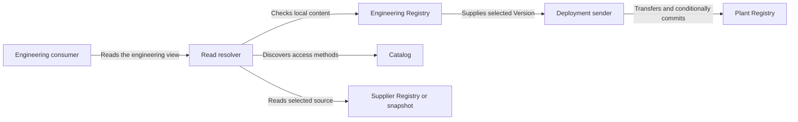
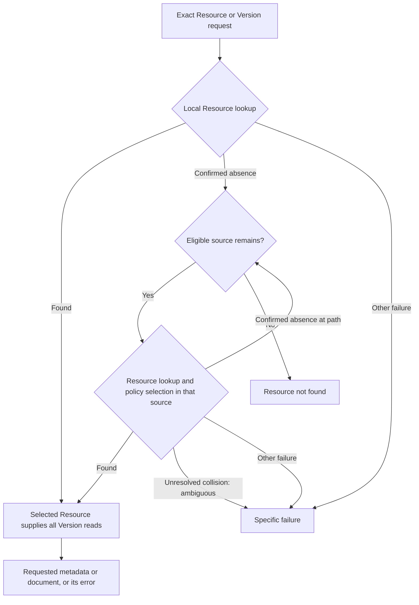
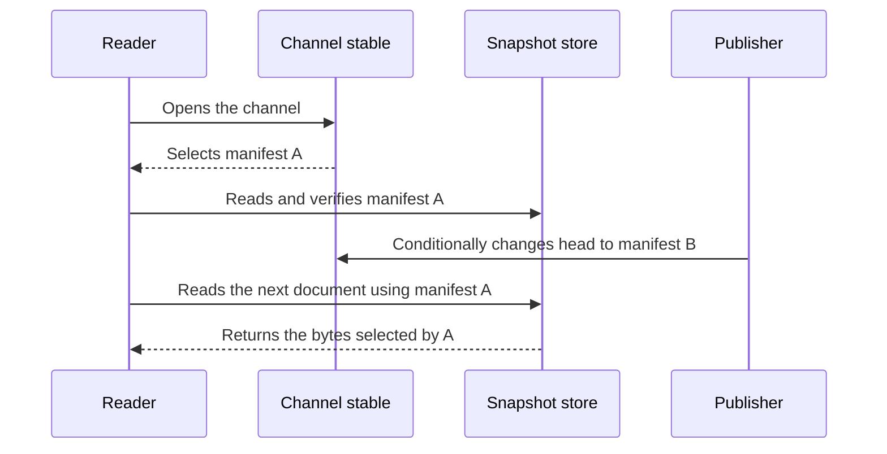
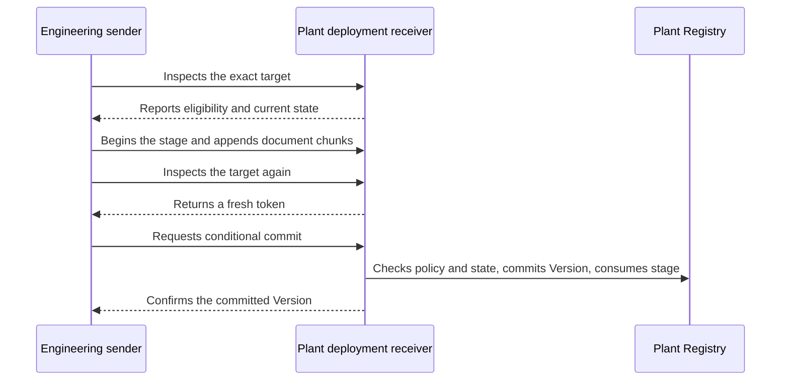

# xRegistry Federation design

<!-- words: base64 bytestring contenttype filetype nodeid -->
<!-- words: federationdeployment xid xids -->
<!-- words: createresource failover inspectstage inspecttarget matchversions -->
<!-- words: mrpc namespace reserialization workflow -->
<!-- words: py sequencediagram standalone weburl xregurl -->

This guide explains the design behind the
[Federation specification](../spec.md). It builds on the
[xRegistry Core primer](../../../core/primer.md): a Registry contains
Groups, a Group contains Resources, and a Resource can have multiple
Versions. The specification and its bindings define interoperable
behavior and wire formats; this guide illustrates them.

| Area | Coverage |
| --- | --- |
| [Federation overview](#one-registry-view-two-directions) | How upstream reads and downstream writes fit together. |
| [Read resolution](#read-resolution-and-view-ownership) | View ownership, discovery, shadowing, and identity. |
| [Captured state](#snapshots-packages-and-publication) | Live reads, offline packages, and pinned publications. |
| [Downstream deployment](#downstream-deployment) | Grants, staged writes, retries, and synchronization. |
| [Trust and conformance](#trust-and-implementation-boundaries) | Security boundaries and implementation examples. |

## One Registry view, two directions

Federation lets a consumer read across independently managed Registries
without copying all their data. Opt-in downstream deployment lets an
authorized sender copy selected Versions to a destination that explicitly
accepts writes. A federated read doesn't write anything. A deployment
doesn't grant access to sources or change the read policy.

The examples follow a manufacturer that maintains an engineering Registry.
It combines its own assembly manuals with reference documents from a
supplier. It also sends selected manual Versions to a plant Registry that
can serve them without contacting engineering for every read.

The diagram distinguishes the upstream read from the downstream write.
Engineering's catalog describes the supplier. The resolver uses the
engineering team's policy to decide whether to read it. A separate
deployment sender uses a grant from the plant to write there.

| Part | Question it answers | What it doesn't decide |
| --- | --- | --- |
| Catalog | Which access methods does a source advertise? | Which source wins, or whether the caller can use it. |
| Composition policy | Which sources can supply a path, and in what order? | How to connect to them, or which content Versions are compatible. |
| Binding | How does the resolver read, or how does the sender deploy? | Whether the endpoint is trusted or the principal is authorized. |
| Snapshot and Publication | What state does the snapshot capture, and which exact release bytes does Publication identify? | Whether the consumer accepts those bytes or how the destination writes them. |
| Deployment grant | Who can write which local Versions at the destination? | What a read resolver selects or when a job runs. |

These responsibilities don't require separate services. An application,
API server, or job can handle several of them. The decisions remain
separate: a catalog update doesn't grant access, and a binding's priority
doesn't set source precedence.

## Read resolution and view ownership

A **resolver** is the component that selects an origin for a read and
retrieves the result. The `resolution` field in the enabled `federation`
capability identifies who combines the view. It applies to the selected
Registry root, access context, and revision, not to the catalog entry that
describes the Registry.

| Hosting model | Resolution owner | What the consumer experiences |
| --- | --- | --- |
| Client-side | `consumer`, also the default when the capability is absent | The application or its library combines the local view with permitted sources. A client without a resolver reads only the supplied view. |
| Live API server | `producer` | The consumer makes an ordinary request to the server's binding. The server resolves it and presents a Core-conforming view. |
| Stored, preassembled view | `producer` | A producer combines sources before serving the stored view. Reads don't repeat the producer's discovery or composition. |

A stored view can still use `consumer` when it contains only local content
and lets clients do the composition. Storage format alone doesn't identify
the resolution owner or show that the view is immutable. A failed
capability read isn't the same as a missing capability. An invalid or
unsupported value reports a failure rather than starting an extra traversal.
The [owner signal](../spec.md#signaling-who-performs-resolution) prevents
two components from composing the same view differently. In particular,
a `not_found` from a producer-owned view doesn't send the consumer back
through that producer's catalog.

### Source discovery and binding selection

A catalog entry is a metadata-only Resource in the
[Registry domain](../../models/registry/spec.md). One of its Versions
describes a source Registry. The entry and its description Version aren't
the described Registry or a revision of its contents.

Among eligible advertisements, lower priority numbers rank first. For
example, the supplier's catalog description includes an HTTP advertisement
with priority `10` and a Git advertisement with priority `0`.
If policy permits only HTTPS Registry API access for this read, the resolver
selects the HTTP advertisement if its endpoint satisfies that policy. Git's
lower number doesn't make it eligible. With both advertisements eligible,
Git wins in this example. The priorities rank access methods for the
supplier, not the supplier against other source Registries.

[Binding selection](../spec.md#discovery-and-binding-selection) starts
from an explicit description Version or, if none is specified, the
catalog entry's Core default Version. A present `xregurl` adds an implicit
HTTP advertisement with priority `0`, even if an explicit advertisement
uses the same endpoint. If `xregurl` and explicit HTTP advertisements
are both present, `xregurl` has to match one of their endpoints exactly.
Caller choice, binding support, and policy determine which advertisements
are eligible. For equal priorities, array order breaks ties, with the
implicit advertisement placed after explicit ones. A `weburl` alone
is a website, not a Registry API. After selection, the resolver doesn't
try a different advertisement on failure. A caller with a known endpoint
can skip the catalog, but still needs to establish the same Registry
context and trust.

| Read binding | What identifies the selected view |
| --- | --- |
| [HTTP](../../bindings/http-federation.md) | The Registry root URL, including its base path. Ordinary live reads don't imply a revision pin. |
| [OPC Unified Architecture (OPC UA)](../../bindings/opcua.md#101-advertisement-and-registry-selection) | The endpoint selects the server, and a portable NodeId identifies the Registry root on that server. In a nonstandard namespace, this form uses a namespace URI rather than a server-assigned index. Native reads don't require HTTP. |
| [MQTT](../../bindings/mqtt.md) | The broker endpoint and the topic base for the view. Each request topic adds the action and target path. Correlation identifies an exchange, not a revision. |
| [Git](../../bindings/git.md) | The repository, mapped directory, and selected revision. A resolved commit, not a moving branch name, provides a pin. |
| [File](../../bindings/file.md) | A selected directory and layout. A mutable directory path doesn't establish a stable snapshot. |
| [Open Container Initiative (OCI)](../../bindings/oci.md) | The repository and selected artifact. The digest, rather than a moving tag, identifies the pinned artifact. |

Git and File share a [directory mapping](../../bindings/mapping.md).
The bindings implement the same [read operations](../spec.md#read-operations)
with different transports or storage. The resolver establishes the root,
model, supported Core and binding versions, and enabled capabilities
before interpreting a result. These are protocol and format versions,
not Resource Versions. The binding then retrieves `model`, `capabilities`, a
`collection`, an `entity`, or a `document` as requested. The first two can
use the information already obtained during setup. An entity result
contains metadata. A document read of a document-bearing Resource or
Version returns domain bytes or, where the binding permits it, an external
document locator. A 0-byte document isn't missing content. A metadata-only
Resource has no separate document, but the
[MQTT native read](../spec.md#mqtt-native-reads) returns Core
metadata for that target. It doesn't substitute metadata for missing or
unreadable document bytes on a document-bearing target. Each binding read
uses the source's exposed view without searching that source's catalog.

### Resource selection and shadowing

A local Resource **shadows** a source Resource at the same path. The unit
of selection is the whole Resource, not its Versions. For an exact read,
the resolver looks for the owning Resource locally and then in its
configured source order. It reads the requested Version from the winner.
Only a confirmed miss for the owning Resource allows the resolver to try
the next configured source.

The diagram shows the selection performed by a consumer-side resolver or
inside a producer that builds the view. If the resolver tries a
catalog-based source, it selects an advertisement before looking up the
Resource there. The source remains a candidate until it supplies the
Resource. A consumer of a producer-owned view sees only the result of
that work.

For example, engineering holds `assembly` at `v1`, while the supplier
has `assembly` at `v2`. An engineering-view request for
`/documents/main/assets/assembly/versions/v2` returns `not_found`.
Engineering's `assembly` already won, so the supplier's `v2` can't fill
the gap. A document request for `assembly` without a Version selects
the local Core default, `v1` in this example. The resolver doesn't compare
Version IDs across Registries. A direct request to the supplier with
its own access context is a different operation. A timeout or authorization
failure on an eligible source isn't evidence that a Resource is absent.

Here, the engineering policy maps two Resources from the same supplier,
`/documents/drafts/assets/copy` and `/documents/approved/assets/copy`,
to `/documents/main/assets/copy`. If neither engineering nor an earlier
source supplies that path, the policy can select the approved copy.
Only that copy contributes Versions, labels, and origin. If both copies
are present and the policy names no single winner, the resolver reports
`ambiguous` for an exact read or a composed collection or selector
covering that path. A selector doesn't resolve the collision even if only
one copy has the requested label.
If engineering already has a local `copy` at the visible path, it wins
regardless of the supplier's collision. The same holds for a Resource
from an earlier source.

If the resolver confirms that the approved copy is absent and the draft
copy is still present and eligible, the draft copy supplies the path in
both exact reads and collections. The preference only breaks a tie. If
looking up the approved copy times out or access is denied, the resolver
reports the failure instead of assuming that copy is absent.

Case-only IDs behave differently from exact-path ties. If two suppliers
project `Pump` and `pump` into the same collection, neither shadows the
other. Unless the policy renames or excludes one, reads of either member
and collection reads covering both return `ambiguous`. Lookups do not
become case-insensitive, and unrelated reads still work.

For an [exact Group metadata read](../spec.md#collections-and-selection),
the resolver uses local metadata if the Group is present. For example,
engineering has no local `/documents/field` Group, and its policy tries
supplier A before supplier B. If A's Group lookup confirms that `field`
is absent, the resolver tries B. If A's Group lookup times out, the
resolver reports the failure and doesn't try B. A missing Registry root
also doesn't establish that the Group is absent.

For collections, Group metadata can come from the local Registry while
its Resources come from several sources. A selector such as
`stage=production` asks for one visible Resource with that label value
on its default Version. The resolver determines which Resources are
visible before testing the labels. The following example shows both steps.

| Origin | Resource | Default Version | `labels.stage` | Visible |
| --- | --- | --- | --- | --- |
| Engineering | `assembly` | `v1` | `development` | Yes |
| Supplier | `assembly` | `v2` | `production` | No |
| Supplier | `reference` | `v3` | `production` | Yes |

A selector for `stage=production` finds `reference`, not `assembly`.
If the local `assembly` disappears, both supplier Resources are visible
and the selector returns `ambiguous`. A first match doesn't
establish uniqueness, and a missing page doesn't establish a complete
collection. The [selection rules](../spec.md#collections-and-selection)
keep an optimized lookup from returning different results than a full
evaluation. A completed live traversal without a detected inconsistency
doesn't establish the contents of an immutable snapshot. Exact reads can
stop at the winning Resource without walking unrelated content.

### Identity, navigation, and origin

An XID identifies an entity in one Registry context. Two Registries can
have the same XID without sharing an entity. For example, when a server
presents the supplier's `reference` in the engineering view, the
consumer-facing XID and navigation refer to engineering. The result's
origin separately identifies the supplier context, selected XID, and
revision pin or its absence. A catalog-based result also records the
selected advertisement and catalog-description Version. If the producer
selects the supplier without a catalog, the origin has neither field.

The following references solve different problems:

| Reference | What determines its meaning |
| --- | --- |
| Core XID or `meta.xref` | The selected logical Registry. An alias still uses Core's same-Registry and same-Resource-type rules. Federation doesn't follow it across Registries. |
| Reference to an external document | The document locator and its binding's policy. It doesn't select remote Resource metadata or import Versions. |
| Relative link inside a domain document | The document's base URI as established by the binding, not the catalog or the package directory. For example, an OCI package can supply `document.base` alongside embedded bytes. If the needed base is unavailable, the resolver fails rather than guessing. |
| Document-view JSON Pointer | The returned JSON document. When a navigation target is included, the pointer addresses that included object. An omitted object doesn't gain a local pointer. |

A `self` link can locate metadata without locating the domain bytes.
An API view needs usable navigation in its own binding. In
[document view](../spec.md#representations), Core navigation uses
document-local JSON Pointers for included targets. Navigation to an omitted
target isn't rewritten to a local pointer. When a producer combines records
into one document, it adjusts the pointers to that document. The origin
remains separate from both forms.

## Snapshots, packages, and Publication

A live read observes the selected view when the binding serves it. Reading
an exact Version ID doesn't make the document immutable. A **snapshot**
captures a Registry state within a declared scope. A **package** stores
that state in a defined representation. The
[snapshot rules](../spec.md#snapshots-and-completeness) distinguish two
completeness classes:

| Class | What it contains |
| --- | --- |
| Linked | A complete internal containment graph. Some domain documents can remain explicit external references. |
| Offline-complete | The complete internal graph, all declared documents in scope, and the model material needed to interpret them without a network. |

Both classes reject a missing internal record. Offline completeness
doesn't imply that arbitrary links inside a document work offline.
Bindings preserve exact bytes and verify the integrity evidence their
formats define. Equal digests identify equal bytes, not a trusted
publisher. Pinning two sources also doesn't prove that the two states
existed at the same time. A reproducible combined view needs the same
local state, selected source contexts and pins, interpreted model, and
composition policy, or a separately materialized complete result.

[Publication](../../publication/spec.md) adds a separate release
mechanism. A **channel**, such as `stable`, is a name whose head can
move. A **manifest** identifies a captured Registry view and its
selected documents by exact references, sizes, and digests. A reader
that opens a channel once works from that manifest rather than checking
the channel again on each read.

The diagram shows an engineering reader continuing to use manifest A
after a Publisher advances `stable` to manifest B. The old selection
remains usable as long as Publication retains the referenced content.

If a document referenced by A is unavailable, the reader reports the
failure. Reading B instead would hide the failure and mix released
states. A manifest records byte identity, not compatibility. For example,
a domain profile can verify which model Version a document depends on.
Neither the channel name nor snapshot integrity establishes that relation.
A Git commit, OCI digest, or exact Version ID doesn't establish
the Publication identity of a view. An alternate binding exposes the
same Publication only when a
[checked mapping](../../publication/spec.md#binding-equivalence)
preserves the unchanged manifest, captured model and metadata, and exact
Version-to-byte associations.

## Downstream deployment

### Deployment to one downstream Registry

The deployment sender acts for a parent Registry and pushes selected
content to one configured downstream Registry. The parent chooses the
source, such as its own live Registry or a pinned Publication, and names
each destination Version. The downstream Registry controls who can deploy
and what they can change. One successful commit creates a Resource and its
first Version, adds a Version to an existing managed Resource, or replaces
an exact managed Version. The write takes effect immediately under normal
Core rules.

Deployment doesn't change [Federation reads](../spec.md#read-operations). A
consumer still resolves local and source Resources as before. No catalog
traversal, source fallback, or write-through takes place during deployment.
The parent invokes each deployment explicitly. The receiver neither forwards
the operation nor treats it as an instruction to mirror the parent.

The parent maps an exact source Version to an exact destination Version
and reads the bytes and selected metadata through the source's binding.
The sender supplies only writable Version fields that the receiver
explicitly allows.
A live read doesn't establish a consistent snapshot across several Versions.
A [pinned Publication](#a-pinned-publication-as-a-source) supplies immutable
source bytes.

Repeated invocations support
[one-way synchronization](#one-way-synchronization), but the binding
doesn't start a run when the source or destination changes.

This design covers HTTPS, native OPC UA, and MQTT. It doesn't add deployment
to File, Git, or OCI. OCI artifact publication remains a separate producer
operation. Deployment doesn't delete missing content, edit the model, create
Groups, or edit Resource Meta directly. It doesn't provide a transaction
across Versions or a release switch for the whole Registry.

### Destination configuration and sender authorization

A **grant** is the receiver's authorization for one authenticated principal
to deploy into a reserved scope in one Registry. An administrator provisions
the Group, Resource types, and permitted Resource IDs or ID rules. Two
grants can't own overlapping scopes. The receiver applies Core's uniqueness
rules to IDs when checking reservations and its exact lookup rules when
resolving request XIDs. For example,
`/sets/plant/documents/intro/versions/4` identifies Version `4` of the
`intro` Resource in the `plant` Group. Before it checks the grant, the
receiver validates the Group and Resource collection names and the entity
IDs against the destination model and Core rules. A string prefix isn't
a scope boundary.

The receiver records ownership for each Resource and Version it creates
through deployment. The record applies to that entity's incarnation, its
lifetime from creation to deletion. An ownership record for a deleted
entity doesn't apply to a new entity with the same XID. An unmanaged
Resource blocks the operation. An unmanaged Version on a managed Resource
can't be replaced. Administrators can revoke grants or release scopes outside
this protocol. Issuing another grant doesn't transfer ownership of existing
entities.

The sender's configuration identifies the receiver's transport identity,
Registry root, binding, and deployment entry point. The receiver maps that
entry point and the authenticated principal to a grant. For example, an HTTPS
entry point selects one Registry even when the host serves several. The sender
doesn't follow redirects, switch entry points, or send deployment credentials
to a source Registry.

When present, the `federationdeployment` Core capability identifies which
deployment profile the receiver supports in the selected binding context.
It's separate from `federation.resolution`, contains no endpoint or
credentials, and need not be visible to read-only clients. The
specification defines `https-deploy/1`, `opcua-deploy/1`, and
`xreg-deploy/1`. The sender confirms the profile and limits with an
authorized `limits` request to the configured entry point, even when it
can read the capability. That request reports bounds such as chunk size
and stage lifetime without requiring access to the read binding.
Catalog advertisements and Core entity mutability don't
grant access. A receiver doesn't advertise deployment in a context that
advertises immutable Core entities to the same principal.

The receiver checks authorization for every operation, including the point
where a commit takes effect. Revocation changes the grant's generation and
invalidates its stages and preconditions. This prevents a queued request from
using earlier authorization. A commit that takes effect before revocation
remains committed. Errors don't disclose another principal's target or stage
state.

### Staging and committing one exact Version

A **stage** holds a pending upload outside the live Registry. A **precondition
token** identifies the destination state that the sender expects to change.
It doesn't authorize an operation or reserve a target. Stage identifiers and
tokens are opaque and bound to the receiver, binding, Registry, principal, and
grant generation. The token also binds the exact target and write mode.
An **observed-state marker** compares the destination state across
inspections without depending on the token's expiration. The marker
reflects the destination state and authorization context checked by
the token. It covers more than document bytes: a recreated Version or
a changed grant can invalidate a previously approved write.
It stays the same when the receiver reissues a token for unchanged state.
It changes if the target incarnation, grant generation, or other guarded
state changes. A marker doesn't authorize a write or replace the token.

The following table shows the common operations. The
[shared operation data](../spec.md#deployment-operation-data)
defines the exact fields and encodings.

| Operation | Input | Successful result |
| --- | --- | --- |
| `limits` | None. The configured entry point selects the Registry. | Profile version, maximum document and chunk sizes, maximum control message size, maximum token age, and stage lifetime and quota limits. |
| `inspectTarget` | Exact destination Version XID and, if supplied, names of Version fields to compare. | Missing Resource, missing Version on a managed Resource, or existing managed Version; allowed mode, observed-state marker, token and expiration, and writable Version fields; for an existing Version, its current document descriptor and requested readable fields with their presence. |
| `begin` | Target XID, mode (`create` or `replace`), and document descriptor. | Stage ID, next offset, effective chunk limit, and expiration time. |
| `inspectStage` | Target XID and optionally the stage ID. | Active stage ID, mode, document descriptor, next offset, effective chunk limit, and expiration time. No document bytes. |
| `append` | Stage ID, offset, and a nonempty chunk of bytes. | Next offset after accepting the chunk. |
| `commit` | Stage ID, current precondition token, and Version metadata to apply. | Created or replaced, exact destination XID, and the new Version epoch and document descriptor. |
| `abort` | Target XID and stage ID. | No further commit can take effect for this stage. `removed` is `true` if this call removed the matching live stage, or `false` if no live stage matched. |

The diagram shows a successful deployment of engineering's `assembly`
to the plant. Transfer doesn't change the live destination. The second
inspection supplies a fresh token after the upload, and the commit
changes the exact Version and consumes the stage together.

A descriptor is either `null` for a metadata-only Version or an object with
byte `size`, `digest`, and `contenttype`. The digest is SHA-256 over the
document bytes, encoded as `sha256:` followed by 64 lowercase hexadecimal
digits. `contenttype` is the media type for those bytes, or `null` if
unspecified. A 0-byte document has a descriptor and the digest of the empty
byte sequence. It isn't a metadata-only Version. The sender doesn't send a
chunk for either case. The receiver checks the descriptor against the type's
`hasdocument` setting at `begin` and again at `commit`. A `null` descriptor
doesn't preserve or clear a document on a document-bearing Version.
A `null` `contenttype` clears the media type if the model permits it. The
descriptor supplies the
media type, so the metadata object doesn't supply it again. The receiver
doesn't accept content locators or dereference values supplied in the write.

#### Transfer, limits, and expiration

The receiver allows one active stage for a grant and exact target in the
selected binding. Repeating `begin` with the same mode and descriptor returns
the active stage and doesn't reset its expiration. A different request for
that target reports `conflict`. If the response to `begin` is lost, the
sender inspects the active stage by target. It resumes only if the mode and
descriptor match. Reusing an active upload doesn't reserve the live Version.
Senders that share a principal coordinate use of the same stage.

Before uploading, the sender uses `inspectTarget` to check the allowed mode
and writable fields. The receiver checks the destination Group, allowed mode,
and known protections again before allocating a new stage. It also checks
whether a create would exceed known Core or store limits and evict a Version.
These early checks avoid known failures without reserving the target or
promising a valid commit. The receiver checks the complete update at commit.
After transfer, the sender inspects the target again for the policy decision
and a fresh token. If the state changed during transfer, the sender
evaluates the new state under its policy. The fresh token doesn't approve
the write by itself. A long transfer doesn't consume that token's lifetime.

The receiver serializes appends on each stage and accepts bytes only at the
advertised next offset. If the offset doesn't match, it returns
`offset_mismatch` with the current offset to the authorized sender and accepts
no bytes. After a lost append response, the sender inspects the stage. The
offset tells the sender where to resume, not which bytes the receiver accepted.
If the offset advanced by the chunk length, the sender resumes at that offset.
If the offset didn't advance, the sender retries the same chunk. The receiver
checks the full digest before publishing the bytes.

The receiver accepts bounded chunks and reserves storage against quotas
before accepting an upload. Each grant limits the total bytes, the number of
active stages, and the control message size. The receiver also limits
aggregate work across grants. It sets the expiration at `begin`, enforces
it with its own clock, and reclaims storage on expiration, revocation,
or `abort`. Stage IDs aren't reused. A receiver that loses staging state
on restart invalidates those IDs rather than recreating the uploads.

The receiver can hash accepted bytes as they arrive or verify them by
streaming the staged object once. The receiver can retain the verified
digest with the published document so an inspection can report the current
document descriptor without hashing it again. Chunk limits bound transfer
memory, and indexes can support target and stage lookups. The receiver can
store the upload outside its Core transaction and publish a reference to
the verified bytes in that transaction. Transfer doesn't lock the live
Resource. This approach doesn't require a Registry scan or rehashing
other documents. A type is ineligible if the receiver can't serve the
committed Version's exact document bytes without reserialization.

#### Destination preconditions at commit

The receiver checks the precondition against the live destination in the
same atomic operation as the write. A `create` token expects the target to
remain absent. A `replace` token expects the exact managed Version that was
inspected to remain present and unchanged. Neither token is a lease. An
authorized sender can use a fresh token with the same verified stage after
a definitive conflict, but only after reviewing the new state. Switching
from `create` to `replace` requires a new stage and an explicit choice.

The token covers enough state to detect intervening changes, including
deletion and recreation with the same XID. One implementation can combine
the following receiver-maintained values:

| State at inspection | Compared state |
| --- | --- |
| Resource is absent. | Group incarnation and a generation for membership of its destination Resource collection. Creating and deleting the same Resource changes the generation even if the collection looks as before. |
| Resource exists and the Version is absent. | Resource incarnation and its Meta epoch, or an equivalent generation that changes with Version membership and default selection. |
| Exact Version exists. | The existing Resource's state plus the Version incarnation and epoch. |

The comparison accounts for Group identity, ownership, the effective model
generation, and the grant generation as applicable. A receiver using a
collection generation can reject a create after an unrelated membership
change in that collection. A receiver can use a narrower generation that
tracks membership changes for the specific Resource ID. Deployments into
different Versions of the same Resource can also conflict. A retry starts
with a fresh inspection rather than a weaker precondition. The receiver limits
each token's lifetime independently of the stage's expiration. Once the
guarded state changes, the old token stays invalid. That holds even if the
state looks the same after another receiver takes over or the store is
restored. A receiver can prevent old requests from becoming valid again
by invalidating outstanding tokens and stages on restore. A Core epoch
alone isn't enough: Core ignores a supplied epoch on create and doesn't
tie it to the entity's lifetime.

At commit, the receiver rechecks authorization, stage validity, target type,
and the complete Core transition. It compares the live incarnations with its
ownership records. It also checks the reserved scope and protections against
changes from other authoring paths that use the same store. A store supports
deployment only if it can make these checks atomic with a create or
replacement.

#### Core write semantics at the destination

The receiver applies the mutation as one Core write to the exact Version.
When both the Resource and Version are new, the same commit creates both.
The sender supplies only writable Version fields that the receiver
explicitly allows. These can include domain fields that a metadata-only
type needs. On replacement, omitted fields stay unchanged. Core and model
validation govern the supplied fields, including whether a value can clear
a field. On creation, the destination's field requirements and defaults apply.
The receiver rejects the operation if meeting these requirements would
change content outside the allowed scope.

The receiver rejects fields that select identity, redirect retrieval, or
change authority. Examples include source epochs, navigation, timestamps,
default or lineage controls, external document URLs, reader-specific
projections, and Publication controls. The receiver also rejects replacement
of a Version that still uses an external document or proxy URL. It doesn't
turn an alias into an owned Resource or mutate the aliased target. It rejects
a `readonly` Resource rather than asking Core to ignore it.

The receiver applies the effective model's Group, format, `matchversions`,
and compatibility constraints. A create uses the Version ID from the
target XID, not from the metadata object. The receiver rejects the create
if the type doesn't allow client-assigned Version IDs. It doesn't
substitute an assigned ID. If the destination can't determine valid lineage
from Core and its model settings, the receiver rejects the mutation. It also
rejects writes that would cause Core or the store to evict a Version.
Deployment doesn't bypass Core's `maxversions` behavior.

Core still manages identity, ancestry, timestamps, epochs, and default
selection. A new Resource gets its first default Version. A Version
added to a Resource with a sticky default doesn't move that selection.
Otherwise, Core and the configured version mode determine the default.
They don't compare Version IDs as numbers. Replacing the current default
changes what ordinary Resource reads see. Core also updates affected
collection state or Resource Meta as part of the write. None of these
effects moves a Publication channel.

#### Recovery without duplicate writes

A successful commit publishes the data and consumes the live stage in the
same durable transaction. That transaction manages the stage record even if
the bytes live elsewhere. The receiver looks up the live stage before it
checks the token and rechecks both at commit. That ordering prevents a
replay from reaching the write after a successful commit. The receiver
checks expiration and grant validity at commit.

An error leaves Core unchanged for that delivery of the request. Another
delivery of the same request might already have succeeded. For example, a
duplicate MQTT delivery might get `stage_unavailable` after the original
commit succeeded. Both that result and a missing usable commit reply
leave the outcome indeterminate. Other commit errors also need
reconciliation when the binding can deliver the commit more than once.
A different delivery might not return the same error.
`stale_precondition` is the exception. It identifies an active stage and
a token that can't become valid again for that target and mode. Invalid
tokens or tokens for another target or mode are not stale tokens. A
caller can inspect current state and reuse the verified bytes with a new
token.

The sender calls `abort` with the exact target and stage ID before retrying
an indeterminate commit. The receiver checks the caller's current grant and
serializes the operation with commit. It returns `removed: true` only if
this call removed the live stage matching the full binding, grant, target,
and ID. Because a successful commit consumes that stage atomically, this
result proves that the stage didn't commit. Otherwise, `removed: false`
guarantees only that this stage can't commit now. It reveals nothing about
nonmatching stages or why this stage ended. A repeated abort can therefore
return `false` after the first one returned `true`. A lost `true` reply
can't be recovered from `false`. The receiver doesn't need to keep records
of ended stages. If the sender can't establish that no further commit can
occur, it doesn't declare failure or start a competing retry.

After `abort` succeeds, the sender inspects the exact target. It compares
document presence, length, digest, media type, and the requested writable
metadata using model-aware equality. The comparison excludes generated
fields. A match means the desired state is present, not that this attempt
wrote it. When the target of an indeterminate first create is absent and
`removed` is `true`, the sender can retry under the normal create policy.
It still needs a fresh token. If `removed` is `false`, the stage could have
committed before someone deleted the Version. The sender reports that case
for review rather than recreating the Version. Other differences return to
the normal conflict policy.
The inspected document descriptor and token describe the same Version
state. The receiver updates or invalidates any retained document
fingerprint when another allowed writer changes the Version, so inspection
doesn't report an outdated digest. Without a current document fingerprint,
the receiver reports that comparison isn't available. The fingerprint
covers the document. The sender's baseline comparison also includes
selected metadata.

### One-way synchronization

Synchronization brings a selected set of exact destination Versions into
agreement with a selected source state. The workflow runs only on explicit
invocation. The parent compares each destination independently
and sends only the writes its policy allows. It doesn't copy downstream
changes back to the source, merge concurrent edits, or delete Versions
that disappear from the source selection.

#### Policy configuration

The sender's job configuration names the source, the destination grant
and binding, and the mapping from exact source Versions to exact
destination XIDs. It also names the Version fields to copy and the rule
for handling differences. A run rejects two assignments to the same
target, including assignments whose IDs would collide under Core's
case-insensitive uniqueness rule. It makes no assumption about the
identity or precedence of equal XIDs across Registries.

The receiver's grant separately configures the destination scope,
allowed write modes, writable Version fields, and limits. It can allow
creation without replacement. An `inspectTarget` result reflects what
the grant and current target state permit. The sender's policy narrows
those permissions. A sender setting or operator decision can't bypass
the receiver's grant, ownership, or precondition checks. If any selected metadata
field is unreadable for comparison or unwritable under the grant, the sender
blocks the item before upload.

The default policy creates new targets and replaces existing managed
Versions only when they still match the sender's baseline and the grant
allows replacement. The baseline records the last verified destination
state for the same mapping and field selection. It covers whether a
document exists, its byte size, digest, and media type, and the actual
values and presence of the selected metadata. The sender can store a
fingerprint of this comparison instead of the metadata itself.
A matching baseline compares values, not the history of edits. It
doesn't grant permission or replace the current receiver token.

An operator initializes the job once for its configured destination
and grant. A no-write run can check the selected mappings through
`limits` and `inspectTarget` before the operator enables the job. After
initialization, new mappings don't need separate approval. The sender
retains mapping history even when an item drops out of the selection.
Before dispatching a commit, it records the stage and that the attempt
might take effect in its retained job history. An absent mapping record
identifies a new mapping only when the job has trusted history. If the
history is missing or restored, the sender treats it as uncertain unless
it can establish continuity. A missing record in uncertain history
doesn't establish that a target is new.

A crash can erase the local attempt record after the commit request has
reached the receiver. A job that resumes automatically after restart can
save the attempt record and stage ID to durable storage before sending
the commit request. If the job can't establish that its records survived,
it treats the history as uncertain rather than assuming it never sent
the request.

An authorized inspection establishes a baseline when it confirms
convergence. This can happen without a write, after a known commit, or
during recovery. The baseline records the observed state, not the source
representation, so model-aware comparisons can account for normalized
values. It applies to the same Registry, binding, grant, target, and
field selection. The history and baseline are local job records. The
receiver doesn't retain commit receipts for them.

#### Conflict resolution

The sender compares current target state against the desired state
and, if available, its baseline. If a prior commit outcome is
indeterminate, the sender follows the
[recovery sequence](#recovery-without-duplicate-writes) before reporting
convergence from an inspection. The table shows how the sender resolves
the comparison before it starts a write.

| Destination observation | Sender decision |
| --- | --- |
| The exact target is absent and trusted job history shows a new mapping or a first create that couldn't commit. | The sender starts a conditional create if the grant allows it. |
| An authorized inspection confirms that the managed Version matches the desired state, even without a comparable baseline. | The sender reports convergence without a write or an epoch increment. The inspection can establish a baseline. |
| The managed target differs from the desired state but matches its baseline. | The sender uses a conditional replace if the grant allows it. No operator approval is needed. |
| The sender can't establish the current state from inspection, or the managed Version differs from the desired state and either differs from its baseline or lacks a comparable baseline. | The sender reports that the item needs review. It can't approve replacement without a comparable inspection. |
| The target is absent, and the job history is uncertain or shows an earlier deployment. | The item needs review. The sender doesn't recreate the target automatically. |
| The target is unmanaged or protected, or the grant disallows the operation. | The sender reports that the operation is blocked. Operator approval at the sender doesn't enable it. |

Without a comparable baseline, a differing existing Version requires
review. An operator can leave the destination as it is, change the mapping,
or approve a specific change. Approval covers a target, write mode,
observed-state marker, and prepared document descriptor and metadata.
A fresh token can use the same approval only when the marker and
prepared write still match. This lets approval survive token expiry
without extending it to a new target incarnation, a changed grant, or
different source content. The approval ends when the change succeeds or
the approved state or write changes.

On `stale_precondition`, the sender inspects the target again and repeats
the policy decision. It stops after a configured retry limit. A job
serializes commits that share a grant and runs only one invocation at a
time over the same mapping records. It can resume a matching upload it
owns or end its own obsolete stage. A stage with a possibly dispatched
commit goes through recovery before the job replaces it. The job
doesn't discard a stage that it can't associate with its own attempt.
A fresh token alone doesn't resolve a conflict. An indeterminate commit
follows the [recovery sequence](#recovery-without-duplicate-writes) before a
sender retries or updates its baseline.

For example, a scheduled job creates a newly mapped Version on its first
run. The next run finds the same bytes and doesn't write. When the source
changes, the job replaces the destination Version if it still matches
the baseline. If a downstream administrator changes the Version first,
the job leaves it alone and reports that it needs review.

#### Signaling and run results

The deployment capability and `limits` identify binding support. The
sender uses `inspectTarget` for target eligibility and compares the
returned state to detect drift. `stale_precondition` signals a change
after inspection or expiration of its token. The receiver's `conflict`
code reports an incompatible stage or write mode, not a divergent
document. `policy_denied` reports an authorization or protection failure.
An accepted chunk signals upload progress, not a Core write. A successful
`commit` confirms a write to the exact Version. An error from a duplicate
delivery of that request doesn't undo that confirmation.

The sender reports a result for each mapped Version, such as created,
replaced, already converged, retry pending, needs review, blocked, or
indeterminate. A temporary source failure, transport error, quota
limit, or expired stage can wait for an automatic retry. An unresolved
commit remains indeterminate until it can be checked. Target drift that
requires review, an absent target with uncertain history, or a persistent
configuration problem needs operator attention. The job reports an
ongoing problem by target and cause rather than requesting the same
decision on every retry. It doesn't expose
credentials or protected metadata. A run reports synchronization only
when every item in its current mapping has converged. A blocked item
isn't synchronized, even when no retry is pending.
Earlier accepted writes remain in place, as do downstream Versions that
are no longer in the mapping.

Deployment doesn't define a subscription or a source-change message.
An operator, release job, or local scheduler can invoke the same explicit
operation. Where available, [Core events](../../../core/events.md#entity-events)
can prompt a local job to inspect the source or destination again.
Events don't authorize writes or substitute for inspecting the target,
and their delivery order doesn't determine conflict resolution. After the
sender prepares the bytes and selected metadata for an item, its desired
state doesn't change during that write. This doesn't give independent live
reads the consistency of a pinned Publication.

### Deployment operations by transport

The [deployment profiles](../spec.md#downstream-deployment) expose the same
stage and commit lifecycle over three transports. The transport code
decodes the request and identifies the principal. The receiver applies
the same grant, stage, and commit rules after decoding. Separate wire
mappings keep transport behavior out of the decision about whether a
Version changes.

The [HTTPS](../../bindings/http-federation.md#downstream-deployment),
[OPC UA](../../bindings/opcua.md#107-downstream-deployment), and
[MQTT](../../bindings/mqtt.md#downstream-deployment) wire examples all append
the same 2 bytes to a stage at offset zero. The sender receives offset
`2` regardless of the transport. If a duplicate request uses offset
zero again, the receiver reports `offset_mismatch` and doesn't append
the bytes twice.

#### HTTPS

The [HTTPS profile](../../bindings/http-federation.md#downstream-deployment) uses a
configured base URL outside the Core entity API. Control messages use
JSON, and `append` carries raw bytes. The receiver limits the body while
reading it. An HTTP status and the operation result describe the outcome
together. Ordinary Core `PUT` isn't a substitute: its epoch check
doesn't protect against an absent target appearing or an existing target
changing incarnation.

#### OPC UA

The [OPC UA profile](../../bindings/opcua.md#107-downstream-deployment) uses
Methods on the selected Registry's `Deployment` component. It carries a
chunk as a native `ByteString`. A `Good` Call status means the call reached
the deployment operation, not that the operation succeeded. The client
also checks the operation status and result. The Session authenticates
the user, but the stage belongs to that principal rather than to one
Session. This lets the same principal reconnect and resume a stage.
Ordinary FileType `Close` can't compare the deployment token at commit.
`CreateResource` with a file handle creates the entities before the file
closes, so that sequence can't provide the atomic deployment write.

#### MQTT

The [MQTT profile](../../bindings/mqtt.md#downstream-deployment) uses one
packet for each request or reply. A large document takes several
`append` requests. Each packet limit accounts for the Base64 encoding
and the packet properties as well as the raw bytes. Delivery can repeat,
and an acknowledgment doesn't confirm a write. The receiver checks the
stage offset, expiration, and commit preconditions without relying on
packets arriving in order or on time.

MQTT doesn't tell a subscriber which authenticated principal published a
message. The receiver relies on a trusted broker that gives one sender
exclusive permission to publish to the configured request topic. It maps
that exact topic to the grant and replies only on the configured reply
topic. A new grant generation uses fresh topics so a queued request
can't select a replacement grant. Correlation Data identifies the
exchange, not the identity or permission of the sender. Deployment
doesn't change the `mrpc/1.0` binding for native operations.

### A pinned Publication as a source

The sender opens the [Publication](../../publication/spec.md#opening-a-channel)
once to select an immutable manifest. It selects explicit source Versions
in the captured Registry context. Before deployment, it checks the stored
descriptors and the source policy for access and redistribution. The sender
can hash bytes during transfer, but it requests commit only after the source
size and digest match the selected descriptor. If they don't match, the
sender aborts the stage. The downstream receiver independently verifies the
bytes against the deployment descriptor.

The sender explicitly maps each source Version to a destination XID.
Matching XIDs across Registries don't prove identity. Deployment doesn't
rewrite a manifest, move a channel, or establish that the destination serves
the same Publication. The receiver excludes Publication channel, snapshot,
and object Resources from generic deployment. It also protects live domain
Versions that a Publication adapter retains as immutable, even when they
belong to a managed Resource. A scope is eligible only if commit can honor
those protections without racing a new retention decision.

For example, `stable` selects a manifest that associates
`/sets/manual/documents/intro/versions/7` with exact source bytes. The
parent maps it to `/sets/plant/documents/intro/versions/4` and first checks
that Version `4` is missing on the managed Resource. An old default
remains readable while the parent uploads. If the token still matches
and no constraint fails, commit creates Version `4`. It becomes the
default if Core selects it as newest and the default isn't sticky.
Readers that already opened `stable` still read the manifest they
selected, subject to Publication retention.

In this example, an administrator changes the managed Resource's Version
membership after the sender's post-upload inspection but before commit.
The receiver reports `stale_precondition` and leaves the Registry unchanged.
The sender can inspect the new state and decide whether to reuse the
verified upload with a new token. If a later commit succeeds but its
reply is lost, the sender calls `abort` so no commit for that stage can
still take effect, then inspects Version `4`. A successful commit consumes the
stage, so `abort` can return `removed: false`. Matching bytes and requested
metadata satisfy the deployment objective without proving which request
produced them.

### Deployment trade-offs

One staged write model gives all three bindings the same authorization
and conditional commit rules. A direct Core write would use fewer calls
for a small document, but it can't enforce those rules across the three
bindings. An inline path can wait until implementations show that the
extra calls matter. A whole-snapshot activation protocol would solve a
different problem that Publication already addresses with an immutable
manifest and a conditional channel-head update.

## Trust and implementation boundaries

Catalog entries, package contents, and sender-supplied fields are
untrusted input. A resolver checks policy before contacting a service,
following a redirect, opening a file, or retrieving external content.
Credentials belong to the authenticated destination. The resolver doesn't
forward them because a catalog entry or redirect names another service.
Deployment has the narrower rule that its sender doesn't follow redirects
at all.

A resolver bounds traversal depth, requests, and bytes. It checks loops
on paths that it actually follows. Git readers don't execute repository
content, and file readers enforce containment even through symbolic
links. An exhausted bound, invalid package, failed integrity check, or
denied access isn't an absent Resource or an empty collection. The failure
tells the caller that the resolver didn't establish absence or completeness.

For deployment, authorization and concurrency solve separate problems.
The grant says whether the authenticated principal can write. The
precondition says whether the destination state still matches the
state the sender observed. The receiver checks both at commit.
The stage limits transfer work without keeping a live Resource locked.
Neither verification of a digest nor a successful transport acknowledgment
substitutes for an authorized, successful commit.

## Implementation and conformance examples

A first implementation can support one role and one binding. Supporting a
resolver, a snapshot producer, or a deployment receiver doesn't imply
support for the other roles. The
[conformance section](../spec.md#conformance) defines the requirements for
each role. The examples below check different parts of those requirements.

| Layer | Useful conformance case |
| --- | --- |
| [Read resolution](../tools/test_spec_examples.py) | A local Resource shadows every source Version. Filtering follows shadowing. A producer-owned miss doesn't trigger another traversal. |
| [Package and binding examples](../samples/README.md) | A missing internal object fails validation, and exact document bytes survive retrieval. A selective lookup can avoid opening unrelated content. |
| [Publication](../../publication/samples/README.md#promotion-rollback-and-an-already-open-reader) | A reader continues using its original snapshot after a channel advances or rolls back. |
| [Deployment](../tools/test_deployment_examples.py) | A retry doesn't append bytes twice or commit into a recreated target. A failed upload leaves live state unchanged, and the three bindings expose the same append result. |

Additional deployment cases distinguish matching content from a baseline
replacement, local drift from transport failure, and both `abort`
outcomes after an indeterminate create. A read or deployment example
doesn't replace tests of an implementation's authorization, storage,
or transport. For example, a test of a mocked MQTT exchange doesn't show
that a live broker enforces the profile's topic restrictions.
