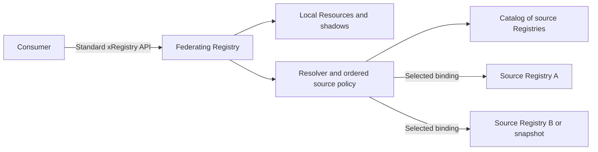
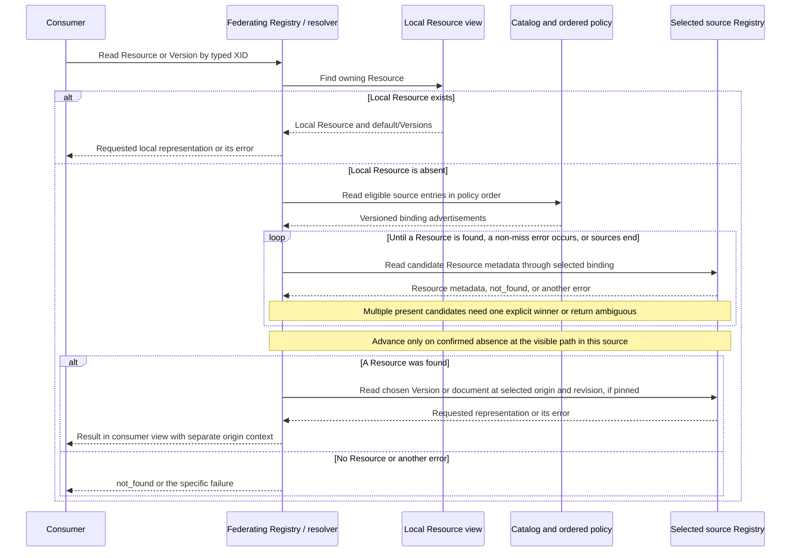

# xRegistry Federation

<!-- words: applicationuri federationprofiles nfc nodeid nodeids opc opcua rebasing registrygroups registryroot reparse topicbase standalone symlinks transportprofileuri ua website weburl xregurl -->
<!-- words: py sequencediagram -->
<!-- words: assetid selectedxid -->
<!-- words: usda -->
<!-- words: powershell pytest workingdrafts -->
<!-- words: contenttype federationdeployment https mqtt opcua staging uint -->
<!-- words: inspectstage inspecttarget matchversions retryable workflow -->
<!-- words: comparisonunavailable coreerror maxchunkbytes maxcontrolbytes maxdocumentbytes -->
<!-- words: maxpreconditionageseconds maxstagebytes maxstages nextoffset readablefields -->
<!-- words: stagelifetimeseconds statemarker writablefields -->

## Abstract

This specification defines how a consumer reads entities and documents across
independently administered xRegistries. A catalog is an xRegistry that uses
the Registry domain to describe how to access other Registries. It describes
those Registries rather than containing their data. A resolver uses the
composition policy to order candidate sources and selects an access method
for each catalog-based source it tries. It uses xRegistry Core to
interpret identifiers and metadata in that source's Registry context.
Protocol bindings define how the resolver retrieves the data. Federation
resolution is read-only.
An independent, OPTIONAL deployment capability lets an authorized sender
push selected Versions to a configured destination Registry that grants
write access.

## Table of Contents

- [Overview](#overview)
- [Notations and Terminology](#notations-and-terminology)
- [Design: Hosting Models](#design-hosting-models)
  - [Signaling Who Performs Resolution](#signaling-who-performs-resolution)
- [Design: Resolving a Consumer Request](#design-resolving-a-consumer-request)
  - [Example: Select After Applying Shadows](#example-select-after-applying-shadows)
- [Discovery and Binding Selection](#discovery-and-binding-selection)
- [Read Operations](#read-operations)
  - [MQTT Native Reads](#mqtt-native-reads)
- [Identity and References](#identity-and-references)
- [Selectors](#selectors)
- [Representations](#representations)
- [Snapshots and Completeness](#snapshots-and-completeness)
- [Downstream Deployment](#downstream-deployment)
  - [Deployment Authority and Discovery](#deployment-authority-and-discovery)
  - [Deployment Operations](#deployment-operations)
  - [Deployment Operation Data](#deployment-operation-data)
  - [Conditional Commit](#conditional-commit)
  - [Recovery and Synchronization](#recovery-and-synchronization)
  - [Deployment from a Publication](#deployment-from-a-publication)
  - [Deployment Errors](#deployment-errors)
- [Errors](#errors)
- [Security Considerations](#security-considerations)
- [Conformance](#conformance)
- [References](#references)

## Overview

The [Federation design guide](design/design.md) explains the architecture
and illustrates how reads and deployment work.

Federation presents local Resources and Resources from configured source
Registries through one Registry view. A Resource present in the local view
takes precedence over a source Resource at the same path. A consumer can
therefore read through one access point without storing all content there.

The [Registry domain](../models/registry/spec.md) contains a hierarchy of
`categories` and `registries` for describing source Registries and
their access methods. A resolver uses this catalog to discover sources.
Each catalog entry is a metadata-only Resource describing another Registry,
not the root of that Registry. When an API server performs resolution, its
consumer need not query or see the catalog.

The resolver reads an advertisement from a Version of the catalog entry,
then uses that advertisement's endpoint and binding to open the described
Registry. The Registry domain's
[context diagram](../models/registry/spec.md#6-discovery-and-selection)
separates the catalog entry and its description Version from the target
Registry.

For example, an organization can expose a Registry containing a locally
approved asset at `/documents/main/assets/approved`. It can also use a
supplier's Registry to serve `/documents/main/assets/supplied`, which is not
locally present. Requests for `approved` use the local Resource even if the
supplier has a Resource at that path. The resolver's
[composition policy](#local-resources-and-ordered-sources) defines which
supplier Registries can supply the path and in what order the resolver
tries them.

This specification defines how resolvers interpret resolution requests.
[HTTP](../bindings/http-federation.md), [OCI](../bindings/oci.md),
[Git](../bindings/git.md), [File](../bindings/file.md),
[OPC UA](../bindings/opcua.md), and [MQTT](../bindings/mqtt.md) define how
to perform those reads. The
[directory mapping format](../bindings/mapping.md) is shared by Git and File.
Native bindings do not require an HTTP facade.

An authorized sender can explicitly [deploy](#downstream-deployment) selected
content to one destination over HTTPS, OPC UA, or MQTT. Deployment does not
perform bidirectional synchronization, automatic propagation, replication,
or write-through. This specification does not define global entity
identifiers, arbitrary merge precedence, or discovery of dependencies inside
domain documents. OCI publication is a separate producer operation.

## Notations and Terminology

The key words "MUST", "MUST NOT", "REQUIRED", "SHALL", "SHALL NOT",
"SHOULD", "SHOULD NOT", "RECOMMENDED", "MAY", and "OPTIONAL" in this
document are to be interpreted as described in
[RFC2119](https://www.rfc-editor.org/rfc/rfc2119).

This specification uses [xRegistry Core](../../core/spec.md) and the
[Core model language](../../core/model.md), both at 1.0-rc4. A binding's
format-version discriminator identifies its package format, not a Core
edition, a catalog-description Version ID, or a target Resource's Version ID.

| Term | Meaning |
| --- | --- |
| Catalog | A Registry using the Registry domain to describe other Registries. |
| Catalog entry | A `registry` Resource under a `category` Group. |
| Advertisement | A record describing one access method in a catalog-description Version. |
| Registry context | The selected logical Registry, model, and access context in which an XID is interpreted. |
| Revision pin | A binding's immutable snapshot selection, when supported. See [Snapshots and Completeness](#snapshots-and-completeness). |
| Origin | The selected context and revision, when pinned, from which a result was obtained. See [Read Operations](#read-operations). |
| Resolver | The client-side or server-side component selecting the source and retrieving a requested entity or document. |
| Resolution owner | The side responsible for producing the selected Registry view: its consumer or its producer. See [Signaling Who Performs Resolution](#signaling-who-performs-resolution). |
| Federating Registry | The consumer-visible Registry whose view combines local Resources and explicitly configured source Registries. |
| Source Registry | A Registry selected as a source by the federating Registry's composition policy. |
| Shadow Resource | A local Resource that takes precedence over the same Resource path in configured sources. |
| Alias | A Resource using Core [`meta.xref`](../../core/spec.md#cross-referencing-resources) to reference another Resource in the same Registry. |
| Selector | A criterion used to select members of a collection, such as a label key and value. See [Selectors](#selectors). |
| Snapshot | A captured Registry state read as one selected revision. See [Snapshots and Completeness](#snapshots-and-completeness). |
| Package | A stored representation of a snapshot's metadata and declared documents, using the document-tree or OCI format. |
| Linked snapshot | A snapshot that contains all records its package references internally and allows explicit external document references. |
| Offline-complete snapshot | A snapshot also carrying all declared xRegistry documents in its selected scope. |
| Deployment sender | The component acting for a parent Registry that explicitly selects content and pushes it to one destination Registry. |
| Deployment receiver | The component that enforces the destination Registry's grant and commits authorized writes to its local store. |
| Deployment grant | Receiver policy that reserves a destination scope and authorizes one principal to deploy there. See [Deployment Authority and Discovery](#deployment-authority-and-discovery). |

The catalog's `registryid`, its entry's `registryid`, and the described
Registry root's `registryid` have different scopes. Their values need not
match. A catalog-description `versionid`, target Resource's Version ID, OCI
digest, Git commit, and endpoint address MUST NOT be treated as
interchangeable.

## Design: Hosting Models

Federation separates a Registry's representation from the component that
performs resolution, following Core's
[Registry views](../../core/spec.md#design-registry-views) and
[no-code servers](../../core/spec.md#design-no-code-servers). Resolution can
run in the consumer, in an API server, or when a producer assembles a stored
view. A consumer does not need to implement every binding.

### Client-Side Resolution

In client-side resolution, the consuming application or a library reads the
Registry and its configured catalog, selects a source, and accesses that
source through its native binding. The application supplies the local view,
permitted source scope, and source order. The consumer keeps each result's
source context and revision separate from its XID.

This is the default when the enabled capabilities omit the
[`federation` extension](#signaling-who-performs-resolution).

An offline tool or application with an OCI, Git, or other native reader can
select and retrieve content directly. The stored catalog describes the
sources; the client performs selection and reads the selected content.

For this view, the producer does not contact source Registries or return
possible matches from them. A client without federation support reads only
the supplied local view. A federation-aware client uses the catalog to obtain
independently maintained descriptions and access advertisements, which its
credentials and composition policy do not necessarily contain. Callers with
a known source endpoint can bypass catalog discovery, as described under
[Read Operations](#read-operations).

The resolution-owner signal tells clients who is responsible for combining
sources for the selected view. It does not define a service that returns a
remote execution plan for the client.

### API Server Resolution

A federating API server performs resolution through its ordinary xRegistry
API. For example, an HTTP consumer reads a Resource or Version using
[Core HTTP](../../core/http.md). The server checks its local Resource store
and, when appropriate, resolves the request through its configured catalog.
The consumer uses the ordinary API request, not a separate federation
request envelope.

A conforming server-hosted resolver MUST expose a Core-conforming Registry
through each consumer-facing binding that it implements. Its model MUST
describe the resulting view. Responses, including source-derived data, MUST
use the consumer-facing Registry's identity and navigation according to that
binding. Source provenance and revision information remain separate.

The server MUST apply the source-selection, shadowing, error, and completeness
rules below. It MUST NOT expose unrelated source identities as though their
XIDs were globally interchangeable. The server's advertised capabilities
describe what it can provide, not the union of features advertised by sources.

The server MUST signal `producer` resolution for this consumer-facing view
as specified below. Its clients read the server's results directly; they
do not repeat the server's catalog traversal.

### No-Code and Stored Views

A no-code server can serve a stored Registry view that a producer has
already assembled. The producer performs resolution when creating the view,
so the server does not repeat federation for each request. Consumers read
the captured state rather than live changes in the referenced Registries.

The producer MUST signal `producer` resolution in the stored view's
capabilities. Storing files alone does not imply that federation has been
performed. A stored Registry intended for consumer-side composition retains
the default `consumer` behavior.

Core single-document exports and multiple-document views remain available.
The [directory mapping](../bindings/mapping.md) and
[OCI](../bindings/oci.md) bindings also define storage formats with
explicit content and integrity references. Their
[snapshot completeness](#snapshots-and-completeness) rules identify which
content has been captured. A live resolver MAY consume these stored
snapshots as source Registries.

The following topology shows a server-hosted resolver. In the client-side
model the same resolver and policy reside in the consumer instead.



### Signaling Who Performs Resolution

The Registry's enabled
[Core capabilities](../../core/spec.md#registry-capabilities) can contain an
OPTIONAL `federation` extension identifying who performs resolution for the
selected view. This extension belongs to the enabled capabilities, not to
a catalog attribute, an `xref` value or the `flags` array.

The extension is an object containing the REQUIRED string field
`resolution`. Its values are case-sensitive:

| Value | Producer responsibility | Consumer behavior |
| --- | --- | --- |
| `consumer` | Supplies the local view and catalog information used by the consumer's composition policy. | Applies local shadowing and the configured source-resolution process. |
| `producer` | Supplies the combined view, either assembled before publication or resolved by an API server on demand. | Reads that view directly. Does not repeat its federation resolution. |

If the `federation` capability is absent, the consumer MUST use `consumer`,
preserving the default behavior for existing Registries. If the capability
is present, `federation` MUST be an object and its `resolution` field MUST
be present and be a string. A malformed `federation` extension produces
`invalid_package`. Check that shape before interpreting the fields. In a
well-formed object, an unknown owner value or unsupported field within the
extension produces `unsupported_operation`. In these cases the consumer
MUST NOT silently fall back to consumer-side resolution.

For example, a producer supplying a combined, read-only view exposes:

```json
{
  "available": {
    "capabilities": {"mutable": false},
    "entities": {"mutable": false},
    "model": {"mutable": false}
  },
  "federation": {
    "resolution": "producer"
  }
}
```

The explicit consumer form is:

```json
{
  "available": {
    "capabilities": {"mutable": false},
    "entities": {"mutable": false},
    "model": {"mutable": false}
  },
  "federation": {
    "resolution": "consumer"
  }
}
```

Omitting `federation` from the second example has the same resolution
behavior. The [capability schema](schemas/capabilities.json) supplements
Core's capability rules without redefining the other fields.

Before traversing a view's catalog, a federation-aware consumer MUST inspect
the resolution-owner signal. It obtains the enabled capabilities through
the selected binding's capability read or an equivalent inlined
representation, rather than using an offered capability as the enabled
value. A failed metadata read does not establish that the signal is absent.
The consumer MUST handle that failure according to the binding's error
rules.

With `producer`, the consumer MUST NOT repeat composition for the same
request through the view's catalog. This rule applies to entity reads,
collection enumeration, label selection, and default or explicit Version
reads. A `not_found` or other failure returned by the producer MUST NOT
trigger fallback through that producer's catalog. A producer advertises this
value only when it resolves the whole exposed view rather than returning a
partial result for its consumer to finish.

For example, suppose a stored combined view already contains the selected
`/documents/main/assets/item`. With `producer`, the consumer reads that
Resource and its chosen Version from the view. It does not read the catalog
and contact a source Registry again. With the capability absent or set to
`consumer`, it follows the local-first process in the next section.

The value applies to the selected Registry root, access context, and revision.
A capture MUST retain the value appropriate to its resulting view rather
than copy `producer` from an upstream view whose composition it has not
preserved. Consumers MUST retain that choice throughout the operation. If
the value changes during an attempt to capture a consistent state across
multiple reads, the outcome is
`inconsistent_snapshot`.

Resolution ownership does not promise immutability or offline completeness.
A producer-resolved HTTP view can be live. A local snapshot can still declare
consumer resolution if its catalog is intended to be followed. Ordinary
document URL retrieval and local Core aliases keep their existing semantics.
An explicit request to another Registry, or a new composition that uses this
view as one source, is a separate operation rather than automatic repetition
of its catalog resolution.

## Design: Resolving a Consumer Request

The following composition process applies when
[`resolution` is `consumer`](#signaling-who-performs-resolution), including
when the capability is absent. With `producer`, the consumer instead uses
the selected view's ordinary read operations without entering this process.
A server or publisher creating a producer-resolved view applies these same
composition rules to its inputs. The signal describes responsibility to
that view's consumers, not how the producer implements its own resolution.

When reading a selected source, the resolver reads only the source's exposed
view. It MUST NOT automatically traverse that source's own catalog to
complete or retry the read, regardless of the source's resolution-owner
signal. A source MAY expose a view its producer has composed, including
from sources that themselves expose composed views. The caller can still
include directly configured sources in its own composition policy or
request a separate read of a configured source.

The resolver starts with an operation and a typed target in the consumer's
Registry view. An exact Resource or Version request identifies its target
by XID. A collection request without a selector enumerates members. A
[selector](#selectors), such as `stage=production`, requests one unique
match from the visible collection instead. The resolver selects a
source Registry separately from selecting a binding for that source.

### Local Resources and Ordered Sources

The federating Registry MUST use an explicit composition policy identifying
the eligible sources and the Group and Resource paths they can supply. For
each Group or Resource path, the policy MUST put the eligible sources in a
total order: for any two eligible sources, one precedes the other. The policy
defines that order; JSON object-map order, Category enumeration order, and
discovery order do not. This specification does not define a catalog
attribute for the policy. A caller MAY select one source explicitly for a
[single-source read](#read-operations) instead of reading the composed view.
Overrides within a composed view remain subject to its composition policy.

The resolver forming the view owns the composition policy: the server or
publisher in producer resolution, or the consuming application in consumer
resolution. The configuration format and management interface are
implementation-specific. An implementation can permit per-call choices or
overrides subject to its access and source-selection policy. Naming a
source does not authorize the caller to access it.

A catalog describes known Registries and how to access them. Listing an
entry does not include it in a particular composed view, assign it
precedence, or authorize access.
For example, a shared catalog can list suppliers for several applications
while one application's view selects only its approved suppliers. Either the
catalog or the policy can change independently. The `priority` inside a
catalog entry orders that entry's access advertisements, not different source
Registries. See [Discovery and Binding Selection](#discovery-and-binding-selection).

If the local view does not supply a Resource path, the resolver selects the
first eligible source that supplies it. If exactly one eligible mapped
Resource is present in that source at the path, the resolver MUST use it.
If multiple eligible mapped Resources are present there, the composition
policy MAY explicitly select one of them. If the policy selects exactly
one of the present Resources, the resolver MUST use it. Otherwise, the
resolver MUST return `ambiguous` without trying another source or binding.
A preference breaks a tie; it does not make other mapped Resources
ineligible. Only the winning Resource contributes Versions, labels, and
origin. If a local Resource or an earlier source already supplies the
path, a collision in a later source does not affect that path's result.

After applying explicit mappings or exclusions and ordinary precedence at
exact paths, the resolver MUST enforce Core's case-insensitive sibling ID
uniqueness in the composed view. If distinct projected Group or Resource IDs
in the same collection differ only in case, the resolver MUST report
`ambiguous` for a read of either path or its descendants, or for a collection
read or selector that covers the colliding siblings. A selector MUST NOT
remove the collision by filtering before this check. Precedence at one exact
path does not shadow a differently spelled path. Lookups remain
case-sensitive; the resolver MUST NOT match an unexposed spelling or fail
an unrelated read because of the collision.

After shadowing, a selector can still match several distinct visible
Resources. The resolver reports `ambiguous` rather than choosing between
them by source precedence. See
[Select After Applying Shadows](#example-select-after-applying-shadows).

For Resource metadata, [Resource Meta](../../core/spec.md#meta-entity),
Version metadata, and document reads, the unit of shadowing is the
Resource, including all of its Versions:

1. Check the requested Resource path in the local Registry view. A present
   local Resource wins, including a local alias. A resolver MUST NOT fill its
   missing Version or unavailable document from another Registry.
2. If the Resource is absent locally, visit the eligible sources in their
   configured order. For a catalog-based source, select a
   catalog-description Version and then one binding using
   [Discovery and Binding Selection](#discovery-and-binding-selection).
   For a directly configured source, use its configured access context.
3. If the policy projects a different source path, it MUST define that
   mapping explicitly. Otherwise, the resolver uses the same typed
   Resource XID in the selected source context. For a source to supply the
   Resource, its model and data MUST allow the resolver to represent the
   result under the consumer-visible model at that path. This requirement
   concerns the projected result, not Core's same-Resource-type rule for
   [local aliases](#local-cross-references).
4. Apply the same-source selection rule above to the eligible Resources
   that are present and map to the requested path. If the preferred
   Resource is confirmed absent, apply the rule to the remaining eligible
   mapped Resources. A Resource is found when the winning Resource's
   metadata can be interpreted under the selected source context and
   composition policy. A successful empty collection, a reachable
   endpoint, or a catalog entry alone is not a found Resource.
5. Stop at the first found Resource. Select its requested Version, or its
   Core default Version, and obtain the requested representation. Within
   this operation, all Meta, Version, and document reads for the Resource
   MUST use that origin and retain the revision pin if one was selected.
   Do not merge Version sets across origins.
6. Advance to the next eligible source only if the resolver establishes
   that no eligible Resource mapped to the requested path is present in
   the selected source context. If the preferred Resource is not the only
   eligible candidate, its `not_found` alone does not establish absence
   at the path. The composed view reports the Resource absent only after
   exhausting the eligible sources.
   A `not_found` from a different stage, such as a failure to
   establish the selected Registry root, does not establish that the
   Resource is absent.
   The resolver MUST report other failures, including a timeout,
   authorization denial, unsupported binding or version, malformed data,
   and integrity failure, rather than treat them as absence. An
   incompatible projection is not evidence that the source lacks the
   Resource. This specification does not define a general compatibility
   test or assign a distinct error code for incompatible projections.

The resolver advances to the next configured source Registry only on
confirmed absence at the requested path. If it cannot retrieve the selected
Resource's Version or document, it reports that failure rather than
selecting a lower-priority origin. Source traversal follows the configured
projection policy, not arbitrary Registries or descriptive catalog
relationships.
Ordered shadowing does not create global identity.



### Collections and Selection

For a Group path, the resolver MUST use the local Group's metadata if
present. Otherwise it MUST use metadata from the first eligible source in
the total order that supplies the Group. For an exact Group metadata read,
the resolver MUST advance from the local view or an eligible source only if
the Group lookup confirms absence in that Registry context. If the local
lookup and all eligible sources confirm absence, the resolver MUST return
`not_found`. Failure to establish the source Registry root or access
context does not confirm Group absence, even if it reports `not_found`.
The resolver MUST report that failure or another lookup failure, such as
a timeout, access denial, or invalid response, rather than advance.

The choice of Group metadata does not shadow the whole Group: the resolver
MUST combine its child collections from the local view and eligible
sources, applying Resource precedence at each Resource path. If a selector
tests Group metadata, it uses the metadata selected for that Group.

A resolver exposing a combined Group or Resource collection MUST
enumerate all eligible source collections needed for that view and apply the
Group and Resource precedence rules before returning members. For each
Resource path, the resolver MUST apply the same-source selection rule
before returning a member or evaluating a selector. A shadowed source
Resource contributes no additional Versions or alternate label values.
When the policy maps source types, the mappings MUST account for
the consumer-visible collection's model as well as the mapped member
paths.

If the caller supplies a label selector, the resolver evaluates it against
the visible collection.
One match in an early source does not establish uniqueness. The resolver
MUST consider all necessary collection pages and unshadowed sources. It
MUST NOT represent an error or incomplete traversal as a complete result.
Counts, continuation links, and reads of the model and capabilities MUST
describe the consumer-visible Registry rather than the first source to
respond. The binding defines how the resolver reaches the end of a
collection. Reaching that end does not prove that the pages represent one
immutable state. See [Selectors](#selectors) for how page completion
affects a unique match.

The client-side model performs the same selection locally. A consumer that
already selected exactly one source bypasses composition and uses the
single-source read operations below.

### Example: Select After Applying Shadows

Consider a consumer-visible collection `/documents/main/assets`. Its policy
uses local Resources first, then source A, then source B. The sources use
compatible models and remain unchanged for this example. Each row below is
one Resource and the label on its default Version:

| Origin | Resource ID | Default Version | `labels.stage` |
| --- | --- | --- | --- |
| Local | `item` | `v1` | `development` |
| Source A | `item` | `v2` | `production` |
| Source B | `other` | `v7` | `production` |

The consumer requests the collection with this literal selector:

```json
{"label": "stage", "value": "production"}
```

First apply Resource precedence, without filtering:

| Visible Resource | Chosen origin and Version | Reason |
| --- | --- | --- |
| `/documents/main/assets/item` | Local, `v1` | The local Resource shadows source A's entire `item` Resource. |
| `/documents/main/assets/other` | Source B, `v7` | Neither the local view nor source A contains `other`. |

Then compare the visible Resources' default-Version labels. Local `item`
does not match. `other` matches, so it is the unique selected Resource.
Filtering the sources before applying shadows would incorrectly admit A's
`item`, which is not part of the consumer-visible view.

With the same live inputs, a subsequent default-document read of `other`
uses source B's `v7`. It does not use `v1` or `v2` from `item`. This example
assumes the inputs remain unchanged; the selector result does not pin a
later live read. For a server exposing Core HTTP, the selected Version's
metadata can be returned as follows:

```json
{
  "assetid": "other",
  "versionid": "v7",
  "self": "https://registry.example.com/documents/main/assets/other/versions/v7$details",
  "xid": "/documents/main/assets/other/versions/v7",
  "epoch": 1,
  "createdat": "2026-01-01T00:00:00Z",
  "modifiedat": "2026-01-01T00:00:00Z",
  "isdefault": true,
  "ancestorid": "v7",
  "contenttype": "text/plain",
  "labels": {"stage": "production"}
}
```

Here `self` belongs to the consumer-facing Registry, not source B. A document
read returns `source B version v7` followed by one newline. The resolver
retains separate origin information, illustrated below. The example omits
the catalog entry's exact identity, advertisement selection, and description
Version. This is resolver context, not an additional Core attribute or a
new HTTP response envelope:

```json
{
  "source": "B",
  "binding": "http",
  "endpoint": "https://b.example.com/registry",
  "registryid": "supplier-b",
  "selectedxid": "/documents/main/assets/other/versions/v7",
  "revision": null,
  "consistency": "live"
}
```

The live HTTP source in this example has no immutable revision pin.
In producer resolution the server supplies this context through its documented
origin-reporting mechanism, described under [Read Operations](#read-operations).
In an unfiltered collection result for this example, `item` has local origin
and `other` has source B origin, even if the `main` Group takes its metadata
from the local view. The consumer-facing `self` URLs alone do not identify
these origins.

Now remove the local `item` Resource and repeat the collection request.
Source A's `item` becomes visible with default Version `v2`. Both `item` and
`other` now match `stage=production`, so the resolver returns `ambiguous`.
Source order selects the origin of an individual Resource. It does not let
the resolver discard a second visible Resource to report a unique label
match.

## Discovery and Binding Selection

The composition policy determines source order and local shadow precedence.
When the resolver tries a catalog-based source, it chooses an access method
from that catalog entry's advertisements before looking up the Resource.

A resolver MUST select a catalog-description Version before interpreting its
advertisements. In the absence of an explicit description Version, it MUST
use the catalog Resource's Core
[default Version](../../core/spec.md#default-version-of-a-resource).
A resolver MUST NOT infer an API from `weburl`, a label, a category name,
or a descriptive relationship.
A website-only entry is valid catalog data, but has no advertisement to
resolve and yields `unsupported_binding`.

The domain's `federationprofiles` array contains advertisements with `binding`,
`endpoint`, OPTIONAL `priority`, and OPTIONAL `parameters`. `binding` values
are case-sensitive. The values defined by this family are:

| Binding | Endpoint | Parameters |
| --- | --- | --- |
| `http` | HTTP(S) Registry root | None. |
| `oci` | `oci://host/repository` | `reference`: tag or `sha256` digest. |
| `git` | HTTPS repository URL | `revision`: full ref or complete object ID. `path` defaults to `xregistry`, with an empty string selecting the repository root. |
| `file` | File URI selecting a directory | `layout`: `document-tree` or `oci-layout`. `reference` for OCI layout selection only. |
| `opcua` | Native UA endpoint URL | `registryroot`: [portable NodeId](../bindings/opcua.md#101-advertisement-and-registry-selection). OPTIONAL `applicationuri` and `transportprofileuri`. |
| `mqtt` | `mqtts://host[:port]` | `topicbase`: concrete MQTT topic base for the [exposed Registry view](../bindings/mqtt.md#advertisement). |

The bindings define parameter grammars and their supported transports.
Endpoints MUST be absolute URIs and MUST NOT embed credentials. A selected
built-in advertisement with an unknown parameter MUST produce
`unsupported_operation`. Silently ignoring a parameter could select a
different Registry or revision. An unknown `binding` value remains valid catalog
metadata, but MUST NOT be executed as a known profile.

Resolvers MUST apply the
[Registry domain's advertisement-selection procedure](../models/registry/spec.md#62-advertisement-selection).
Apply the caller's choice, binding support, and access policy before ranking
eligible advertisements by ascending priority, preserving array order for
ties. An absent `priority` means zero; absent `parameters` means an empty
object. Validate binding parameters for the selected advertisement before
establishing the target Registry context.

A present `xregurl` contributes an implicit HTTP advertisement of priority
zero, after explicit advertisements for tie-breaking. This applies even if
an explicit advertisement names the same endpoint at another priority. If
explicit HTTP advertisements exist, at least one endpoint MUST equal
`xregurl` exactly. This exact comparison is a consistency rule, not a
definition of URI identity.

An explicitly selected advertisement denied by policy, or denial of all
otherwise supported candidates matching the caller's choice, produces
`policy_denied`. If no supported candidate matches the caller's choice
(or no supported candidate exists when there is no choice), the outcome is
`unsupported_binding`, except for an explicit denied selection as above.
Resolvers MUST NOT contact denied targets. If the caller did not select a
specific denied advertisement and a matching, supported candidate is
permitted, selection can proceed among the permitted candidates.

Once an advertisement has been selected, the resolver MUST NOT fall back to
another advertisement after a failure. The caller MAY inspect the failure
and initiate another operation with an explicitly different advertisement.
A Resource miss can advance source-entry traversal, not select a second
advertisement for the same entry. A catalog entry's advertisements describe
the same logical Registry, but need not expose the same instantaneous state.
Credentials and trust are established independently.

The Registry domain's
[selection table](../models/registry/spec.md#62-advertisement-selection)
applies this order to the
[multi-profile catalog](../models/registry/samples/multi-profile-catalog.json).
The implicit HTTP advertisement has priority zero even when an explicit
HTTP advertisement has priority 20. The catalog entry's selected description
Version is not the target Registry's snapshot revision. With
[Resource shadowing](#local-resources-and-ordered-sources), a local hit
needs no advertisement. Otherwise, the resolver tries sources in policy
order, using the selected binding for each one. The first source to supply
the Resource determines its origin.

## Read Operations

Each binding read uses one selected source context. A request to a combined
Registry view can require multiple such reads. Its
[resolution owner](#signaling-who-performs-resolution) determines who applies
[local and source selection](#local-resources-and-ordered-sources).
Consumers of a producer-resolved view use these reads directly.

The bindings share the following abstract read operations. These operations
define behavior, not URLs, HTTP verbs, or a transport-level request envelope:

| Operation | Target | Result |
| --- | --- | --- |
| `model` | `/` | The selected Registry's interpreted model and available model source. |
| `capabilities` | `/` | Enabled capabilities of the selected Registry view through the binding, not merely offered capabilities. |
| `collection` | Typed collection path | Collection members, with explicit completeness or continuation information. |
| `entity` | Registry, Group, Resource, Meta, or Version XID | xRegistry metadata, not raw domain content. |
| `document` | Resource or Version XID | Domain bytes, an external-document locator where permitted by the binding, or Core metadata for a metadata-only target where the binding specifies it. Otherwise, an explicit failure. |

For a document-bearing Resource, a `document` request selects its Core
[default Version](../../core/spec.md#default-version-of-a-resource). An explicit
Version request selects exactly that Version, case-sensitively. Neither
operation selects the greatest Version string, latest OCI tag, newest Git
commit or most recently modified file. Metadata-only Resources have no domain
document. A `document` read of a metadata-only Resource or Version MUST
produce `unsupported_operation` unless the selected binding specifies
returning Core metadata for that target, as the
[MQTT binding](#mqtt-native-reads) does. This exception does
not permit returning metadata when a domain document is missing or unreadable.

For each single-source binding read a resolver MUST:

1. Establish the selected Registry root and any revision pin.
2. Obtain the model needed to interpret the target and check supported Core
   and binding versions before interpreting entities.
3. Obtain or derive the binding's declared capabilities without inventing
   support for filters, writes, atomic snapshots, or inline representations.
   Read the exposed view without traversing the selected source's own catalog
   as part of this operation.
4. Resolve the typed target and any selector in that Registry context.
5. Apply Core Resource, default-Version,
   [Meta](../../core/spec.md#meta-entity), and
   [`xref`](../../core/spec.md#cross-referencing-resources) semantics.
6. Retrieve the requested view, checking the binding's integrity and
   consistency rules.
7. Return the result with its origin and revision context, or a specific
   failure.

The model and capabilities acquired in steps 2 and 3 supply the results for
`model` and `capabilities` reads. These operations do not require recursive
requests for those same results.

Origin information MUST identify the selected source context, target XID,
and revision pin or the absence of an immutable pin. For catalog-based
access, it MUST also identify the chosen advertisement and catalog-description
Version. A standalone endpoint or local data has no selected catalog
advertisement unless the resolver obtained it through the catalog. Origin
information MUST be returned separately from Core identity attributes.

A composed collection result MUST provide this origin information for each
returned member, including a member returned by a selector. A Group
member's metadata uses the origin chosen for that Group, not the origins
of its children. The member's exposed XID remains in the composed Registry
context; its origin identifies the member in the selected source context.

A library can return origin information alongside the value. A
producer-resolved service MUST document how an authorized consumer obtains
the result's context through a binding extension or associated metadata
interface. An internal server log alone does not provide that context to
the consumer.

This draft does not standardize an HTTP header, UA node, or new
Core response envelope for that purpose. An ordinary Core response alone
therefore does not identify whether its Resource originated locally or in
another Registry.

The OPTIONAL [publication extension](../publication/spec.md) defines a
concrete open-context record and HTTP discovery link for views associated
with an immutable publication. An implementation that declares support for
the extension MUST return its checked context. This does not impose a
publication write API on ordinary federation sources or change the
resolution-owner signal.

A resolver MAY bypass catalog discovery when the caller supplies a standalone
endpoint, but MUST still establish all other context.

If a model is captured, the package MUST preserve enough model source to
retain Resource type sharing. An expanded model alone can obscure
[`ximportresources`](../../core/model.md#reuse-of-resource-definitions)
provenance.
[Included model documents](../../core/model.md#includes-in-the-xregistry-model-data)
MUST be available within the captured scope or through immutable checked
references. For offline-complete interpretation, all model material needed
MUST be available without network access, even if a reference is immutable.
A consumer MUST NOT accept unknown Core versions merely because a document
parses.

### MQTT Native Reads

The [MQTT binding](../bindings/mqtt.md) uses one `read` action. The topic
contains the selected view's `topicbase`, `read`, and the target. The
resolver maps the abstract operations to native reads as follows:

| Federation operation | Target | MQTT payload |
| --- | --- | --- |
| `model` | `/` | `{"surface":"model"}` and, when available, a separate `{"surface":"modelsource"}` read. |
| `capabilities` | `/` | `{"surface":"capabilities"}`. |
| `collection` | The typed collection path | `{}` for a complete collection, or `page` arguments when supported. |
| `entity` | The entity XID | `{}` for Core API view. |
| `document` | The Resource or Version XID | `{"view":"document"}`. |

The resolver MUST keep these reads in the selected Registry context. A
producer-resolved view applies composition before serving the reads.
Its MQTT replies MUST provide the [result provenance][mqtt-provenance]
for that view, including member origins on every collection page.
A Consumer MUST NOT repeat the Producer's resolution. A Consumer
resolving sources itself MUST track each selected source and assemble
the origin information defined above. Ordinary independent Registry replies
need not report origins; the Consumer MUST NOT invent a revision or a
catalog selection on behalf of the serving Registry.

The resolver MUST evaluate selectors over the complete visible collection
under [Selectors](#selectors). A selector is not an MQTT payload member.
The resolver MUST honor native pagination, if used, and MUST NOT
interpret a partial or failed traversal as an empty collection or a
unique match. A detected inconsistency in a page chain MUST produce
`inconsistent_snapshot`; other retrieval failures retain their specific
outcomes. A complete live traversal does not establish a snapshot.

Before accepting a `document` result, the resolver MUST establish that
the model applies to the exposed view and the reply. A deployment
guarantee covering both, or an independently verified immutable snapshot
pin covering the model and reply under the same Registry and binding,
satisfies this rule. Reading the model immediately before the document,
or matching MQTT Correlation Data, does not establish that relationship.
The resolver MUST NOT infer the model from the result's member names.

On a document-bearing type, the native reply contains separate metadata
and document content. When that content is a locator, the resolver MUST
apply caller policy and the relevant integrity and consistency rules
before following it. If the operation permits returning a locator, the
resolver MAY return an authorized locator rather than bytes. If policy
denies access, the resolver MUST report `policy_denied`. If policy allows
retrieval but the bytes are unobtainable, it MUST report `unavailable`
unless a more specific integrity or consistency error applies. On a
metadata-only type, the native reply contains Core metadata directly.
Failure to obtain document bytes on a document-bearing type MUST NOT be
treated as metadata or as a missing Registry entity.

[mqtt-provenance]: ../bindings/mqtt.md#result-provenance

## Identity and References

An [XID](../../core/spec.md#xid-attribute) identifies an entity within one
Registry. Resolvers MUST preserve both its Registry context and typed
collection path. The same XID in unrelated Registries does not establish
that the entities or their bytes are identical.
Core [IDs](../../core/spec.md#singularid-id-attribute) are unique
case-insensitively within their parent, but are looked up
case-sensitively. Storage bindings MUST NOT weaken either rule.

### Local Cross-References

Core [`meta.xref`](../../core/spec.md#cross-referencing-resources) remains
an intra-Registry Resource XID. Federation chooses a source Registry through
the catalog and composition policy, rather than adding a remote meaning to
this Core attribute. The referencing Resource and its target MUST have the
same Resource model type. Structurally identical independent definitions
are insufficient. Sharing between Group types uses
[`ximportresources`](../../core/model.md#reuse-of-resource-definitions).

An [alias](#notations-and-terminology) is the source Resource in that Core
cross-reference. In the example below, the `mirrors` Group type imports the
`assets` Resource type. Its name does not identify a standard mirror-Group
feature or a replication mechanism. The shared Resource type permits a
local alias in this Group to reference an asset in a `documents` Group:

```json
{
  "groups": {
    "documents": {
      "singular": "document",
      "resources": {
        "assets": {
          "singular": "asset"
        }
      }
    },
    "mirrors": {
      "singular": "mirror",
      "ximportresources": ["/documents/assets"]
    }
  }
}
```

An alias in `/mirrors/local/assets/copy` can then carry
`meta.xref: "/documents/main/assets/item"`. Even when Core includes metadata
from the target, IDs and navigation MUST remain relative to the alias.
If the target is itself an alias, a resolver MUST NOT follow another `xref`.
If the target does not exist or is not visible to the client,
[Core's minimal alias serialization](../../core/spec.md#cross-referencing-resources)
applies. This is not automatically `not_found` for the alias and does not
turn an unrelated transport failure into a dangling reference.

Core's malformed-reference rules distinguish a malformed XID or nonexistent
model type from a dangling entity instance. In document view, the resolver
MUST NOT expand the target. A document-view request for an alias's Versions
or an individual Version MUST retain Core's `cannot_doc_xref` behavior. This
specification does not add remote writes to aliases.

### Remote References and Composition

A Version's `<RESOURCE>url` references a domain document. A consumer MUST
NOT interpret it as remote Resource metadata or as a request to import
Versions.
Reading its bytes does not change the identity of the describing Version.

A projected Registry MAY expose locally modeled Resources representing
external content. Any `xref` it exposes MUST satisfy Core within that
Registry. A projection MUST NOT treat Resources as identical solely because
their XIDs collide. When projecting source Registries into a federated view,
use the [composition policy](#local-resources-and-ordered-sources) to select
the Resource and its origin for a visible path. For other projections,
report `ambiguous` if competing origins remain unresolved rather than
choosing one implicitly.
A domain can define a shared logical-identity policy without altering XID
scope.

Catalog relationships are descriptions, not instructions to walk a graph,
copy registries, establish trust, or synchronize changes.

### Reference Bases

| Reference | Resolution base |
| --- | --- |
| Core XID or `meta.xref` | Selected Registry root, never the current file's directory. |
| Registry-domain `relationships.target` starting with `/` | Containing catalog Registry root. |
| Absolute Registry-domain `relationships.target` | The URI identifies an entry in another catalog, not that catalog's root. See the [Registry domain](../models/registry/spec.md#72-target). |
| Package storage reference | The selected package root or record base defined by its format. |
| Relative domain-document URI | The document's declared origin/base under its binding. Not an inferred catalog URL. |
| Model include | The model source document containing the include, following Core. |
| `#` JSON Pointer navigation | The returned JSON document. |

A resolver MUST NOT substitute one of these bases for another. Some bindings
cannot preserve or supply the base needed to interpret a relative document
URI. If that base is missing, the resolver MUST report `invalid_package`
or `unsupported_operation` rather than guess. Where the selected binding
specifies the outcome, its rules apply. For example, a relative external
locator in the [directory mapping](../bindings/mapping.md#documents)
requires an absolute `base`; without it, the descriptor is invalid.
The [OCI binding](../bindings/oci.md#53-version-documents-and-placeholders)
requires an absolute external locator and allows a separate base for
relative links inside an embedded document. The external locator identifies
the document itself. The base for embedded bytes is used to interpret
references inside those bytes.

For example, these three references retain different bases even when
their metadata and bytes are retrieved through the same package. The
pointer row assumes the named Resource is included in the returned JSON.

| Reference value | Established base | Resolved target |
| --- | --- | --- |
| Core XID `/documents/main/assets/item` | Registry root `https://supplier.example/registry` | Resource under `https://supplier.example/registry/documents/main/assets/item` |
| Domain URI `textures/wood.png` | Document base `https://assets.example/scenes/main.usda` | `https://assets.example/scenes/textures/wood.png` |
| Navigation `#/documents/main/assets/item` | Returned JSON document | Its included `documents.main.assets.item` object, not a network request |

Neither the file containing a stored record nor the catalog entry's URL
supplies the domain URI base. The
[directory mapping](../bindings/mapping.md) keeps storage references
separate from those identities.

## Selectors

A label selector looks for one matching member of a named collection using Core label
matching, as described under [the Filter flag](../../core/spec.md#filter-flag).
It does not create an entity identifier. The conformance examples illustrate
a selector with this JSON:

```json
{
  "operation": "collection",
  "target": "/documents/main/assets",
  "selector": {
    "label": "stage",
    "value": "production"
  }
}
```

The [request schema](schemas/request.json) constrains these example envelopes.
The operation table and Core constrain typed paths and semantics.

The `label` names a map key. `value` is a literal string. Labels MAY be absent,
and an empty string value is valid. An absent key does not match an empty
value. Comparison MUST follow Core's case-insensitive string filtering.
En-US Unicode collation is STRONGLY RECOMMENDED by Core. This specification
adds neither mandatory language keys nor NFC normalization. Map-key selection
remains exact. Comparison applies to the selected value.

A resolver using a transport filter MUST escape its literal value and
attribute path under that binding. `*`, `\`, `.`, or an operator in a selector
MUST NOT accidentally become a wildcard or another expression. Implementations
MAY instead enumerate and compare locally. An optimization MUST NOT change
the matching or ambiguity outcome.

With no matches, the outcome is `not_found`. If complete evaluation of the
visible collection yields exactly one match, the result is that member.
Multiple matches produce `ambiguous`.
A resolver MUST inspect all necessary continuation pages before reporting
a unique match. It MAY report ambiguity as soon as it establishes a
second distinct, unshadowed visible match, without reading further pages.
A resolver MUST NOT report a request limit,
incomplete page chain, or unstable collection as a unique selection.
Resource selectors examine the effective metadata of their default Versions
as defined by Core, not only the reduced Resource object in document view.

For a live binding, a completed traversal with no inconsistency detected
establishes the match count for the members observed, not a match count at
one immutable revision. The resolver reports the result as live. If the
binding detects inconsistent pages, the resolver reports the failure under
that binding's rules. For example,
[HTTP](../bindings/http-federation.md#pagination-and-no-filter-fallback)
requires reporting conflicting duplicates or changed declared totals;
[OPC UA](../bindings/opcua.md#47-supported-operations-discovery-and-pagination)
reports an invalid or expired Browse continuation point as
`inconsistent_snapshot`. If a resolver reports snapshot consistency for an
operation, the requirements in
[Snapshots and Completeness](#snapshots-and-completeness) apply.

## Representations

Metadata and domain documents are distinct results, even when both are JSON.
`self`, `metaurl`, and `defaultversionurl` locate metadata under the relevant
Core binding. A consumer MUST NOT automatically treat them as raw-byte
locations.

Native access to a [snapshot](#snapshots-and-completeness) uses Core
[document view](../../core/spec.md#doc-flag), with storage descriptors and
transport context outside the Core entity. A binding MAY also offer an
API view with the navigation contract below. Document view removes duplicated
default-Version attributes, Version validation-result attributes, and
`shortself`, and suppresses alias-target expansion. Core navigation attributes
(`self`, `<COLLECTION>url`, `metaurl`, and `defaultversionurl`) MUST use
document-local JSON Pointers when their targets are included in the returned
document. If a target is omitted, its navigation URL MUST NOT be rewritten
to a local pointer. Reassembling records into a larger document requires rebasing
their pointers to that document. Concatenating records whose pointers are
relative to each individual record does not preserve those targets.

The Registry domain's
[view comparison](../models/registry/spec.md#33-document-view)
shows a partial inclusion: only links whose targets are present become
local pointers. Core's [Inline flag](../../core/spec.md#inline-flag)
determines inclusion for API representations. Document view does not
make an omitted target present.

Native bindings MUST distinguish document-view metadata from the operation
that retrieves an alias's target document under Core. If a binding does
not support the requested view, the resolver MUST report it as unsupported.
If the binding supports document view and the request in that view is for
an alias's Versions collection or one of its Versions, the resolver MUST
retain Core's `cannot_doc_xref` failure. It MUST NOT silently substitute
a different representation.

A binding offering API-view results MUST define Core-conforming `self` and
navigation URLs that clients can retrieve. An implementation-defined URI
with no retrieval contract is insufficient. An OPTIONAL HTTP facade MUST
conform separately to [Core HTTP](../../core/http.md). Neither `oci://`
locators nor UA NodeIds become Core XIDs.

Formats MUST preserve extension attributes and domain bytes. A zero-byte
document is present content and MUST NOT be replaced by `{}`, `null`, or a
missing document. Binary documents MUST NOT pass through text conversion.

## Snapshots and Completeness

A snapshot is a captured state of a Registry, including the model, metadata,
and in-scope domain documents or their permitted references. It lets a
consumer make related reads against one chosen state instead of observing
different live states between requests. A package stores such a snapshot using the
[directory mapping](../bindings/mapping.md) or [OCI](../bindings/oci.md)
representation. Core Resource Versions remain distinct from the revision
of a snapshot that contains them.

A consumer can cache individual responses under the selected binding's
rules, but those responses do not establish one consistent captured state.
Every snapshot producer MUST declare the scope and completeness class.
The selected package format defines which containment edges are mandatory.

This specification does not prescribe a capture trigger or refresh schedule.
A caller can request a capture, or a server or publisher can manage captures
and refreshes. Each operation still uses its selected revision. A refresh
does not replace a revision already pinned by an ongoing operation.

Every snapshot MUST have a complete internal containment graph. The
completeness class determines how it handles external content:

- A linked snapshot MAY retain explicit external document references.
- An offline-complete snapshot MUST also contain the declared xRegistry
  document content in its selected scope and the model material needed to
  interpret that content.

Missing data referenced by an internal containment edge makes the package
invalid in either class.
Explicit external document locators permitted by the linked class are not
internal containment links.

Offline completeness does not mean copying all cataloged Registries or
discovering arbitrary links inside every domain document. External reference
bases and known content integrity descriptors MUST survive packaging.
Materializing external content requires preserving its actual bytes.

An immutable revision MUST remain pinned throughout an operation. A moving
tag, branch, or mutable directory name is not a revision pin. If a live HTTP
or UA endpoint has no snapshot guarantee, the resolver MUST report it as
live rather than an atomic snapshot. Revision identifiers MUST NOT be
substituted for Resource Version IDs.

This report is part of the origin and revision context returned under
[Read Operations](#read-operations), not the resolution-owner capability.
The [source-selection example](#example-select-after-applying-shadows)
illustrates a live result with `revision: null` and `consistency: "live"`.
Those field names illustrate resolver context, not a new wire format.

Digests identify exact bytes; they do not establish semantic equality.
Equivalent publications can therefore have different digests. New snapshots
MAY reuse unchanged content and subtrees, but MUST be readable without
replaying older snapshots.

The [publication extension](../publication/spec.md) adds named channels over
these snapshots. A resolver selects a moving channel once per operation and
retains the selected immutable context across collection pages, entity
reads and document retrieval. Missing data in that context MUST NOT trigger
a refresh or lookup against another channel head. Opening the channel
again is a separately identified operation.

Publication descriptors select exact xRegistry Version documents through
an explicit binding access context and verify their digest and size.
Captured Registry JSON and manifests are Version documents too. Native UA
reads use that binding's FileType operations; HTTP GET is not a general
publication prerequisite. Physical backing storage remains the Registry's
implementation choice. A binding's ordinary live reads still do not supply
publication immutability.

Pinning each source does not establish that the sources were captured
simultaneously. To reproduce a combined view, a reader needs the same local
state, selected source contexts and pins, interpreted model, and exact
composition policy, or a separately materialized complete snapshot.
Resource precedence follows
[Local Resources and Ordered Sources](#local-resources-and-ordered-sources).
It neither selects compatible domain Versions nor fills a winning Resource's
missing Version from a lower-priority source.

Publication IDs, Git commits, and OCI digests are distinct. A claim that two
bindings expose the same publication requires an explicit, checked mapping
to the same unchanged manifest, captured model and metadata, and exact
Version-to-byte associations. Equal Registry IDs, endpoint names, XIDs or an
unchecked assertion do not establish that mapping. See
[Binding Equivalence](../publication/spec.md#binding-equivalence).
Bindings without such a mapping report their own pins, not an invented
publication ID. Channel writes, promotion, and retention are publication
operations, outside Federation resolution and downstream deployment.

The first three rows compare live reads and snapshot completeness.
The last row describes the additional checks a domain profile applies
to a snapshot. It does not define another completeness class.

| Selected view | What the reader can rely on | What it does not establish |
| --- | --- | --- |
| Live HTTP or UA view | The binding's checked responses and reported origin | One immutable state across several reads |
| Linked snapshot | Complete internal graph at the selected revision | Offline availability of external documents |
| Offline-complete snapshot | Declared xRegistry documents and model material available without network access | Closure of arbitrary links inside domain documents |
| Domain-validated publication | The domain profile's checked exact targets and acceptance rules | Compatibility from a channel name, or simultaneous capture of independent sources |

For the last row, see the
[WoT closure and acceptance design](../publication/design/design.md#wot-channels-snapshots-and-dependency-bindings).
The [publication examples](../publication/samples/README.md) exercise
generic byte replay independently of domain closure.

## Downstream Deployment

Deployment commits one exact Version to a receiver's local Registry. A
sender MUST choose an explicit mapping from a source Version to a
destination Version in one configured Registry. The receiver MUST NOT
traverse the destination's catalog, resolve an alias for writing, or
forward a deployment operation. Resource paths visible only through
read composition are not local write targets. The sender MUST NOT infer
write authority from a source relationship, catalog advertisement, or
matching XID. A sender using a live source MUST select an exact source
Version through an authorized binding. An exact live Version ID does not
establish that its document is immutable.

The receiver either creates an exact Version, including its owning Resource
when absent, or conditionally replaces an existing managed Version. The
destination MUST expose each successful write independently. A later
failure MUST NOT undo an earlier write. No operation deletes Versions,
changes the model, creates a Group, edits Resource Meta explicitly, or
activates a snapshot.

Each deployment profile maps the same operations to its transport:

| Profile | Binding |
| --- | --- |
| `https-deploy/1` | [HTTPS](../bindings/http-federation.md#downstream-deployment) |
| `opcua-deploy/1` | [OPC UA](../bindings/opcua.md#107-downstream-deployment) |
| `xreg-deploy/1` | [MQTT](../bindings/mqtt.md#downstream-deployment) |

The [design](design/design.md#downstream-deployment) describes the choices
behind the contract.

### Deployment Authority and Discovery

Deployment MUST be disabled unless the receiver enables a binding profile
and grants a principal access to a pre-provisioned scope. The scope
identifies one Registry root, an existing Group, allowed Resource types,
and Resource IDs or rules for those IDs. A grant also identifies permitted
write modes, writable Version fields, and limits. The receiver MUST NOT
enable overlapping scopes, including collisions under Core's
case-insensitive ID uniqueness rule.

The sender MUST configure the destination identity, root, profile, and
deployment entry point independently of read discovery. It MUST authenticate
the configured destination. It MUST NOT follow a redirect, fall back to
another endpoint or binding in the same operation, or send deployment
credentials to a source. The receiver MUST authenticate the caller using
the selected binding's rules and authorize each operation. In particular:

- The receiver MUST validate and resolve the exact typed Version XID
  under the destination model and Core ID rules before applying a grant.
  Authorization MUST use the validated components, not a string-prefix
  comparison. Case-insensitive uniqueness does not allow different-case
  lookup or creation of another entity at a colliding path.
- The receiver MUST record ownership for each Resource and Version created
  by deployment. Ownership MUST be bound to the entity's incarnation, its
  lifetime from creation to deletion. A scope reservation alone does not
  make existing entities managed. A new grant MUST NOT adopt an existing
  Resource or Version implicitly.
- The receiver MUST deny mutations to unmanaged Resources, replacement
  of unmanaged Versions, and mutations to aliases, read-only or protected
  targets. The receiver MUST NOT expose target or stage state to a caller
  outside the grant.
- Revocation MUST invalidate existing preconditions and stages. The
  receiver MUST check the current grant and stage at the point of commit.
  Operations committed before revocation remain committed.

The OPTIONAL `federationdeployment` extension of Core's enabled
capabilities is an object containing a REQUIRED `profiles` array of
one or more distinct deployment profile identifiers. This specification
defines `https-deploy/1`, `opcua-deploy/1`, and `xreg-deploy/1`. It does not add
fields to `federation.resolution`, the Core `flags` array, or catalog
advertisements. For example:

```json
{
  "available": {
    "capabilities": {"mutable": false},
    "entities": {"mutable": true},
    "model": {"mutable": false}
  },
  "federationdeployment": {"profiles": ["https-deploy/1"]}
}
```

In the enabled capabilities for a Registry context, the extension MUST
list only profiles that the receiver offers in that context. A receiver
MUST NOT advertise immutable Core entities to the same principal in a
context that permits deployment to them. Capability discovery does not
identify endpoint locations or grant write permission. A sender using a
configured deployment entry point MUST confirm its profile and limits
directly through `limits`. That operation does not require access to a
separate read binding. The [capability schema](schemas/capabilities.json)
constrains the extension's shape.

### Deployment Operations

The [deployment profiles](#downstream-deployment) map these operations
and their [shared data](#deployment-operation-data) to each transport.
A stage is a bounded pending upload outside the live Registry. A
precondition token is an opaque comparison value for a later write.
Neither one confers authorization.

| Operation | Target and arguments | Result |
| --- | --- | --- |
| `limits` | Configured deployment entry point | Active profile and bounds for documents, chunks, control messages, tokens, and staging. |
| `inspectTarget` | Exact destination Version XID and OPTIONAL requested Version fields | Live target state, eligible mode, and a comparison token, expiration, and state marker if writable. For an existing managed Version, the document descriptor and requested readable fields. |
| `begin` | Exact destination Version XID, mode `create` or `replace`, and document descriptor | Identifier and current progress of the active stage for that request. |
| `inspectStage` | Exact destination Version XID and OPTIONAL stage ID | Metadata and current progress of the matching live stage, without document bytes. |
| `append` | Stage ID, byte offset, and a nonempty byte chunk | Next accepted byte offset. |
| `commit` | Stage ID, precondition token, and Version metadata | Exact destination XID, `created` or `replaced`, Version epoch, and document descriptor. |
| `abort` | Exact destination Version XID and stage ID | Whether this operation removed the matching live stage. No future commit of that stage can take effect. |

For a document-bearing Version, the descriptor MUST specify the size in
bytes, the SHA-256 digest of those exact bytes, and the media type or
`null` when it is absent. A zero-byte document has size zero and the
digest of the empty byte sequence. For a `hasdocument: false` type, the
descriptor MUST be `null`. Neither case requires an `append`. An omitted
descriptor is invalid. The descriptor MUST agree with the effective
`hasdocument` setting at `begin` and at `commit`. The receiver MUST NOT
substitute external locators, fetch a location supplied by the sender, or
normalize the document bytes. On a document-bearing Version, the descriptor
sets `contenttype`; `null` expresses its absence, subject to model validation.

The receiver MUST bind stages and tokens to the selected Registry, binding
context, principal, and grant generation. It MUST bind a stage to the exact
target, mode, descriptor, and a fixed expiration. Stage IDs MUST NOT be
reused, including after a staging-state loss or rollback. The receiver
MUST enforce configured limits by grant and across grants. It MUST account
for the declared size against staging quotas before accepting an upload
and release its staging allocation when the stage ends. A stage MUST NOT
hold a live Resource lock while the sender uploads. Before allocating a
new stage, the receiver MUST check the destination Group, write eligibility,
and whether the requested write would evict a live Version under known
Core or store limits. If the write would cause such an eviction, the
receiver MUST reject `begin` with `validation_error` without allocating a
stage. Exceeding a staging size or quota bound is a separate
`limit_exceeded` condition. See [Deployment Errors](#deployment-errors).

The receiver MUST allow at most one live stage per grant, target, and
binding. For the same mode and descriptor, `begin` returns an existing
live stage without extending its lifetime. A different mode or descriptor
for that stage produces `conflict`. A sender that loses a `begin` reply
can inspect the stage by target and compare the mode and descriptor.

The receiver MUST serialize appends on a stage and accept a chunk only at
the current next offset, initially zero. If the offset differs, it MUST
return `offset_mismatch` with the current offset and accept no bytes. It
MUST reject an append that exceeds the declared total or the configured
chunk limit without advancing the offset. The sender can inspect the
stage after a lost reply. Offsets report progress, not the identity of
accepted bytes. The receiver MUST verify the total length and exact digest
before publishing. Verification MUST NOT require buffering the entire
document in memory.

### Deployment Operation Data

Each configured entry point identifies one live destination Registry. It
MUST support all [deployment operations](#deployment-operations) for its
profile. The sender selects the entry point outside the deployment
messages. No request parameter can change the selected Registry.

JSON control data MUST be [RFC8259](https://www.rfc-editor.org/rfc/rfc8259)
JSON encoded as UTF-8. A decoder MUST reject duplicate object member names,
unrecognized members of defined records, and incorrect types. It MUST NOT
interpret caller-supplied metadata as transport fields. The destination
model defines the members of `metadata`. Names and enumerated values are
case-sensitive.

| Type | Definition |
| --- | --- |
| Target | An exact Core Version XID in the configured destination Registry. The receiver MUST validate and resolve it using Core and the effective model. |
| Byte count | An unsigned 64-bit integer. In JSON, encode it as a decimal string with no leading zero except `"0"`, no sign, and no exponent. |
| Stage ID and token | Nonempty, opaque, case-sensitive strings of ASCII letters, digits, `-`, and `_`. A stage ID has at most 128 characters and a token at most 512. The sender MUST NOT parse or rewrite either one. |
| State marker | An opaque, case-sensitive string with the same syntax as a token, with the comparison behavior specified by [Conditional Commit](#conditional-commit). |
| Time | An [RFC3339](https://www.rfc-editor.org/rfc/rfc3339) timestamp with `Z` for UTC. |
| Descriptor | `null` for a metadata-only Version, or an object containing exactly `size` (a byte count), `digest` (`sha256:` followed by 64 lowercase hexadecimal digits), and `contenttype` (an [HTTP media type](https://www.rfc-editor.org/rfc/rfc9110#name-media-type) string or `null`). |
| Mode | `create` or `replace`. |

Fields in the following table are REQUIRED unless marked OPTIONAL. An
absent `fields` input has the same meaning as an empty array. When supplied,
`fields` MUST be an array of distinct nonempty Version field names.

| Operation | Argument object |
| --- | --- |
| `limits` | Empty. |
| `inspectTarget` | `target`, OPTIONAL `fields`. |
| `begin` | `target`, `mode`, and `descriptor`. |
| `inspectStage` | `target` and OPTIONAL `stage`. |
| `append` | `stage`, `offset`, and `data` (nonempty bytes). |
| `commit` | `stage`, `token`, and `metadata` (a JSON object, empty if no fields are supplied). |
| `abort` | `target` and `stage`. |

The following records are successful results:

- `limits`: `profile` (the entry point's profile identifier),
  `maxDocumentBytes`, `maxChunkBytes`, `maxControlBytes`, and
  `maxStageBytes` (byte counts), and `maxStages`, `stageLifetimeSeconds`,
  and `maxPreconditionAgeSeconds` (positive JSON integers at most
  4294967295). `maxStages` and `maxStageBytes` bound the active stage count
  and aggregate staged bytes for the grant. `maxChunkBytes` MUST be
  positive and at most `maxDocumentBytes` when the latter is positive.
  `maxControlBytes` MUST be positive. These limits apply to authorization
  for the selected entry point. Lower transport limits still apply.
- `inspectTarget`: `target`, `state` (`resource_absent`, `version_absent`,
  or `version_present`), `mode` (or `null` if neither mode is allowed),
  and `readableFields` and `writableFields` (distinct names from the
  requested fields that the current grant and model permit the sender
  to read and to write, respectively). If `mode` is not `null`, the result
  MUST also include `token`, `expires` (a time), and `stateMarker`.
  Otherwise it MUST NOT include them. For `version_present`, `fields`
  MUST contain the readable subset of the requested fields. Each member
  of `fields` is `{"present": false}` if that field is absent, or contains
  `present: true` and `value` if present. An omitted field is not readable.
  Its omission does not show that the field is absent. The
  `version_present` result MUST include `descriptor` unless the
  receiver cannot compare the current document fingerprint; in that case
  it MUST omit `descriptor` and include `comparisonUnavailable: true`.
  `fields`, `descriptor`, and `comparisonUnavailable` MUST NOT appear
  for an absent Version.
- `begin` and `inspectStage`: `stage`, `target`, `mode`, `descriptor`,
  `nextOffset` (a byte count), `maxChunkBytes` (a byte count), and
  `expires` (a time).
- `append`: `nextOffset`, the byte count accepted so far.
- `commit`: `outcome` (`created` or `replaced`), `target`, `epoch` (the
  destination Version epoch encoded as an unsigned decimal string), and
  `descriptor` describing the committed Version.
- `abort`: `removed` (Boolean). `true` means this operation removed a
  matching live stage. `false` means it found no matching live stage.
  Both values confirm that the stage cannot commit after this response.

### Conditional Commit

`inspectTarget` MUST evaluate one exact target under current policy. An
authorized result distinguishes a missing Resource, a missing Version on
a managed Resource, and an existing managed Version. It MUST NOT convert
an unmanaged collision, unavailable read, or denied inspection into
absence. If it issues a token, the receiver MUST:

1. Bind it to the Registry, binding, principal, grant generation, target,
   write mode, expiration, and relevant destination state.
2. Detect changes to that state even when the target or owning entity was
   deleted and recreated with the same XID. A create token MUST detect
   an intervening creation and deletion of that target. For example, a
   generation on the destination Resource collection can protect absence
   of a Resource, and a Resource's incarnation and Meta epoch can protect
   absence of one of its Versions.
3. Use a comparison value for changes to the Group identity, effective
   model, ownership, and applicable Version or Resource state. An
   implementation recovering from a restore MUST prevent earlier staged
   operations or preconditions from becoming valid again.

A state marker MUST be stable when only the token's issuance or expiration
changes. It MUST change when the guarded state or authorization context
changes, including when a Version is recreated with the same data. The
sender uses the marker for comparing observations, not for granting or
committing a write. Neither inspection nor a token reserves the target.

`commit` is the only deployment operation that mutates live Core state.
The receiver MUST establish that the exact stage is live before comparing
the token. It MUST check the token, grant, protection, ownership, and
applicable model at the same atomic point as the Core mutation. A create
MUST find the exact target absent. A replace MUST find the exact managed
Version unchanged. The receiver MUST NOT substitute a new token or switch
the write mode. If comparison fails for a correctly bound token that has
expired or whose state changed, it MUST return `stale_precondition` without
changing Core state. It MUST NOT discard the stage solely for that error.
Expired, aborted, consumed, and revoked stages MUST NOT commit.

The receiver MUST apply Core create and update semantics, including format,
Group, `matchversions`, lineage, and compatibility checks. It MUST use
the supplied exact Version ID, or reject creation if the target model
does not permit client-assigned IDs. It MUST NOT commit if the complete
Core transition would evict a Version, affect protected content, or
require an unauthorized change. For metadata, the receiver MUST:

- Accept only expressly allowed writable Version fields. It MUST reject
  navigation, identity, generated state, alias, external retrieval, and
  publication controls. It MUST NOT accept the document or its media type
  a second time in the metadata object. A Version using an external
  document or proxy URL is not replaceable through deployment.
- Preserve omitted metadata fields on replace. On create, apply the
  destination model's field requirements and defaults. Interpret supplied
  values, including `null`, under Core and the model.
- Let Core determine default selection, epochs, timestamps, and ancestry.
  A new Version can become the Core default. A replacement of the
  current default changes ordinary Resource reads without moving a
  Publication channel.

The Core write and consumption of the stage MUST take effect in the same
durable transaction. A successful response MUST describe the committed
Version. An operation error MUST leave Core unchanged for that execution.
A receiver that cannot enforce this transaction, the preconditions, or
byte fidelity MUST NOT offer deployment for the affected targets.

### Recovery and Synchronization

One commit request might arrive more than once. A duplicate cannot
commit after the successful execution consumes its stage. In particular,
`stage_unavailable` does not establish that the earlier execution failed.
If a binding can deliver a commit more than once, the sender MUST
reconcile a commit error rather than assume that all deliveries produced
the same error. A `stale_precondition` from a live stage is an exception:
the same token cannot later become valid again. A new token requires a
new policy decision. A usable commit success MUST NOT be superseded by
an error from another delivery of the same exchange.

If a commit outcome is indeterminate, the sender MUST NOT blindly replay
it or change bindings. Before another commit attempt, the sender MUST
obtain an authorized `abort` result for the exact target and stage, then
inspect the exact target. The receiver MUST serialize `abort` with
commit. Both `removed: true` and `removed: false` guarantee that this
stage cannot commit in the future. Only `true` establishes that the
receiver removed the matching live stage and that the stage never
committed. A later `false` does not recover a lost `true` result and
does not distinguish consumption from expiration or other removal.

The sender compares document presence, byte length, digest, media type,
and requested metadata using model-aware equality. Generated fields are
not part of that comparison. Matching state can meet the objective but
does not identify the writer. The receiver MUST associate any reported
document fingerprint with the same Version state as the inspection.
If a current fingerprint is not available, it MUST report that comparison
is unavailable rather than return a stale descriptor.

A sender using this specification's synchronization workflow runs it only
on explicit invocation. A local scheduler or Core event consumer can
invoke it; neither events nor transport acknowledgments grant permission
or establish convergence. The receiver does not reconcile multiple
sources or downstream edits. The sender MUST reject multiple mappings to
one target, including collisions under Core ID uniqueness. If the grant
or model does not permit the sender both to read and to write every
selected metadata field, the sender MUST report the item as blocked
without uploading or reporting convergence.

For that workflow the sender MUST inspect the target again after upload
and apply its policy with a current token before requesting commit.
The sender initializes a job for one configured destination. It records
attempts before dispatch and retains mapping history locally. It MUST treat
missing or restored history as uncertain unless it has independently
established continuity. If a prior commit outcome for the target is
indeterminate, the sender MUST obtain the authorized `abort` result and
inspect the target as described above before reporting convergence from
an inspection.

The default policy is:

| Observation | Result |
| --- | --- |
| Target is absent and trusted history identifies a new mapping. | Create conditionally if authorized. |
| Authorized inspection confirms the managed target matches the desired state, with or without a comparable baseline. | Report convergence without a write. This inspection can establish a baseline. |
| Managed target differs from the desired state but matches its last verified baseline for the same mapping and selected fields. | Replace conditionally if authorized. |
| Managed target differs from the desired state and either differs from its last verified baseline for the same mapping and selected fields or lacks a comparable baseline. | Report the item for review rather than replace it. |
| Target is absent and history is uncertain or identifies an earlier deployment. | Report the item for review rather than recreate it. |
| Authorization, ownership, or protection rejects the write. | Report the item as blocked. |

The sender MAY retry an indeterminate first create with a fresh token
if `abort` returned `removed: true` and inspection still shows absence.
If `abort` returned `false` and the target is absent, it MUST report the
item for review; the Version might have been created and then deleted.
A baseline MUST come from authorized inspection confirming convergence.
Approval for an exceptional write MAY survive token expiry only if the
observed-state marker, target, write mode, and prepared document
descriptor and metadata still match. The sender MUST inspect again and
obtain a current token before that commit. Sender-side review does not
override a receiver denial.

The sender MUST distinguish completed writes and already converged items
from blocked, retryable, unresolved, or review items. It MUST NOT report
the selected mapping as synchronized while any item remains unresolved.
A blocked item does not establish convergence even if no retry is pending.
The schedule, persistence, approval interface, and retry budget are sender
policy; they are not deployment wire protocols.

### Deployment from a Publication

A sender deploying from a [Publication](../publication/spec.md) MUST
retain the selected immutable manifest context and verify the source
document's descriptor before requesting commit. It MUST apply the source
access and redistribution policy separately from the receiver's grant.
If source verification fails, the sender MUST NOT commit the stage. An
unavailable Version in a pinned snapshot is not a request to reopen its
channel or use a different manifest.

The receiver MUST reject writes to Publication control Resources and
writes that would change a Version protected by Publication immutability
or retention. It MUST enforce that protection atomically with commit or
exclude the affected scope. Deployment MUST NOT rewrite a manifest, move
a channel, extend retention, or assert binding equivalence for the
destination.

### Deployment Errors

An operation error includes `code`, one of the values below, and MAY
include `message` and `coreError`, both strings. `coreError` is the
underlying Core error name, when safe to disclose. An `offset_mismatch`
error MUST also include `nextOffset`. The error MUST NOT
include that member for an unauthorized caller.

| Code | Condition |
| --- | --- |
| `invalid_request` | An operation, field, target, token, or offset has invalid syntax or does not bind to its declared request context. |
| `policy_denied` | Authentication, authorization, ownership, or target protection denies the operation. |
| `not_found` | The provisioned destination Group is absent. |
| `stage_unavailable` | The matching stage is not live. An authorized `abort` does not use this error. |
| `stale_precondition` | A correctly bound token for the live stage expired or the expected state changed. |
| `conflict` | The requested mode cannot use the current target, or a different stage is active. |
| `offset_mismatch` | The byte offset is not the next accepted byte offset. |
| `unsupported_operation` | The receiver or target does not support the requested operation. |
| `integrity_error` | The staged bytes do not match the declared length or digest. |
| `validation_error` | The proposed change does not satisfy Core or the model, or would cause eviction. |
| `limit_exceeded` | The request exceeds a size or quota bound. |

The receiver MUST retain a safe Core diagnostic when available without
disclosing protected data or credentials. A transport acknowledgment or
missing authenticated operation result MUST NOT be represented as a
successful write. The binding defines the wire encoding of these errors.
A request exceeding a transport limit can fail before the receiver can
encode an operation result. If the sender dispatched `commit` and did
not receive a usable result, it follows
[Recovery and Synchronization](#recovery-and-synchronization).

## Errors

These are abstract resolver outcomes, not additions to Core's error catalog
or mandates for new HTTP status codes:

| Outcome | Meaning |
| --- | --- |
| `unsupported_binding` | No selected supported access method. |
| `unsupported_version` | Unsupported Core, binding, or package format version. |
| `unsupported_operation` | Unsupported view, parameter, or read operation. |
| `not_found` | No selected entity, Version, root, or label match. |
| `ambiguous` | More than one eligible result without disambiguation. |
| `policy_denied` | Access, credential, trust, or traversal policy rejected the operation. |
| `integrity_error` | Size, digest, or authenticated identity check failed. |
| `invalid_package` | Malformed advertisement, metadata, or containment structure. |
| `inconsistent_snapshot` | Data cannot be read as the selected state. |
| `limit_exceeded` | A resource or traversal bound prevents completion. |
| `unavailable` | A transport or backing object is temporarily unavailable. |

When an underlying Core error or transport diagnostic is available, the
resolver error MUST retain it without exposing credentials. A resolver
MUST NOT return an incomplete retrieval as a successful empty collection.
Core's dangling-alias exception still applies.

## Security Considerations

Catalog data and package contents are untrusted input. Discovery is not an
authorization grant. A resolver MUST apply caller policy before contacting
endpoints, following redirects, reading local paths, or retrieving external
documents. A resolver MUST scope credentials to the authenticated
destination, and MUST NOT forward them merely because a catalog entry or
redirect names it.

Resolvers MUST bound traversal depth, request count, and aggregate bytes,
detect cycles in the discovery and redirects they actually follow, and
report when a bound is exhausted. A cycle or exhausted bound does not
establish that a Resource is absent.
SHA-256 integrity does not authenticate a publisher. Signature and
provenance policies are separate from containment completeness. Git readers
MUST NOT execute repository content. Filesystem readers MUST enforce
containment, including symlinks and reparse points.

## Conformance

A catalog producer conforms to the Registry domain. Base-class conformance
does not imply that its entries have usable endpoints. A resolvable entry
also satisfies the domain's stricter advertisement requirements.

A federation resolver MUST implement the resolution-owner signaling,
selection, context, Core semantics, representations, and failures defined
above and identify each binding it implements. Conformance to one binding
does not imply support for another.

A snapshot producer MUST identify its format, scope, and completeness class
and produce a complete internal graph. An OPTIONAL
API facade requires separate protocol-binding conformance.

A deployment sender or receiver MUST conform to
[Downstream Deployment](#downstream-deployment) and identify each
profile it implements. For each claimed profile, it MUST implement all
operations and security rules for its role. Support for reads, generic
Core writes, or Publication writes does not establish deployment
conformance. Deployment support does not imply support for all read
bindings. The [offline deployment examples](tools/test_deployment_examples.py)
exercise the shared operations and wire mappings; they do not implement a
production receiver or prove that a live broker or Registry enforces the
requirements.

The executable examples check the specified behavior offline; they do not
implement production resolution. The
[shared selection tests](tools/test_spec_examples.py) distinguish
identity, selection, and reference cases. Their reduced logical vectors are
not complete serialized Core API responses. Omitted server-generated metadata
in a test vector does not authorize an API to omit the same metadata.

[examples.json](samples/examples.json) contains the named Registry examples
used by the [shared generator](tools/generate_examples.py). See the
[samples README](samples/README.md) for a short description of the source. The
[generation and reading instructions](../README.md#generating-and-reading-examples)
show how to produce the existing File, Git, and OCI formats. The source is
non-normative example notation, not another federation representation.
Protocol observations and expected results remain in the
[HTTP](../bindings/tools/test_http_examples.py),
[OPC UA](../bindings/tools/test_opcua_examples.py), and other binding tests.

Tests MUST distinguish full graph validation from selective lookup. A
validator walking everything does not demonstrate efficient selective
resolution. Run the shared and binding suites from the repository root:

```powershell
python -B -m pytest workingdrafts\federation\tools workingdrafts\bindings\tools -q
```

The [source-selection example](tools/federation_resolution_examples.py)
uses in-memory read functions. It demonstrates local shadow precedence,
ordered source misses, and selection of one Resource origin for all Version
reads. It does not introduce a federation wire API. The caller supplies
already authorized sources with compatible model mappings.

The same helper accepts enabled capabilities on the selected `Source`.
It demonstrates both the consumer default and direct reads of a
producer-resolved view, including failures that do not trigger a second
catalog traversal.

## References

- [xRegistry Core](../../core/spec.md)
- [xRegistry Model](../../core/model.md)
- [xRegistry HTTP](../../core/http.md)
- [Registry of Registries](../models/registry/spec.md)
- [RFC3986: URI Syntax](https://www.rfc-editor.org/rfc/rfc3986)
- [RFC6901: JSON Pointer](https://www.rfc-editor.org/rfc/rfc6901)
