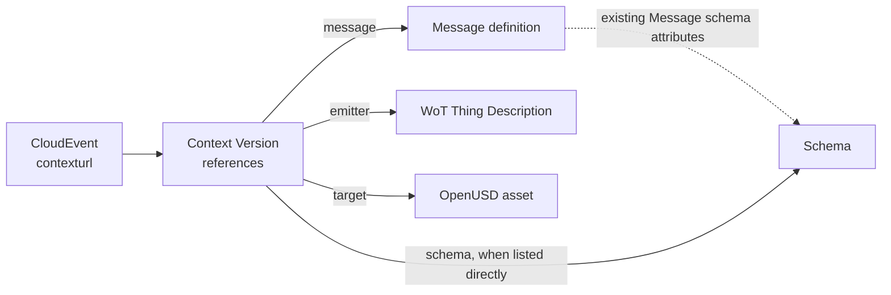

# Event Context for CloudEvents - Design

**Status:** Design rationale for the [Event Context Registry
specification](../spec.md), a working draft related to
[xregistry/spec#792](https://github.com/xregistry/spec/issues/792). The
specification defines the interoperable contract; this document explains
the design choices and trade-offs. Names remain provisional while the
draft is under review.

<!-- words: contexturl dataref linkset openusd -->
<!-- words: requestable standalone uncached -->
<!-- words: contextgroups reserialization workingdrafts -->

## 1. Problem

A Consumer can need more than the CloudEvent's `type`, `source` and
`dataschema` to interpret an event. It can also need the Message definition,
the payload schema, a description of the emitting entity, or a domain model
that the event targets. Carrying each URL in the event duplicates
configuration across Producers and increases the event's context metadata.

Reviewers also rejected a list of links as the solution: a Consumer would
still need to parse the list and discover which link has which meaning. The
event therefore carries one value the Consumer can request directly.

## 2. Decision

The CloudEvents `contexturl` extension attribute identifies one Context
Resource or Context Version. The value is an absolute URL. The Consumer uses
it as the request URL; it does not parse the value, construct another URL
from it, or remove or append path segments.

A Context is a metadata-only Resource in an xRegistry model. Its
`references` map is keyed by Role, and each entry has a `urlabsolute` `url`
attribute identifying the representation for that Role. The current model
defines `message`, `schema`, `emitter` and `target`; profiles can define
qualified roles for other references.

The [Context model](../model.json) is authoritative. The model and processing
rules are specified in [the specification](../spec.md), including
[Consumer processing](../spec.md#62-consumer-processing),
[schema precedence](../spec.md#53-relationship-to-cloudevents-attributes),
and [publication](../spec.md#7-retrieval-and-publication).

Text equivalent: `contexturl` points to one Context Version. Its
`references` map identifies representations by Role. The Message definition
can identify its schema using the existing Message model; a separate
`schema` Role can identify that schema directly when useful, for example to
include it in a resolved Context view. References do not imply containment.

## 3. Design Goals and Boundaries

- Give the event one directly requestable URL for its shared context.
- Let Consumers select references by JSON map key, not by parsing link
  syntax or deriving URLs.
- Keep Message, Endpoint, Schema, xRegistry Core and CloudEvents core
  attributes unchanged.
- Keep event-specific values, such as a prim path, in the event's existing
  attributes or data.
- Allow the basic Context model to work without a Registry-side resolver.
- Make resolution of all direct Targets in one response a separately
  negotiated capability at the same Context URL.

The model does not define the meaning or trustworthiness of a Target's
contents. It does not recursively collect links inside Targets or create a
persisted snapshot of a Context and its Targets. How a Producer obtains its
Context URL is also outside the design; configuration is the expected
mechanism.

## 4. Context Identity and Versioning

A Context Version gives a stable URL for one set of references when its
Publisher follows the specification's stability rule. Producers generally
use a Version URL. Core permits in-place Version updates, so the Publisher
uses a new Version to change references after configuring Producers with
the existing URL.

A Context Resource URL instead serves the current default Version. This
allows the Publisher to change the references used by Producers without
reconfiguring them, but the same event attribute value can then identify
different reference sets over time. A cache therefore cannot assume that
the value always identifies the same references.

Versioning the Context does not version the Targets. Identifying a Target
Version makes replay more stable when the event needs a reproducible
interpretation. The Publisher is responsible for retaining the Context
Version and Targets for as long as events that name them can be processed or
replayed.

## 5. CloudEvents and Schema Relationship

The `contexturl` CloudEvents extension attribute uses the standard
CloudEvents `URI` type. Its URL identifies a Context. It does not
replace or redefine `id`, `source`, `type`, `subject`, `time`, `dataschema`
or `dataref`.

The Consumer selects the first available schema source: the event's
`dataschema`, the Context's `schema` Reference, then the schema declared by
the Message definition. The specification favors supplying one source and
matching schemas when several are supplied. The Consumer follows the
precedence even if the sources disagree; it does not compare them.

A direct `schema` Role is not needed merely because the Message definition
already identifies a schema. It is useful when the schema needs to remain
fixed independently of a changing Message definition, or when including
the schema in the resolved view avoids following another URL.

The `emitter` Role can supply a Thing Description directly. It does not
change the meaning of CloudEvents `source` or authenticate the event. An
application that resolves `source` through a WoT identifier lookup can use
that mechanism independently; the specification does not define precedence
between that lookup and an `emitter` reference. This does not waive the
`source` or `subject` rules of another profile followed by the event.

## 6. Retrieval and Publication

An ordinary request to `contexturl` returns the Context metadata, including
all Roles. The Consumer reads only the Roles it needs. It then requests the
corresponding Targets, subject to its URL, authorization and content trust
policies. A missing or unavailable Role needed by the Consumer makes the
Context incomplete; the Consumer does not derive replacement references from
the Context URL.

If a Registry supports Core root `POST` and its model contains the Context
Group and all Target Group types, one request can publish them together.
Requesting `inline=contextgroups.contexts` includes the Context Version
metadata in the response. Without `inline` support, obtaining that metadata
needs a subsequent read. Core does not check whether URL-valued references
resolve, so ordering within the write does not establish Target availability.
Across Registries, the Publisher first makes the Targets available, then
publishes the Context, then configures Producers with the Context Version
URL.

## 7. Resolved Context View

The base Context model requires no resolver. A Registry can additionally
serve a resolved Context view at the same URL. A Consumer requests it with
HTTP content negotiation and can offer ordinary JSON as a fallback. No
separate capability lookup, new API path, write operation or CloudEvents
attribute is needed.

The view contains two members:

- `context`: the unchanged Context metadata, including its `references`.
- `documents`: one entry per Role in `context.references`, containing the
  Target URL, media type and content.

The Registry resolves every direct Reference or returns an error. It does
not return a partial view and does not follow references inside the
Targets. JSON content can be embedded as a JSON value; other content can be
returned as base64. This keeps the view generic without interpreting a
Message, schema, Thing Description or model. The response is not an atomic
snapshot across Registries, and the Target bytes can change independently
of the Context Version.

The resolver takes on work and risk that ordinary retrieval leaves to the
Consumer. Its implementation applies authorization, outbound request and
redirect policy, size and time limits, and caching rules to every Target,
including Targets already held locally. The Consumer applies its own trust
policies to the supplied content as well. A view reduces client round trips;
it does not eliminate the trust boundary or guarantee that further
dependencies will not need retrieval.

### 7.1. Relationship to Federation, Publication and WoT

The drafts in [xregistry/spec#571][issue571] address different layers. This
comparison uses their pinned revision linked below, not an assumption that
they are released or merged into Core.

| Draft | Its responsibility | Context boundary |
| --- | --- | --- |
| [Federation][federation-draft] | Select sources and compose a Registry view, including resolution ownership and shadowing. | A Context associates an event with explicit Target URLs. Negotiating its view does not select sources or establish federation resolution ownership. |
| [Publication][publication-draft] | Capture exact bytes and descriptors, publish immutable manifests, and retain selected state through channels and open contexts. | Core writes of Contexts are not channel promotion. A resolved Context view is neither a manifest nor a publication open context. |
| [WoT][wot-draft] | Resolve versioned Thing references and define a CloudEvents profile with `source` and `subject` rules. | A Context `emitter` does not replace that profile's source selection or its rule that `subject` addresses the resolved Thing Description. |

Both federation and the Context view can retrieve remote representations.
That shared activity does not make their contracts interchangeable: one
composes a Registry view; the other collects explicitly listed event Targets.
An event Context is also not a Registry context or a publication open context.

The Context view can embed parsed JSON, so it does not establish the exact
byte identity needed by publication digests. A Consumer that needs those
bytes uses `contentbase64` supplied without reserialization, or retrieves the
original representation, and performs the publication checks separately.
Context retrieval does not supply or replace checked open records, closure
bindings or snapshot-local lookup. Combining the features cannot justify
live/default fallback where the publication or WoT snapshot rules forbid it.
A publication-aware Context integration is outside this draft.

The specification's OpenUSD prim-path `subject` example is a generic
CloudEvent, not an example of the WoT CloudEvents profile. Using a Thing
Description as an `emitter` Target alone does not assert that profile. An
event that follows both profiles retains the WoT rules; this draft does not
choose precedence when an `emitter` and WoT source selection disagree.

## 8. Alternatives and Trade-offs

| Alternative | Why it was not selected |
| --- | --- |
| Multiple direct links in one CloudEvents extension | A Consumer still has to parse and interpret the link list. Events grow with the number of references, and a reference change requires Producer reconfiguration. |
| One CloudEvents extension per Role | Avoids a link list, but requires a separate extension for each Role and puts multiple URLs in each event. |
| Message definition as the indirection point | Requires extending the Message model. A Message definition is shared by an event type, while the emitter and target can differ for each Producer. |
| Endpoint as the indirection point | Requires extending the Endpoint model, which describes a channel rather than an emitter's context. |
| RFC 9264 Linkset document | Uses a separate link representation and needs an xRegistry document Resource to participate in a Core write. The chosen model stores Role references directly as metadata. |
| Out-of-band Producer configuration only | Does not give Consumers a generic way to discover the context of an event. |

| Benefit | Cost |
| --- | --- |
| One URL per event instead of one per Role | Requires publishing and retaining a Context Resource. |
| Roles are explicit JSON keys, not a parsed link syntax | The uncached base flow adds a Context request before Target retrieval. |
| Context references can change by publishing a new Version | Version stability depends on Publisher discipline; the Target itself can still change. |
| Resolved view returns all direct Targets in one client response | Registry implementation takes on Target retrieval, authorization and combined caching. |
| Existing Core and domain models remain unchanged | Without the view, each uncached Target can require another request. |

### 8.1. Context Document Alternative

[Review of the draft][document-review] proposed that a Context have a
document containing its Targets' content. Core's representations would then
select the form: the Context URL returns the document, and the `$details`
URL returns the metadata with `references`. A Consumer could obtain the
content of all Targets without a negotiated media type or further requests.

| Benefit | Cost |
| --- | --- |
| Uses Core's document and `$details` representations instead of a negotiated media type. | The event carries only one of the two URLs. If `contexturl` contains `$details`, a Consumer reaches the content only by removing the suffix, which is the URL construction that the indirection model avoids. Otherwise, every Consumer receives the content of every Target, including Targets it does not use. |
| A document that the Publisher stores needs no server-side Target retrieval, outbound request policy or combined cache policy. | Each Context Version duplicates its Targets' content, and a Target change reaches Consumers only after the Publisher stores a new document. Core does not check that the document agrees with `references`. |
| A Context Version URL identifies fixed content as well as fixed references. | Core would define a `contexturl` metadata attribute for an externally stored document, which differs in meaning from the CloudEvents attribute. A document that the Registry generates reintroduces the resolver's retrieval, authorization and caching rules. |

The draft keeps Contexts metadata-only. A Registry can instead provide the
content through the resolved Context view at the same URL. Whether Core's
document mechanism is preferable despite these costs remains an open
question.

## 9. Open Questions

The specification and its
[README](../README.md#open-questions) track the current open questions:

1. Whether `contexturl` is the final CloudEvents attribute name, including
   its relationship to the proposals in issues [#792][issue792] and
   [#314][issue314].
2. Where Roles are registered and whether `emitter` and `target` need
   domain-specific variants.
3. Whether a Reference needs a digest or media type, and how to select a
   definition inside a schema document without a URL fragment.
4. Whether same-Registry references need an `xid` alternative that lets a
   server check the Target type.
5. How a Registry could enforce Context Version stability and retention.
6. How applications handle conflicting event `source` and `emitter`
   interpretations.
7. Whether the Context model is standalone or part of a CloudEvents
   composite Registry.
8. Whether a Context has a document that contains its Targets' content
   instead of the negotiated resolved Context view
   ([Section 8.1](#81-context-document-alternative)).

[issue792]: https://github.com/xregistry/spec/issues/792
[issue314]: https://github.com/xregistry/spec/issues/314
[issue571]: https://github.com/xregistry/spec/pull/571
[document-review]: https://github.com/xregistry/spec/pull/796#discussion_r4540821623
[federation-draft]: https://github.com/xregistry/spec/blob/2d072a03bc8647f1d07efddede571076e8cf6553/workingdrafts/federation/spec.md
[publication-draft]: https://github.com/xregistry/spec/blob/2d072a03bc8647f1d07efddede571076e8cf6553/workingdrafts/publication/spec.md
[wot-draft]: https://github.com/xregistry/spec/blob/2d072a03bc8647f1d07efddede571076e8cf6553/workingdrafts/models/wot/spec.md
