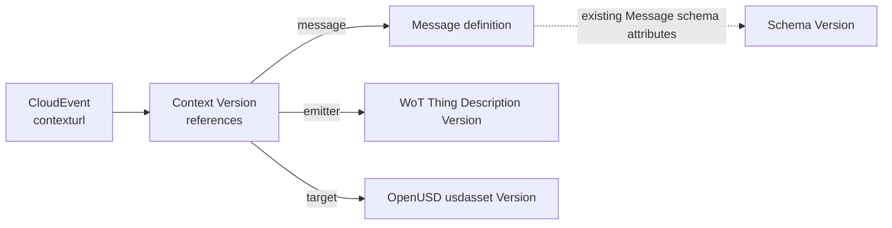

# Event Context Registry Service - Version 1.0-rc4

<!-- words: contextgroup contextgroups contextgroupid contextgroupsurl -->
<!-- words: contextgroupscount contextid contextsurl contextscount -->
<!-- words: usdasset usdassets usdassetgroups usda OpenUSD -->
<!-- words: thingdescriptiongroups thingdescriptions -->
<!-- words: allowlist baseurl contexturl dataref evt reserializing -->

## Abstract

This specification extends the xRegistry document format and API
[specification][xRegistry Core] with an Event Context Registry. It also
defines the `contexturl` CloudEvents extension attribute. A Context is a
metadata-only xRegistry entity that associates role names, such as the
event's Message definition, payload schema, emitting WoT Thing and target
OpenUSD model, with absolute URLs. An event carries the URL of one Context
instead of one URL for each entity that gives the event its meaning.

This specification is a working draft for discussion of
[xregistry/spec#792][issue792]. Its model, attribute and media type names are
provisional.

## Table of Contents

- [Event Context Registry Service - Version 1.0-rc4](#event-context-registry-service---version-10-rc4)
  - [Abstract](#abstract)
  - [Table of Contents](#table-of-contents)
  - [1. Overview](#1-overview)
    - [1.1. Event Context](#11-event-context)
    - [1.2. Relationship to Other xRegistry Specs](#12-relationship-to-other-xregistry-specs)
    - [1.3. Versioning](#13-versioning)
    - [1.4. Metadata-only Resources](#14-metadata-only-resources)
  - [2. Notations and Terminology](#2-notations-and-terminology)
    - [2.1. Notational Conventions](#21-notational-conventions)
    - [2.2. Terminology](#22-terminology)
      - [2.2.1. Context](#221-context)
      - [2.2.2. Reference and Role](#222-reference-and-role)
      - [2.2.3. Target](#223-target)
      - [2.2.4. Resolved Context View](#224-resolved-context-view)
      - [2.2.5. Publisher, Producer and Consumer](#225-publisher-producer-and-consumer)
    - [2.3. Context Group](#23-context-group)
  - [3. Event Context Registry Model](#3-event-context-registry-model)
  - [4. Event Context Registry](#4-event-context-registry)
    - [4.1. Context Groups](#41-context-groups)
    - [4.2. Context Resources](#42-context-resources)
      - [4.2.1. `references` Attribute](#421-references-attribute)
      - [4.2.2. `url` Attribute](#422-url-attribute)
      - [4.2.3. Roles](#423-roles)
      - [4.2.4. Versions and Stability](#424-versions-and-stability)
      - [4.2.5. Granularity](#425-granularity)
  - [5. CloudEvents `contexturl` Extension Attribute](#5-cloudevents-contexturl-extension-attribute)
    - [5.1. `contexturl` Attribute](#51-contexturl-attribute)
    - [5.2. Formats and Bindings](#52-formats-and-bindings)
    - [5.3. Relationship to CloudEvents Attributes](#53-relationship-to-cloudevents-attributes)
  - [6. Processing](#6-processing)
    - [6.1. Producer and Publisher Requirements](#61-producer-and-publisher-requirements)
    - [6.2. Consumer Processing](#62-consumer-processing)
    - [6.3. Example](#63-example)
  - [7. Retrieval and Publication](#7-retrieval-and-publication)
    - [7.1. Retrieval](#71-retrieval)
    - [7.2. Publication Within One Registry](#72-publication-within-one-registry)
    - [7.3. Publication Across Registries](#73-publication-across-registries)
    - [7.4. Resolved Context View](#74-resolved-context-view)
      - [7.4.1. Negotiation and Fallback](#741-negotiation-and-fallback)
      - [7.4.2. Representation and Collection Boundary](#742-representation-and-collection-boundary)
      - [7.4.3. Authorization, Limits and Errors](#743-authorization-limits-and-errors)
      - [7.4.4. Caching and Consistency](#744-caching-and-consistency)
      - [7.4.5. Example](#745-example)
  - [8. Security](#8-security)

## 1. Overview

A CloudEvent states its type and source, but a Consumer often needs more
information to process it: the Message definition that describes the event,
the schema of its data, a description of the entity that emitted it, and the
model that the event concerns. Carrying a URL for each of these items makes
every event larger, and changing one item requires reconfiguring every
Producer that sends it.

An Event Context Registry stores Contexts. A Context is a small,
metadata-only xRegistry Resource whose `references` map associates role
names with absolute URLs. An event names one Context through the
`contexturl` extension attribute. A Consumer obtains every reference with one
`GET` of that URL and selects the roles it needs by map key. It does not
parse a list of links or construct Context or target URLs.

A supporting Registry can also return a resolved Context view, which
contains the Context and every directly referenced target in one response.
The Consumer requests that representation at the same URL through HTTP
content negotiation.

### 1.1. Event Context

The figure shows the reference relationships for one event. Every arrow is a
reference; none of them denotes containment.



Text equivalent: the event's `contexturl` names one Context Version. The
Context Version's `references` map has three roles. The `message` role names
a Message definition, the `emitter` role names a WoT Thing Description
Version, and the `target` role names an OpenUSD `usdasset` Version. The
Message definition already references its payload schema through its own
attributes; this specification does not change that reference.

This specification follows these principles:

- One event attribute holds one URL, and Consumers use that URL as given.
- One request returns every reference for the event.
- A Registry MAY also return the directly referenced contents in one
  response when the Consumer requests the resolved Context view.
- Consumers select a reference by map key. They do not parse reference
  values or derive URLs from them.
- Existing models are referenced, not extended.
- Values that differ per event, such as a prim path, stay in the event.

### 1.2. Relationship to Other xRegistry Specs

An Event Context Registry is complementary to the xRegistry
[Message][xRegistry Message], [Schema][xRegistry Schema] and
[Endpoint][xRegistry Endpoint] registries, and to domain registries such as
the [WoT][WoT Draft] and [OpenUSD][OpenUSD Draft] working drafts. A Context
references their entities. It does not add attributes to their models, and
this specification does not change xRegistry Core or the meaning of any
CloudEvents core attribute.

[Message definition matching][Message matching] continues to associate an
event with its Message definition. A Context's `message` reference
identifies the Message definition directly, without that lookup. Issue
[#314][issue314-proposal] proposed an attribute that names the Message
definition; `contexturl` instead names a Context, which can reference the
Message definition, a schema and domain entities together.

A Registry MAY combine the Context Group type with the Message, Schema,
Endpoint and domain Group types, or it MAY serve Contexts alone. A Consumer
uses only `GET`. Any server that returns the representations defined in
[Section 4](#4-event-context-registry) and
[Section 7.4](#74-resolved-context-view) for a URL serves that Consumer
equally well.

This specification does not define how a Producer obtains its Context URL.
Configuration is the expected mechanism. It also does not define the
semantics of the referenced documents, a persisted snapshot of a Context
and its targets, or recursive collection of the targets' dependencies.

### 1.3. Versioning

Context Resources use the default Core versioning rules. A Context Version
identifies one fixed set of references when its Publisher follows
[Section 4.2.4](#424-versions-and-stability), so Producers SHOULD name a
Context Version rather than a Context Resource.

Addressing a `context` Resource without naming a Version serves that
Resource's [Core default Version][Core defaults]. A Publisher can change the
default Version to update every Producer that uses the Resource URL.

### 1.4. Metadata-only Resources

Context Resources have no domain-specific document
([`hasdocument`][Core hasdocument] is `false`). An ordinary `GET` of a
Context Resource URL or Context Version URL returns the entity's metadata as
a JSON object without a `$details` suffix, as
[Core HTTP][HTTP representations] defines for
[metadata-only Resources][Core metadata-only].

The resolved Context view ([Section 7.4](#74-resolved-context-view)) is a
negotiated response envelope at the same URL. It is not a document attached
to the Context, and it adds no attributes to this model.

## 2. Notations and Terminology

### 2.1. Notational Conventions

The key words "MUST", "MUST NOT", "REQUIRED", "SHALL", "SHALL NOT", "SHOULD",
"SHOULD NOT", "RECOMMENDED", "MAY", and "OPTIONAL" in this document are to be
interpreted as described in [RFC 2119](https://tools.ietf.org/html/rfc2119).

For clarity, OPTIONAL attributes (specification-defined and extensions) are
OPTIONAL for clients to use, but the servers' responsibility will vary.
Server-unknown extension attributes MUST be silently stored in the backing
datastore. Specification-defined, and server-known extension, attributes MUST
generate an error if the corresponding feature is not supported or enabled.

However, as with all attributes, if accepting the attribute results in a bad
state (such as exceeding a size limit or resulting in a security issue), then
the server MAY choose to reject the request.

In the pseudo JSON format snippets `?` means the preceding attribute is
OPTIONAL, `*` means the preceding attribute MAY appear zero or more times,
and `+` means the preceding attribute MUST appear at least once. The presence
of the `#` character means the remaining portion of the line is a comment.
Whitespace characters in the JSON snippets are used for readability and are
not normative.

### 2.2. Terminology

This specification defines the following terms:

#### 2.2.1. Context

A Context is a `context` Resource of this specification
([Section 4.2](#42-context-resources)) that maps roles to references. A
Context Version is one Version of a Context Resource. This term is distinct
from the CloudEvents term "context attributes".

#### 2.2.2. Reference and Role

A Reference is one entry of a Context's `references` map. Its key is a Role,
which states what the referenced representation means for the event.
[Section 4.2.3](#423-roles) defines the Roles of this specification.

#### 2.2.3. Target

A Target is the representation that a Reference's `url` identifies, for
example a Message definition, a schema document or a WoT Thing Description.

#### 2.2.4. Resolved Context View

A resolved Context view is a read-only response that contains a Context and
the contents of all of its direct References
([Section 7.4](#74-resolved-context-view)).

#### 2.2.5. Publisher, Producer and Consumer

A Publisher is a client that creates Contexts and their Targets in a
Registry. This specification uses Producer and Consumer as defined by
[CloudEvents][CE-Spec].

### 2.3. Context Group

A Context Group contains Contexts related in an application-defined way, for
example all Contexts for one production line, tenant or Producer. This
specification places no restriction on which Contexts a Group contains.

## 3. Event Context Registry Model

The authoritative xRegistry extension model of the Event Context Registry
resides in [model.json](model.json). Its `modelversion` is `0.1` while this
remains a working draft. It versions the Context model independently of the
xRegistry Core specification version in a Registry's `specversion`.

The JSON serialization of an Event Context Registry adheres to this form:

```yaml
{
  "specversion": "<STRING>",                       # xRegistry core attributes
  "registryid": "<STRING>",
  "self": "<URL>",
  "xid": "<XID>",
  "epoch": <UINTEGER>,
  "name": "<STRING>", ?
  "description": "<STRING>", ?
  "documentation": "<URL>", ?
  "labels": {
    "<STRING>": "<STRING>" *
  }, ?
  "createdat": "<TIMESTAMP>",
  "modifiedat": "<TIMESTAMP>",

  "model": { ... }, ?

  "contextgroups": {                               # ContextGroups collection
    "KEY": {                                       # contextgroupid
      "contextgroupid": "<STRING>",                # xRegistry core attributes
      "self": "<URL>",
      "xid": "<XID>",
      "epoch": <UINTEGER>,
      "name": "<STRING>", ?
      "description": "<STRING>", ?
      "documentation": "<URL>", ?
      "labels": { "<STRING>": "<STRING>" * }, ?
      "createdat": "<TIMESTAMP>",
      "modifiedat": "<TIMESTAMP>",
      "deprecated": { ... }, ?

      "contexts": {                                # Contexts collection
        "KEY": {                                   # contextid
          "contextid": "<STRING>",                 # xRegistry core attributes
          "versionid": "<STRING>",
          "self": "<URL>",
          "xid": "<XID>",

          #  Start of default Version's attributes
          "epoch": <UINTEGER>,
          "name": "<STRING>", ?
          "description": "<STRING>", ?
          "documentation": "<URL>", ?
          "labels": { "<STRING>": "<STRING>" * }, ?
          "createdat": "<TIMESTAMP>",
          "modifiedat": "<TIMESTAMP>",
          "ancestorid": "<STRING>",
          "references": {                          # References keyed by Role
            "<STRING>": {                          # Role
              "url": "<URL>"                       # absolute URL of the Target
            } +
          },
          #  End of default Version's attributes

          "metaurl": "<URL>",
          "meta": { ... }, ?

          "versions": { ... }, ?
          "versionsurl": "<URL>",
          "versionscount": <UINTEGER>
        } *
      }, ?
      "contextsurl": "<URL>",
      "contextscount": <UINTEGER>
    } *
  }, ?
  "contextgroupsurl": "<URL>",
  "contextgroupscount": <UINTEGER>
}
```

Contexts have no document, so the Core `contexturl`, `context` and
`contextbase64` Resource attributes never appear in Context metadata. In this
specification, `contexturl` always denotes the CloudEvents extension
attribute defined in [Section 5](#5-cloudevents-contexturl-extension-attribute).

## 4. Event Context Registry

The Event Context Registry organizes Contexts and their Versions. It stores
only metadata.

Implementations of this specification MAY include additional extension
attributes, including the `*` attribute of type `any`.

Groups, Resources, and Versions inherit their Core attributes from the
[xRegistry specification][xRegistry Core].

### 4.1. Context Groups

A Context Group collects Contexts related in an application-defined way,
without restricting the contained Contexts. Its Group Type (`<GROUP>`) name
is `contextgroup` (singular), and its collection name is `contextgroups`. It
has no specific extension attributes.

Every Context (the `context` Resource) MUST reside inside a Context Group.

Example:

```yaml
{
  # xRegistry top-level attributes excluded for brevity

  "contextgroups": {
    "line1": {
      "contextgroupid": "line1",
      # other xRegistry Group-level attributes excluded for brevity

      "contextsurl": "https://registry.example/contextgroups/line1/contexts",
      "contextscount": 2
    }
  },
  "contextgroupsurl": "https://registry.example/contextgroups",
  "contextgroupscount": 1
}
```

### 4.2. Context Resources

A Context Resource contains one or more Versions, each holding a
`references` map. Inside Context Groups, its Resource Type (`<RESOURCE>`)
name is `context` and its collection name is `contexts`.

Context Resources have no document, as
[Section 1.4](#14-metadata-only-resources) describes. Default Core versioning
applies. Implementations of this specification SHOULD use the xRegistry
default algorithm for generating new `versionid` values. See
[Version IDs][Core version-ids] for more information.

#### 4.2.1. `references` Attribute

- Type: Map of objects
- Description: References that give an event its context, keyed by Role.

- Constraints:
  - REQUIRED.
  - MUST contain at least one entry.
  - Each key is a Role and MUST follow the Core [map key rules][Core types]:
    lowercase alphanumeric characters, `:`, `-`, `_` or `.`, at most 63
    characters, starting with an alphanumeric character.
  - Each Role appears at most once. A profile that needs two references of
    one kind defines two Roles.
  - Consumers MUST ignore Roles they do not use and Reference attributes
    they do not understand.

- Examples:
  - `{ "message": { "url": "https://registry.example/messagegroups/factory/messages/com.example.temperature.v1" } }`

#### 4.2.2. `url` Attribute

This attribute is a member of each `references` entry.

- Type: URL (`urlabsolute`)
- Description: Absolute URL of the Target representation.

- Constraints:
  - REQUIRED.
  - When retrieving a Target, Consumers and Registries that assemble a
    resolved Context view MUST use the value as given and MUST NOT rewrite
    it. A Consumer MAY instead use the Target content supplied in a resolved
    Context view.
  - The URL selects the representation. For an xRegistry Resource that has a
    document, the unsuffixed URL returns the document, and the `$details` URL
    returns its metadata ([representations][HTTP representations]). The
    Publisher chooses the representation that the Role requires.
  - MAY identify an entity in any Registry, or a resource that is not an
    xRegistry entity.
  - SHOULD identify a Version when the Target is versioned and the Publisher
    needs the event's interpretation to be reproducible.
  - Cannot contain a fragment, because a `urlabsolute` value is an absolute
    URI as defined in RFC 3986 Section 4.3 ([data types][Core types]).

- Examples:
  - `https://registry.example/thingdescriptiongroups/factory/thingdescriptions/pump42/versions/3`

#### 4.2.3. Roles

This specification defines four Roles:

| Role | Meaning | Typical Target |
| --- | --- | --- |
| `message` | Message definition that describes the event | Message Resource; metadata only |
| `schema` | Schema for the event's `data` | Schema Version document |
| `emitter` | Description of the entity that emitted the event | WoT Thing Description Version document |
| `target` | Model that the event concerns or acts on | OpenUSD `usdasset` Version document |

- Unprefixed Role names are reserved for this specification. Other Roles
  SHOULD contain a `:` after a prefix that identifies the defining
  organization or profile, for example `acme:policy`.
- A `message` Target is metadata-only, so its URL returns JSON directly.
  Message Resources keep one Version ([model][Message model]), so a
  `message` Reference follows the definition as it changes. A Publisher that
  needs a fixed payload schema, or needs a separately referenced schema
  included in a resolved Context view, also adds a `schema` Reference
  ([Section 5.3](#53-relationship-to-cloudevents-attributes) and
  [Section 7.4.2](#742-representation-and-collection-boundary)).
- A `schema` Target is a schema document that a Consumer can use to validate
  `data`.
- An `emitter` Target describes the Producer's source entity, for example a
  WoT Thing. It does not authenticate the event ([Section 8](#8-security)).
- A `target` Target is the model that the event concerns, for example an
  OpenUSD asset ([artifacts][OpenUSD artifacts]). A location within that
  model, such as a prim path, stays in `subject` or `data`.

#### 4.2.4. Versions and Stability

- A Context Version URL identifies one fixed set of references when the
  Publisher follows the next rule. Producers SHOULD use Context Version
  URLs.
- Core permits a Version to be updated in place. A Publisher MUST NOT change
  the `references` of a Context Version after any Producer has been
  configured with that Version's URL. To change references, the Publisher
  creates a new Version and reconfigures the Producers.
- A Context Resource URL returns the default Version. A Publisher can change
  the default Version to update every Producer that uses the Resource URL
  without reconfiguring them. Consumers then cannot assume that two events
  with the same `contexturl` used the same references, and they SHOULD bound
  the lifetime of cached Resource representations.
- Publishers SHOULD retain each Context Version and its Targets for as long
  as events that name it can be processed or replayed.

#### 4.2.5. Granularity

- A Context with a `message` Role applies to one event type, so a Producer
  that emits several event types uses one Context per type.
- A Context without a `message` Role can be shared by every event type of
  one emitter. A Consumer then finds the Message definition by
  [Message definition matching][Message matching].

## 5. CloudEvents `contexturl` Extension Attribute

This section defines one CloudEvents extension attribute. As CloudEvents
[recommends for extensions][CE-Extensions], it defines the attribute's name,
type, meaning and values.

### 5.1. `contexturl` Attribute

- Type: `URI`, as defined by the [CloudEvents type system][CE-Types]
- Description: URL of the Context that applies to this event.

- Constraints:
  - OPTIONAL.
  - If present, MUST be an absolute URL that identifies a Context Resource
    or a Context Version. As a CloudEvents `URI`, the value cannot contain a
    fragment.
  - SHOULD identify a Context Version
    ([Section 4.2.4](#424-versions-and-stability)).
  - Consumers MUST use the value without modification as the request URL
    and as the URL component of the cache key. Cache selection MUST also
    respect the selected representation and authorization context
    ([Section 7.4.4](#744-caching-and-consistency)).
  - Consumers MUST NOT construct other URLs from it. For example, they do
    not append `$details`, a view path or a query parameter, and they do not
    remove a `/versions/<id>` segment.
  - When the attribute is absent, this specification supplies no Context for
    the event. Absence does not mean that no context exists by other means.

- Examples:
  - `https://registry.example/contextgroups/line1/contexts/pump42-temperature/versions/1`

The name meets the CloudEvents [attribute naming convention][CE-Naming]: it
uses lowercase alphanumeric characters and has no more than 20 characters.

### 5.2. Formats and Bindings

- In the JSON event format, the attribute is the top-level member
  `"contexturl"` with a string value, as for any
  [extension attribute][CE-JSON].
- In the HTTP binary content mode, the attribute is the
  [`ce-contexturl` header][CE-HTTP]. The Producer percent-encodes the
  characters that the [HTTP header value rules][CE-HTTP-Values] require,
  including `%` itself. The Consumer decodes the header value as the binding
  requires before it uses the URL.
- Other protocol bindings map the attribute as they map any extension
  attribute.

### 5.3. Relationship to CloudEvents Attributes

- `id`, `source`, `type`, `subject` and `time` keep their CloudEvents
  meaning.
- [`dataschema`][CE-dataschema] keeps its meaning. A Consumer determines the
  schema for `data` from the first applicable source:
  1. The event's `dataschema` attribute.
  2. The Context's `schema` Reference.
  3. The schema that the Context's `message` Target declares, as the
     [Message specification][Message schema] defines.

  Publishers and Producers SHOULD supply only one of these. When they supply
  more than one, the sources SHOULD identify the same schema. A Consumer
  applies this precedence and does not compare the sources. A direct
  `schema` Reference alongside `message` is useful when a resolved Context
  view needs to include a schema that would otherwise require another
  retrieval. This does not change the precedence or the Message model.
- [`dataref`][CE-dataref] locates the event's data and is unrelated to this
  specification.
- [`subject`][CE-subject] carries values that differ per event, such as a
  prim path within the `target` model.
- An `emitter` Reference supplies the Thing Description directly, without
  the WoT draft's [identifier lookup][WoT lookup]. It does not redefine the
  event's [`source`][CE-source].

## 6. Processing

### 6.1. Producer and Publisher Requirements

A Producer:

- MAY include `contexturl` in any event.
- MUST set `contexturl` only to a Context whose references apply to the
  event.
- SHOULD use one configured value for all events of one emitter and event
  type, rather than computing a value per event.
- Does not need to dereference `contexturl`.
- SHOULD omit `dataschema` when the Context supplies the schema.

A Publisher:

- MUST make each Target available before it configures Producers with a
  Context that references the Target.
- MUST follow the Version rules in
  [Section 4.2.4](#424-versions-and-stability).
- SHOULD NOT supply both `message` and `schema` References unless it needs a
  fixed schema or needs the separately referenced schema included in a
  resolved Context view
  ([Section 7.4.2](#742-representation-and-collection-boundary)).

### 6.2. Consumer Processing

A Consumer that supports this specification processes an event as follows:

1. If the event has no `contexturl`, the Consumer processes the event
   without a Context.
2. If local policy does not permit the URL, for example because its origin
   is not on an allowlist, the Consumer MUST NOT dereference it. The Context
   is unavailable.
3. If the Consumer holds a cached representation for the exact URL, selected
   representation and authorization context that is valid under HTTP and
   local cache policy, it uses that representation. Otherwise, it sends
   `GET` to the URL with `Accept: application/json`, or it requests the
   resolved Context view as described in
   [Section 7.4.1](#741-negotiation-and-fallback).
4. The Consumer checks the response status and `Content-Type`. For ordinary
   JSON, the body is the Context. For a resolved Context view, `context` is
   the Context and `documents` supplies the Targets. The Context is
   unavailable when the response is not successful, the representation is
   unsupported, the Context lacks a `references` map, or the view violates
   [Section 7.4.2](#742-representation-and-collection-boundary).
5. For each Role it uses, the Consumer reads `references.<role>.url` and
   ignores other Roles. If a Role that the Consumer requires is absent, the
   Context is incomplete.
6. The Consumer applies its Target origin and content trust policies before
   it uses any supplied Target. A resolved Context view does not bypass
   those policies. The Consumer retrieves any needed Targets that an
   accepted view or a valid cache entry does not supply. It sends each
   request to the URL exactly as given, applies step 2 to each URL, and MAY
   send the requests concurrently.
7. The Consumer determines the payload schema
   ([Section 5.3](#53-relationship-to-cloudevents-attributes)) and applies
   the context.

When the Context is unavailable or incomplete, or a Target that the Consumer
needs cannot be retrieved, the Consumer MUST NOT derive a replacement Context
or replacement references from the `contexturl` value. It MAY still use
mechanisms that do not depend on this specification, such as
[Message definition matching][Message matching]. According to local policy,
it then defers the event, rejects it, or processes it without that context,
and it SHOULD record the condition.

### 6.3. Example

A Producer emits the following event in the JSON event format:

```json
{
  "specversion": "1.0",
  "id": "evt-1042",
  "source": "urn:example:factory:thing:pump42",
  "type": "com.example.temperature.v1",
  "subject": "/Line1/Pump42",
  "time": "2025-01-15T09:30:00Z",
  "datacontenttype": "application/json",
  "contexturl": "https://registry.example/contextgroups/line1/contexts/pump42-temperature/versions/1",
  "data": { "temperature": 42.0 }
}
```

In the HTTP binary content mode, the same event is:

```yaml
POST /events HTTP/1.1
Host: consumer.example
ce-specversion: 1.0
ce-id: evt-1042
ce-source: urn:example:factory:thing:pump42
ce-type: com.example.temperature.v1
ce-subject: /Line1/Pump42
ce-time: 2025-01-15T09:30:00Z
ce-contexturl: https://registry.example/contextgroups/line1/contexts/pump42-temperature/versions/1
Content-Type: application/json

{ "temperature": 42.0 }
```

With an empty cache, the Consumer requests the Context Version:

```yaml
GET /contextgroups/line1/contexts/pump42-temperature/versions/1 HTTP/1.1
Host: registry.example
Accept: application/json
```

The Registry returns the Version's metadata. OPTIONAL Core attributes are
omitted.

```json
{
  "contextid": "pump42-temperature",
  "versionid": "1",
  "self": "https://registry.example/contextgroups/line1/contexts/pump42-temperature/versions/1",
  "xid": "/contextgroups/line1/contexts/pump42-temperature/versions/1",
  "epoch": 1,
  "isdefault": true,
  "createdat": "2025-01-15T09:00:00Z",
  "modifiedat": "2025-01-15T09:00:00Z",
  "ancestorid": "1",
  "references": {
    "message": {
      "url": "https://registry.example/messagegroups/factory/messages/com.example.temperature.v1"
    },
    "emitter": {
      "url": "https://registry.example/thingdescriptiongroups/factory/thingdescriptions/pump42/versions/3"
    },
    "target": {
      "url": "https://assets.example/usdassetgroups/line1/usdassets/line1.usda/versions/7"
    }
  }
}
```

The Consumer then sends up to three concurrent requests, one for each Role
it uses:

| Role | Request | Result |
| --- | --- | --- |
| `message` | `GET` Message URL | Message definition metadata, including its schema reference |
| `emitter` | `GET` Thing Description Version URL | WoT Thing Description document |
| `target` | `GET` `usdasset` Version URL on `assets.example` | OpenUSD layer document |

The event has no `dataschema` and the Context has no `schema` Reference, so
the Consumer validates `data` against the schema that the Message definition
declares. If the Message definition references a schema by URL, retrieving
that schema is one more request.

## 7. Retrieval and Publication

### 7.1. Retrieval

The number of client requests depends on the cache state and on the
representation that the Registry returns:

| Cache state and representation | Client requests |
| --- | --- |
| Context and needed Targets cached | None |
| Context cached, N Targets not cached | N, concurrent |
| Nothing cached; ordinary Context | 1 for the Context, then N concurrent |
| Nothing cached; resolved Context view supported and successful | 1 for the Context and all direct Targets |
| Resolved Context view requested with JSON fallback; view unsupported | 1 for the Context, then N concurrent |

The ordinary representation returns every Reference, not the Target content.
Core's [`inline` flag][Core inline] expands nested collections and documents
of the requested entity; it does not follow URL-valued attributes such as
`url`. The resolved Context view ([Section 7.4](#74-resolved-context-view))
adds that retrieval behavior without changing `inline`. One client request
can still cause several Registry-side retrievals. Dependencies not directly
listed in the Context can need further requests in either mode.

### 7.2. Publication Within One Registry

When one Registry's model includes the Context Group type and the Group types
of the Targets, one [`POST /`][HTTP root POST] request can create the Targets
and the Context together. If any part of the request fails, the server
rejects the entire request and makes no updates
([processing][HTTP processing]). The server does not check that `url` values
resolve, so the order of entities within the request does not matter.

The following schematic request omits the Message attributes for brevity.
The Thing Description Version already exists in this Registry, and the
OpenUSD asset is in another Registry.

```yaml
POST /
Content-Type: application/json

{
  "messagegroups": {
    "factory": {
      "messages": {
        "com.example.temperature.v1": { ... }     # Message attributes
      }
    }
  },
  "contextgroups": {
    "line1": {
      "contexts": {
        "pump42-temperature": {
          "references": {
            "message": { "url": "https://registry.example/messagegroups/factory/messages/com.example.temperature.v1" },
            "emitter": { "url": "https://registry.example/thingdescriptiongroups/factory/thingdescriptions/pump42/versions/3" },
            "target": { "url": "https://assets.example/usdassetgroups/line1/usdassets/line1.usda/versions/7" }
          }
        }
      }
    }
  }
}
```

The Publisher reads the new Context's `versionid` from the response and
configures Producers with the Context Version URL.

### 7.3. Publication Across Registries

No request spans Registries, so a Publisher:

1. Publishes the Targets in their Registries.
2. Publishes the Context.
3. Configures Producers with the Context Version URL.

A failure in step 1 or step 2 leaves no Context that names a missing Target,
because each step depends only on earlier steps.

### 7.4. Resolved Context View

The resolved Context view is OPTIONAL for both Registries and Consumers.
Supporting the Context model does not imply support for this feature.

The view is an alternative response at the existing Context Resource or
Context Version URL. It adds no CloudEvents attribute, model attribute,
write operation or API path. It does not extend Message, Endpoint, Schema or
Core's `inline` behavior. The view is derived from existing entities; it is
not a Resource that Publishers create.

#### 7.4.1. Negotiation and Fallback

The media type of the view is
`application/vnd.xregistry.context-view+json`. The name is provisional and
is not registered.

A Consumer requests the view by sending `GET` to its unchanged `contexturl`
with the following [HTTP `Accept` header][RFC9110-Accept]:

```yaml
Accept: application/vnd.xregistry.context-view+json, application/json;q=0.5
```

- A supporting Registry MUST select the view when the request explicitly
  names it and prefers it over ordinary JSON. A complete response uses
  `200 OK` with `Content-Type: application/vnd.xregistry.context-view+json`.
  Conditional requests follow
  [Section 7.4.4](#744-caching-and-consistency).
- Without an explicit request for the view, the Registry MUST retain the
  ordinary JSON behavior. An absent `Accept` header or `*/*` alone does not
  request the view.
- The lower-preference `application/json` permits a Registry without view
  support to return the ordinary Context in the same round trip. Consumers
  MUST distinguish the representations by `Content-Type` and MUST NOT assume
  that sending the header guarantees a view.
- A Consumer that requires a view MAY omit the JSON alternative. A Registry
  that implements this negotiation MUST return `406 Not Acceptable` when it
  cannot offer any acceptable representation. A Consumer MUST reject an
  unexpected representation, even if an older server ignores `Accept`.
- Once a Registry selects the view, a retrieval or authorization failure
  MUST produce an error as described in
  [Section 7.4.3](#743-authorization-limits-and-errors), not an ordinary
  JSON response that conceals the failed resolution.

No separate capability discovery request is needed. A Consumer that needs
only a few Targets can continue to request ordinary JSON and retrieve those
Targets individually.

#### 7.4.2. Representation and Collection Boundary

The response is a JSON object with two REQUIRED members:

| Member | Type | Meaning |
| --- | --- | --- |
| `context` | Object | The Context metadata selected for this request, including its unchanged `references` map. |
| `documents` | Map of objects | One entry for every Role in `context.references`, using the same keys. |

Each `documents` entry has the following members:

| Member | Presence | Meaning |
| --- | --- | --- |
| `url` | REQUIRED | The exact `url` from the corresponding Reference. |
| `contenttype` | REQUIRED | The Target's media type, including relevant parameters; `application/octet-stream` when none is supplied. |
| `content` | Conditional | The Target represented as a JSON value, when it can be embedded as JSON. |
| `contentbase64` | Conditional | The Target bytes encoded as a base64 string. |
| `baseurl` | Conditional | The final retrieval URL, REQUIRED when an allowed redirect changed it; otherwise omitted. |

- Exactly one of `content` and `contentbase64` MUST be present. The encoding
  follows Core's [document embedding pattern][Core document encoding]: valid
  JSON can appear directly as `content`, and other content, including text in
  formats other than JSON, MUST use `contentbase64`.
- HTTP content codings, such as gzip, MUST be decoded before either form is
  produced.
- An empty Target uses `"contentbase64": ""`. A JSON `null` Target uses
  `"content": null`, which is a value in this response, not an xRegistry
  update instruction.
- Registries MAY also use base64 for JSON to preserve its exact bytes.
  Consumers MUST support both forms and MUST NOT assume that reserializing
  `content` reproduces the original bytes.

These members belong only to the response envelope. They are not added to
Context metadata or to the referenced models. The Registry MUST NOT rewrite
URLs or other values inside Target documents. When a document format uses
its retrieval location to resolve relative references, Consumers use
`baseurl`, or `url` when `baseurl` is absent, subject to that format's own
base URI rules. They do not use the Context URL as the document's location.

The Registry captures one Context representation, then obtains the complete
Target representation for every direct Reference in the captured map:

- The Registry MAY use authorized, valid cache entries or local storage
  rather than issuing network requests.
- Network retrieval uses the URL as given with `Accept: */*`. The Registry
  MUST NOT forward the view's `Accept` header.
- If several Roles name the same URL, one retrieval MAY supply their
  entries.
- The completed map MUST have exactly the keys of `context.references`, and
  each entry's `url` MUST match its Reference.

The Registry MUST NOT recursively follow links inside those Targets. For
example:

- A Message definition's inline schema is already part of its retrieved
  metadata. A separately referenced schema is not automatically retrieved.
- A Publisher that needs that separate schema in the view lists it under the
  Context's `schema` Role. It creates a new Context Version when
  [Section 4.2.4](#424-versions-and-stability) requires one.
- Schema imports, WoT links, OpenUSD sublayers, textures and references to
  other Contexts do not cause further collection.
- An event's `dataschema` is not an input to this request. If it names a
  schema that is not among the direct Targets, the Consumer retrieves that
  schema separately and follows the precedence in
  [Section 5.3](#53-relationship-to-cloudevents-attributes).

Thus, a complete view includes every direct Target. It is not a package of
all dependencies, an atomic snapshot across Registries, or a guarantee that
all processing can finish without another request.

#### 7.4.3. Authorization, Limits and Errors

Before including a Target, the Registry MUST establish that the caller is
authorized to receive it. Read access to a Context alone grants no access to
its Targets. The Registry MAY use credentials for each origin or an
explicitly configured publication policy. Possession of a service credential
alone is not proof that the caller is authorized. The Registry MUST NOT
blindly forward the caller's credentials to referenced origins.

The Registry MUST apply outbound request policy to every Target, resolved
network address and redirect destination. This includes protection against
requests to disallowed local or internal services. The Registry rejects
unsupported URL schemes or origins rather than trying them through an
unrestricted proxy.

The Registry MUST bound the number of Targets, the total retrieved and
encoded response bytes, the retrieval time, redirects and concurrency. The
byte limit includes any decompression and base64 expansion.

If authorization is denied, a Target is missing or unavailable, or a limit
is exceeded, the Registry MUST return an error response rather than a
partial view. It MUST NOT omit a Role, substitute an empty body or return
truncated content as a successful Target.

Errors SHOULD use the [Core HTTP error format][HTTP errors] and identify
whether resolution was denied, unavailable or exceeded a limit. Error
details MUST NOT disclose Target content or credentials. The Consumer
handles the failure as described in
[Section 6.2](#62-consumer-processing). It MAY explicitly retry with
ordinary JSON and retrieve only the Targets its own processing requires.

#### 7.4.4. Caching and Consistency

Registries that support the view MUST send `Vary: Accept` on both the
ordinary Context response and the resolved Context view, preserving any
other `Vary` fields that the response needs. Caches MUST distinguish those
representations and honor [HTTP caching rules][RFC9111], including
authorization and source cache restrictions. A view that contains content
specific to one caller MUST NOT be reused for another caller without
establishing authorization.

Any freshness lifetime for a view MUST be bounded by that of the Context and
of every included Target. If the Registry cannot establish a safe combined
cache policy, it MUST return `Cache-Control: no-store`. Entries extracted
from a view MUST NOT be treated as independently public or as longer-lived
than the view that supplied them.

If supplied, the view's `ETag` MUST validate the whole selected
representation, not only the Context's `epoch` or Version ID. Before it
returns `304 Not Modified`, the Registry MUST establish that the Context and
every included Target remain valid under their cache policies and that the
resulting view is unchanged.

A Context Version fixes its reference list under
[Section 4.2.4](#424-versions-and-stability); it does not make the Target
bytes immutable. Targets can change independently and can be read at
different times during assembly. A view MUST NOT be described as an atomic
snapshot merely because it arrived in one response.

#### 7.4.5. Example

A Context named `pump42-processing` references the payload schema and an
OpenUSD asset for the scenario in [Section 6.3](#63-example). The asset is
in another Registry and contains a small USDA layer that defines
`/Line1/Pump42`. An event that names this Context's Version leads to the
following request at the unchanged URL:

```yaml
GET /contextgroups/line1/contexts/pump42-processing/versions/1 HTTP/1.1
Host: registry.example
Accept: application/vnd.xregistry.context-view+json, application/json;q=0.5
```

A supporting Registry returns the following response headers:

```yaml
HTTP/1.1 200 OK
Content-Type: application/vnd.xregistry.context-view+json
Vary: Accept
Cache-Control: no-store
```

The body contains the Context metadata and both direct Targets. OPTIONAL
Core attributes are omitted; no Reference or Target content is omitted.

```json
{
  "context": {
    "contextid": "pump42-processing",
    "versionid": "1",
    "self": "https://registry.example/contextgroups/line1/contexts/pump42-processing/versions/1",
    "xid": "/contextgroups/line1/contexts/pump42-processing/versions/1",
    "epoch": 1,
    "isdefault": true,
    "createdat": "2025-01-15T09:00:00Z",
    "modifiedat": "2025-01-15T09:00:00Z",
    "ancestorid": "1",
    "references": {
      "schema": {
        "url": "https://registry.example/schemagroups/factory/schemas/temperature/versions/1"
      },
      "target": {
        "url": "https://assets.example/usdassetgroups/line1/usdassets/pump42.usda/versions/1"
      }
    }
  },
  "documents": {
    "schema": {
      "url": "https://registry.example/schemagroups/factory/schemas/temperature/versions/1",
      "contenttype": "application/schema+json",
      "content": {
        "$schema": "https://json-schema.org/draft/2020-12/schema",
        "type": "object",
        "properties": {
          "temperature": { "type": "number" }
        },
        "required": [ "temperature" ]
      }
    },
    "target": {
      "url": "https://assets.example/usdassetgroups/line1/usdassets/pump42.usda/versions/1",
      "contenttype": "model/vnd.usda",
      "contentbase64": "I3VzZGEgMS4wCmRlZiBYZm9ybSAiTGluZTEiIHsKICAgIGRlZiBYZm9ybSAiUHVtcDQyIiB7fQp9Cg=="
    }
  }
}
```

The Consumer uses `documents.schema.content` and decodes
`documents.target.contentbase64` without another retrieval. Neither document
has external dependencies, so this example needs no further requests. A
Registry without view support can instead return `application/json` that
contains only the Context metadata; the Consumer then retrieves the Targets
it needs by their `references` URLs.

A view of the `pump42-temperature` Context in
[Section 6.3](#63-example) would include the Message definition, the Thing
Description and the OpenUSD layer. It would not follow the Message
definition's separate schema reference. Including that schema requires a
direct `schema` Reference in a new Context Version. The OpenUSD bytes, which
are not JSON, would appear as `contentbase64`, not as a parsed or rewritten
model.

## 8. Security

Like the [xRegistry Core][xRegistry Core] specification, this specification
does not explicitly address authentication or authorization levels of users,
nor how to securely protect the APIs.

Implementations are expected to use authentication and authorization
mechanisms suited to the application domain and deployment environment.
These MAY include OAuth 2.0, OpenID Connect, API keys, or other mechanisms.

Operators and Consumers SHOULD be aware of the following considerations:

- **Event and Reference URLs are supplied by others.** A Consumer MUST apply
  local policy, such as an origin allowlist, before it dereferences a
  `contexturl` or `url` value, to prevent server-side request forgery.
- **A Reference grants no access.** A Consumer uses the credentials that its
  configuration associates with each Target origin, and SHOULD NOT send
  credentials for one origin to another.
- **A Context is as trustworthy as its writers.** Its integrity depends on
  the write access control of the Registries that hold the Context and its
  Targets. This specification defines no digest for a Reference.
- **References are claims.** `contexturl` and the `emitter` Reference are
  claims made by the Producer. They do not authenticate `source` or the
  event.
- **Retrieval consumes resources.** Consumers SHOULD bound the Context size,
  the number of References they retrieve, request timeouts and concurrent
  requests.
- **A Context discloses all of its References.** An event exposes one URL
  rather than every Target URL. Anyone who can read the Context can read all
  of its References, so the Context needs read access control matching its
  most sensitive Target.
- **A resolving Registry distributes Target content.** The Registry MUST
  apply [Section 7.4.3](#743-authorization-limits-and-errors) even to content
  it already holds locally or in a cache. Consumers trust the Registry to
  supply that content correctly; a view does not prove that the Target
  origin signed or authenticated the supplied bytes.

---

[issue792]: https://github.com/xregistry/spec/issues/792
[issue314-proposal]: https://github.com/xregistry/spec/issues/314#issuecomment-2880321588
[Core types]: ../../../core/spec.md#data-types
[Core version-ids]: ../../../core/spec.md#version-ids
[Core defaults]: ../../../core/spec.md#default-version-of-a-resource
[Core inline]: ../../../core/spec.md#inline-flag
[Core document encoding]: ../../../core/spec.md#resource-attribute
[Core metadata-only]: ../../../core/spec.md#document-resources-vs-metadata-only-resources
[Core hasdocument]: ../../../core/model.md#groupsstringresourcesstringhasdocument
[HTTP representations]: ../../../core/http.md#resource-metadata-vs-resource-document
[HTTP root POST]: ../../../core/http.md#post-
[HTTP processing]: ../../../core/http.md#creating-or-updating-entities
[HTTP errors]: ../../../core/http.md#error-processing
[Message matching]: ../../../message/spec.md#message-definition-matching
[Message schema]: ../../../message/spec.md#dataschemaformat
[Message model]: ../../../message/model.json
[WoT Draft]: ../wot/spec.md
[WoT lookup]: ../wot/spec.md#53-lookup
[OpenUSD Draft]: ../openusd/spec.md
[OpenUSD artifacts]: ../openusd/spec.md#11-artifacts-and-asset-containers
[CE-Spec]: https://github.com/cloudevents/spec/blob/ce@v1.0.2/cloudevents/spec.md
[CE-Types]: https://github.com/cloudevents/spec/blob/ce@v1.0.2/cloudevents/spec.md#type-system
[CE-Naming]: https://github.com/cloudevents/spec/blob/ce@v1.0.2/cloudevents/spec.md#attribute-naming-convention
[CE-Extensions]: https://github.com/cloudevents/spec/blob/56b54136a6088c47058ed43c2df45e433b4868f0/cloudevents/spec.md#extension-context-attributes
[CE-dataschema]: https://github.com/cloudevents/spec/blob/ce@v1.0.2/cloudevents/spec.md#dataschema
[CE-source]: https://github.com/cloudevents/spec/blob/ce@v1.0.2/cloudevents/spec.md#source-1
[CE-subject]: https://github.com/cloudevents/spec/blob/ce@v1.0.2/cloudevents/spec.md#subject
[CE-JSON]: https://github.com/cloudevents/spec/blob/v1.0.2/cloudevents/formats/json-format.md
[CE-HTTP]: https://github.com/cloudevents/spec/blob/56b54136a6088c47058ed43c2df45e433b4868f0/cloudevents/bindings/http-protocol-binding.md#313-metadata-headers
[CE-HTTP-Values]: https://github.com/cloudevents/spec/blob/v1.0.2/cloudevents/bindings/http-protocol-binding.md#3132-http-header-values
[CE-dataref]: https://github.com/cloudevents/spec/blob/56b54136a6088c47058ed43c2df45e433b4868f0/cloudevents/extensions/dataref.md
[RFC9110-Accept]: https://www.rfc-editor.org/rfc/rfc9110.html#section-12.5.1
[RFC9111]: https://www.rfc-editor.org/rfc/rfc9111.html
[xRegistry Core]: https://xregistry.io/xreg/xregistryspecs/core-v1/docs/spec.html
[xRegistry Endpoint]: https://xregistry.io/xreg/xregistryspecs/endpoint-v1/docs/spec.html
[xRegistry Message]: https://xregistry.io/xreg/xregistryspecs/message-v1/docs/spec.html
[xRegistry Schema]: https://xregistry.io/xreg/xregistryspecs/schema-v1/docs/spec.html
