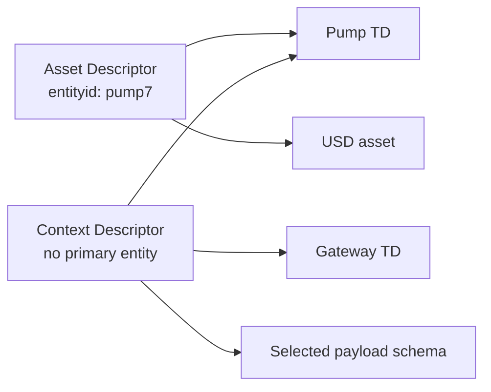

# Descriptor Registry - Design

<!-- words: describedby entityid entitytype schemaref endpointref -->
<!-- words: linkset uncached reserialization prebuilt -->
<!-- words: affordance affordances descriptorid ETags matchversions namespace namespaces -->
<!-- words: opc ua opcua OpenUSD TDs TMs USD workingdrafts -->
<!-- words: prebuilding -->
<!-- words: thingdescription thingmodel usdasset thingref affordanceselector -->
<!-- words: descriptorgroups processData -->
<!-- words: opcuawriter -->

Use one metadata-only Descriptor Resource for entity descriptions and shared
processing inputs. Its named References identify representations that a
Consumer can retrieve independently. A CloudEvent can select that Descriptor
with `describedby`, while a profile can use an existing event attribute when
it already identifies the description the Consumer needs.

This document records the rationale and consequences of the
[Descriptor Registry specification](../spec.md), a working draft related to
[xregistry/spec#792][issue792]. The specification defines the domain
requirements. The [CloudEvents proposal][CE] defines event linkage and its
WoT and OPC UA bindings. The discussion here explains those decisions
without adding requirements.

## 1. Problem

A Consumer needs more than an event type to interpret some messages. A
payload schema defines the data structure, a Web of Things (WoT) Thing
Description (TD) identifies a device and its affordances, and an OpenUSD
asset can describe the geometry affected by the event. These descriptions
can have different publishers and revision histories.

Putting a separate URL for every representation into every message couples
the event envelope to that inventory. Adding another representation then
changes the metadata Producers send and Consumers parse, even when the
messages use the same shared configuration. Keeping everything in local
configuration avoids that repetition but leaves another Consumer without
an agreed retrieval path.

A catalog needs the same associations independently of events. One device
can have both a TD and an OpenUSD representation. A software actor can have
identity and descriptive metadata without either. The needed capability
is therefore a published description that Consumers can select and retrieve,
with event linkage defined separately.

## 2. Decision

A Descriptor contains metadata and a `references` map grouped by type.
Each bucket maps local names to Reference objects containing retrieval URLs.
Names remain unique across all buckets, so a selector can identify one
entry without carrying a path. The profile determines how the selected
representation is used.

The OPTIONAL `data` map holds inline values under profile-defined type
keys. This separates retrievable documents from inline metadata. A profile
defines the Core-compatible type of its value; the generic model does not
turn every value into a string or give URI-valued members retrieval
semantics.

Asset and Actor descriptions require `entityid` and `entitytype`. A Context
description can combine several entities without assigning one of them a
primary identity. An agreed catalog or publication profile determines those
requirements; the Consumer does not infer them from Group names or the
presence of a TD.

The specializations use the same Resource shape. A device description can
also serve as a processing context when it supplies all the inputs that the
event profile requires. A separate `kind` discriminator would force a choice
between uses that can legitimately overlap.

An Actor Descriptor identifies the participant, such as a service or device,
independently of its conversation roles. The same service can receive a
command in one conversation and produce a notification in another without
changing its entity identity. Publisher, Producer and Consumer describe
responsibilities that an actor can combine.

A conversation defines permitted interactions. A Processing Descriptor
supplies the descriptions needed to interpret a message instance; a Message
definition describes the contract that instance follows. Listing the
participants, schema and endpoints does not itself specify the conversation.

The figure illustrates an Asset description and a separately published
Context description.

The Asset Descriptor references the pump TD and USD asset. The Context
Descriptor references the same TD, a gateway TD, and a payload schema. It
supplies its own processing metadata; retrieving it does not require merging
metadata from the Asset Descriptor.

## 3. Identity, Selection and Stability

Entity identity and description identity change for different reasons.
`descriptorid` identifies a Resource within a Registry. `entityid` identifies
the primary entity that Resource describes. Changing a connector address or
publishing a new TD does not assign a new identity to the device. Several
Descriptors can describe the same entity for different audiences, with
independent References and access policies.

### Who can change the entity association?

The Publisher cannot reassign a published Descriptor Resource to another
entity. Core's `matchversions: true` checks equality or common absence of
`entityid` across retained Versions, but it cannot detect a reassignment
after deletion or when all retained Versions are updated together. The
Publisher's no-reassignment rule covers that history. Reclassification can
change `entitytype` in a new Version while preserving `entityid`.

Both fields use Core `uri` and require a scheme. `entityid` excludes a
fragment; `entitytype` can use one to identify a class within an ontology
document. URNs are allowed because an identifier need not be a retrieval
location. The model and generated schemas do not enforce every
lexical, relationship, or publication rule; implementations also apply the
domain specification.

### Which Reference does the Consumer select?

The [Schema Descriptor profile][Schema profile] defines `schema` and
`schemaref`; neither belongs to the generic base model. `schemaref` names
the schema Reference exactly. Without that selector, one
entry in `references.schema` selects that entry, zero means absence, and more than one
means ambiguity when an operation needs a schema. An invalid explicit
selector invalidates the Descriptor under that profile even when an event
supplies its own schema. Map order and guessed names cannot repair that
metadata.

Short type keys containing lowercase letters and digits, starting with a
letter, are reserved for coordinated standard profiles. The Schema profile defines
`schema`, the WoT profile defines `thingdescription` and `thingmodel`, and
the [OpenUSD profile][OpenUSD profile] defines `usdasset`. Each type has one
canonical key across composable standard profiles. A Consumer compares the
key exactly. URI keys, per-Reference `class` members and flat Reference
maps are not alternate representations.

An independently defined type uses a reverse-DNS key controlled by its
authority, such as `com.example.calibration`. The entire key fits Core's
63-character map-key limit and is not resolved as a network address.
The same key rules apply to Reference buckets and inline `data`, but their
values have distinct roles. A well-formed unknown type can be unsupported;
a malformed key or a duplicate Reference name is invalid metadata.

Message definitions are excluded from the standard Reference types because the
Message model retains only one Version. Replacing it can change the metadata
at the same URL. A direct schema Reference allows the Publisher to select
and retain the schema used for processing.

The [Endpoint Descriptor profile][Endpoint profile] defines
`endpoint` and `endpointref` for endpoint
metadata selection. The Endpoint model represents endpoints as Groups,
without Resource Version URLs. The Publisher therefore preserves the
referenced metadata through write policy and retention, or serves a
separately retained representation. A change uses a distinct URL and a new
Descriptor Version.

### How does a Consumer discover a description change?

Once published for use, a Descriptor Version's References, selector, entity
description, and processing-significant profile attributes remain stable.
Publishing an Asset or Actor description to a catalog counts as use; the
Publisher does not wait for an event to carry its URL. Semantic changes
require a new Version. Core bookkeeping retains its Core behavior.

For replay, the Publisher also selects suitable referenced Resource Versions
and retains their representations for the intended processing period.
Pinning the Descriptor URL alone cannot enforce stability at another
origin. Publication permissions and retention have to preserve the content
that the URL identifies.

A Resource URL remains an alias for the default Version. Consumers using
that URL bound cache freshness because the default can change. Consumers
needing a particular interpretation select its Version URL. If that Version
is unavailable, processing reports the missing input rather than silently
substituting the current Version.

Returning to an earlier description requires that its Version and referenced
representations remain available. Reusing its URL for revised content would
make cached and newly retrieved descriptions disagree.

## 4. CloudEvents Without Unnecessary Links

The [CloudEvents extension][CE] owns the common `describedby` contract and
failure boundary. Applicable profiles define how `source` and `subject`
identify descriptions and how native metadata is conveyed. xRegistry owns
the Descriptor's structure, publication and Version stability.

An explicit Processing Descriptor supplies the processing inputs that the
event and profile require from it. Combining incomplete descriptions would
make interpretation depend on the Consumer's local choices, so the common
CloudEvents contract determines selection and failure rather than leaving
each profile to define a competing fallback policy.

Profiles can use an existing event attribute when it already identifies the
needed description. This permits direct descriptions without requiring a
Descriptor for every event. The Schema Descriptor profile determines the
schema candidate within a selected Descriptor; the event binding determines
precedence relative to a schema supplied by the event.

The boundary also separates identities: the event's `source` and `id`
identify the event, while a Descriptor Version identifies its shared
interpretation. Subject interpretation and filtering consequences follow
the applicable event profile.

### What if the subject needs its own description?

A pointer in an event identifies a location but gives a catalog nowhere to
attach metadata about that selection. A subject Descriptor provides that
location without putting the annotations in every event or modifying the TD.
The WoT profile defines `thingref` to name the local TD Reference and an
OPTIONAL `affordanceselector` object to select a property, action, or event
affordance within that TD. Without the selector, the subject is the whole
Thing. Descriptor-level metadata describes the whole subject; attributes
inside the selector annotate the selected affordance under the agreed
vocabulary.

The WoT event profile defines how `subject` selects a subject Descriptor
Version or refers directly to a TD. Its selection and correlation rules
apply together with the common CloudEvents failure boundary.

For example, `subject` can identify the Descriptor Version
`https://registry.example/descriptorgroups/subjects/descriptors/pump7-pressure/versions/1`.
Its `thingref` selects Reference `pump7`. An `affordanceselector` with
`pointer` set to `/properties/processData` selects that property; additional
profile-defined attributes in the selector describe the selection. The
pointer uses JSON Pointer string form; it is not decoded as a URI fragment
when read from the Descriptor. Omitting the selector selects the whole
Thing without using an empty pointer.

Subject metadata and processing metadata have separate roles. The applicable
profiles define their correlation and prevent subject annotations from
silently supplying missing processing inputs. One Descriptor can serve both
roles when selected for both, with each role validated independently.

Changing the selection or its processing-significant annotations requires
a new subject Descriptor Version. Changing its URL in `subject` also changes
the value used for event filtering, not the `source`-plus-`id` identity.

## 5. Retrieval and Publication

Ordinary GET returns Descriptor metadata without `$details`. The Consumer
selects the needed References and retrieves their URLs unchanged. Core
`inline` expands contained entities; it does not retrieve a representation
merely because metadata contains its URL.

If a Registry supports root POST and contains the relevant Group types,
one request can publish the referenced resources and Descriptor together.
Core validates the write, not whether the Reference URLs resolve. The
Publisher checks availability before releasing the description for use.
Across Registries, it publishes the referenced resources first, publishes
the Descriptor, verifies the inputs its profile requires, and then releases
it to Consumers. A failure stops publication for use; no transaction covers
all the participating Registries.

### What does one bundle request guarantee?

The OPTIONAL Descriptor bundle returns the selected metadata in
`descriptor` and each directly referenced representation in `documents`,
keyed by Reference name. An empty `references` map produces an empty
`documents` map. The server returns every complete direct representation
authorized for the caller or an error.

This reduces an uncached retrieval from one Descriptor request followed by
requests for the needed representations to one response containing all
direct representations. It can also retrieve content that the Consumer
does not need. If geometry is unavailable while the Consumer needs only the
TD and schema, the bundle fails. The Consumer can retry ordinary JSON at
the same Descriptor URL and retrieve that subset. The retry changes the
representation requested, not the selected context.

Bundle assembly needs additional serving behavior. A server can retrieve
the content or a Publisher can assemble a bundle for a configured static
endpoint. Both apply the same completeness, authorization, freshness, and
Version-selection rules. Content negotiation selects the representation;
it does not implement those checks.

Collection is limited to `references.*.*.url`. The `documents` map stays
flat because Reference names are unique across the type buckets. Inline
`data`, identity URIs, other extension attributes and transitive dependencies
are not retrieved automatically. JSON embedding can change bytes through reserialization;
base64 can preserve the decoded representation's bytes.

The server checks caller authorization for each resource, restricts outbound
requests and redirects, and bounds retrieval work. It sends `Vary: Accept`;
caches isolate callers and respect the combined freshness restrictions.
ETags validate the whole bundle. Prebuilding the response moves assembly to
publication time but does not remove these obligations.

The representations can be retrieved at different times. A bundle is not
an atomic snapshot or a dependency closure verified by digests. Consumers
still validate the type, format, and content they receive.

## 6. Relationship to Federation, Publication and WoT

Descriptors identify the representations a Consumer uses. The drafts in
[xregistry/spec#571][issue571] address how Registry views are composed,
content is published, and WoT documents are resolved. The pinned references
identify the inspected revision, not a released contract.

| Draft | Responsibility | Descriptor boundary |
| --- | --- | --- |
| [Federation][federation] | Select sources and compose a Registry view, including ownership and shadowing. | References identify representations; federation determines the Registry view serving them. |
| [Publication][publication] | Capture bytes, publish manifests, and retain selected state through channels and open contexts. | A Descriptor write publishes metadata. Channel promotion and snapshot guarantees follow the publication model. |
| [WoT registry][wot] | Store TDs and Thing Models (TMs) and provide domain-specific resolution. | Its profile defines resolved representations and projection provenance. |
| [CE WoT profile][CE] | Bind events to TDs and their subjects. | CloudEvents defines direct TD and Descriptor-relative subject processing. A WoT event need not use a Descriptor. |

A TD Reference and an OpenUSD asset Reference do not establish which
affordance corresponds to which prim, coordinate transform, or units.
A profile needing those relations supplies an explicit mapping. Likewise,
publication checked records, closure bindings, and runtime admission
require their respective publication or execution mechanisms. Listing the
representations does not implement those mechanisms.

Execution observations are separate from these descriptions. A recorded
send does not establish receipt, and a recorded receipt does not establish
successful processing. A trace collects observations for an execution;
the observer and the meaning of each record determine what it establishes.
An endpoint Reference or a configured relationship supplies no execution
evidence on its own.

## 7. Alternatives and Trade-offs

The selected model separates a description's lifecycle from the event
envelope and allows catalogs to use the same Resource independently of
events. The alternatives change where that description is stored or how
the Consumer obtains it.

| Alternative | Trade-off |
| --- | --- |
| Multiple direct links in one CE attribute | Avoids a Descriptor retrieval but carries every URL and requires link-list parsing in the event binding. |
| One CE attribute per representation | Gives each URL a separate value, but each new representation needs an envelope convention. |
| Message definition as the indirection point | Requires extending the Message model and combines event-type definitions with deployment descriptions. Its single retained Version also prevents independent historical description selection. |
| Endpoint as the indirection point | Reuses channel metadata but ties device and actor descriptions to a channel model without Resource Version URLs. |
| RFC 9264 Linkset | Defines a general-purpose link document, but introduces a document format instead of using Core metadata directly. |
| Out-of-band configuration only | Avoids event links but requires every Consumer to obtain the configuration through another agreed mechanism. |
| Always require a Descriptor | Gives every event the same lookup path but adds a Resource even when a direct TD subject or `dataschema` supplies the needed inputs. |

A Descriptor adds a metadata request when uncached and requires publication
and retention controls. In return, the Publisher can change the description
by publishing a new Version rather than changing the inventory of URLs in
every message. The Consumer follows the selected URL without reconstructing
the description from registry-specific paths.

### 7.1. Descriptor Document Alternative

Storing all referenced content as the Resource document would let Core serve
the assembled content directly, with Reference metadata under `$details`.
That removes retrieval during a read when the Publisher stores the bundle.
It also gives the Consumer two distinct URLs for metadata and content.

| Benefit | Cost |
| --- | --- |
| Core serves a prebuilt document without retrieving referenced resources. | Switching from the selected metadata URL to the document requires adding or removing `$details`. |
| One document contains all referenced representations. | Each Version copies the content, and Core does not check that it agrees with the References. |
| Content can remain fixed alongside the metadata. | A stored document changes only when republished; generating it during retrieval requires resolver authorization and freshness checks. |

The selected design retains metadata-only Resources and OPTIONAL negotiated
bundles at one URL. Additional serving behavior is REQUIRED, including for
prebuilt bundles. Consumers requesting only metadata avoid downloading
every referenced representation, while Consumers requesting a bundle use
the same selected Descriptor URL.

## 8. Generator Compatibility and Profile Boundaries

Descriptor Avro generation uses `--avro-nullable-optionals` to represent
absent OPTIONAL fields. The option is disabled by default and enabled only
for Descriptor Avro generation. The four published top-level Avro artifacts
and default generator output remain unchanged; enabling the option globally
would alter the accepted values for existing schemas. Focused regressions
remain in the existing generic generator tests.

The option changes optionality, not integer width. A profile's encoding
needs to support the ranges that the profile defines rather than relying on
this option to widen a field.

The WoT Descriptor profile defines the TD/TM Reference buckets,
projection-plan provenance, resolved TD/TM pairing, and annotated subject
Descriptors. The [OpenUSD profile][OpenUSD profile] owns its asset bucket.
The [CloudEvents OPC UA extension][OPC profile] defines how shared native
metadata is conveyed through event attributes, retained envelopes, source parameters,
and xRegistry Descriptor attributes. The OPC UA companion specification
references that mapping directly. Native OPC UA types and semantics remain
defined by OPC UA; the conveyance profile determines which values a Consumer
uses and how duplicates are compared. The Descriptor sample illustrates
those values in `data.opcuawriter`; the four existing field names and values
remain unchanged. The generic model does not define the native mapping or
retrieve the inline value.

The generic domain defines identity, named References, profile extension
rules, and publication stability. The Schema and Endpoint Descriptor
profiles are hosted at the end of the draft so their respective released
specifications and models remain unchanged. When the Descriptor working
draft graduates, those profiles move into the Schema and Endpoint
specifications.

Digest schemes, transitive packaging, universal type vocabularies,
same-Registry ID alternatives, lifecycle APIs, and device execution remain
outside this draft. A profile determines the inputs its operation needs;
the base model permits an empty Reference map.

[issue792]: https://github.com/xregistry/spec/issues/792
[issue571]: https://github.com/xregistry/spec/pull/571
[CE]: https://github.com/cloudevents/spec/pull/1406
[federation]: https://github.com/xregistry/spec/blob/2d072a03bc8647f1d07efddede571076e8cf6553/workingdrafts/federation/spec.md
[publication]: https://github.com/xregistry/spec/blob/2d072a03bc8647f1d07efddede571076e8cf6553/workingdrafts/publication/spec.md
[wot]: https://github.com/xregistry/spec/blob/2d072a03bc8647f1d07efddede571076e8cf6553/workingdrafts/models/wot/spec.md
[OpenUSD profile]: ../../openusd/spec.md#57-descriptor-profile
[OPC profile]: https://github.com/cloudevents/spec/blob/1c4caca73c69a7e076e75fe0727f6a216c83e500/cloudevents/extensions/opcua.md#opc-ua-descriptor-profile
[Schema profile]: ../spec.md#9-schema-descriptor-profile
[Endpoint profile]: ../spec.md#10-endpoint-descriptor-profile
