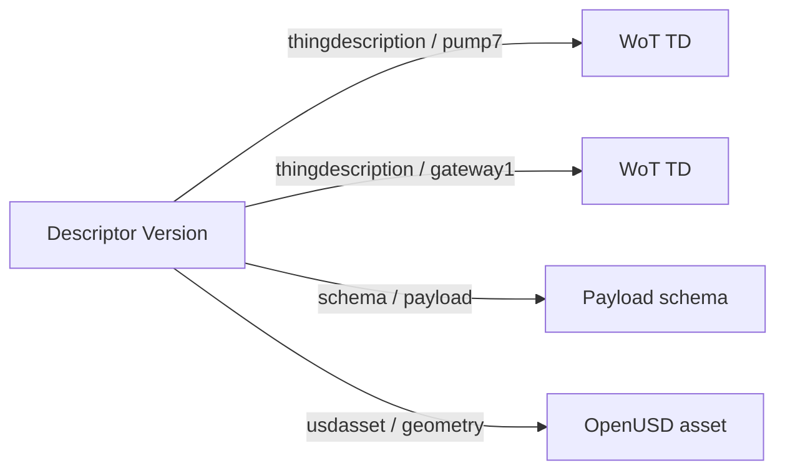

# Descriptor Registry Service - Version 1.0-rc4

<!-- words: descriptorgroup descriptorgroups descriptorgroupid -->
<!-- words: descriptorgroupsurl descriptorgroupscount descriptorid -->
<!-- words: descriptorsurl descriptorscount entityid entitytype -->
<!-- words: schemaref endpointref describedby baseurl allowlist -->
<!-- words: thingdescription thingmodel thingdescriptiongroups thingdescriptions -->
<!-- words: usdasset usdassetgroups OpenUSD reserializing -->
<!-- words: opcuapublisherid opcuadatasetwriterid opcuadatasetwritername -->
<!-- words: opcuadatasetname opcuawriter UInt16 -->
<!-- words: matchversions namespace namespaces -->
<!-- words: opc ua prebuild prebuilt nodeset -->
<!-- words: PumpProcessData servicekind TDs uncached usdassets -->
<!-- words: RDF -->
<!-- words: actorinfo -->

## Abstract

This specification defines a Descriptor Registry extension to the xRegistry
document format and API [specification][xRegistry Core]. A Descriptor
Registry allows for the storage, management and discovery of metadata
describing entities and shared processing inputs. Descriptors reference
schemas and other representations defined by the applicable profile.

## Table of Contents

- [Abstract](#abstract)
- [Table of Contents](#table-of-contents)
- [1. Overview](#1-overview)
  - [1.1. Descriptions and Processing Context](#11-descriptions-and-processing-context)
  - [1.2. Relationship to Other Specifications](#12-relationship-to-other-specifications)
- [2. Notations and Terminology](#2-notations-and-terminology)
- [3. Descriptor Registry Model](#3-descriptor-registry-model)
- [4. Descriptor Registry](#4-descriptor-registry)
  - [4.1. Descriptor Groups](#41-descriptor-groups)
  - [4.2. Descriptor Resources](#42-descriptor-resources)
    - [4.2.1. `references` Attribute](#421-references-attribute)
    - [4.2.2. `entityid` Attribute](#422-entityid-attribute)
    - [4.2.3. `entitytype` Attribute](#423-entitytype-attribute)
    - [4.2.4. Profile Attributes](#424-profile-attributes)
    - [4.2.5. `data` Attribute](#425-data-attribute)
  - [4.3. References](#43-references)
    - [4.3.1. Type Keys](#431-type-keys)
    - [4.3.2. `url` Attribute](#432-url-attribute)
  - [4.4. Specializations](#44-specializations)
  - [4.5. Reference Selection](#45-reference-selection)
  - [4.6. Versions and Publication Stability](#46-versions-and-publication-stability)
- [5. CloudEvents Integration (Informative)](#5-cloudevents-integration-informative)
- [6. Examples](#6-examples)
  - [6.1. Asset and Actor Descriptions](#61-asset-and-actor-descriptions)
  - [6.2. Context Descriptor](#62-context-descriptor)
- [7. Retrieval and Publication](#7-retrieval-and-publication)
  - [7.1. Ordinary Retrieval](#71-ordinary-retrieval)
  - [7.2. Publication Within One Registry](#72-publication-within-one-registry)
  - [7.3. Publication Across Registries](#73-publication-across-registries)
  - [7.4. Descriptor Bundle](#74-descriptor-bundle)
    - [7.4.1. Negotiation](#741-negotiation)
    - [7.4.2. Representation and Collection Boundary](#742-representation-and-collection-boundary)
    - [7.4.3. Authorization, Limits and Errors](#743-authorization-limits-and-errors)
    - [7.4.4. Caching and Consistency](#744-caching-and-consistency)
    - [7.4.5. Example](#745-example)
- [8. Security](#8-security)
- [9. Schema Descriptor Profile](#9-schema-descriptor-profile)
  - [9.1. Schema References](#91-schema-references)
  - [9.2. `schemaref` Attribute and Selection](#92-schemaref-attribute-and-selection)
  - [9.3. Model Extension](#93-model-extension)
- [10. Endpoint Descriptor Profile](#10-endpoint-descriptor-profile)
  - [10.1. Endpoint References](#101-endpoint-references)
  - [10.2. `endpointref` Attribute and Selection](#102-endpointref-attribute-and-selection)
  - [10.3. Model Extension](#103-model-extension)

## 1. Overview

A Descriptor Registry manages descriptions that are shared by applications
and consumers of data. Each Descriptor Resource contains metadata and named
References to related representations. Versions allow a Publisher to change
a description while retaining the description used by an existing consumer.

An asset description can associate one entity with several independently
versioned representations. An actor description can contain identity and
descriptive metadata with an empty set of References. A processing context
can combine a payload schema, several entities and shared publisher
metadata. Asset, Device, Actor and Context descriptions use the same
Descriptor Resource type.

An Actor Descriptor describes a participant entity, such as a service or
device. Its identity is independent of the roles it plays in conversations.
A conversation describes permitted interactions among actor roles; a
Processing Descriptor supplies the shared inputs used to interpret a
message.

### 1.1. Descriptions and Processing Context

The `references` attribute groups named References by representation type.
Each type bucket is a map from local names to Reference objects containing
an absolute `url`. Profiles define the types and accepted representations.
The OPTIONAL `data` map carries profile-defined inline values under type
keys. Inline values do not cause Reference retrieval.

The following example combines two device descriptions, a payload schema
and an asset representation. The technology-specific types are defined
by their respective profiles.



The example shows four References in a Descriptor Version: `pump7` and
`gateway1` identify TDs, `payload` identifies a schema, and `geometry`
identifies an OpenUSD asset. A profile selects which References a Consumer
uses for its task.

An ordinary retrieval returns the Descriptor metadata, including its
References. A Consumer then retrieves the representations it needs for its
task. A server MAY support a [Descriptor bundle](#74-descriptor-bundle),
which returns the metadata and every directly referenced representation in
one response. The server assembles or serves that representation under
the rules in [Section 7.4](#74-descriptor-bundle).

Core's `inline` flag expands contained Groups, Resources and Versions.
Reference URLs remain values in the Descriptor metadata.

### 1.2. Relationship to Other Specifications

Descriptors complement the [Message][xRegistry Message],
[Schema][xRegistry Schema] and [Endpoint][xRegistry Endpoint] registries.
A Registry MAY combine Descriptor Groups with Groups from other models,
or serve only Descriptor Groups.

A profile defines its type keys, accepted representations, inline data,
additional attributes and processing requirements. Such profiles use the
base identity, Reference and publication rules. The Schema and Endpoint
Descriptor profiles are defined in [Section 9](#9-schema-descriptor-profile)
and [Section 10](#10-endpoint-descriptor-profile).

The CloudEvents [`describedby` extension][CloudEvents Descriptors]
associates an event with a Descriptor; see
[Section 5](#5-cloudevents-integration-informative).

## 2. Notations and Terminology

The key words "MUST", "MUST NOT", "REQUIRED", "SHALL", "SHALL NOT", "SHOULD",
"SHOULD NOT", "RECOMMENDED", "MAY", and "OPTIONAL" in this document are to be
interpreted as described in [RFC 2119](https://tools.ietf.org/html/rfc2119).

For clarity, OPTIONAL attributes are OPTIONAL for clients to use.
Servers MUST store server-unknown extension attributes, subject to Core's
validation and resource limits. If a specification-defined or server-known
attribute uses a feature that is unsupported or disabled, the server MUST
generate an error. Attribute writes, omission and `null` values follow
the xRegistry Core rules.

In pseudo-JSON snippets, `?` marks an OPTIONAL attribute, `*` permits zero or
more entries, and `#` starts an explanatory comment. Ellipses mark omitted
attributes, not literal JSON values.

| Term | Meaning |
| --- | --- |
| Descriptor | A metadata-only `descriptor` Resource. A Descriptor Version is one Version of that Resource. |
| Reference | One named object in a type bucket of `references`, containing the URL of a referenced resource. |
| Referenced resource | The resource identified by a Reference's `url`. It can be inside or outside xRegistry; the enclosing type specifies which representation is retrieved. |
| Type key | A profile-defined key identifying a Reference bucket or an inline value in `data`. |
| Profile | Agreed catalog, publication or processing rules that determine a specialization and its needed inputs. |
| Actor | A participant entity capable of behavior, such as a service or device. |
| Conversation | A contract describing permitted message exchanges and related behavior among actor roles. |
| Conversation role | A responsibility in a conversation that a concrete actor can perform. The role and the participant playing it have distinct identities. |
| Message definition | A contract describing a message's structure and semantics, distinct from an individual message. |
| Message | An individual communication instance, such as one CloudEvent. |
| Publisher | A client that publishes Descriptors and makes the referenced resources available. |
| Consumer | A client that reads Descriptors or uses their References. |
| Producer | A component that emits messages under an agreed profile. |
| Processing Descriptor | The Descriptor selected by a message binding as its shared processing inputs. |
| Observation | A record of what an observer reports happened during execution. |
| Trace | A collection of execution observations, distinct from the contract describing permitted behavior. |
| Descriptor bundle | A negotiated read-only response containing a Descriptor and the representations identified by all of its References. |

Publisher, Producer and Consumer name responsibilities rather than mutually
exclusive entity types. An actor can perform several of these
responsibilities and play different roles in different conversations.

Descriptors describe entities and processing inputs. A Reference to an
endpoint describes communication configuration; it does not establish that
a message was sent, received or processed. Those outcomes are recorded as
separate observations, whose meaning depends on what the observer recorded.

## 3. Descriptor Registry Model

The extension model of the Descriptor Registry resides in
[model.json](model.json). Its `modelversion` is `0.1` and versions this model
independently of the Core specification version in `specversion`.

The hierarchy is:

```text
Registry
  descriptorgroups/{descriptorgroupid}
    descriptors/{descriptorid}
      meta
      versions/{versionid}
```

The JSON serialization follows this form. Common Core attributes other
than IDs and collection links are omitted for brevity. A Resource contains
its default Version's attributes. An explicitly addressed Version contains
the values for that Version.

```yaml
{
  "specversion": "<STRING>",
  "registryid": "<STRING>",
  "descriptorgroups": {
    "KEY": {
      "descriptorgroupid": "<STRING>",
      "descriptors": {
        "KEY": {
          "descriptorid": "<STRING>",
          "versionid": "<STRING>",
          "entityid": "<URI>", ?
          "entitytype": "<URI>", ?
          "references": {
            "<STRING>": {
              "<STRING>": {
                "url": "<URL>"
              } *
            } *
          },
          "data": {
            "<STRING>": <ANY> *
          }, ?
          # Other Version attributes, including profile metadata, omitted
          "metaurl": "<URL>",
          "meta": { ... }, ?
          "versions": { ... }, ?
          "versionsurl": "<URL>",
          "versionscount": <UINTEGER>
        } *
      }, ?
      "descriptorsurl": "<URL>",
      "descriptorscount": <UINTEGER>
    } *
  }, ?
  "descriptorgroupsurl": "<URL>",
  "descriptorgroupscount": <UINTEGER>
}
```

The Descriptor Resource declares `hasdocument: false`. Under the
[HTTP binding][HTTP representations], an ordinary `GET` at the Resource or
Version URL returns its metadata without a `$details` suffix.

The generated schemas express structural constraints. Implementations MUST
also validate the identity and type-key syntax, global Reference-name
uniqueness, selector relationships,
applicable profile requirements and publication rules in this
specification. The model uses Core `uri` for identity and maps for
`references` and `data`; domain constraints and the selected profiles apply
in addition to the generated schemas. Profile value types and additional
attributes are declared by extending this base model.

## 4. Descriptor Registry

The Descriptor Registry is an application of
[xRegistry Core][xRegistry Core]. Groups, Resources and Versions inherit
their attributes and operations from Core. Implementations MAY include
additional extension attributes.

### 4.1. Descriptor Groups

The Group Type name is `descriptorgroup` (singular), with collection name
`descriptorgroups`. A Descriptor Group contains Descriptors related in an
application-defined way. Every Descriptor Resource MUST reside in a
Descriptor Group.

This specification defines no standardized Group classifications. Group IDs
are application-defined; `devices`, `actors` and `streams` are illustrative
names used in the examples. Consumers MUST NOT infer specialization,
entity type, authorization or message role from Group or Resource IDs.

### 4.2. Descriptor Resources

The Resource Type inside a Descriptor Group is `descriptor`, with
collection name `descriptors`. A Descriptor Resource contains one or more
Versions of its metadata. The model permits an unlimited number of Versions
(`maxversions: 0`) and client-specified Version IDs (`setversionid: true`).
Implementations SHOULD use the default Core [Version ID][Core version-ids]
algorithm. A Resource URL selects the [default Version][Core defaults].

#### 4.2.1. `references` Attribute

- Type: Map of maps of objects
- Description: Reference type buckets containing named References associated
  with this Descriptor Version.

- Constraints:
  - REQUIRED.
  - The value MUST be a map of type buckets. Each bucket MUST be a map of
    named Reference objects. Empty maps are valid. Write operations follow
    Core's omission and update rules.
  - Type keys MUST follow [Section 4.3.1](#431-type-keys).
  - Each Reference name MUST follow the Core [map key rules][Core types]:
    one through 63 lowercase alphanumeric characters, `:`, `-`, `_` or `.`, starting
    with an alphanumeric character.
  - Reference names MUST be unique across all buckets in a Descriptor
    Version. Reusing a name in another bucket is invalid metadata.
  - Names and type keys MUST be compared exactly. Consumers MUST NOT
    interpret a Reference name as a type, source identity, destination or
    permission.
  - A bucket MAY contain multiple References. Selection follows
    [Section 4.5](#45-reference-selection) or the applicable profile.
  - If a profile requires a referenced resource, the Consumer MUST reject
    an empty map for that operation.

- Examples:
  - `{}` for a metadata-only Actor description.
  - `{ "schema": { "payload": { "url": "https://schemas.example/pump-process-data/versions/3" } } }`

#### 4.2.2. `entityid` Attribute

- Type: URI (`uri`)
- Description: Identity of the primary entity described by this Descriptor.
  The Core `descriptorid` identifies the Descriptor Resource itself.

- Constraints:
  - OPTIONAL in the base model; REQUIRED for Asset and Actor
    specializations.
  - The value MUST be a non-empty RFC 3986 [absolute URI][absolute URI],
    including a scheme and excluding a fragment. URNs are permitted.
  - Comparison MUST be exact, without case folding or URI normalization.
  - Its presence and value MUST be the same across all Versions of a
    Descriptor Resource. The model declares the scalar attribute with
    [`matchversions: true`][Core matchversions].
  - Changing or adding an entity association requires a new Resource.
    The Publisher MUST NOT repurpose a published Resource URL for another
    entity, including after deletion of older Versions or the Resource.
    The rule applies when updating the only Version or all retained
    Versions together.
  - Multiple Resources MAY have the same `entityid`. Consumers MUST
    apply each Resource's References, access policies and Versions
    independently.

- Examples:
  - `https://assets.example/devices/pump7`
  - `urn:example:asset:pump7`

#### 4.2.3. `entitytype` Attribute

- Type: URI (`uri`)
- Description: Type of the primary entity, using an agreed vocabulary.

- Constraints:
  - OPTIONAL in the base model; REQUIRED for Asset and Actor
    specializations.
  - If `entitytype` is present, `entityid` MUST be present and non-null.
  - The value MUST be a non-empty RFC 3986 URI with a scheme. A fragment
    MAY identify a class within an ontology document.
  - Values MUST be compared exactly, without case folding or URI
    normalization.
  - The applicable profile defines its accepted vocabulary and mapping.
    Consumers MUST treat unknown type URIs as opaque identifiers.
  - Reclassification MAY change this value in a new Version without
    changing the entity association. Publication stability still applies.

- Examples:
  - `https://models.example/ontologies/devices.owl#Device`, identifying the
    `Device` class in an RDF/OWL ontology document.
  - `https://models.example/classes/software-actor`

#### 4.2.4. Profile Attributes

Profiles MAY define additional typed Version attributes on a Descriptor.
Deployment models SHOULD declare the types of those attributes. Attribute
names MUST follow Core attribute syntax and its
[extension-naming rules][Core extensions].

A profile defines attribute presence, value comparison and the handling of
conflicting values. Processing-significant shared values follow
[Section 4.6](#46-versions-and-publication-stability). Values that vary
per message, such as a sequence number, belong in the message, not in a
Descriptor.

#### 4.2.5. `data` Attribute

- Type: Map of profile-defined values
- Description: Inline metadata associated with this Descriptor Version,
  grouped by profile-defined type.

- Constraints:
  - OPTIONAL. An empty map (`{}`) is valid.
  - A present response value MUST be a map. Core's omission, update and
    `null` write rules apply.
  - Each key MUST follow [Section 4.3.1](#431-type-keys). The applicable
    profile defines the value's Core-compatible type, members and semantics.
    Deployment models SHOULD declare those definitions.
  - `data` values MUST be validated under the applicable profile. They
    MUST NOT be interpreted as Reference objects or automatically retrieved,
    even when they contain URI-valued members.
  - Missing REQUIRED inline inputs make the operation's context unavailable.
    A Consumer MUST NOT substitute a Reference or another inline type
    without an explicit profile rule.
  - Processing-significant inline values follow
    [Section 4.6](#46-versions-and-publication-stability).

Reference type buckets and `data` entries have separate roles. A profile
defines how any relationship between them is validated; equal type keys
alone establish no substitution or inheritance.

### 4.3. References

Each Reference contains a `url`; its enclosing type bucket identifies the
representation type. A profile MAY define additional Reference attributes.
A Consumer MAY ignore additional attributes that its profile does not
require. A Reference MUST NOT contain a per-Reference `class` member.

#### 4.3.1. Type Keys

The same type-key rules apply to the outer keys of `references` and `data`.
Each key MUST satisfy Core's map-key syntax and its 63-character limit.

- A standard-profile type key MUST contain only lowercase ASCII letters
  and digits, starting with a letter. Standard profiles MUST coordinate
  their canonical keys across composable profiles. A key MUST NOT have
  conflicting meanings across those profiles.
- An independently defined type key MUST use a reverse-DNS domain-qualified
  name controlled by the defining authority, such as
  `com.example.calibration`. It MUST contain at least two dot-separated
  labels. Each label MUST start and end with a lowercase ASCII letter or
  digit and MAY contain lowercase letters, digits or hyphens internally.
- Keys MUST be compared exactly. URI keys, alternate spellings and the
  former flat Reference shape MUST NOT be accepted as aliases.
- Consumers MUST NOT attempt to resolve a type key as a domain or URL.
  A well-formed unknown type MAY be ignored unless the operation's profile
  requires it. An unsupported REQUIRED type makes that input unavailable.
  Malformed keys are invalid metadata.

The base model defines no profile types. The profiles at the end of this
document and in other working drafts define their own Reference buckets,
inline values and selection rules.

#### 4.3.2. `url` Attribute

- Type: URL (`urlabsolute`)
- Description: The URL at which the referenced resource's representation
  is retrieved.

- Constraints:
  - REQUIRED.
  - The value MUST be absolute and fragment-free.
  - Consumers and bundle servers MUST use the URL as given. They MUST NOT
    add `$details`, append query parameters, remove a Version segment or
    derive another representation URL.
  - The Publisher MUST choose the representation specified by the enclosing
    Reference type.
    A referenced resource MAY be in any Registry or outside xRegistry.
  - The URL SHOULD identify a Version when replay needs the same
    interpretation.
  - The Publisher MUST keep the referenced representation stable for the
    intended processing and replay period.

- Examples:
  - `https://registry.example/thingdescriptiongroups/factory/thingdescriptions/pump7/versions/3.0.0`

### 4.4. Specializations

The applicable profile specifies which specialization requirements apply
to a Descriptor, including its identity and type vocabulary and the metadata
or References it requires. A Consumer MUST NOT infer a specialization from
Group names, Reference names, the presence of `entityid` or a particular
Reference type.

| Specialization | Requirements and scope |
| --- | --- |
| Asset Descriptor | Requires `entityid` and `entitytype` for one primary asset. The applicable profile defines the identity and type mapping. |
| Device Descriptor | An Asset Descriptor whose applicable profile identifies the primary asset as a device. Different References can describe its behavior and geometry. |
| Actor Descriptor | Requires `entityid` and `entitytype` for one participant entity, such as a service or device, independently of its conversation roles. Its References describe that participant; an empty map is valid. |
| Context Descriptor | `entityid` and `entitytype` are OPTIONAL. It supplies shared inputs for an agreed interpretation, potentially concerning several entities. All REQUIRED Descriptor inputs MUST be supplied locally. |

These specializations can overlap. An Asset Descriptor that independently
supplies all inputs for a message profile can also serve as its Context
Descriptor. A device participating in message exchanges can also be
described as an Actor. A multi-asset Context Descriptor MAY omit primary
identity.

An application organizing Descriptors as a catalog uses ordinary Core
collections. An `entityid` lookup can return multiple authorized
descriptions; the application selects among them using an explicit policy.

### 4.5. Reference Selection

The applicable profile MUST define which References an operation needs,
how they are selected and how explicit selectors are validated. Multiple
same-type References are valid metadata; an operation that needs one
entry requires the profile's selection rules. Consumers MUST NOT substitute
map order, guessed names or event-type matching for those rules.

Consumers retrieve only the selected inputs unless they request a bundle.
Failure to obtain a selected REQUIRED referenced resource, an unsupported
REQUIRED type or ambiguous REQUIRED selection makes the operation's
context unavailable. When prerequisites are missing, Consumers MUST NOT
report successful interpretation or validation and SHOULD record the
condition.

### 4.6. Versions and Publication Stability

Once a Descriptor Version is published for use, the Publisher MUST NOT
change its References, selector, entity description, inline `data` or
processing-significant profile attributes. The Publisher MUST create a new
Version for a semantic change. Publication for use includes making an Asset
or Actor description available to catalog readers. Core-controlled
bookkeeping follows Core.

Core permits Version updates. `matchversions` compares retained Versions.
Publisher services and write permissions MUST enforce the publication rule,
including the no-reassignment rule for `entityid`. A deployment can retain
a record of published Versions or prohibit changes to all Versions after
creation.

Consumers SHOULD select Version URLs when a reproducible interpretation
is needed. A Resource URL can select a new default Version; Consumers
SHOULD bound cache freshness for such representations. Publishers SHOULD
retain Descriptors and REQUIRED referenced resources for their intended
processing and replay period. When a selected historical Version is
unavailable, the Consumer MUST report that condition and MUST NOT
substitute the current Version.

To signal a description change through a new Descriptor URL, the Publisher
selects specific referenced Resource Versions and creates a new Descriptor
Version when its References or shared inputs change. The Publisher MUST keep
the referenced representations stable for the intended processing and
replay period.

## 5. CloudEvents Integration (Informative)

The CloudEvents [`describedby` extension][CloudEvents Descriptors] identifies
a Descriptor containing shared processing inputs. A Consumer retrieves
that Descriptor using the ordinary representation or the bundle in
[Section 7.4](#74-descriptor-bundle).

The CloudEvents extension defines the common `describedby` contract,
event-format decoding, processing-description selection and the failure
boundary. Applicable profiles define `source` and `subject` interpretation
and native metadata mappings. The
[Schema Descriptor profile](#9-schema-descriptor-profile) defines the
Descriptor-supplied schema candidate; the event binding defines its
precedence. Descriptor structure, publication and Version stability follow
this specification.

## 6. Examples

The [sample](samples/descriptor.json) is a Core create/update input containing
an Asset, an Actor and a Context Descriptor in three Groups. The Group names
and entity type URIs illustrate deployment-specific organization and
vocabularies.

The examples use the Schema Descriptor profile and the WoT, OpenUSD and
OPC UA profiles. Their type keys and inline data
illustrate profile-specific data; the base model defines none of those
types or selectors.

### 6.1. Asset and Actor Descriptions

Asset Descriptor `pump7` describes `urn:example:asset:pump7` through a TD
and an OpenUSD asset. These are representations of different aspects of
one device. An additional maintenance Descriptor can have the same
`entityid` and different References.

Actor Descriptor `planner7` has `entityid`, `entitytype`,
`"references": {}` and inline `data.com.example.actorinfo`. This
deployment-defined object contains `acme_servicekind` with string value
`maintenance-planner`. It is profile data, separate from Core attributes
and top-level selectors. The Descriptor illustrates identity and metadata
for a software participant.
The same participant can play different conversation roles while retaining
its `entityid`.

### 6.2. Context Descriptor

The `pump7-telemetry` Descriptor combines pump and gateway TDs, a selected
payload schema, an OpenUSD asset and illustrative inline OPC UA metadata.
It omits primary entity identity. The following body is a
Version create/update input; Core supplies response bookkeeping:

```json
{
  "descriptorid": "pump7-telemetry",
  "versionid": "1",
  "schemaref": "payload",
  "references": {
    "thingdescription": {
      "pump7": {
        "url": "https://registry.example/thingdescriptiongroups/factory/thingdescriptions/pump7/versions/3.0.0"
      },
      "gateway1": {
        "url": "https://registry.example/thingdescriptiongroups/factory/thingdescriptions/gateway1/versions/1.0.0"
      }
    },
    "schema": {
      "payload": {
        "url": "https://schemas.example/pump-process-data/versions/3"
      }
    },
    "usdasset": {
      "geometry": {
        "url": "https://assets.example/usdassetgroups/line1/usdassets/pump7/versions/2"
      }
    }
  },
  "data": {
    "opcuawriter": {
      "opcuapublisherid": "UInt16:12",
      "opcuadatasetwriterid": 17,
      "opcuadatasetwritername": "pump7-process",
      "opcuadatasetname": "PumpProcessData"
    }
  }
}
```

Under the [Schema Descriptor profile](#9-schema-descriptor-profile),
`schemaref` selects `payload` in `references.schema`. The
`data.opcuawriter` value illustrates inline metadata whose members, types
and native mapping are defined by the OPC UA profile. The selected schema
and existing native values are unchanged by this grouping.

## 7. Retrieval and Publication

### 7.1. Ordinary Retrieval

A Consumer requests a Descriptor at the selected Resource or Version URL
without modification:

```http
GET /descriptorgroups/streams/descriptors/pump7-telemetry/versions/1 HTTP/1.1
Host: registry.example
Accept: application/json
```

The Consumer MUST check response status, media type, Descriptor shape and
explicit selectors before using it. It applies the agreed profile to
determine the referenced resources needed and uses their URLs unchanged,
subject to retrieval policy. The Consumer MUST validate each retrieved
representation against its enclosing type and supported format.

| Cache state and representation | Client requests |
| --- | --- |
| Descriptor and needed referenced resources cached | None. |
| Descriptor cached; N needed referenced resources uncached | N, potentially concurrent. |
| Nothing cached; ordinary Descriptor | One for the Descriptor, then N. |
| Nothing cached; complete bundle returned | One for the Descriptor and every referenced resource. |

Caches use the exact request URL, representation and authorization context
and honor HTTP freshness and validation. Core's [`inline`][Core inline]
expands contained entities. Dependencies inside referenced representations
can require more retrievals in either representation.

### 7.2. Publication Within One Registry

If a Registry supports [`POST /`][HTTP root POST] and contains all involved
Group types, one request can publish Descriptors and referenced resources
together. Core's [write processing][HTTP processing] rejects the entire
request when any part fails. The Publisher MUST check Reference
availability before publication for use.

This schematic request omits Schema attributes for brevity and assumes
support for `inline`. The response can include Descriptor Version metadata:

```yaml
POST /?inline=descriptorgroups.descriptors
Content-Type: application/json

{
  "schemagroups": {
    "factory": {
      "schemas": {
        "pump-process-data": {
          "versionid": "1",
          ...
        }
      }
    }
  },
  "descriptorgroups": {
    "streams": {
      "descriptors": {
        "telemetry": {
          "schemaref": "payload",
          "references": {
            "schema": {
              "payload": {
                "url": "https://registry.example/schemagroups/factory/schemas/pump-process-data/versions/1"
              }
            }
          }
        }
      }
    }
  }
}
```

Without `inline` support, the write is still one request; a subsequent GET
obtains the Version metadata.

### 7.3. Publication Across Registries

The Publisher MUST make REQUIRED referenced resources available and verify
them before publishing the Descriptor for use by catalog readers or
Producers. If any step fails, the Publisher MUST stop publication for use.
The Publisher MUST retain those representations for the intended
processing and replay period.

When a profile ties publication to an applied runtime generation, the
Publisher follows that profile's application rule.

### 7.4. Descriptor Bundle

The bundle is OPTIONAL for servers and Consumers. Supporting this feature
requires the server to assemble the referenced representations or serve
a complete prebuilt bundle. A Publisher MAY prebuild a bundle for a
suitably configured static endpoint, subject to the same
completeness, Version selection, access and freshness rules hold.

The bundle is a negotiated response at the existing Descriptor URL.

#### 7.4.1. Negotiation

The media type is `application/vnd.xregistry.descriptor-bundle+json`.
A Consumer requests it at the unchanged Descriptor URL. The request can
also permit ordinary JSON:

```http
Accept: application/vnd.xregistry.descriptor-bundle+json, application/json;q=0.5
```

- A supporting server MUST select the bundle when explicitly requested
  and preferred over ordinary JSON. A complete response uses `200 OK`
  and `Content-Type: application/vnd.xregistry.descriptor-bundle+json`.
  Conditional requests follow [Section 7.4.4](#744-caching-and-consistency).
- Without an explicit bundle request, the server MUST retain ordinary
  JSON behavior. An absent `Accept` or `*/*` alone MUST select ordinary JSON.
- Offering JSON permits a server without bundle support to return metadata
  in the same round trip. Consumers MUST distinguish responses by media
  type.
- A Consumer MAY omit the JSON alternative. A server implementing this
  negotiation MUST return `406 Not Acceptable` if it cannot offer an
  acceptable representation. A Consumer MUST reject an unexpected
  representation even when an older server ignores `Accept`.
- Once the server selects the bundle, referenced resource retrieval or
  authorization failure MUST produce an error.

A Consumer MAY explicitly retry ordinary JSON at the same Descriptor URL
after bundle failure and retrieve only the referenced resources it needs.
The retry MUST use the same Descriptor URL.

#### 7.4.2. Representation and Collection Boundary

The JSON response has two REQUIRED members:

| Member | Type | Meaning |
| --- | --- | --- |
| `descriptor` | Object | The selected Descriptor metadata, unchanged. |
| `documents` | Map of objects | Exactly one entry per Reference name across all type buckets of `descriptor.references`. |

An empty `references` map, or only empty buckets, produces an empty
`documents` map. The response retains a flat `documents` map because
Reference names are globally unique within the Descriptor. Each entry has:

| Member | Presence | Meaning |
| --- | --- | --- |
| `url` | REQUIRED | The exact URL of the corresponding Reference. |
| `contenttype` | REQUIRED | The referenced representation's media type with relevant parameters; `application/octet-stream` if none was supplied. |
| `content` | Conditional | The referenced representation as a JSON value. |
| `contentbase64` | Conditional | The referenced representation's bytes as a base64 string. |
| `baseurl` | Conditional | The final retrieval URL; REQUIRED when an allowed redirect changed it, otherwise omitted. |

Exactly one of `content` and `contentbase64` MUST be present. Following
Core's [document embedding pattern][Core document encoding], valid JSON can
be embedded as a value; other content, including non-JSON text, MUST use
base64. A server MAY also use base64 to preserve exact JSON bytes.
Consumers MUST support both forms and MUST NOT assume reserializing
`content` reproduces original bytes.

The server MUST decode HTTP content codings before embedding. An empty
representation is `"contentbase64": ""`; a JSON null representation is
`"content": null`. These members belong to the response envelope.

The server MUST capture one Descriptor representation for the response
and obtain the representations identified by its `references.*.*.url`
values:

- Authorized local content and valid cache entries MAY replace network
  requests.
- Network requests MUST use the exact URL with `Accept: */*`. The server
  MUST preserve values inside the retrieved representations.
- One retrieval MAY supply multiple names with the same URL. The result
  still has every name and its exact corresponding `url`.
- A successful response MUST contain the complete representation for every
  Reference, with authorization established for each one. Otherwise, the
  server MUST return an error.
- The server MUST limit collection to `references.*.*.url`. Additional
  representations MUST be listed as named References in their type buckets
  to be included. `data` values MUST NOT cause retrieval.

Consumers MUST resolve relative dependencies using the referenced
representation's `baseurl`, or `url` when unchanged, subject to the format's
own base rules.

#### 7.4.3. Authorization, Limits and Errors

Before including a referenced representation, the server MUST establish
that the caller is authorized to receive it. Credentials for each origin
or an explicit publication policy can support the check. The server MUST
establish caller authorization independently of its own service credentials.
The server MUST NOT forward caller credentials to referenced resource
origins without an origin-specific credential policy.

The server MUST apply outbound request policy to each URL, resolved
network address and redirect destination, including protection against
disallowed local and internal services. Unsupported schemes or origins
MUST be rejected.

The server MUST bound Reference count, retrieved and encoded bytes, retrieval
time, redirects and concurrency. Byte limits include decompression and
base64 expansion. These access and limit rules also apply to content held
locally, in a cache or in a prebuilt bundle.

Denied authorization, missing or unavailable referenced resources and
exceeded limits MUST return an error. The server MUST NOT substitute an
empty body for missing or denied content.
Errors SHOULD use the [Core HTTP error format][HTTP errors]. They SHOULD
distinguish denied, unavailable and limit-exceeded conditions without
disclosing referenced content or credentials.

#### 7.4.4. Caching and Consistency

Servers supporting bundles MUST send `Vary: Accept` on both representations,
preserving other REQUIRED `Vary` fields. Caches MUST honor
[HTTP caching rules][RFC9111], representation selection, authorization and
source cache restrictions. Caller-specific content MUST NOT be reused for
another caller without establishing authorization.

Bundle freshness MUST NOT exceed that permitted by the Descriptor and
every included representation. When the server cannot establish a combined
cache policy meeting those restrictions, it MUST send `Cache-Control: no-store`.
Extracted entries MUST NOT be treated as independently public or
longer-lived than the bundle that supplied them.

If supplied, an `ETag` MUST validate the whole selected representation.
Before sending `304 Not Modified`, the server MUST establish that every
included response is still valid under its cache policy and that the
resulting bundle is unchanged.

Published Descriptor metadata is stable under
[Section 4.6](#46-versions-and-publication-stability). Representations can be
retrieved at different times. Consumers MUST apply the freshness and
validation policy to each included representation before reuse.
Servers MUST describe bundle consistency in terms of independent resource
retrieval and cache validation.

#### 7.4.5. Example

The metadata-only `planner7` Actor from the sample needs no resource
retrieval. The following complete bundle illustrates the empty-map case.
OPTIONAL Core metadata is omitted.

```http
GET /descriptorgroups/actors/descriptors/planner7/versions/1 HTTP/1.1
Host: registry.example
Accept: application/vnd.xregistry.descriptor-bundle+json
```

Response headers:

```http
HTTP/1.1 200 OK
Content-Type: application/vnd.xregistry.descriptor-bundle+json
Vary: Accept
Cache-Control: no-store
```

```json
{
  "descriptor": {
    "descriptorid": "planner7",
    "versionid": "1",
    "self": "https://registry.example/descriptorgroups/actors/descriptors/planner7/versions/1",
    "xid": "/descriptorgroups/actors/descriptors/planner7/versions/1",
    "epoch": 1,
    "isdefault": true,
    "createdat": "2025-01-15T09:00:00Z",
    "modifiedat": "2025-01-15T09:00:00Z",
    "ancestorid": "1",
    "entityid": "urn:example:actor:planner7",
    "entitytype": "https://models.example/classes/software-actor",
    "references": {},
    "data": {
      "com.example.actorinfo": {
        "acme_servicekind": "maintenance-planner"
      }
    }
  },
  "documents": {}
}
```

A bundle for `pump7-telemetry` instead has entries `pump7`, `gateway1`,
`payload` and `geometry`. The TDs and schema can use `content`; non-JSON
OpenUSD bytes use `contentbase64`. Unavailable geometry makes the entire
bundle fail even when the Consumer needs only the TD and schema; it can
then explicitly retry ordinary JSON and retrieve that subset.

## 8. Security

Implementations use authentication and authorization mechanisms appropriate
to their deployment, following [Core][xRegistry Core]. Consumers MUST
establish authenticated identity and operation authorization through those
mechanisms.

Descriptor metadata and URLs are untrusted input. Before retrieving a
Descriptor or referenced resource, Consumers MUST apply retrieval policy to
the URL, redirect destinations and resolved network addresses. Credentials
are associated with configured origins and MUST NOT be forwarded
indiscriminately.

Writers and referenced resource origins can affect interpretation of a
description. Publication permissions, write controls and retention enforce
the stability requirements in
[Section 4.6](#46-versions-and-publication-stability).

A Descriptor exposes all of its metadata to its reader. Access policy needs
to account for Reference URLs, entity identities, inline `data` and profile
attributes,
including when the reader lacks access to the referenced resources.

Consumers SHOULD bound metadata size, request count, retrieval time and
concurrency. Bundle servers additionally follow the authorization and limit
rules in [Section 7.4.3](#743-authorization-limits-and-errors).

Consumers MUST apply type, format and content-trust checks to the
representations received in a bundle.

## 9. Schema Descriptor Profile

This profile defines schema References and schema selection for a Descriptor.
It applies when the catalog, publication or processing agreement selects
this profile. Its attributes extend the generic Descriptor model.

**Publication note:** This profile is hosted here while the Descriptor
specification is a working draft. When this draft graduates, move the
profile into the Schema Registry specification. The existing Schema
Registry specification and model are unchanged by this draft.

### 9.1. Schema References

This profile defines the standard Reference type key `schema`, without
aliases. A named Reference in `references.schema` MUST identify a schema
document in a format supported by the Consumer. When a Schema Registry
serves the schema, the Publisher MUST provide its document-view URL.
The Consumer MUST retrieve that URL unchanged;
it MUST NOT add `$details` or interpret Registry metadata as the schema.

The schema MAY be served outside a Schema Registry. Its representation
MUST satisfy the format and payload requirements of the applicable
processing profile. A Reference alone does not determine whether the
schema describes an event payload, a protocol envelope or another value.

The Publisher MUST keep the referenced representation stable for its
intended processing and replay period under
[Section 4.6](#46-versions-and-publication-stability). The URL SHOULD
identify a specific schema Version when a Schema Registry serves it.

Message Resources keep one Version ([Message model][Message model]).
Replacing that Version can change the metadata at the same URL. This
profile references the schema document directly for independent version
selection and retention.

### 9.2. `schemaref` Attribute and Selection

- Type: String
- Description: The name of the Reference that supplies the Descriptor's
  payload schema.

- Constraints:
  - OPTIONAL.
  - The value MUST exactly match the globally unique name of an existing
    Reference in `references.schema`.
  - A Consumer applying this profile MUST validate a present selector when
    validating the Descriptor, including when another source supplies the
    schema. A missing entry or an entry in another type bucket makes the
    Descriptor invalid under this profile.

- Examples:
  - `"schemaref": "payload"`

When an operation needs the Descriptor-supplied schema, the Consumer MUST
apply these rules:

1. If `schemaref` is present, validate it and select the named Reference.
2. Otherwise, collect the entries in `references.schema`.
3. If there is one candidate, select it. No candidates means absence;
   more than one means ambiguous selection.

An invalid selector or ambiguous selection MUST NOT be treated as absence.
Failure to retrieve or validate a selected REQUIRED schema makes that
processing input unavailable. An event binding defines precedence between
this candidate and a schema supplied by the event.

### 9.3. Model Extension

A deployment using this profile SHOULD add the following attribute
definition to the Descriptor Resource's `attributes` map:

```json
{
  "schemaref": {
    "name": "schemaref",
    "type": "string",
    "description": "Exact name of the schema Reference selected by the Schema Descriptor profile"
  }
}
```

The extension declares the field's type. The Consumer still validates the
named Reference and selection rules in
[Section 9.2](#92-schemaref-attribute-and-selection).

## 10. Endpoint Descriptor Profile

This profile defines References to asynchronous endpoint metadata in an
[Endpoint Registry][xRegistry Endpoint]. It applies when the catalog,
publication or processing agreement selects this profile.

**Publication note:** This profile is hosted here while the Descriptor
specification is a working draft. When this draft graduates, move the
profile into the Endpoint Registry specification. The existing Endpoint
Registry specification and model are unchanged by this draft.

### 10.1. Endpoint References

This profile defines the standard Reference type key `endpoint`, without
aliases. A named Reference in `references.endpoint` MUST identify endpoint
metadata conforming to the Endpoint Registry specification. The URL
identifies metadata, not the messaging address that the metadata describes.
A Consumer MUST use the Reference URL
unchanged and validate the metadata before using its protocol configuration.

For example, the following named Reference identifies endpoint metadata:

```json
{
  "endpoint": {
    "output": {
      "url": "https://registry.example/endpoints/pump7-output"
    }
  }
}
```

Endpoints are Groups in the Endpoint Registry model, so they have no
Resource Version URL. The Publisher MUST preserve the representation at a
referenced URL for the Descriptor's intended processing and replay period.
When endpoint metadata changes, the Publisher MUST make the new metadata
available at a distinct URL and publish a new Descriptor Version referencing
it. Retention and write policy, or a separately retained representation of
the endpoint metadata, can enforce that requirement.

Endpoint usage, protocol, connection and security parameters follow the
Endpoint Registry specification. Before connecting, the Consumer MUST
apply its own authorization and connection policy. Retrieving the metadata
does not authorize use of the described endpoint.

### 10.2. `endpointref` Attribute and Selection

- Type: String
- Description: The name of the Reference that supplies the endpoint
  metadata selected by this profile.

- Constraints:
  - OPTIONAL.
  - The value MUST exactly match the globally unique name of an existing
    Reference in `references.endpoint`.
  - A Consumer applying this profile MUST validate a present selector.
    A missing entry or an entry in another type bucket makes the Descriptor
    invalid under this profile.

- Examples:
  - `"endpointref": "output"`

When an operation needs one endpoint, the Consumer MUST select the named
Reference if `endpointref` is present. Otherwise, exactly one entry in
`references.endpoint` selects that entry, no candidates means absence, and
more than one means ambiguity. Invalid selectors and ambiguity MUST NOT be
treated as absence. Failure to obtain or validate a REQUIRED endpoint
makes that input unavailable.

### 10.3. Model Extension

A deployment using this profile SHOULD add the following attribute
definition to the Descriptor Resource's `attributes` map:

```json
{
  "endpointref": {
    "name": "endpointref",
    "type": "string",
    "description": "Exact name of the endpoint metadata Reference selected by the Endpoint Descriptor profile"
  }
}
```

The extension declares the field's type. Reference existence, bucket,
selection and endpoint metadata validation follow this profile.

[absolute URI]: https://www.rfc-editor.org/rfc/rfc3986.html#section-4.3
[Core types]: ../../../core/spec.md#data-types
[Core extensions]: ../../../core/spec.md#extensions
[Core matchversions]: ../../../core/model.md#attributesstringmatchversions
[Core version-ids]: ../../../core/spec.md#version-ids
[Core defaults]: ../../../core/spec.md#default-version-of-a-resource
[Core inline]: ../../../core/spec.md#inline-flag
[Core document encoding]: ../../../core/spec.md#resource-attribute
[HTTP representations]: ../../../core/http.md#resource-metadata-vs-resource-document
[HTTP root POST]: ../../../core/http.md#post-
[HTTP processing]: ../../../core/http.md#creating-or-updating-entities
[HTTP errors]: ../../../core/http.md#error-processing
[Message model]: ../../../message/model.json
[RFC9111]: https://www.rfc-editor.org/rfc/rfc9111.html
[CloudEvents Descriptors]: https://github.com/cloudevents/spec/blob/1c4caca73c69a7e076e75fe0727f6a216c83e500/cloudevents/extensions/descriptors.md
[xRegistry Core]: https://xregistry.io/xreg/xregistryspecs/core-v1/docs/spec.html
[xRegistry Endpoint]: https://xregistry.io/xreg/xregistryspecs/endpoint-v1/docs/spec.html
[xRegistry Message]: https://xregistry.io/xreg/xregistryspecs/message-v1/docs/spec.html
[xRegistry Schema]: https://xregistry.io/xreg/xregistryspecs/schema-v1/docs/spec.html
