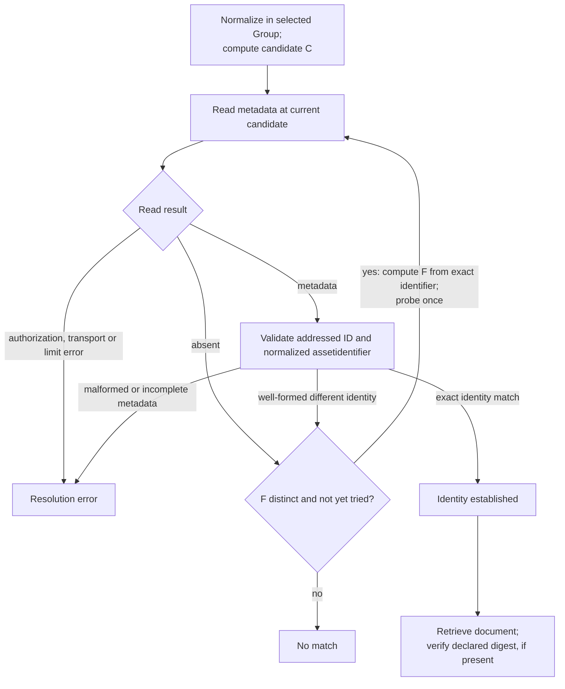

# OpenUSD Artifact Registry Service - Version 1.0-rc4

<!-- words: OpenUSD usd usda usdc usdz usdi AOUSD MaterialX mtlx OpenVDB -->
<!-- words: Alembic Omniverse prim prims sublayer sublayers subLayers -->
<!-- words: payload payloads referenced resolver resolvers usdasset retargeting -->
<!-- words: usdassets usdassetid usdasseturl usdassetbase64 usdassetsurl -->
<!-- words: usdassetscount usdassetbase usdassetgroup usdassetgroups -->
<!-- words: usdassetgroupid usdassetgroupsurl usdassetgroupscount -->
<!-- words: usdschemaplugingroup usdschemaplugingroups -->
<!-- words: usdschemaplugingroupid usdschemaplugingroupsurl -->
<!-- words: usdschemaplugingroupscount assetidentifier assetkind dependson -->
<!-- words: digestalg rootlayer plugInfo generatedSchema materialx codeless -->
<!-- words: plugin plugins schemas hasdocument formatvalidated -->
<!-- words: compatibilityvalidated formatvalidatedreason -->
<!-- words: compatibilityvalidatedreason fabrikam contoso pumps robotics -->
<!-- words: plant turbine addressspace assetcontainergroups disambiguator -->
<!-- words: federatable interoperate opc schemaplugin schemaplugingroups ua -->
<!-- words: userinfo -->

## Abstract

This specification extends the xRegistry document format and API
[specification][xRegistry Core] with an OpenUSD Artifact Registry. The
registry stores, manages, discovers and federates [OpenUSD][OpenUSD]
(Universal Scene Description) artifacts. These include layers, packages,
textures, MaterialX documents, volumes and schema plugins used to compose and
render a USD stage.

## Table of Contents

- [OpenUSD Artifact Registry Service - Version 1.0-rc4](#openusd-artifact-registry-service---version-10-rc4)
  - [Abstract](#abstract)
  - [Table of Contents](#table-of-contents)
  - [1. Overview](#1-overview)
    - [1.1. Artifacts and Asset Containers](#11-artifacts-and-asset-containers)
    - [1.2. Relationship to Other xRegistry Specs](#12-relationship-to-other-xregistry-specs)
    - [1.3. Versioning](#13-versioning)
    - [1.4. Document Store](#14-document-store)
  - [2. Notations and Terminology](#2-notations-and-terminology)
    - [2.1. Notational Conventions](#21-notational-conventions)
    - [2.2. Terminology](#22-terminology)
      - [2.2.1. USD Asset](#221-usd-asset)
      - [2.2.2. Asset Identifier](#222-asset-identifier)
      - [2.2.3. Schema Plugin](#223-schema-plugin)
      - [2.2.4. Consumer and Producer](#224-consumer-and-producer)
    - [2.3. Asset Container Group](#23-asset-container-group)
    - [2.4. Schema Plugin Group](#24-schema-plugin-group)
  - [3. OpenUSD Registry Model](#3-openusd-registry-model)
  - [4. OpenUSD Registry](#4-openusd-registry)
    - [4.1. Asset Container Groups](#41-asset-container-groups)
    - [4.2. USD Asset Resources](#42-usd-asset-resources)
    - [4.3. Schema Plugin Groups](#43-schema-plugin-groups)
    - [4.4. Schema Plugin Resources](#44-schema-plugin-resources)
    - [4.5. Formats](#45-formats)
      - [4.5.1. USD Layer](#451-usd-layer)
      - [4.5.2. USD Package](#452-usd-package)
      - [4.5.3. MaterialX Document](#453-materialx-document)
      - [4.5.4. USD Plugin Manifest](#454-usd-plugin-manifest)
      - [4.5.5. USD Generated Schema](#455-usd-generated-schema)
      - [4.5.6. Opaque](#456-opaque)
  - [5. Relationships and Cross-References](#5-relationships-and-cross-references)
    - [5.1. Asset Identifiers and `xid`s](#51-asset-identifiers-and-xids)
      - [5.1.1. The Symbolic Identifier Construction](#511-the-symbolic-identifier-construction)
    - [5.2. The Dependency Closure](#52-the-dependency-closure)
    - [5.3. Federation](#53-federation)
    - [5.4. Asset Resolution](#54-asset-resolution)
    - [5.5. OpenUSD Registry to Schema Registry](#55-openusd-registry-to-schema-registry)
    - [5.6. OpenUSD Registry to Endpoint Registry](#56-openusd-registry-to-endpoint-registry)
  - [6. Security](#6-security)

## 1. Overview

An OpenUSD Artifact Registry provides a repository for managing the artifacts
that make up an [OpenUSD][OpenUSD] scene:

- layers (`.usda`, `.usdc`, `.usd`);
- packages (`.usdz`);
- the textures, MaterialX documents and volumes those layers reference;
- the schema plugins that teach a Consumer about vendor-defined prim types.

USD itself deliberately says nothing about where assets live. A layer refers
to another asset by writing an **asset identifier** between `@` characters —
for example `@./pump.usda@` — and delegates the job of turning that string into
retrievable bytes to an **asset resolver**. Deployments can store assets in
a file share, an object store, a version-control checkout or a vendor asset
service. This specification defines a common description of asset
dependencies, integrity and revisions across those locations.

An OpenUSD Artifact Registry makes a set of USD artifacts:

- **Discoverable** — what does this scene consist of?
- **Verifiable** — are these the bytes the Producer intended?
- **Versioned** — which revision, and what came before it?
- **Federatable** — this registry does not host that texture, but it knows
  which registry does.

The registry exposes artifact bytes at document URLs. An existing USD asset
resolver can therefore retrieve them without making authored scenes
xRegistry-aware.

### 1.1. Artifacts and Asset Containers

A **USD artifact** is a single retrievable document: one layer, one package,
one texture, one MaterialX document, one plugin manifest.

A stage is opened against a single **root layer**. It pulls in other layers
through composition arcs — sublayers, references and payloads. Those layers
in turn reference textures and materials. The transitive set is the **dependency
closure**. A Consumer that is missing any member of it cannot compose the
scene correctly. USD will
either fail to open the layer or compose a scene with silently missing
opinions.

This specification therefore groups artifacts by **asset container**: a named
collection holding a root layer together with everything reachable from it.
The asset container is the unit a Producer curates, a Consumer retrieves, and
an authorization policy protects.

### 1.2. Relationship to Other xRegistry Specs

An OpenUSD Artifact Registry is complementary to the xRegistry
[Schema][xRegistry Schema], [Endpoint][xRegistry Endpoint] and
[Message][xRegistry Message] registries:

- A schema plugin's generated schema declares USD prim types. Where those
  types are also described in an xRegistry Schema Registry, the two MAY be
  cross-referenced. See [Section 5.5](#55-openusd-registry-to-schema-registry).
- A scene whose attributes are driven by live data has that data delivered by
  some endpoint, which MAY be managed by an xRegistry Endpoint Registry. See
  [Section 5.6](#56-openusd-registry-to-endpoint-registry).

These cross-references are informative: an implementation MAY validate them,
but this specification does not require that all referents resolve.

This specification is also the wire-format peer of an OPC Unified Architecture
(OPC UA) projection of the same model. In that projection, the registry appears
in an OPC UA AddressSpace
and each artifact is retrieved through the OPC UA file-transfer interface. The
two projections share collection names, attribute names and the identifier
rules of [Section 5.1](#51-asset-identifiers-and-xids). A Consumer MAY therefore
move between them without re-resolving anything. That projection is defined
externally and this specification does not depend on it.

### 1.3. Versioning

Unlike some document classes, a USD layer carries **no intrinsic version
member**: nothing inside a `.usda` file states which revision it is. An
implementation therefore has no document-supplied value to reflect into
[`versionid`][xRegistry version-ids]. The xRegistry Core rules for Version-ID
assignment, `ancestorid` lineage and default-Version selection apply unchanged.

The **asset identifier binds to the Resource, not to the Version.** All
Versions of one `usdasset` share one `assetidentifier` and one `usdassetid`.
Their `versionid` values distinguish the revisions. An authored `@...@`
reference continues to name the same Resource when a new Version is
published. Version selection follows the Core rules described below.

For the same reason a `usdassetid` MUST NOT be derived from the artifact's
bytes. A Resource is the umbrella over its Versions, so an id computed from a
document would change on every revision and split one logical artifact into a
new Resource each time.

The content hash of a Version is the `digest`
([Section 4.2](#42-usd-asset-resources)), which is Version-level metadata. The
candidate and its sole collision fallback are derived only from the
`assetidentifier`, which is Version-invariant.

The assigned id also reflects
the sibling reservations at first publication and remains stable thereafter
([Section 5.1.1](#511-the-symbolic-identifier-construction)).

A Consumer that does not select a Version explicitly MUST receive the
Resource's [default Version][xRegistry default version]. An `xid` that
addresses a specific Version MUST NOT be used as an asset identifier.

A change that violates the Resource's [`compatibility`][xRegistry compatibility]
policy MUST result in a new Resource, not a new Version. Re-authoring a layer
so that it references assets the previous revision did not is such a change
when the registry's policy declares it so. This is because a Consumer that
cached the old closure would silently compose an incomplete scene.

### 1.4. Document Store

The OpenUSD Artifact Registry is a document store: the `usdassets` Resources
are defined with the Core [`hasdocument` model property][xRegistry hasdocument]
set to `true`. Core distinguishes the Resource's metadata from its
domain-specific document in
[Resource Metadata vs Resource Document][xRegistry resource metadata and
document].

A GET against the Version's document URL, without `$details`,
returns the artifact bytes. A [`self`][xRegistry self] URL ending in
`$details` identifies metadata and is not an artifact path.

The document
response uses the appropriate content-type and carries Resource metadata
in HTTP headers. Metadata can also be retrieved via the `$details` suffix.

For unmodified USD tooling, **a Resource Version's document URL is a valid USD
asset path.** A USD asset resolver plugin uses the bounded metadata locations in
[Section 5.1.1](#511-the-symbolic-identifier-construction) and checks the
authoritative identifier before retrieving a Document. A `.usdz` package
retrieved from a registry is byte-for-byte the package the Producer produced.

## 2. Notations and Terminology

### 2.1. Notational Conventions

The key words "MUST", "MUST NOT", "REQUIRED", "SHALL", "SHALL NOT", "SHOULD",
"SHOULD NOT", "RECOMMENDED", "MAY", and "OPTIONAL" in this document are to be
interpreted as described in [RFC 2119](https://tools.ietf.org/html/rfc2119).

For clarity, OPTIONAL attributes (specification-defined and extensions) are
OPTIONAL for clients to use, but the servers' responsibility will vary.
Server-unknown extension attributes MUST be silently stored in the backing
datastore. Specification-defined, and server-known extension, attributes MUST
generate an error if the corresponding feature is not supported or enabled.

In the pseudo JSON format snippets `?` means the preceding attribute is
OPTIONAL, `*` means the preceding attribute MAY appear zero or more times,
and `+` means the preceding attribute MUST appear at least once. The presence
of the `#` character means the remaining portion of the line is a comment.
Whitespace characters in the JSON snippets are used for readability and are
not normative.

### 2.2. Terminology

This specification defines the following terms:

#### 2.2.1. USD Asset

This specification uses **USD asset** (or `usdasset` Resource) for a logical
grouping of **USD Asset Versions**. A **USD Asset Version** is one
concrete artifact document — a layer, a package, a texture, a MaterialX
document, a volume, a plugin manifest or a generated schema.

The USD asset
Resource groups one or more concrete documents that represent iterations of
the same logical artifact.

Per the definition of the
[`compatibility`][xRegistry compatibility] attribute, all Versions of a
single USD asset MUST adhere to the rules defined by the `compatibility`
attribute. Any breaking change MUST result in a new USD asset Resource
being created.

#### 2.2.2. Asset Identifier

An **asset identifier** is the string a USD layer authors between `@`
characters to refer to another artifact, as defined by
[OpenUSD][OpenUSD]. It is location-independent: it names *what* is wanted, not
*where* it is stored, and an asset resolver is responsible for producing a
retrievable path from it.

Within this specification an asset identifier is always **normalized relative
to its Group**: a leading `./` is removed, while sub-paths and package-relative
selectors are preserved. `@./pump.usda@` yields `pump.usda`.
`@textures/albedo.png@` yields `textures/albedo.png`. `@pkg.usdz[tex/a.png]@`
yields `pkg.usdz[tex/a.png]`.

#### 2.2.3. Schema Plugin

A **schema plugin** is a set of files that declares USD prim types to a
Consumer at runtime. This specification is concerned with **codeless** schema
plugins, which require exactly two documents — a plugin manifest and a
generated schema — and no compiled code. A Consumer that retrieves and
registers both can browse and author the vendor's declared prim types rather
than treating them as untyped prims.

#### 2.2.4. Consumer and Producer

A **Consumer** is the party that retrieves artifacts from an OpenUSD Artifact
Registry and composes or renders them. A **Producer** is the party that
publishes artifacts to that registry.

Capitalized role names in this specification denote these defined roles.

### 2.3. Asset Container Group

An **Asset Container Group** is a container for the USD assets that make up one
composable unit: a root layer together with the sublayers, references,
payloads, textures, MaterialX documents and volumes reachable from it.

Unlike the Groups of some other xRegistry domains, an Asset Container Group is
not an arbitrary application-defined bucket. Its membership is determined by
composition: see [Section 5.2](#52-the-dependency-closure).

### 2.4. Schema Plugin Group

A **Schema Plugin Group** is a container for the files of exactly one codeless
USD schema plugin. The Group id is the plugin name, so a Consumer that has read
a plugin name out of a scene can address the Group directly.

## 3. OpenUSD Registry Model

The authoritative xRegistry extension model of the OpenUSD Artifact Registry
resides in the [model.json](model.json) file.

The JSON serialization of an OpenUSD Artifact Registry adheres to this form:

```yaml
{
  "specversion": "<STRING>",                       # xRegistry core attributes
  "registryid": "<STRING>",
  "self": "<URL>",
  "xid": "<XID>",
  "epoch": <UINTEGER>,
  "name": "<STRING>", ?
  "description": "<STRING>", ?
  "documentation": "<URL>", ?
  "labels": {
    "<STRING>": "<STRING>" *
  }, ?
  "createdat": "<TIMESTAMP>",
  "modifiedat": "<TIMESTAMP>",

  "model": { ... }, ?

  "usdassetgroupsurl": "<URL>",                    # AssetContainerGroups collection
  "usdassetgroupscount": <UINTEGER>,
  "usdassetgroups": {
    "KEY": {                                       # usdassetgroupid
      "usdassetgroupid": "<STRING>",               # xRegistry core attributes
      "self": "<URL>",
      "xid": "<XID>",
      "epoch": <UINTEGER>,
      "name": "<STRING>",
      "description": "<STRING>", ?
      "documentation": "<URL>", ?
      "labels": { "<STRING>": "<STRING>" * }, ?
      "createdat": "<TIMESTAMP>",
      "modifiedat": "<TIMESTAMP>",
      "deprecated": { ... }, ?

      "rootlayer": "<STRING>", ?                   # OpenUSD extension attribute

      "usdassetsurl": "<URL>",                     # UsdAssets collection
      "usdassetscount": <UINTEGER>,
      "usdassets": {
        "KEY": {                                   # usdassetid
          "usdassetid": "<STRING>",                # xRegistry core attributes
          "versionid": "<STRING>",
          "self": "<URL>",
          "xid": "<XID>",

          #  Start of default Version's attributes
          "epoch": <UINTEGER>,
          "name": "<STRING>",
          "description": "<STRING>", ?
          "documentation": "<URL>", ?
          "labels": { "<STRING>": "<STRING>" * }, ?
          "createdat": "<TIMESTAMP>",
          "modifiedat": "<TIMESTAMP>",
          "ancestorid": "<STRING>",
          "contenttype": "<STRING>", ?             # e.g. model/vnd.usda
          "format": "<STRING>",                    # see section 4.5
          "formatvalidated": <BOOLEAN>, ?
          "formatvalidatedreason": "<STRING>", ?
          "compatibilityvalidated": <BOOLEAN>, ?
          "compatibilityvalidatedreason": "<STRING>", ?

          "assetidentifier": "<STRING>",           # OpenUSD extension attributes
          "assetkind": "<STRING>",
          "dependson": [ "<STRING>" * ], ?
          "digest": "<STRING>", ?
          "digestalg": "<STRING>", ?

          "usdasseturl": "<URL>", ?
          "usdasset": <ANY>, ?                     # the artifact document
          "usdassetbase64": "<STRING>", ?
          #  End of default Version's attributes

          "metaurl": "<URL>",
          "meta": { ... }, ?

          "versionsurl": "<URL>",
          "versionscount": <UINTEGER>,
          "versions": { ... } ?
        } *
      } ?
    } *
  }, ?

  "usdschemaplugingroupsurl": "<URL>",             # SchemaPluginGroups collection
  "usdschemaplugingroupscount": <UINTEGER>,
  "usdschemaplugingroups": {
    "KEY": {                                       # usdschemaplugingroupid
      "usdschemaplugingroupid": "<STRING>",
      # ... xRegistry Group-level attributes ...

      "usdassetsurl": "<URL>",                     # UsdAssets collection
      "usdassetscount": <UINTEGER>,
      "usdassets": {
        "KEY": {                                   # usdassetid
          "usdassetid": "<STRING>",
          "versionid": "<STRING>",
          # ... xRegistry Resource and default-Version attributes ...

          "format": "<STRING>",                    # USD-PlugInfo/1.0 or
                                                   # USD-GeneratedSchema/1.0
          "assetidentifier": "<STRING>",
          "assetkind": "<STRING>",                 # SchemaPlugin or GeneratedSchema
          "usdasseturl": "<URL>", ?
          "usdasset": <ANY>, ?
          "usdassetbase64": "<STRING>", ?

          "versions": { ... } ?
        } *
      } ?
    } *
  } ?
}
```

## 4. OpenUSD Registry

The OpenUSD Artifact Registry stores USD artifact documents and organizes
metadata about their Versions.

Implementations of this specification MAY include additional extension
attributes, including the `*` attribute of type `any`.

Since the OpenUSD Artifact Registry is an application of the
[xRegistry specification][xRegistry Core], all attributes for Groups,
Resources, and Resource Version objects are inherited from there.

### 4.1. Asset Container Groups

The Group (`<GROUP>`) name for asset containers is `usdassetgroup` (singular).
The plural, used as the collection name, is `usdassetgroups`.

An Asset Container Group is a collection of USD assets that together compose
one scene unit. Every USD asset (i.e. the `usdasset` Resource) MUST reside
inside either an Asset Container Group or a Schema Plugin Group.

The `usdassetgroupid` is the asset container identifier. This
specification does not define a separate attribute for it. An
implementation MUST NOT treat the Group id as a prefix of its members'
`assetidentifier` values — member identifiers are already normalized relative
to the Group. Where the container identifier is not already a legal xRegistry
id, the `usdassetgroupid` MUST be its symbolic identifier
([Section 5.1.1](#511-the-symbolic-identifier-construction)).

Already legal Core container IDs remain verbatim. An implementation MUST reject
a case-insensitive collision for such an ID, and MUST NOT repair it by
switching it to a symbolic ID.
The sibling assignment rules apply where symbolic construction is needed.

An Asset Container Group MUST set the core [`name`][xRegistry Core] attribute
to the asset container identifier verbatim, so the exact string survives the
normalization the id applies. A registry is browsed by people, often through
generic third-party tooling that has only the id and the name to show.

An Asset Container Group has one extension attribute:

- **`rootlayer`** — OPTIONAL, type `string`. The `assetidentifier` of this
  container's single `RootLayer` USD asset. When present, its value MUST equal
  the `assetidentifier` of a `usdasset` in this Group whose `assetkind` is
  `RootLayer`. It exists so a Consumer can find the composition entry point
  without enumerating and inspecting the whole collection.

Example:

```yaml
{
  "specversion": "1.0",
  # other xRegistry top-level attributes excluded for brevity

  "usdassetgroupsurl": "https://example.com/usdassetgroups",
  "usdassetgroupscount": 1,
  "usdassetgroups": {
    "fabrikam.plant-01": {
      "usdassetgroupid": "fabrikam.plant-01",
      "rootlayer": "Plant.usda",
      # other xRegistry Group-level attributes excluded for brevity

      "usdassetsurl": "https://example.com/usdassetgroups/fabrikam.plant-01/usdassets",
      "usdassetscount": 3
    }
  }
}
```

### 4.2. USD Asset Resources

The Resource (`<RESOURCE>`) inside of Asset Container Groups is named
`usdasset`. The plural, used as the collection name, is `usdassets`. Any single
`usdasset` is a container for one or more `versions`, each of which holds one
concrete artifact document.

The `usdassetid` MUST be the assigned symbolic identifier of the Resource's
`assetidentifier`. See [Section 5.1](#51-asset-identifiers-and-xids). The
`assetidentifier`, not the id, is authoritative. It is REQUIRED: a layer
authors it, and a Consumer matches an authored `@...@` reference against it.

A `usdasset` MUST set the core [`name`][xRegistry Core] attribute to its
`assetidentifier` verbatim. A person browsing the registry therefore sees the
string a layer actually authors, unchanged by the normalization the id applies.
This includes browsing through generic third-party tooling that has only the
id and the name to show.

A `usdasset` has the following extension attributes:

- **`assetidentifier`** — REQUIRED, type `string`. The authored USD asset
  identifier, normalized relative to its Group as defined in
  [Section 2.2.2](#222-asset-identifier). An implementation MUST NOT invent an
  identifier that no layer authors.

- **`assetkind`** — REQUIRED, type `string`, one of `RootLayer`, `SubLayer`,
  `Reference`, `Payload`, `Texture`, `Package`, `MaterialX`, `Volume`,
  `SchemaPlugin`, `GeneratedSchema` or `Manifest`. It records the artifact's
  **role in the composition closure**, which is orthogonal to its document
  format: a `SubLayer` and a `Reference` are both USD layers.

  An Asset Container Group MUST contain exactly one `usdasset` whose
  `assetkind` is `RootLayer`.

- **`dependson`** — OPTIONAL, type `array` of `string`. The asset identifiers
  this artifact directly references, in the order they are authored. These are
  **asset identifiers, not `xid`s**, so a resolver can match them directly
  against the `@...@` references it encounters. See
  [Section 5.2](#52-the-dependency-closure).

- **`digest`** — OPTIONAL, type `string`. The lower-case hexadecimal digest of
  the exact document bytes a Consumer retrieves. When a `usdasset` is served by
  reference (`usdasseturl`) the digest covers the bytes at that URL. When both
  a package and its members are present, a member's `digest` covers the
  extracted member bytes, not the package.

- **`digestalg`** — OPTIONAL, type `string`, one of `Sha256`, `Sha384` or
  `Sha512`. REQUIRED when `digest` is present. A Consumer that finds a `digest`
  with no `digestalg` MUST interpret the digest as `Sha256`. This is a
  processing rule rather than a model default, because an artifact that
  declares no `digest` has no algorithm to record.

A Consumer that has retrieved an artifact for which a `digest` is declared
MUST verify it. A Consumer MUST NOT use an artifact whose digest does not
match. A digest establishes **integrity, not authenticity**. It proves the
bytes are those the registry described, not that the registry is entitled to
describe them.

The media type of the document is carried by the core
[`contenttype`][xRegistry Core] attribute — for example `model/vnd.usda`,
`model/vnd.usdc`, `model/vnd.usdz+zip`, `image/png`. This specification
defines no separate media-type attribute.

All Versions of a single `usdasset` MUST adhere to the semantic rules of the
Resource's [`compatibility`][xRegistry compatibility] attribute, if specified.
Implementations SHOULD use the xRegistry default algorithm for generating new
`versionid` values. Default-Version selection follows Core's default-Version
rules. See
[Core Version IDs][xRegistry version-ids] and
[default-Version rules][xRegistry default version].

### 4.3. Schema Plugin Groups

The Group name for schema plugins is `usdschemaplugingroup` (singular), with
collection name `usdschemaplugingroups`. The Schema Plugin Group does not have
any specific extension attributes.

The `usdschemaplugingroupid` is the plugin name, normalized: it MUST be the
symbolic identifier of the plugin name declared by the `SchemaPlugin` document
the Group contains ([Section 5.1.1](#511-the-symbolic-identifier-construction)).
An implementation MUST reject a Group whose id does not match.

A Schema Plugin Group MUST set the core [`name`][xRegistry Core] attribute to
the plugin name verbatim, which is non-empty by construction.

A Schema Plugin Group SHOULD contain exactly two `usdasset` Resources: one
whose `assetkind` is `SchemaPlugin` and one whose `assetkind` is
`GeneratedSchema`. A Consumer requires both to register the schema. A
Group offering only one of them is not usable.

### 4.4. Schema Plugin Resources

The Resource inside Schema Plugin Groups is also named `usdasset`, with
collection name `usdassets`. It is the **same Resource type** as in
[Section 4.2](#42-usd-asset-resources). Plugin manifests and generated schemas
use that type's attributes and identifier rules, as well as its retrieval,
versioning and verification rules. Only their `assetkind` and `format` values
differ.

The `assetkind` of the plugin manifest MUST be `SchemaPlugin` and its `format`
MUST be `USD-PlugInfo/1.0`. The `assetkind` of the generated schema MUST be
`GeneratedSchema` and its `format` MUST be `USD-GeneratedSchema/1.0`.

`rootlayer` is not defined for Schema Plugin Groups, and a Schema Plugin Group
MUST NOT contain a `usdasset` whose `assetkind` is `RootLayer`: a schema plugin
is not composed, it is registered.

### 4.5. Formats

This specification refines the
[core specification's `format`](https://xregistry.io/xreg/xregistryspecs/core-v1/docs/spec.html#format-attribute)
for use in an OpenUSD Artifact Registry by defining the format identifiers such
a registry MUST recognize. Implementations MAY define extension format
identifiers for other artifact classes, but MUST NOT use the identifiers below
for any document that is not conformant with the corresponding specification.

`format` describes the **document**. `assetkind` describes the artifact's
**role**. For example, a `SubLayer`, a `Reference` and a `Payload` are all
`OpenUSD/1.0` documents, while a single `Reference` might be a layer, a package
or a MaterialX document.

#### 4.5.1. USD Layer

- Format identifier: `OpenUSD/1.0`
- Document: a USD layer in any of the crate (`.usdc`), ASCII (`.usda`) or
  generic (`.usd`) serializations, conformant with [OpenUSD][OpenUSD].
- `contenttype` SHOULD be `model/vnd.usda`, `model/vnd.usdc` or
  `model/vnd.usd` as appropriate.

#### 4.5.2. USD Package

- Format identifier: `USDZ/1.0`
- Document: a `.usdz` package conformant with the
  [USDZ specification][USDZ].
- `contenttype` SHOULD be `model/vnd.usdz+zip`.
- A package-relative identifier such as `pkg.usdz[textures/albedo.png]` is an
  `assetidentifier` like any other. See
  [Section 5.2](#52-the-dependency-closure) for how packages interact with the
  closure.

#### 4.5.3. MaterialX Document

- Format identifier: `MaterialX/1.39`
- Document: a MaterialX document (`.mtlx`) conformant with
  [MaterialX][MaterialX].

#### 4.5.4. USD Plugin Manifest

- Format identifier: `USD-PlugInfo/1.0`
- Document: a USD `plugInfo.json` plugin manifest.
- The containing Group's `usdschemaplugingroupid` MUST be the symbolic
  identifier of the manifest's `Plugins[0].Name`
  ([Section 5.1.1](#511-the-symbolic-identifier-construction)), and the Group's
  `name` MUST be that plugin name verbatim.

#### 4.5.5. USD Generated Schema

- Format identifier: `USD-GeneratedSchema/1.0`
- Document: a USD `generatedSchema.usda` carrying codeless schema definitions.
- Although a generated schema is syntactically a USD layer, a Producer MUST
  publish it with this format identifier rather than `OpenUSD/1.0`, because it
  is registered rather than composed.

#### 4.5.6. Opaque

- Format identifier: `Opaque/1.0`
- Document: any artifact whose internal structure this specification does not
  describe — textures, volume caches, geometry caches, sidecar manifests.
- `contenttype` carries the meaningful type discrimination for such artifacts,
  and an implementation MUST NOT attempt format validation on them.

## 5. Relationships and Cross-References

### 5.1. Asset Identifiers and `xid`s

xRegistry defines an [`xid`][xRegistry Core] as the stable path of an entity
within its registry, independent of the hosting endpoint. xRegistry also
constrains each entity id to [RFC 3986][RFC3986] `unreserved` characters plus
`:` and `@`, starting with a letter, a digit or `_`, at most 128 characters
long, and unique case-insensitively within its parent.

A USD asset identifier
is the stable,
location-independent name a layer authors. The two express the same idea but
are **not the same grammar**: `@./pump.usda@` is not a valid `xid`, an `xid` is
not what a layer authors, and an identifier such as `textures/albedo.png`
cannot appear in an id at all.

This specification therefore does not equate them. It derives one from the
other by a **bounded, one-way candidate construction and stable sibling-scoped
assignment**, and keeps the authored identifier as the authority:

> A `usdasset`'s `assetidentifier` MUST be its authored USD asset identifier,
> normalized relative to its Group. Its `usdassetid` MUST be the **assigned symbolic
> identifier** of that `assetidentifier` (Section 5.1.1). Its `xid` is
> consequently `/usdassetgroups/<usdassetgroupid>/usdassets/<usdassetid>`.
> The `assetidentifier` attribute is REQUIRED on every `usdasset` and is the
> authority: an implementation MUST NOT recover an asset identifier by
> attempting to invert the construction.

#### 5.1.1. The Symbolic Identifier Construction

A symbolic candidate is built from a source string as follows. The result is a
dot-separated token in the alphabet `A-Z a-z 0-9 _ . -`, a strict subset of what
xRegistry permits, so that it is simultaneously safe in a URL, on a command line
and as a file name in the [file-system representation][xRegistry primer].

1. Split the source into an *authority* and a *path*. For an absolute URI with
   an authority component the authority is the host together with its port when
   present, and the path is the URI path. The scheme, userinfo, query and
   fragment are discarded. For a URN the authority is empty and the path is the
   URN split on `:`. Otherwise — the usual case for an asset identifier — the
   authority is empty and the path is the source split on `/`.
2. Reverse the authority's `.`-separated labels (`contoso.org` becomes `org`,
   `contoso`), appending the port, where present, as a further label.
3. Percent-decode each path segment and discard the empty ones.
4. Normalize each label: replace every run of characters outside
   `A-Z a-z 0-9 _ . -` with a single `-`. Collapse runs of `-` and runs of `.`.
   Strip leading and trailing `-` and `.`. Discard a label that becomes empty.
   Letter case is preserved.
5. Join the surviving labels with `.`. If no label survives, the identifier is
   `_`.
6. If the result is longer than 128 characters, drop trailing labels — never
   the first — until it is at most 119 characters long. If that first label is
   itself longer than 119 characters, truncate it to 119 and strip any trailing
   `-` or `.`. Then append the disambiguator of step 7.
7. The disambiguator is `.` followed by the first eight lower-case hexadecimal characters of the
   SHA-256 of the UTF-8 encoding of the **exact source string**. The
   disambiguator is a function of the identifier, not of any document, so it
   does not change when a new Version is written.

**Candidate and sole fallback.** Let `C` be the candidate above, including a
suffix only when step 6 needed shortening. Results of at most 128 characters
MUST remain unchanged as `C`; a Producer MUST NOT unconditionally suffix them.

Let `F` be the sole collision fallback. It uses the same normalized source
labels from steps 1-5, reduced by the step-6 dropping/truncation rules to at most
119 characters before adding the suffix.

This reservation applies whenever a
suffix is needed, including collision-only results of 120 through 128
characters.

An implementation MUST NOT split a normalized label again at its
literal dots. An already shortened candidate has no additional fallback:
`F` equals `C`, not `C` with another suffix.

For a Resource, the source is its already normalized `assetidentifier`. The
hash input is not a decoded path, extracted package member, canonicalized URI,
Document, or candidate ID. For a symbolically named Group, the source is its
exact mandatory `name`; Section 4.1's exception for legal Core container IDs is
unchanged.

**Stable assignment.** The policy is deterministic for a fixed sibling state,
not for a source string alone. Sibling state includes published bindings and
explicit reservations for other sources in the same collection and transaction.
Core ID collisions are compared case-insensitively; source strings are compared
exactly, without case folding or another decoding step.

1. A Producer MUST retain an existing binding for the same exact source,
   even if the sibling that caused the collision is later deleted. It MUST NOT
   rename an existing entity to make room, and MUST NOT rebind an existing ID
   to another source.

   The source-to-ID binding remains stable across Versions
   and restarts. A retained symbolic binding MUST use that source's exact `C`
   or `F`. A Producer MUST reject inconsistent bindings rather than repair them
   by renaming.

   For a Resource represented by a one-hop alias, retargeting
   MUST preserve its exact `assetidentifier` too.
2. For a source without an existing binding, reserve `C` if it does not
   collide. Otherwise reserve `F` if it is distinct and does not collide.
   Publication MUST check the final reservations and prior bindings atomically,
   and MUST reject duplicate exact-source bindings in the same collection.
   The Producer supplies explicit reservations; JSON member enumeration order
   is not a tie-breaker. Publication order can determine which source first
   owns `C`, but MUST NOT reshuffle already published IDs.
3. A Producer MUST reject the assignment if the sole fallback also collides.
   It MUST NOT append another suffix, overwrite a sibling, or choose a random
   discriminator. Eight hexadecimal characters are a finite discriminator,
   not a uniqueness guarantee. A concurrent reservation conflict requires a
   new consistent sibling state, not an overwrite.

For example, each row below starts with the stated sibling bindings:

| Source | Existing `id -> exact source` | Candidate `C` | Assigned ID or outcome |
|---|---|---|---|
| `a/b` | none | `a.b` | `a.b` |
| `a.b` | `a.b -> a/b` | `a.b` | `a.b.2e7336dc` |
| `a/b` | `a.b -> a.b` | `a.b` | `a.b.c14cddc0` |
| `pump` | `Pump -> Pump` | `pump` | `pump.0b203c46` |
| `a.b` | `a.b.2e7336dc -> a.b` | `a.b` | `a.b.2e7336dc` (retained) |
| `a.b` | `a.b -> a/b; a.b.2e7336dc -> a.b.2e7336dc` | `a.b` | reject |

The last row is a secondary collision with another source's ordinary candidate;
it requires no hash collision. For a collision-only source consisting of 120
copies of `a`, `F` is 119 copies of `a` followed by `.2f3d3354`, not a
129-character ID. For 128 copies it is 119 copies followed by `.6836cf13`,
not a 137-character ID. Without a collision those 120- and 128-character
candidates remain unchanged.

Actual hash-prefix collisions also exist. The exact sources
`https://example.test/asset?i=184995` and
`https://example.test/asset?i=191756` both have `C` equal to
`test.example.asset` and `F` equal to `test.example.asset.df41192b`. If `C`
belongs to another source and the first source already owns `F`, the second
assignment MUST fail.

**Bounded forward resolution.** A Consumer uses at most two distinct metadata
locations within one selected Group and consistent Registry context:

1. Normalize the authored identifier as specified in Section 2.2.2 and compute
   `C`. Read the Resource's metadata at `C`, using the binding's metadata
   representation (for example HTTP `$details`), not an artifact acquisition
   inferred from the source string.
2. A response MUST identify the exact addressed Resource ID and contain a
   nonempty, normalized `assetidentifier`. The Consumer MUST compare the
   returned `assetidentifier` exactly with the normalized authored identifier.
   Only a match establishes the intended Resource. Neither `name` nor an
   attempted inverse of the symbolic ID establishes that identity.
3. If `C` is established to be absent, or its well-formed identity metadata
   belongs to a different source, compute and probe `F` if distinct. This is
   needed even when `C` is absent: a retained fallback can outlive its
   original competitor. A match at `F` is validated the same way.
4. If neither permitted location matches, resolution fails. An already
   shortened source has just one distinct location. A Consumer MUST NOT try
   a third suffix or claim a match from an incomplete search. It MUST NOT
   treat authorization, transport, malformed metadata, incomplete reads, or
   exhausted limits as absence.

**Figure 1 — Bounded symbolic-identifier lookup.** This diagram is an
informative summary of the preceding algorithm. Missing metadata can lead to
the sole fallback; acquisition or validation errors do not.



Consumers MUST use finite source-byte, cumulative metadata-byte and parsing-work
budgets and support cancellation.

Metadata acquisition, when needed, MUST be
explicitly authorized for the selected Registry context. No metadata or artifact
acquisition is implicit in candidate computation.

Artifact retrieval follows
successful identity resolution and the applicable authorization and integrity
rules. For a symbolically named Group, the analogous bounded lookup compares
the Group's exact `name`; a legal Core container ID has only its verbatim
location.

The construction is lossy, so only the forward direction is defined:

| Direction | Operation |
|---|---|
| authored `@X@` in a layer of container `C` → registry location | normalize `X` against `C`, probe the candidate and sole fallback under `/usdassetgroups/C/usdassets/`, validate the returned `assetidentifier` |
| `usdassetid` → authored identifier | read the Resource's `assetidentifier` attribute |

For example, in container `fabrikam.plant-01`:

| Authored | `assetidentifier` | `usdassetid` | `name` |
|---|---|---|---|
| `@./pump.usda@` | `pump.usda` | `pump.usda` | `pump.usda` |
| `@textures/albedo.png@` | `textures/albedo.png` | `textures.albedo.png` | `textures/albedo.png` |
| `@pkg.usdz[tex/a.png]@` | `pkg.usdz[tex/a.png]` | `pkg.usdz-tex.a.png` | `pkg.usdz[tex/a.png]` |

Conflating the identifier with the id would break relative resolution. A
Consumer that caches artifacts locally places each one at the relative path
given by its `assetidentifier`, so an authored reference such as
`@./pump.usda@` resolves from its sibling layer. Caching by
`usdassetid` would not.

### 5.2. The Dependency Closure

An Asset Container Group's membership is determined by composition, not by
convention. A Group SHOULD contain the artifact named by `rootlayer` together
with every artifact transitively reachable from it. This includes every
sublayer, referenced layer, payload, texture, MaterialX document and volume.
A Consumer holding the Group can then compose the scene with no further asset
resolution.

Where `dependson` is present it MUST be consistent with that closure: every
identifier it lists MUST resolve, by `assetidentifier`, to a `usdasset` in the
same Group.

Two rules keep the closure decidable:

- **A package is canonical.** Where an artifact is a `Package`, serving the
  package alone satisfies the closure for everything inside it. A Consumer MUST
  NOT treat an absent package member as a missing entry, because it can extract
  it. Individually published members are an optimization, letting a Consumer
  retrieve one texture without the whole package.
- **A member published without its package** is an ordinary artifact and is
  subject to the ordinary closure rule.

Some composition arcs are not discoverable by inspecting the artifacts. A
Producer can compose a scene by authoring references at runtime, in which case
no stored layer contains the corresponding `@...@` string. `dependson` is
authoritative in those cases, and an implementation that derives the closure by
scanning documents alone will under-report it.

### 5.3. Federation

A registry need not host every artifact it knows about. A `usdasseturl` can
name an external domain document instead of an inline document. It does not
import the remote Resource's metadata or Versions.

[`xref`][xRegistry xref] has a different purpose: it aliases a Resource of
the same Resource model type within the same Registry. It is not a remote
URL and is not followed transitively. The
[federation working draft][Federation] defines the common behavior through
its [selection][Federation selection], [identity][Federation identity] and
[read][Federation reads] clauses.

The identifier rules of [Section 5.1](#51-asset-identifiers-and-xids) let a
plant-level registry describe a turbine supplied by a vendor and delegate
the bytes to the vendor's own registry. It does so without copying the vendor's
content, and without either party re-authoring the scene. The authored
`@turbine.usda@` resolves to the same `assetidentifier` in both registries, and
only the hosting changes.

Consequently:

- An `assetidentifier` MUST be stable across federated registries. A federating
  registry MUST NOT rewrite the identifiers of artifacts it delegates, because
  a rewritten identifier no longer matches what the referencing layer authored.
- A `dependson` entry that resolves to a delegated artifact is satisfied. The
  closure rule of [Section 5.2](#52-the-dependency-closure) is about
  *describability*, not about *hosting*.
- A delegated artifact carries no `digest` of its own unless the delegating
  registry has verified the bytes it points at. Publishing a digest for content
  the registry has not seen would assert an integrity guarantee it cannot keep.

A Consumer follows a federation link exactly as it would consult the next
resolver in its chain, and MAY stop as soon as an artifact resolves.

### 5.4. Asset Resolution

The registry serves as an addressable asset resolver backend under Sections
[5.1](#51-asset-identifiers-and-xids) through [5.3](#53-federation).

A USD asset
resolver plugin holding a container context
resolves an authored `@...@` reference by the bounded forward procedure in
Section 5.1.1. It normalizes the identifier, computes the candidate and sole
fallback, and validates the returned authoritative metadata.

It retrieves bytes from the matched
Resource only after that validation, as [Section 1.4](#14-document-store)
describes.

No inverse mapping, all-sibling enumeration, or xRegistry awareness
in the authored scene is needed.

A Consumer composing a scene from a registry SHOULD:

1. Read the Group's `rootlayer`, or find the `usdasset` whose `assetkind` is
   `RootLayer`.
2. Verify that the closure is complete, using `dependson` where present.
3. Retrieve each artifact and verify its `digest`.
4. Place each artifact at the relative path given by its `assetidentifier`,
   preserving the authored layout so that relative `@...@` references resolve.
5. Open the root layer.

### 5.5. OpenUSD Registry to Schema Registry

This section is informative.

A generated schema declares USD prim types. Where the same types are also
described in an xRegistry [Schema Registry][xRegistry Schema], the two MAY be
cross-referenced by a `links` entry or by an implementation-defined extension
attribute on the `usdasset`. That can happen, for example, because the types
were derived from a data model published there.

This specification does not require such a correspondence to exist. A codeless
schema plugin is self-sufficient: a Consumer registers it and reads the scene.

### 5.6. OpenUSD Registry to Endpoint Registry

This section is informative.

A USD scene is often static geometry whose attributes are driven by live data
at runtime. Where that data is delivered by an endpoint managed by an xRegistry
[Endpoint Registry][xRegistry Endpoint], an implementation MAY correlate the
two. A Consumer retrieving a scene can then also discover how to animate it.
This specification defines no correlation mechanism.

## 6. Security

Like the [xRegistry Core][xRegistry Core] specification, this specification
does not explicitly address authentication or authorization levels of users,
nor how to securely protect the APIs.

Implementations are expected to use authentication and authorization
mechanisms suited to the application domain and deployment environment.
These MAY include OAuth 2.0, OpenID Connect, API keys or other mechanisms.

Users can be granted access to particular `usdassetgroup` and
`usdschemaplugingroup` Groups and their artifacts. For an Asset Container
Group, this covers the artifacts needed to compose one scene unit.

Operators SHOULD be aware of three domain-specific considerations:

- **Artifacts are intellectual property.** A USD layer is engineering data:
  geometry, tolerances, materials and plant topology. Read access can disclose
  that data even when write access is restricted.
- **A digest is integrity, not authenticity.** Verifying a `digest` proves the
  bytes match what the registry described. It does not establish who authored
  the artifact. Deployments needing provenance SHOULD carry a signature
  alongside, out of band of this specification.
- **Composition can follow external references.** A Consumer that opens a
  retrieved root layer will follow its composition arcs, and a maliciously
  authored layer can direct a resolver at unintended locations. A Consumer
  SHOULD confine resolution to the registry and its declared federation links
  rather than allowing arbitrary resolution from authored strings.

---

[OpenUSD]: https://openusd.org/release/index.html
[USDZ]: https://openusd.org/release/spec_usdz.html
[MaterialX]: https://materialx.org/
[xRegistry Core]: https://xregistry.io/xreg/xregistryspecs/core-v1/docs/spec.html
[xRegistry primer]: https://xregistry.io/xreg/xregistryspecs/core-v1/docs/primer.html
[RFC3986]: https://datatracker.ietf.org/doc/html/rfc3986#section-2.3
[xRegistry Endpoint]: https://xregistry.io/xreg/xregistryspecs/endpoint-v1/docs/spec.html
[xRegistry Message]: https://xregistry.io/xreg/xregistryspecs/message-v1/docs/spec.html
[xRegistry Schema]: https://xregistry.io/xreg/xregistryspecs/schema-v1/docs/spec.html
[xRegistry self]: https://xregistry.io/xreg/xregistryspecs/core-v1/docs/spec.html#self-attribute
[xRegistry compatibility]: https://xregistry.io/xreg/xregistryspecs/core-v1/docs/spec.html#compatibility-attribute
[xRegistry version-ids]: https://xregistry.io/xreg/xregistryspecs/core-v1/docs/spec.html#version-ids
[xRegistry hasdocument]: ../../../core/model.md#groupsstringresourcesstringhasdocument
[xRegistry default version]: ../../../core/spec.md#default-version-of-a-resource
[xRegistry resource metadata and document]: ../../../core/spec.md#resource-metadata-vs-resource-document
[xRegistry xref]: https://xregistry.io/xreg/xregistryspecs/core-v1/docs/spec.html#xref-attribute
[Federation]: ../../federation/spec.md
[Federation selection]: ../../federation/spec.md#discovery-and-binding-selection
[Federation identity]: ../../federation/spec.md#identity-and-references
[Federation reads]: ../../federation/spec.md#read-operations
