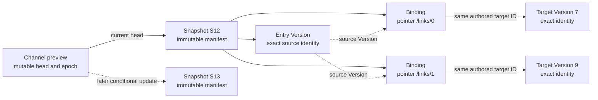

# WoT Channels, Snapshots and Dependency Bindings

<!-- words: bytewise jsonld namespace opcfoundation prerelease prereleases -->
<!-- words: submodel subthing tds tms ua uav unversioned versionid xids -->
<!-- words: workflow workflows lockfile marcschier compatibilityline -->
<!-- words: href nodeids opc REQUIREDEXTENSIONS standalone -->
<!-- words: workingdrafts -->

## Decision and status

Use the [generic xRegistry publication extension][Publication] for channels
and immutable snapshots. Its
[manifest and integrity rules][Publication manifest] capture immutable state.
Its [channel rules][Publication channel] define how publishers update heads
and readers open channels. WoT defines dependency closure and compatibility
checks. It adds no channel API or Group hierarchy.
This is an informative implementation design, not an implemented WoT
profile. The current SemVer specification and its vectors remain unchanged.

The generic proposal defines a reusable model and manifest schema. It specifies
conditional head semantics and an HTTP open context, and it defines an offline
byte bundle. Its executable examples cover only synthetic state transitions
and integrity. The WoT profile still needs resolver/provider integration and
cross-repository fixtures. Until then, a deployment cannot claim conformance
to it.

## What is versioned?

| Entity | Identity and behavior |
| --- | --- |
| Document revision | One Resource history stores its exact bytes and fixed metadata. |
| Compatibility line | Domain declaration of compatible incremental revisions. |
| Snapshot | Exact model/metadata, revisions and dependency bindings. |
| Channel | A mutable scoped name that selects a snapshot. |
| Source release | A source release records capture provenance. It is not a revision or snapshot ID. |

The same document revision can appear in multiple snapshots. A publisher can
move a channel across compatibility lines, but consumers still apply their
compatibility requirement to the selected head. No Group represents a
channel, snapshot or compatibility line.

A channel resembles a Git branch only in that it has a mutable head and a
publisher can fork it cheaply. The manifest's OPTIONAL parent records
preparation history. It does not enable automatic merge, rebase, a working
tree or the Git protocol. Reconciliation creates another complete, validated
snapshot.

## A complete WoT publication

A domain-complete snapshot contains each entry document and every transitive
TM/TD dependency needed to interpret it. It also contains fixed metadata and
original reference bases. For each recognized external reference occurrence,
it records one exact binding. The publication does not change domain bytes.
The producer resolves each recognized external reference to an exact target
under the generic [closure rules][Publication closure]. The resolver checks
whether the caller accepts that target.

Two reference occurrences can bind the same logical target ID to different
exact Versions:

**Figure A-1.** Informative channel and closure view. A channel has one
current head. Each binding identifies one source occurrence and one exact
target Version in the selected snapshot.

The closure extension URI is:

`http://opcfoundation.org/UA/WoT-Binding/publication-closure/1`

Its value in the generic manifest's `extensions` map is a checked descriptor
of a `wot-publication-closure/1` JSON document. A domain-complete publication
lists that URI in `requiredExtensions`. A generic reader that does not
understand it fails rather than claiming WoT-complete interpretation.
The [schema](schemas/publication-closure.schema.json) defines its shape.

`entries` lists Version XIDs from the captured Registry view.
Each `bindings` record contains:

| Field | Meaning |
| --- | --- |
| `source` | Exact source Version XID in the captured view. |
| `pointer` | RFC 6901 pointer to the authored reference object. |
| `operator` | WoT relation/operator in the source's captured contexts. |
| `href` | Exact authored reference string, including any fragment. |
| `target` | Exact target Version XID in the same captured view. |

Document digests, originating Registry/Version identities and original bases
come from the generic manifest's document associations. Profile and line
expectations come from the captured trusted metadata. Duplicating them in
each binding would introduce competing authorities.

The profile recognizes these external references, all defined by the WoT
draft:

- `tm:extends`
- `tm:submodel`
- `tm:ref`
- `td:extends`
- `td:subthing`
- `td:ref`
- TD `type` links
- Projection-source references

The schema deliberately permits operator strings so the existing
vocabulary/contexts remain authoritative. An unknown operator cannot satisfy
closure validation. The producer follows the WoT draft's reference rules. It
does not treat an interaction endpoint, documentation link or arbitrary
application link as a dependency solely because that item has a URL.

The producer enumerates references independently of the emitted binding
table. It applies the WoT draft's rules for contexts, fragments and
composition.
Local fragment references stay within their source document and need no
external binding. Every external occurrence needs exactly one binding.
For a `links` item, `pointer` identifies that item. For `tm:ref`/`td:ref`,
it identifies the object containing that member. Source bytes need to contain
the stated operator and exact `href` at that object.

The producer materializes external dependencies as exact Versions in the
captured view and preserves their source associations. The binding key is
`(source, pointer)`, not the authored target ID.
The target's bytes and fragment need to satisfy the actual source reference.
An existing Version with unrelated bytes is not a valid binding.

Entries, sources and targets need to exist in the generic document associations.
Bindings need to be unique and cover the complete reachable closure from the
entries. They need to exclude unreachable or invented edges.

During traversal, the resolver records each visited Version/reference pair.
The composition operator's existing rules determine whether a cycle is valid.
The resolver bounds traversal even when a cycle exists.

The producer preserves the contexts needed to interpret captured documents.
It retains the original JSON-LD material or uses a supported immutable context
set. Offline interpretation does not fetch live contexts.

## Selection and acceptance

Opening a channel under the
[Publishing and Opening a Channel][Publication channel] rules selects its
current immutable manifest once. During that open, the resolver reads every
entry, dependency and page from the selected snapshot. If the snapshot lacks
closure data, the resolver fails instead of looking up the highest live
version.

The resolver first selects the bound exact revision for snapshot-bound
composition. It checks the source reference's constraints against that
revision and confirms that the caller accepts it.
Incremental targets need the declared compatibility line and any numeric
floor. SemVer targets retain their target-kind floors, next-major bounds
and prerelease rules. Conflicting trusted declarations fail.
The snapshot determines content. It does not waive those requirements. The
raw exact-pin retrieval path remains separate from this
[compatibility-checked composition][Publication closure].

The standalone live resolver still selects the highest qualifying revision
under [D7](versioning-design.md#d7-selection-defaults-and-exact-pins),
including its sticky-default rule. A captured default describes the
snapshot's raw Resource read. It does not replace an explicit dependency
binding.
The existing raw exact-pin retrieval path still bypasses live floor/default
selection. It is not compatibility-validated snapshot composition.

For example, entry E in snapshot S12 binds a line-A dependency to revision 42.
After the author publishes revision 43/B, opening S12 still reads 42/A.
The publisher can advance `preview` to S13 with 43/B. A caller requiring A
rejects that head. The resolver does not search earlier snapshots for an A
candidate. To accept another result, the caller changes its authored
requirement or selects another channel explicitly.

## Publication and user workflows

The existing [63 workflows](versioning-design.md#publisher-workflows) explain
per-document publishing and version selection. They also cover exact replay
and migration. These additional workflows explain set publication and its
relationship to compatibility. Each follows the generic
[channel publication and opening rules][Publication channel]. Each also uses
the [export and federation contract][Publication export].

### N01. Convert a versioned companion specification

The publisher records the standard's release as provenance. It reuses
unchanged document revisions and allocates revisions only for changed
documents. It resolves and validates the complete set, then persists a
manifest. The publisher moves the channel only if the conditional update
succeeds. If conversion fails, the old head remains unchanged.

### N02. A publisher captures a revision of a server model

The publisher records the server identity, model revision and capture method.
It verifies a source consistency mechanism or states that it observed the
server on a best-effort basis. Immutable output does not prove atomic source
capture. If the caller demands a guarantee the server lacks, the publisher
rejects the capture.

### N03. A publisher publishes an individual edit

The publisher starts from S12 and replaces one entry or dependency revision.
It retains the other exact associations, validates every affected edge and
publishes S13. IDs for unrelated document revisions do not change.

### N04. A publisher changes one document incompatibly

The publisher assigns the document a new compatibility line and revision.
In a new snapshot, it binds accepting entries to that revision and keeps
other entries' dependencies exact. Consumer requirements can reject the new
head. Publication does not redefine those requirements.

### N05. Fork development

The publisher creates `preview` pointing to S12. Both channels initially
share the same manifest and bytes. Later head changes are independent.
Deleting a channel never authorizes reuse of its old Resource identity.

### N06. Reconcile two publishers

Both publishers read epoch 12. One publishes S13. The other's conditional
update fails. The publisher whose update failed reads the new head and
reconciles deliberately. It then creates another complete snapshot. It does not
overwrite the winner or silently merge JSON.

### N07. A publisher promotes a reviewed set

The publisher conditionally points `stable` at the exact reviewed manifest.
The existing revisions and snapshot suffice. If the stable head changes
concurrently, promotion fails. The publisher reviews the new head before
trying again.

### N08. A publisher rolls back the channel

The publisher conditionally restores S12 and advances the channel epoch.
Operations already in progress keep using their pinned snapshots. The caller
activates the deployment separately.

### N09. A publisher recovers a timed-out head update

The publisher reads back the head and epoch, then reconciles. A matching head
can satisfy the publication objective without proving which request wrote it.
The publisher reuses the immutable manifest instead of repeating anonymous
document uploads.

### N10. Export and replay offline

Offline replay requires the byte bundle to retain:

- The manifest
- Registry metadata
- Context material
- Closure data
- Exact document bytes

The reader resolves URLs through the bundle's map without contacting the
origin. Missing, corrupt or unsupported material causes replay to fail. Raw
cached documents alone are insufficient.

### N11. A consumer federates a channel

The consumer opens each moving source once and retains its pin and context.
It applies whole-Resource precedence without replacing binding targets.
Reproducible combination requires exact source pins, a model and policy, or a
materialized combined snapshot. Distinct source captures do not represent a
simultaneous state.

### N12. Refresh, retain or revoke

A consumer refreshes the channel to review a new head. Old pins remain
unchanged. Operators retain reachable content under policy. If an operator
revokes or deletes it, replay becomes unavailable. The reader reports replay
as unavailable instead of substituting a newer resource.

For N01 and N02, a source's incremental model revision is sufficient
provenance. The publisher does not need to express it as SemVer or copy it
into every changed document's registry revision. Individual authors use the
same publication protocol without a product-wide release number.

## Validation and implementation boundary

The schema checks the descriptor's shape only. The adapter/resolver needs to
independently rediscover edges from source bytes and expand contexts. The
adapter/resolver then needs to match each pointer, operator and target, check
compatibility, and bound transitive traversal.

The planned negative fixtures omit or replace edges after recomputing all
digests. They also test wrong source bases, conflicting declarations, missing
context material and a dependency added to an unrelated entry.

Neither the generic proposal's tests nor the 27 representative SemVer vectors
establish those WoT semantics. A mapping for OPC UA needs the same context
and closure semantics, including append-only generated NodeIds. This design
pass does not change the `1.1-draft` model or either .NET runtime.

The [shape example](samples/publication-closure.json) illustrates one binding,
not an independently complete snapshot. Three schema checks cover its shape
and malformed pointers/missing targets. They do not validate authored bytes
or prove dependency closure.

[Publication]: ../../publication/spec.md
[Publication manifest]: ../../publication/spec.md#manifest-and-integrity
[Publication channel]: ../../publication/spec.md#publishing-and-opening-a-channel
[Publication export]: ../../publication/spec.md#export-federation-and-binding-equivalence
[Publication closure]: ../../publication/spec.md#domain-closure-and-compatibility
