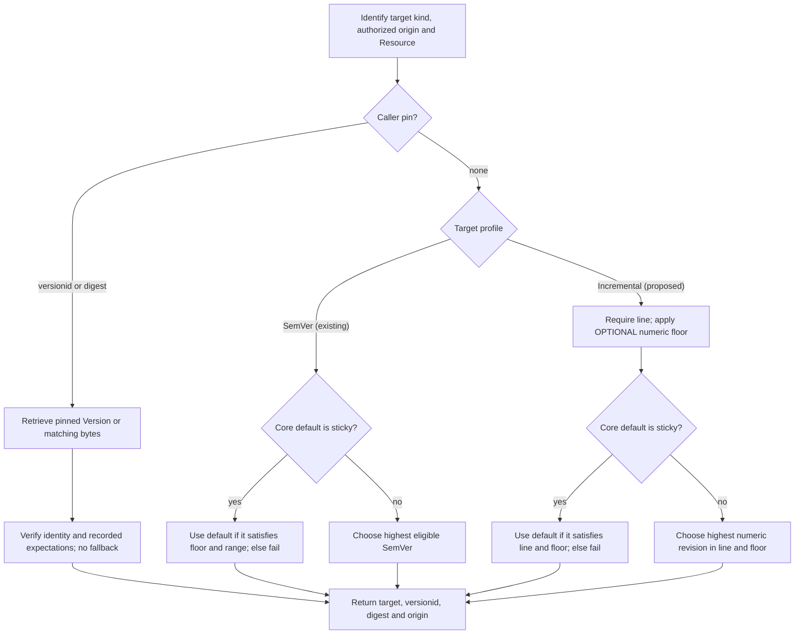

# WoT Versioning: Design and Operating Workflows

<!-- words: allowprerelease contentdigest dotnet idempotency minversion -->
<!-- words: netstandard opc prereleases readonly REQUIREDVERSION submodel -->
<!-- words: subthing tds tms tombstones ua uav versionorigin versionprofile -->
<!-- words: wotid wotversionprofile -->
<!-- words: compatibilityline ctt href lockfile marcschier namespace nodeids -->
<!-- words: nodeset opcfoundation rdf REQUIREDCOMPATIBILITYLINE unversioned -->
<!-- words: walkthroughs workaround workflow workflows -->
<!-- words: standalone -->
<!-- words: ih pv sx -->

## Status and reading guide

This document proposes an informative design for review. This documentation
does not implement or make normative the incremental profile, vocabulary,
diagnostics or mappings described here. The [WoT specification](spec.md),
[model](model.json) and [64 resolution vectors](tests/resolution/README.md)
define the SemVer baseline; they do not demonstrate that the incremental
design works.

The [two-page overview](versioning-design-summary.md) states the decision.
The [mechanisms](#design-mechanisms) define the proposed contract, and the
[workflow catalog](#publisher-workflows) traces operations, failures and
reversal. The [evidence index](#workflow-evidence-index) separates current
checks from proposed implementation work.

The [channel/snapshot design](publication-design.md) defines 12 additional
set-publication workflows, N01-N12, alongside the 63 workflows here. The
generic xRegistry proposal defines the publication model and HTTP/offline
context. WoT defines a proposed dependency-binding schema and compatibility
acceptance. This specification-first work changes neither .NET runtime nor
the OPC UA model.

## Decision

Keep the native SemVer profile and add a separate incremental profile.
Select the profile when provisioning a registry endpoint/model, not by
guessing from each document. Both profiles use the existing TD and TM
collection names. A deployment needing both exposes separate endpoints.

For incremental documents, integer revisions establish order; an explicit
compatibility line determines which revisions a consumer follows. A publisher
normally uploads unchanged bytes with a line declaration, and the registry
assigns the next revision. A consumer names the target and line, adding a
minimum revision only when it requires a particular feature. The resolver
returns an exact pin for repeatable use.

Use channels for named update streams and immutable snapshots for complete
publication sets. Compatibility remains separate: a channel named `stable`
does not promise that its next head meets the same consumer requirements.
Groups represent none of these concepts. The
[publication design](publication-design.md) defines exact dependency
bindings, conditional promotion, export and federation.

Use `uav:minVersion` and `uav:compatibilityLine` in the existing OPC UA WoT
Binding namespace for deployment now. Core WoT vocabulary standardization is
a separate proposal track, not a prerequisite for operating this design.

## Problem and boundaries

A TM can state `version.model`, and a TD can state `version.instance`.
Neither tells a registry how to assign revision IDs or which revision a
reference selects. Requiring SemVer in every document excludes those
whose authors use integers, free-form labels or no version.

The current generated fallback, `0.0.0-N`, permits storage without changing
document bytes, but its IDs are prereleases and cannot serve as floors. It is
SemVer-profile bookkeeping, not incremental versioning.

The design separates authored identity, registry revision order,
compatibility selection and exact replay. It covers TM and TD composition,
type links and projection-source selection. Existing operators, fragment
rules, authorization and deployment activation rules remain in force. It
adds no compatibility graph, signature format, lockfile, exactly-once
protocol or replacement for xRegistry Core.

## Design mechanisms

### D1. Fixed endpoint profiles

Propose registry metadata `wotversionprofile` with strict values `semver`
and `incremental`, declared read-only with a fixed default in each model.
Absence means legacy SemVer. Unknown profiles fail version-aware resolution;
integer-looking content is not a profile signal.

Keep `model.json` as the SemVer model and propose a separate
`model-incremental.json`. The latter filename is a planned artifact, not a
file delivered by this review update. Providers and offline catalogs carry
equivalent profile information for their candidate sets.

Core's [`versionmode`][Core versionmode] and
[`singleversionroot`][Core singleversionroot] aspects determine Version ancestry.
The [`ancestorid`][Core ancestorid] attribute records that ancestry.
The Core model aspects are:

| Aspect | SemVer | Incremental |
| --- | --- | --- |
| `versionmode` | `semver` | `manual` |
| `singleversionroot` | `true` | `false` |
| Resolver order | SemVer precedence | Numeric revision |
| Compatibility boundary | Existing rules | Explicit line |

Core's manual ancestor tree is not a numeric sequence or compatibility line.
Allowing several roots makes middle-ancestor deletion legal without a
custom repair protocol. No SemVer model migration is needed.

An endpoint with published Versions does not switch profiles in place.
Provisioning another endpoint is an intentional operating cost of preserving
native SemVer behavior.

### D2. Identity and source scope

The authored WoT `id` identifies the target. The registry origin, Resource,
and `versionid` identify one stored revision. The authored version remains
inside the original bytes; it need not be the registry's ordering key.

Two independent registries assigning revision `42` have not identified the
same revision. Resolve one authoritative source sequence before comparing
numbers. Replication preserves source identity and numbering, or supplies an
explicit old-to-new mapping. Discovery never silently combines independent
integer sequences with the same authored `id`.

A line is an absolute URI, compared exactly and case-sensitively. The
examples abbreviate `urn:example:pump:control-a` as A and
`urn:example:pump:control-b` as B in prose only. Their names have no order.

### D3. Publication and durable allocation

An incremental ID is a string matching `[1-9][0-9]*`, within Core's
128-character ID limit. Compare by integer value, using arbitrary precision
or decimal length followed by ordinal comparison. Thus `10` follows `9`
without a floating-point or 64-bit limit.

The publication owner reads the Resource's durable high-water mark and:

1. Inspects TM `version.model` or TD `version.instance`.
2. Uses a canonical authored integer verbatim, with origin `authored`,
   when it exceeds the high-water mark.
3. Otherwise, for an absent or non-integer authored value, assigns the
   high-water mark plus one with origin `generated`.
4. Rejects a supplied registry ID that is invalid or differs from this
   assignment.
5. Validates metadata and commits bytes, revision, line, counter, and
   applicable Core state atomically.

A canonical integer exceeding the ID length limit fails; it is not converted
to a generated ID. A signed, leading-zero, free-form, or SemVer-looking
authored value is preserved but does not supply the numeric ID. An explicitly
supplied registry ID in those forms is invalid.

An authored integer at or below the watermark fails as a new publication.
Repeating an existing explicit creation is a separate D8 operation.

Allocated history includes accepted authored numbers and deleted revisions.
Normal writes do not reuse numbers, fill gaps, or insert older history.
Generated integers are ordinary candidates and valid floors, not prereleases.

The pure assignment function receives durable counter state; retained
Versions alone cannot reconstruct it after deletion. A writable adapter
provides transactions or compare-and-swap protection. An adapter lacking
that capability rejects publication before mutation and advertises only
the operations it actually supports.

Core's [default Version ID algorithm][Core version IDs] already retains a
generated high-water position. Advancing past authored IDs and committing
all associated WoT state remain obligations to prove in the actual adapter.
The assignment uses Core's immutable [`versionid`][Core versionid].
Loading the proposed model is not proof of that behavior.

### D4. Compatibility and authority

Each incremental Version has zero or one effective compatibility line.
A higher revision in the same line claims backward compatibility with
every earlier revision in that line. Different lines can be incompatible.
Neither revision order nor `ancestorid` proves the claim.

Declare the line through root `uav:compatibilityLine`, or through authorized
publication metadata `compatibilityline` when the bytes cannot change.
If both declare a line, require exact agreement. Fix the effective value,
including absence, when creating the revision. Adding or changing it later
requires another revision.

For example, an authorized publisher supplies this metadata separately from
unchanged, unversioned document bytes:

```json
{
  "compatibilityline": "urn:example:pump:control-a"
}
```

At watermark 41, the publication result exposes `versionid: "42"`,
`versionorigin: "generated"`, and that effective line, together with the
actual digest and source identity. These are logical metadata values,
not a new upload envelope; each adapter uses its existing publication API.

A line-less revision is valid storage and remains reachable through raw
retrieval and exact pins. It cannot satisfy automatic line selection.
The publishing boundary exposes the absent line with a diagnostic:
"not eligible for automatic compatibility-line selection." The concrete
response/tool mapping is planned adapter work, not an existing wire field.

Accepted authority is an authorized publisher or explicitly configured
trusted provider/catalog origin. Metadata binds the profile and line to
target, source Resource, revision, and exact document digest. A digest alone
does not authenticate an external declaration.

The publisher owns compatibility classification. A domain validator can
check it; the resolver does not treat the label as proof. Do not assert
Core Resource-wide `compatibility: backward` across incompatible lines.
The existing SemVer compatibility contract remains separate.

### D5. Deployable vocabulary and WoT standardization

Use the existing namespace exactly:

```json
{
  "@context": {
    "uav": "http://opcfoundation.org/UA/WoT-Binding/",
    "uav:minVersion": {
      "@id": "uav:minVersion",
      "@type": "http://www.w3.org/2001/XMLSchema#string"
    },
    "uav:compatibilityLine": {
      "@id": "uav:compatibilityLine",
      "@type": "@id"
    }
  }
}
```

This is a proposed context excerpt, not a complete TD/TM context or a claim
that the remote context already defines these terms. Extend the Binding
context, Turtle vocabulary, and JSON Schema together during implementation.
Do not rebind `uav` or replace composition operators with new `uav` operators.

`uav:minVersion` serves either target kind. A link relation, reference
operator, or declared source media type establishes TD versus TM.
Root `uav:compatibilityLine` declares the containing document's line;
the same term on a supported reference selects the target's line.
The root value is never inherited by dependencies.

The [WoT versioned-reference proposal][WoT proposal] pursues standardization
in core WoT vocabulary. Its current status is an open proposal on the
author's fork, not W3C Working Group adoption. Proposed `tm:minVersion`
and `td:minVersion` remain informative candidate mappings here; deployment
does not depend on W3C accepting those names or semantics.

New emitters use `uav` terms. Readers retain the existing draft floor forms
as compatibility inputs, including their target-kind restrictions. Normalize
one accepted form into one internal requirement. A reference carrying both
an old floor and `uav:minVersion` fails `invalid-floor`, even if they agree.
Authoring validation and WoT-aware publication detect this structural error
without retrieving targets; the resolver retains a safety check.

Core-only storage might not inspect document internals. Storage acceptance
therefore does not prove well-formed version requirements. Preserve existing
exact-pin precedence over selection requirements; structural document
validation and floor-based candidate selection are distinct operations.

Upgrade readers before new emitters. Do not duplicate a composition or type
link once per vocabulary: that can change composition or introduce ambiguity.
A later standardized vocabulary gets an explicit conformance/mapping update.
It does not rewrite old bytes, pins, or `uav` term identities.

### D6. Reference requirements

An unpinned incremental reference needs an explicit
`uav:compatibilityLine`. It can add `uav:minVersion` as a numeric floor.
Omission means no floor, not a hidden floor of `1`. A floor without a line
fails `compatibility-required`.

This abbreviated link assumes the existing TD composition context plus D5:

```json
{
  "rel": "td:extends",
  "href": "urn:example:pump:base",
  "uav:compatibilityLine": "urn:example:pump:control-a",
  "uav:minVersion": "42"
}
```

For a TM link, use the same versioning members with the appropriate existing
operator. For ordinary `tm:ref` or `td:ref`, the members are siblings of
the string-valued reference. Projection-source entries carry them on the
entry whose declared target kind they constrain.

Malformed floors fail `invalid-version`; conflicting syntax fails
`invalid-floor`. A line selector for a SemVer target, a selector at an
unsupported location, or an invalid line URI also fails explicitly rather
than being ignored. Final protocol error mappings are implementation
contract work; this review does not invent Core error responses.

An incremental target receives no implicit floor from the referencing
document's `version.model` or `version.instance`. It has no SemVer major
cap or prerelease filter. Document-local references check the containing
revision's line/floor instead of substituting another document.

SemVer retains its existing behavior, with deployed `uav:minVersion`
normalized to the same floor:

- A TM floor has no upper bound under its existing identity contract.
- A TD floor `X.Y.Z` selects at least that version and below `(X+1).0.0`,
  including the same major-zero rule. An unfloored TD can cross majors.
- A TD type link combines its explicit floor with implicit `version.model`
  by taking the greater value. Multiple SemVer type links with that root
  value need explicit floors on every SemVer link.
- Prereleases need opt-in or an effective prerelease floor. Generated
  `0.0.0-N` floors remain invalid.

For mixed-profile type links, determine profiles first and apply the legacy
implicit/ambiguity rules to the SemVer-target subset. Incremental links
always keep their own explicit line and OPTIONAL explicit numeric floor.
An unknown/unavailable profile fails rather than weakening the requirement.

### D7. Selection, defaults, and exact pins

This diagram summarizes standalone live selection and raw pin retrieval.
The pin branch bypasses live floor/default candidate selection. A `versionid`
pin names one Version; a digest matching several Versions is ranked under the
known profile. Both fail without an unpinned fallback.



**Figure D7-1.** Informative live-selection and raw-pin flow. Snapshot-bound
composition instead selects the binding from its immutable manifest and
validates the authored requirement and caller policy under the
[WoT snapshot acceptance rules][Publication acceptance] and generic
[Domain Closure and Compatibility][Publication closure]. It does not replace
the binding with a live highest-version result or another channel head.

The incremental path is illustrated by
[C01](#c01-follow-the-newest-revision-in-a-line) and
[C02](#c02-require-a-features-minimum-revision); exact replay by
[C14](#c14-replay-an-exact-revision); and sticky-default behavior by
[A05](#a05-set-a-sticky-default) and
[A06](#a06-diagnose-a-default-conflict).
The checked SemVer vectors include
[version-ID pinning](tests/resolution/006-versionid-pin.json),
[pin precedence](tests/resolution/026-pin-overrides-floor-and-sticky.json),
and [a sticky default below its floor](tests/resolution/007-sticky-below-floor.json).
They do not exercise the proposed incremental profile.

Ordinary Resource retrieval serves the [Core default][Core defaults].
Core's [`defaultversionsticky`][Core sticky] aspect keeps an explicitly
selected default fixed; when it is false, Core derives the default from the
Resource's `versionmode`. In manual mode that non-sticky default follows
leaf/time rules and need not be the highest integer, especially after import
or metadata changes. Constrained resolution instead selects numerically
unless a sticky default is authoritative. This is a distinction between
operations, not a change to Core.

Keep the selected tuple outside the document. New records include profile
and effective line when applicable; replay verifies recorded expectations
against trusted metadata. Existing pin shapes stay accepted.

A bare digest pin is deliberately line-agnostic. If the same bytes occur
in several revisions, select the highest matching revision under the known
profile. For a particular revision, use the existing version-ID pin and
retain its digest for verification. The existing input API accepts a digest
or a version ID, not both; a richer stored record is not a new API promise.

Pins override floor, line-selection, sticky-default, and prerelease choice.
They still require identity, authorization, bytes, and any recorded metadata
expectations to match. Pinning a parent does not pin its transitive
dependencies. Preserve records and bytes for every dependency when exact
replay is needed.

That override belongs to raw exact retrieval. A publication snapshot does
not override compatibility acceptance: it fixes the inputs to that check.
Pinning a parent and retaining a complete dependency closure are separate
claims; a WoT-complete publication explicitly supplies both.

### D8. State changes, recovery, and migration

An explicit existing revision can be idempotent under the publication API's
existing contract; different content or fixed metadata conflicts.
Anonymous publication has no exactly-once guarantee.

After an ambiguous timeout, use an existing request-status or explicit-ID
read path when available. Otherwise inspect Version history for matching
digest, line, and publication metadata. Matching content can satisfy an
availability objective; it does not prove which request created it.
Checking only the highest revision is insufficient under concurrency.
No match does not prove failure while a request might still be committing.
Keep the outcome unknown; reconcile or deliberately accept possible
duplication on retry.

Hard deletion can invalidate pins. It cannot reset the high-water mark.
Resource recreation retains a counter tombstone or establishes a distinct
sequence identity. Restore of an old backup cannot resume an old identity
using a guessed counter: recover authoritative allocation history or
create a distinct sequence.

Migrate through an offline manifest into a separate endpoint. Inventory
bytes, roots, IDs, defaults, and origins; assign new numbers/lines with
publisher approval; record explicit source-to-destination paths. Validate
the destination before discovery cutover. Preserve the source for old pins.
Rollback changes routing, not history or revision numbers.

### D9. Implementation responsibilities

Core supplies storage semantics, ancestor processing, raw defaults, and
existing concurrency/authorization operations. The WoT publisher supplies
profile-aware assignment, durable allocation, declaration agreement, and
early structural validation. The provider supplies trusted candidate
metadata. The resolver supplies constrained selection and exact replay.
The caller owns deployment activation and retained dependency records.

The generic publication adapter owns immutable manifests and durable
conditional channel heads under [Manifest and Integrity][Publication manifest]
and [Publishing and Opening a Channel][Publication channel]. Its
[Export and Federation rules][Publication export] define checked context and
binding equivalence. The WoT layer independently discovers and validates the
reference closure under [Domain Closure and Compatibility][Publication closure].
A channel head changes a publication set; it does not allocate document
revisions or decide compatibility.

Extend existing .NET snapshots/APIs with profile and line context and reuse
the SemVer implementation. Audit actual publication owners: a pure helper
test is not evidence of durable allocation.

For OPC UA, propose registry/provider `VersionProfile`, Version-level
`CompatibilityLine`, and an OPTIONAL dependency `RequiredCompatibilityLine`.
Keep `RequiredVersion` string-valued and profile-interpreted. Verify owners,
modelling rules, field order, and OPTIONAL encodings against generated types
before changing generators. Append NodeIds; remain on `1.1-draft` with a new
model identity/date. Regenerate model/types/tables/ledgers/CTT together.

Keep provider acquisition, held-target fast paths, caches, snapshots,
conversion, refresh, and materialization consistent with the resolver.
A selector present in a NodeSet is not proof it was enforced.

## Operating examples and notation

Use one incremental source `https://registry.example`, target
`urn:example:pump:base`, and history `42/A`, `43/B`, `44/A`.
Each number identifies a Version; each letter abbreviates the line URI in D2.
Unless stated otherwise, selection is unpinned and the default is not sticky.
Revision-creation examples state their starting watermark separately.

Every workflow states inputs/actions, observable state, failure/recovery,
and its supporting mechanism. Its ID is also the planned evidence case
in the [index](#workflow-evidence-index). These are proposed walkthroughs,
not execution reports. Related workflows reuse a mechanism without adding
another protocol or administrative service.

## Publisher workflows

### P01. Author an editable TM or TD

The author chooses a stable `id` and root `uav:compatibilityLine` A, with
the context in D5. The authored version is OPTIONAL for incremental use.
The publisher submits the bytes to the configured incremental endpoint.
The response identifies the stored revision and digest.

D3 and D4 keep version numbering and line agreement at the publishing
boundary. A conflicting metadata line fails before commit; correct the
request rather than retrying unchanged. The author owns the compatibility
claim, not the registry counter.

### P02. Publish unchanged external bytes

An authorized publisher uploads an existing document and metadata
`compatibilityline` A, without inserting a root declaration. D3 allocates
the revision; D4 associates line, origin, and digest with those exact bytes.
The stored document digest equals the input digest.

If a root declaration already says B, publication fails with no counter,
default, or content change. Supply matching metadata or publish another
authorized document; never silently overwrite the root claim.

### P03. Create the first revision

For a new Resource with no allocation history and an unversioned document,
upload bytes and line A. D3 assigns `"1"` and origin `generated`; Core
establishes its initial ancestor/default state. The publisher records the
returned source identity, revision, and digest.

Failure before commit leaves no Version. A timeout with unknown commit state
uses P14, not a blind assumption that the Resource is still empty.

### P04. Keep a missing or free-form authored version

Publish a TM with no `version.model`, or a TD whose `version.instance` is
`"release-blue"` or `"1.2.0"`, to the incremental endpoint with line A.
If the watermark is 41, D3 assigns `"42"` with generated origin.
The authored value and exact bytes remain unchanged.

That label is not a numeric ordering claim. A caller-supplied registry
ID `"release-blue"` fails; omit it to request allocation. The SemVer endpoint
has its own assignment rules and is not selected by inspecting this value.

### P05. Supply an authored integer

With watermark 41, publish a TM `version.model: "42"` or TD
`version.instance: "42"`, plus line A. D3 uses `"42"` with authored origin.
A supplied registry ID has to be `"42"` too.

Publishing authored `"40"` is rejected as a new revision, not inserted into
history. Explicit recreation of an existing ID follows P15. Use controlled
initial import for historical data, or let the registry allocate numbers
when the external author's numbering does not fit this sequence.

### P06. Publish a compatible update

Starting with 42/A, publish updated bytes whose compatibility claim remains A.
For server-assigned publication, the next revision is 43/A. Existing
unpinned line-A references can follow it; existing exact pins do not move.

D4 places the compatibility decision with the publisher. Known violations
are rejected by applicable validation; a label alone proves nothing.
Withdraw a bad publication through existing retention/activation policy,
not by silently changing its line.

### P07. Publish a breaking incremental update

With 42/A present, publish incompatible bytes under line B, creating 43/B.
The authored target ID can remain the same. An A consumer still selects 42;
after a compatible A update creates 44/A, it selects 44.

D4 and D6 isolate lines without separate per-line Resources or defaults.
Consumers adopt B explicitly. A mistaken B declaration is corrected through
another revision, not reclassification of 43.

### P08. Publish SemVer updates and breaks

At the SemVer endpoint, publish `1.0.0`, `1.1.0`, then late `1.0.1`.
Existing SemVer precedence keeps `1.1.0` highest. A breaking TM major uses
a new target ID; a breaking TD instance advances its major under the same
Thing ID. D1 and D6 preserve these existing rules.

Authored/build-metadata mismatches retain their current errors. Reversal
uses exact pins or routing/activation policy, not renumbering releases.
Incremental line rules do not change this endpoint's behavior.

### P09. Publish without a line

An upload omits both root and metadata line. D3 can still create revision 42.
D4 exposes its absent line with the immediate diagnostic that it is not
eligible for automatic compatibility-line selection. Raw retrieval and
exact pins remain available.

This is successful storage, not successful compatible publication.
A consumer requiring A receives `unsatisfied`. To make the content eligible,
publish a new revision with A; do not attach A retroactively to 42.

### P10. Detect declaration disagreement

Submit root line A with metadata line B. D4 compares the absolute URIs and
rejects the operation before committing. No Version, counter advancement,
or default change is reported as successful.

The authorized publisher resolves the disagreement at its source and
resubmits. The registry neither guesses which claim is correct nor rewrites
document bytes to make the declarations agree.

### P11. Reject later line mutation

Attempt to patch revision 42/A to B, or attach A to a previously line-less
revision. D4 fixes both the value and its absence at creation, so the
selection-metadata mutation fails.

Publish the desired bytes/claim as a new revision. Existing pins keep the old
declaration or absence. A downstream provider presenting changed metadata
against a retained expected line fails replay validation rather than
silently updating the consumer's record.

If the bytes contain canonical authored integer 42, D3 cannot allocate 43
for those same bytes: the author has to advance that authored integer too.
Immutable external bytes with such a value cannot be reclassified in this
sequence. Retain exact-only access or use a separately scoped sequence;
there is no hidden override of authored integer assignment.

### P12. Handle invalid and oversized IDs

Supply registry ID `"0042"`, `"-1"`, or an integer exceeding 128 characters.
D3 rejects the supplied ID. A canonical oversized authored integer also
fails rather than falling back to generation.

An authored free-form value such as `"0042"` can instead be preserved while
the server assigns the registry ID. The response distinguishes generated
origin. Correct invalid registry metadata; no consumer is asked to compare
malformed numbers.

### P13. Publish concurrently

Two publishers upload unversioned bytes at watermark 41. D3's storage owner
serializes allocation or retries a failed compare-and-swap, yielding distinct
42 and 43 on successful commits. It commits each line and digest with its ID.

Exhausted transaction retries are an explicit failure, not an infinite loop.
An adapter without durable atomic state rejects allocation support before
accepting writes. Pure assignment calls alone cannot provide this guarantee.

### P14. Recover an unknown anonymous outcome

An upload times out before the publisher receives its assigned revision.
Use an existing request-status facility first, if available. Otherwise,
inspect Version history for the submitted digest, line, and metadata.
Do not inspect only the highest revision: another writer might have followed it.

D8 preserves the distinction between matching content and request identity.
No match is inconclusive while the original request might still commit.
Reconcile or deliberately retry accepting possible duplicate content;
do not claim exactly-once behavior or require a new idempotency service.

### P15. Repeat an explicit creation

After a confirmed explicit creation of 42/A, repeat that request.
Where the existing publication API defines idempotent creation, identical
bytes and fixed metadata are a no-op. Different content or line conflicts.
The watermark does not become 43 merely because the same explicit creation
was repeated.

D3 and D8 preserve the API's actual contract. An API lacking this facility
reports its existing conflict behavior; callers do not assume all publication
interfaces support idempotent replay.

### P16. Abort or exhaust publication

Declaration validation fails or the transaction aborts before commit.
D3 returns failure and leaves no partial content/line/default update.
The storage owner retries ordinary contention through its existing mechanism;
an unknown commit outcome follows P14.

If the next number exceeds the ID limit, allocation fails without resetting
the counter. Preserve the old sequence for pins and provision another
sequence if needed. Deleting history is not a counter-recovery procedure.

## Consumer workflows

### C01. Follow the newest revision in a line

Author a target reference with `uav:compatibilityLine` A and no floor.
The resolver discovers the incremental profile and D7 selects 44/A from
42/A, 43/B, 44/A. It returns 44, its exact digest, origin, and line context.

The consumer does not choose a number or inspect ancestry. A later 45/B
does not move this selection. If no A revision exists, resolution fails
`unsatisfied`; it does not choose B.

### C02. Require a feature's minimum revision

Add `uav:minVersion: "44"` to the A reference. D6 and D7 select 44/A.
With only 42/A and 43/B, the result is `unsatisfied`, even though B is newer
than A's first revision.

The floor belongs to this source sequence. Record the selected origin and
do not reuse `"44"` against an unrelated registry counter. Remove or lower
the floor only if the consumer's feature requirement actually changes.

### C03. Reject an incomplete requirement

Resolve an incremental target with floor `"42"` but no line. D6 returns
`compatibility-required` rather than selecting across possibly incompatible
lines. A line-A reference with floor `"45"` returns `unsatisfied` in the
running history.

Add the intended line or explicitly pin a revision. An exact pin is a
deliberate selection, not a way to pretend the missing compatibility claim
has been verified.

### C04. Distinguish raw retrieval from resolution

Retrieve the Resource normally, then resolve its line-A reference. The first
operation returns Core's default; D7 returns 44/A unless a sticky default
restricts it. The results can differ under manual leaf/time ordering.

Use the compatible-resolution operation for composition. Diagnostics identify
the operation, profile, and chosen/default revisions under existing disclosure
rules. A raw GET is not advertised as satisfying the consumer's line/floor.

### C05. Compose TM targets

Place the line and OPTIONAL floor on a `tm:extends` or `tm:submodel` link,
or beside an ordinary `tm:ref`. D5 and D6 normalize the requirement without
changing the operator. D7 selects the containing document before traversing
an external fragment.

If the selected version lacks the definition, fail ordinary composition.
Do not try an older revision until a definition appears. The existing
operator's target-kind and cycle rules still apply.

### C06. Resolve a TD type link

For an incremental TM target, put A and any explicit numeric floor on the
TD's `rel: "type"` link. The TD's root `version.model` supplies no incremental
floor, and its root line supplies no dependency line.

D6 makes the requirement visible at the link. If A is absent, fail as C03.
SemVer type links retain their separate implicit-floor behavior in C09;
authors need not disguise an integer as `0.0.42`.

### C07. Compose TD targets

Place A and any floor on `td:extends`/`td:subthing`, or beside `td:ref`.
D7 selects 44/A; ordinary TD composition then processes the result.
The referencing TD's own instance/model versions do not constrain this
target implicitly.

An incremental target has no major cap. At the SemVer endpoint a TD floor
retains its next-major bound. The target profile, not the reference author's
registry, determines comparison.

### C08. Select projection sources and local fragments

Each projection source entry carries its own line/floor and expected kind.
D6 constrains the source before existing projection selection proceeds.
The projection envelope's version and line are not defaults for its sources.

For a local reference, validate the containing revision against its stated
line/floor without replacing that document. A failing local constraint or
missing pointer is an error. Existing explicitly authored source-digest
mechanisms remain distinct from consumer-owned resolution records.

### C09. Resolve SemVer type-link floors

A TD with `version.model: "1.1.0"` and one SemVer type link cannot select
`1.0.1`. With explicit floor `1.2.0`, the effective floor is `1.2.0`.
With several SemVer type links and the root value, each needs its own floor.

D6 retains `ambiguous-floor` when one is missing. Without root
`version.model`, each SemVer link has only its own OPTIONAL floor.
An explicit pin retains the existing precedence over floor derivation.

### C10. Resolve mixed-profile type links

A TD has one SemVer type link and one incremental type link. Discover both
profiles first. D6 applies root `version.model` only to the SemVer subset;
the incremental link independently requires A and an OPTIONAL integer floor.

Two SemVer links still trigger their existing multi-link rule. An unavailable
profile fails rather than guessing from the floor's spelling. To avoid a
shared implicit requirement entirely, omit root `version.model` and author
explicit per-link requirements.

### C11. Admit SemVer prereleases deliberately

With `1.2.0` and `1.3.0-rc.1` available at a SemVer endpoint, ordinary release
selection excludes the prerelease. Explicit opt-in or an effective
prerelease floor enables the existing eligibility rule.

D6 preserves precedence: `1.2.0-rc.1` remains below floor `1.2.0`, and a TD
floor cannot cross its next-major cap. Incremental integers have no hidden
prerelease state or related consumer switch.

### C12. Distinguish generated origins

A SemVer document without a valid authored version can receive `0.0.0-1`;
that generated prerelease is not a valid floor. An incremental unversioned
document can receive `"42"`; with line A it is an ordinary selectable revision
and can be a floor.

D1 and D3 prevent `versionorigin: generated` from imposing SemVer semantics
on an integer. An old SemVer-only client cannot silently process an
incremental source as an unconstrained success.

### C13. Capture dependency records

After resolving a parent and its dependencies, retain each target, revision,
exact digest, origin, and applicable profile/line expectations. D7 uses the
existing snapshot mechanism where available; otherwise the API exposes the
records to its caller.

Do not insert registry pins into authored reference strings or replace floors
with the selected version. Missing records make a future unpinned dependency
refresh possible; the consumer cannot claim exact transitive reproduction.

### C14. Replay an exact revision

Replay the record for 42/A while 44/A is now available. D7 retrieves 42,
verifies its digest and recorded expectations, and does not run highest-version
selection. Authored floors/defaults do not override the explicit pin.

A missing 42 or mismatching digest/line fails. It never falls back to 44.
The application distinguishes a stored full record from the existing
single-selector pin input and performs the associated verification.

### C15. Replay a shared digest

Suppose 42/A and 44/B contain identical bytes. A bare digest pin matches both
and D7 chooses the higher matching revision under the known profile.
The bytes are pinned; line membership is not.

For the specific 42/A publication, retain its revision and expected metadata
instead. Do not claim a bare digest authenticates a publisher or a line.
A later metadata mismatch in a full record is a replay error, not a reason
to silently relabel that record.

### C16. Refresh and review a newer dependency

Start from the pinned 42/A record. Perform a new unpinned A resolution and
obtain 44/A. The caller compares, validates, and activates the new snapshot
through its existing deployment process.

D7 keeps refresh separate from replay. If resolution or validation fails,
do not report activation as successful; retain the old usable snapshot.
The resolver does not invent a deployment transaction or decide when a
consumer accepts an update.

### C17. Handle unavailable pinned content

Delete or lose revision 42, then attempt its exact replay. D7 reports a
missing target or pin mismatch under the existing error mapping. An
available 44 does not repair the pin.

Restore authorized exact content from retained storage/export, or explicitly
refresh and review another revision. A service outage is not interpreted as
permission to weaken identity or digest checks.

### C18. Reproduce transitive dependencies

Pin a parent whose dependency could otherwise move from 42/A to 44/A.
Retain the dependency's own record and bytes as C13 describes.
Replaying only the parent's bytes leaves that dependency unpinned.

D7 applies the same rules to every edge. Missing dependency records/content
prevent a claim of exact offline reproduction. Either supply them or perform
an explicitly unpinned refresh; do not silently blend old and new results.

### C19. Run offline

Export the selected bytes and per-dependency records with trusted profile,
line, and source associations. Configure the offline catalog's authority
through existing deployment policy. D2, D4, and D7 reproduce the selection
without an origin network request when all artifacts are present.

A bare document cannot prove a metadata-only line. Missing metadata, missing
pinned bytes, or untrusted provenance fails the corresponding constrained
operation. Offline use does not require a new signature or lockfile format.

### C20. Resolve through a cache or held provider target

A cache/held-target fast path receives an A/floor-44 requirement or a full
pin. D9 requires it to validate source, profile, line, floor, and digest
expectations just as the acquisition path would.

Do not key a constrained result only by `wotid` or bypass checks because
the document is already materialized. A cache mismatch triggers the supported
revalidation/acquisition path or fails; it never returns an incompatible
success. No new cache implementation is prescribed.

### C21. Discover deprecation and successors

Browse an old Resource's deprecation/successor information. It can identify
a replacement TM identity or another deployment route, but it is navigation,
not a candidate in the original source sequence.

D2 and D7 keep old references on their original target. If old content is
retained, its pins continue working. Deprecation does not authorize the
resolver to substitute a successor to satisfy an unmet floor.

### C22. Adopt a different line or successor

A consumer deliberately changes A to B, or changes a SemVer TM target to
its new-major successor. Perform new unpinned resolution, validate the
changed dependency, and capture a new record before activation.

D4 and D7 make compatibility-boundary crossing explicit. Rollback uses the
prior complete snapshot if its content remains available. Never rewrite an
old record to make it appear to have selected the replacement.

## Administrator and provider workflows

### A01. Provision one profile

Choose one model profile for an endpoint and configure authorized publishers
and provider trust. An incremental-only deployment needs one endpoint,
not both. D1 fixes the profile before published history exists.

Expose its supported read/write operations and profile discovery. A model
load without the WoT publication adapter is not advertised as durable
incremental publication. Misconfiguration is corrected before activation.

### A02. Operate both profiles

Keep the existing SemVer endpoint and provision another incremental endpoint,
each with the same familiar collection names. D1 avoids mixed ordering in
one collection and preserves native SemVer defaults/deletion.

Configure resolver routes to the intended source. This is an acknowledged
deployment cost; the design does not require separate physical servers.
If two routes are ambiguous, fail source selection rather than union numbers.

### A03. Select an authoritative source

Discovery finds two Resources with the same authored ID. The configured
resolver selects one origin/Resource before D7 compares candidates.
Record that source with every result.

D2 prevents a destination's revision 42 from satisfying a source pin merely
because the numbers match. An unresolved origin ambiguity is an error.
Correct routing or provide explicit migration mappings; do not guess by
publication time.

### A04. Handle unknown profiles or limited adapters

A provider announces an unknown profile, or supports reading incremental
history but cannot allocate safely. D1 rejects unsupported version-aware
selection; D3 rejects unsupported publication before mutation.

Expose that boundary before an upload is attempted where the interface
supports capability discovery. Operators install/configure a compliant
adapter or use its read-only contract. Falling back to SemVer or raw retrieval
does not satisfy the requested constrained operation.

### A05. Set a sticky default

An operator intentionally makes 42/A the Core sticky default. An A reference
without a higher floor selects 42 even though 44/A exists. D7 respects that
explicit operator choice.

Use the existing Core default operation and authorization. Clearing the
sticky setting re-enables numeric highest-eligible selection. This changes
unpinned behavior, not retained exact pins.

### A06. Diagnose a default conflict

The sticky default is 43/B, while a reference requires A. D7 returns
`unsatisfied`; it does not silently pick 44/A. Report the requested line/floor
and default context only as permitted by disclosure policy.

Resolve by correcting an unintended default, changing the consumer's
requirement deliberately, or using an exact pin. A global default cannot
simultaneously pin several incompatible lines; no per-line pointer is added.

### A07. Stage a deployment

Keep a multi-line Resource non-sticky for ordinary automatic resolution.
Different consumer deployments retain their own reviewed pins, such as
42/A for production and 44/A for a trial.

D7 and the caller's snapshot facility avoid changing the Resource's global
default for every rollout. The registry does not become a deployment
orchestrator, and a trial update does not move another consumer's pin.

### A08. Roll back activation

After a reviewed refresh to 44/A, the deployment tool restores its prior
42/A snapshot using its existing activation mechanism. D7 validates the old
records and bytes on replay.

If 42 is no longer retained, rollback fails explicitly; publication of another
revision with different bytes under ID 42 is not a recovery path. Retention
policy needs to support the deployment's rollback objective.

### A09. Delete a middle ancestor

Delete revision 43 from a manual incremental ancestor tree. Core can make
its child another root because D1 permits several roots. Line-A numeric
resolution still chooses retained 44.

D2 and D7 do not derive compatibility from ancestry. Exact pins to 43 fail
after deletion, and authorization/retention policy can prohibit that deletion.
The SemVer endpoint continues its native ancestor maintenance.

### A10. Delete the highest revision

Delete 44 with historical watermark 44. Line-A resolution falls back to
retained 42 when no floor prevents it; a floor of 44 fails. The next successful
generated publication is 45, not 43 or 44.

D3 preserves allocation history independently of retained content.
A sticky default affected by deletion follows Core's legal state rules;
the resolver never invents a dangling default as a successful write.

### A11. Restart or restore durable state

Restart after 44 was committed and confirm the next allocation is 45.
Restore only a backup containing authoritative allocation history, or recover
the missing history before resuming the same sequence identity.

D3 and D8 prohibit guessing the counter from remaining Versions.
An old backup missing issued IDs cannot safely resume as the old sequence.
Provision a distinct sequence if history cannot be recovered; this design
states the invariant, not a new backup product or recovery protocol.

### A12. Delete and recreate a Resource

Delete the Resource, then recreate the same public origin/Resource identity.
D8 requires a retained allocation tombstone, or a distinct sequence identity
instead of resetting the old counter to 1.

Old pins remain missing unless their exact content is retained separately.
Operators cannot make new content satisfy an old pin by recycling its number.
Document the chosen retention/recreation policy in the deployment.

### A13. Replicate a preserved sequence

Copy exact bytes, revision IDs, profile, line associations, and logical source
identity to a replica. D2 permits the replica to serve that established
sequence through the configured provider mapping.

Verify digests and metadata rather than allocating fresh local numbers.
A replica with incomplete authority/history cannot claim source-equivalent
selection. It can serve only the validated subset under its supported
operation contract.

### A14. Copy to an independent sequence

Import the same authored document into another registry that allocates
its own IDs. D2 treats the result as a separate sequence even if authored
`id` and bytes match. Record the explicit old-to-new mapping.

A source floor `"42"` is not automatically a destination floor `"42"`.
Cutover requires routing/mapping review, or preservation of the original
sequence as A13. Do not change authored bytes to hide the difference.

### A15. Export trusted metadata

Export exact documents, records, effective lines, profiles, and source
associations for C19. The receiving provider is explicitly trusted under
the configured publication/catalog authority.

D4 rejects contradictory or untrusted declarations for constrained use.
Copying a digest or trusting the first seen label is insufficient.
If the receiver lacks authority metadata, exact-byte availability does not
become a compatibility claim.

### A16. Operate while the origin is unavailable

Use an authorized replica or complete offline snapshot to replay retained
pins without contacting the original endpoint. D2 and D7 preserve the
logical source and exact bytes through the configured route.

An unpinned request needing unavailable candidate metadata cannot determine
the highest eligible revision and fails. It does not substitute an unrelated
registry, stale claim, or raw default while claiming current resolution.

## Migration workflows

### M01. Inventory legacy roots

Before importing a Resource with several roots, inventory every Version,
authored ID/version, digest, ancestor, default, origin, and relevant
compatibility evidence. An authorized publisher assigns intended lines.

D8 does not infer a line from a root or version spelling. Unknown compatibility
stays unresolved or exact-only; do not label everything A to finish import.
The source remains unchanged and available for old callers during review.

### M02. Import an initial history

Create a migration manifest mapping each retained source revision to its
destination integer, line, and exact bytes. Build a separate destination
offline, validate uniqueness/declarations, and establish its high-water mark.

D8 allows controlled initial import without a public runtime mode switch.
Choose a sticky default explicitly if desired. A rejected import does not
activate a partially validated endpoint; discard or repair the destination
while leaving source routing unchanged.

### M03. Change profiles through another endpoint

Keep a populated SemVer endpoint unchanged and create an incremental
destination using M01/M02. Do not strip `0.0.0-` prefixes or infer compatible
lines from major numbers without publisher review.

D1 preserves old model behavior and D2 records origin-scoped mappings.
The authored target ID can remain stable, but discovery selects one route.
Both endpoints being reachable does not authorize merging their candidates.

### M04. Cut over and reverse routing

After validation, switch configured discovery/routing to the destination.
Consumers needing its numeric requirements obtain new records there.
Preserve the source for existing pins and legacy consumers.

D8 makes reversal a routing/activation operation. Restore the source route
if the destination is unsuitable; do not renumber destination history.
If content needed for rollback has been removed, report that limitation
rather than claim a reversible migration.

### M05. Roll out the deployment vocabulary

Upgrade readers to accept the existing draft floor forms and the `uav` form
through one normalizer. Then new authors/emitters use `uav:minVersion`.
Retain existing stored legacy bytes and their digests.

D5 forbids duplicate composition/type links as an alias workaround.
Consumers that cannot enforce the extension need an explicit legacy route
or a delayed rollout. Do not advertise an ignored requirement as compatible
resolution or silently rewrite old documents.

## Standardization and validation workflows

### S01. Deploy without waiting for W3C adoption

Publish the `uav` vocabulary/context/schema updates through the OPC draft
process and implement their specified behavior in both resolvers.
Use the established namespace in xRegistry/provider examples.

D5 makes those contracts independently implementable while the core
vocabulary proposal is discussed. A reference to the fork proposal states
its actual status, not W3C endorsement. This document update alone publishes
neither the vocabulary artifacts nor working resolver support.

### S02. Read existing draft floor terms

A stored SemVer document carries `tm:minVersion` or `td:minVersion`.
D5 accepts it as a documented compatibility input with its original
target-kind restrictions and D6 semantics.

Do not rewrite it to `uav` on retrieval or change its digest. Wrong-kind
legacy terms retain `invalid-floor`. New outputs use the deployment terms
without removing the reader's old input support.

### S03. Reject conflicting or misbound vocabulary

An author supplies both a legacy floor and `uav:minVersion` on one reference,
or rebinds `uav` to another namespace. D5's authoring/WoT publication checks
reject the malformed requirement before consumers encounter it.

Resolver validation remains necessary for imported or Core-only-stored
documents. Follow existing syntax/namespace validation and pin-precedence
contracts rather than silently choosing one floor. Correct the document
through a new publication; no first-value-wins rule is defined.

### S04. Adopt a future core vocabulary

If W3C adopts versioning terms, review their actual semantics and define
an explicit conformance mapping from the deployment extension.
Do not assume today's proposed names will be final or RDF-equivalent.

D5 retains old namespace identities, bytes, and pinned documents.
Readers can gain another validated input form when the mapping is specified.
A document migration is explicit publication, not a redirect that changes
the meaning of already-stored `uav` properties.

## Workflow evidence index

All 63 workflow IDs above name proposed acceptance cases. This index is a
review checklist, not a generated test report. None of the new incremental,
vocabulary, or operating cases is claimed executed by this documentation
change. Each future case retains its workflow ID to connect its result to
the mechanism and state/error trace above.

Evidence labels:

- `E0`: current [SemVer vectors](tests/resolution/README.md) and checker.
  They exercise normalized assignment/selection, not HTTP publication,
  compatibility validation, real digests, or migration.
- `N-P`: planned publication/adapter integration evidence.
- `N-R`: planned reference/context/resolver evidence in both implementations.
- `N-A`: planned Core/storage/provider integration evidence.
- `N-M`: planned migration fixtures with source/destination state.
- `N-S`: planned vocabulary/schema/normalizer evidence.
- `Caller`: existing caller/deployment procedure, to be documented and
  demonstrated where supported, not claimed as a new registry feature.

For E0, existing concrete examples include
[authored assignment](tests/resolution/036-publish-authored-assignment.json),
[type-link floors](tests/resolution/043-single-type-greater-floor-sticky.json),
[pin precedence](tests/resolution/049-pin-bypasses-type-floor-derivation.json),
and [TD major bounds](tests/resolution/051-td-caret-excludes-next-major.json).
Their current contract is in [spec.md](spec.md); they contain neither
incremental profiles nor deployment-vocabulary parsing.

| Workflow IDs | Mechanisms | Evidence status |
| --- | --- | --- |
| P01-P04 | D1-D5 | N-P |
| P05-P07 | D3-D4, D6 | N-P |
| P08 | D1, D6-D8 | E0 subset; N-A, Caller |
| P09-P12 | D3-D5 | N-P |
| P13-P16 | D3, D8 | N-P; Caller for reconciliation |
| C01-C04 | D1-D2, D6-D7 | N-R, N-A |
| C05-C08 | D5-D7 | N-R |
| C09 | D6 | E0 subset; N-R for deployed terms |
| C10 | D1, D6 | N-R |
| C11 | D6-D7 | E0 subset; N-R for deployed terms |
| C12 | D1, D3, D6 | E0 SemVer subset; N-P, N-R |
| C13-C16 | D7-D9 | N-R; Caller for snapshot/activation |
| C17-C20 | D2, D4, D7-D9 | N-R, N-A; Caller for export |
| C21-C22 | D2, D4, D7 | E0 subset; N-R, Caller |
| A01-A04 | D1-D3, D9 | N-A |
| A05-A08 | D7-D9 | N-A; Caller for deployment |
| A09-A12 | D1, D3, D8 | N-A; Caller for backup |
| A13-A16 | D2, D4, D7-D9 | N-A; Caller for trust/routing |
| M01-M04 | D1-D4, D8 | N-M; Caller for approval/cutover |
| M05 | D5 | N-S; Caller for rollout |
| S01-S04 | D5 | N-S; Caller for standards process |

The future migration fixture records roots, mappings, counters, defaults,
bytes, and failure outcomes explicitly; it is not represented by the current
normalized resolver schema. Prove real durable allocation under concurrent
writes, deletion, restart, rollback, and Resource recreation. Independent
counter-state assertions re-derive state from the storage history rather
than comparing two outputs from one emitter.

Mechanism links for the workflow support references:
[D1](#d1-fixed-endpoint-profiles),
[D2](#d2-identity-and-source-scope),
[D3](#d3-publication-and-durable-allocation),
[D4](#d4-compatibility-and-authority),
[D5](#d5-deployable-vocabulary-and-wot-standardization),
[D6](#d6-reference-requirements),
[D7](#d7-selection-defaults-and-exact-pins),
[D8](#d8-state-changes-recovery-and-migration),
[D9](#d9-implementation-responsibilities).

## Simplicity assessment and implementation gates

The routine publisher chooses a line and uploads bytes. The routine consumer
chooses a target and line, optionally a floor, and stores returned pins.
Neither manages ancestry, manually assigns counters, or translates version
vocabularies. Line choice remains a semantic decision no number can automate.

The costs are explicit: deployments needing both profiles configure two
endpoint/model instances; providers preserve trusted metadata alongside
unchanged documents; writable adapters persist atomic allocation history;
anonymous publication does not gain exactly-once retries.

Before implementation sign-off, demonstrate P02/P06/P07, C01/C02/C14/C16,
P09/P14, A06/A11, and C19 through actual public entry points. Check the full
catalog too, using fixture/integration evidence or a stated caller boundary.
Do not count the length of this workflow list as evidence of usability.

Open implementation proof gates are:

1. Verify model/profile discovery and counter behavior against the actual
   upstream reference server. Identify adapter obligations it does not meet.
2. Locate actual .NET publication owners and persistent state boundaries;
   reject unsupported writes instead of claiming helper-only support.
3. Verify JSON-LD context, Turtle, schemas, reference parsing, and early
   diagnostics agree across registries and both implementations.
4. Review OPC UA field ownership/encoding and regenerate append-only model
   outputs on the `1.1-draft` track.

This specification-first pass adds the generic publication proposal and
[WoT closure design/schema](publication-design.md), while the
[summary](versioning-design-summary.md) remains the overview. Incremental
runtime/profile enforcement, WoT closure integration and generated OPC UA
changes remain implementation gates; generic synthetic examples do not close
them.

## Specification and implementation impact

The xRegistry WoT draft needs the incremental profile, publication rules,
line metadata, resolver contract, samples, and separate migration fixtures.
Core itself does not change.

The [generic publication proposal](../../publication/spec.md)
owns channels, manifests and observable open context. Its federation
integration reuses the existing snapshot definition and source-precedence
rules. WoT adds closure/acceptance rules rather than embedding WoT semantics
in generic federation or interpreting a Group as a channel.

The W3C proposal explains the deployment extension and proposed core
standardization path. Its acceptance is not an execution gate for xRegistry,
OPC UA, or either implementation.

The OPC Binding supplies `uav` vocabulary/context/schema definitions.
Connectivity supplies profile/line/dependency mapping. The two .NET
implementations normalize the terms, branch on profile, enforce the same
selection rules, and use byte-identical shared fixtures. Their adapter,
provider, and materialization paths need to enforce the same constraints.

## Alternatives and reasons

Mixing policies per Resource in one collection requires replacing native
SemVer ancestor/default management with domain code. Separate profiles avoid
that regression and Core extension.

Disguising integers as `0.0.N` preserves unnecessary SemVer syntax and
conflates bookkeeping with compatibility. Integer order plus explicit line
has one rule for generated and authored incremental revisions.

Following the highest number without a line permits incompatible upgrades.
Full ranges, compatibility graphs, and several line memberships add
selection rules not needed by the chosen common path.

Putting exact registry revisions into authored reference URLs binds them
to one source's numbering. Keep authored requirements separate from the
origin-scoped resolution record; explicitly map independent copies.

[Core versionmode]: ../../../core/model.md#groupsstringresourcesstringversionmode
[Core singleversionroot]: ../../../core/model.md#groupsstringresourcesstringsingleversionroot
[Core version IDs]: ../../../core/spec.md#version-ids
[Core versionid]: ../../../core/spec.md#versionid-attribute
[Core ancestorid]: ../../../core/spec.md#ancestorid-attribute
[Core defaults]: ../../../core/spec.md#default-version-of-a-resource
[Core sticky]: ../../../core/spec.md#defaultversionsticky-attribute
[WoT proposal]: https://github.com/marcschier/wot-thing-description/pull/1
[Publication acceptance]: publication-design.md#selection-and-acceptance
[Publication manifest]: ../../publication/spec.md#manifest-and-integrity
[Publication channel]: ../../publication/spec.md#publishing-and-opening-a-channel
[Publication export]: ../../publication/spec.md#export-federation-and-binding-equivalence
[Publication closure]: ../../publication/spec.md#domain-closure-and-compatibility
