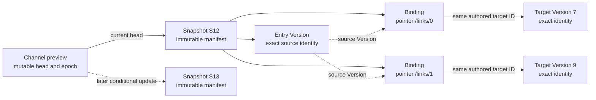
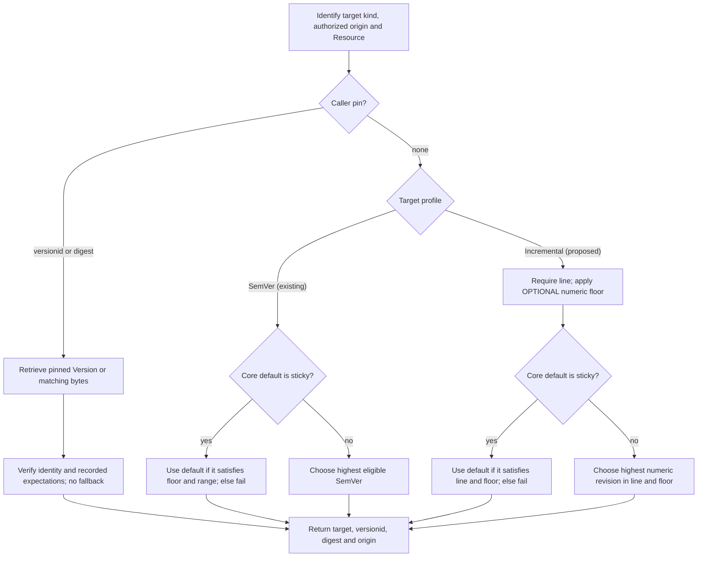

# WoT Publication and Versioning Design

## WoT Versioning: Design Overview

<!-- words: minversion prereleases subthing ua uav versionorigin -->
<!-- words: compatibilityline lockfile marcschier opcfoundation unversioned -->
<!-- words: workflow workflows -->
<!-- words: href namespace nodeids opc workaround -->

This document proposes an incremental versioning profile for WoT registries.
No implementation exists yet. The
[full design](#wot-versioning-design-and-operating-workflows) describes the
mechanisms and 63 operating workflows, including defaults and exact pins in
the [D7 selection flow][D7]. The
[publication design](#wot-channels-snapshots-and-dependency-bindings) describes
12 additional workflows for:

- Editing individual documents and publishing sets
- Managing channels and snapshots
- Exporting manifests and federating sources

The existing [specification](../../models/wot/spec.md) defines SemVer rules. The
[vectors](../../models/wot/tests/resolution/README.md) exercise that baseline.

### Decision and problem

The proposed decision is to retain native SemVer behavior and add a separate
incremental profile. An operator selects the profile when provisioning each
endpoint/model; the registry does not infer it from a document's version
string. Both profiles use the existing TD and TM collection names. Supporting
both therefore requires separate endpoint/model instances, although they can
share a physical server.

A TM can contain `version.model`, and a TD can contain `version.instance`.
Requiring SemVer for both makes documents with ordinary integer versions or
unchanged external bytes difficult to publish and reference. The current
generated `0.0.0-N` fallback does not provide incremental revision selection:
it is a prerelease label and cannot serve as a floor.

The registry assigns integer revision IDs. A publisher declares each
Version's compatibility line. A consumer follows a named line and can set a
numeric floor. The resolver returns an exact pin for repeatable use.

Channels name update streams; immutable snapshots fix complete publication
sets. Neither represents a Group or determines compatibility. A channel can
advance across compatibility lines, so consumers still reject a head that
violates their requirements.

### Publication and identity

The publisher uploads unchanged bytes and declares a compatibility line.
An editable document can carry root `uav:compatibilityLine`; otherwise,
authorized metadata supplies `compatibilityline`. Publication rejects
conflicting declarations. The line is an absolute URI, not another registry
Resource.

With watermark 41, an unversioned or free-form document receives registry
revision `"42"` and `versionorigin: generated`. A canonical authored integer
can supply the ID only when it exceeds the allocation watermark. Publication
then sets `versionorigin` to `authored`. Neither path rewrites the document.

The publication owner commits the high-water mark together with the content,
line and applicable Core state. Deleting history or restarting does not reset
that mark. An adapter without durable allocation state rejects publication
rather than approximating the counter. Exhaustion also fails; publication
never recycles old IDs.

A line-less upload remains available for raw retrieval and exact pins, but
cannot participate in automatic line selection. The publishing diagnostic
reports that limitation. Each revision keeps the line declared at creation,
including no line. To add or change a line later, publish another revision.

Revision IDs are scoped to one originating Resource and sequence.
Independent copies with the same authored `id` therefore do not share a
numeric floor. Replicas preserve source identity and numbering or provide
explicit mappings.

### Reference vocabulary and selection

The proposal places the extensions in the existing namespace
`http://opcfoundation.org/UA/WoT-Binding/`:

```json
{
  "rel": "td:extends",
  "href": "urn:example:pump:base",
  "uav:compatibilityLine": "urn:example:pump:control-a",
  "uav:minVersion": "42"
}
```

This excerpt assumes the appropriate composition and extension contexts.
Existing operators identify the target kind, and the same versioning members
apply to TM targets. A line alone is sufficient; a floor is added only when a
feature requirement needs it. For an incremental target, the resolver derives
no floor from the referring document's model/instance version or root line.

For history 42/A, 43/B, 44/A, a line-A reference selects 44. A floor of 45
fails. An unpinned incremental reference without a line fails. A sticky
default of 43/B makes the A reference fail. It does not silently select 44.
Without a sticky default, choose the highest qualifying integer.

For SemVer targets, the resolver keeps the existing rules:

- Native ordering and ancestry
- Target-kind floors, including TD next-major caps
- Implicit floors for type links
- The resolver requires opt-in or an effective floor for prereleases

The resolver applies those rules only to SemVer targets. Generated integer
IDs are ordinary revisions and valid floors. The SemVer profile's generated
`0.0.0-N` IDs remain prereleases and cannot serve as floors.

Ordinary retrieval serves Core's default, which can differ from numeric
compatible selection in the incremental manual profile. The consumer examples
therefore use constrained resolution rather than treating raw retrieval as
an equivalent operation.

### Compatibility, pins, and operation

A publisher claims that each later revision is compatible with every earlier
revision in the same line. A breaking incremental change uses another line.
Its target ID can stay the same. Labels and digests do not prove semantic
compatibility or publisher authority.

A consumer keeps these values outside the authored document:

- Target, Version ID, digest, and origin
- Applicable profile and line expectations

During replay, the consumer retrieves the exact revision and bytes before
floor/default selection. An unavailable pinned revision causes replay to fail
without an upgrade. A bare digest can identify bytes shared by several
revisions and lines; it does not, by itself, pin line membership.

The consumer retains records for all transitive dependencies. To refresh, it
resolves new candidates for review or activation through existing deployment
machinery. Offline operation also needs trusted metadata for declarations
absent from the bytes. This design adds no lockfile or signature protocol.

For set publication, a publisher follows the generic xRegistry
manifest/channel contract. It can convert a standard or capture a revision
of a server model. It reuses unchanged document Versions and records the
source release as provenance. It binds each dependency to an exact target.
An individual author follows the same flow with one changed document.

The publisher persists a complete snapshot before conditionally updating one
channel head. A fork, promotion, or rollback uses an existing manifest. A
stale update fails rather than overwriting another publisher's work.

During federation, a consumer opens each moving source once and retains its
pin and context.

The extension maps each reference pointer in a source Version to an exact
target Version. Snapshot-bound composition checks the authored requirement
against that target rather than falling back to live highest-version
selection. Offline replay needs the manifest, trusted metadata, contexts and
exact bytes.

After an anonymous upload times out, the publisher checks existing
request-status or explicit-ID read facilities when available. Otherwise, it
inspects Version history for matching bytes and metadata. Looking only at the
highest revision is unsafe under concurrent writers. The absence of a match
does not prove failure while a request might still commit. The publisher
reconciles the outcome or explicitly accepts possible duplicates on retry.
Anonymous publication has no exactly-once guarantee.

### Core mapping, adoption, and next gate

The SemVer model remains native. The incremental model uses Core `manual`
ordering and permits multiple roots. Ancestor trees define neither
compatibility nor numeric order. Deleting a middle ancestor needs no
single-root repair, but can make exact pins unavailable.

Migration uses a separately validated endpoint and an offline manifest. The
manifest records:

- Bytes and revisions
- Lines and counters
- Defaults and origin mappings

The migration preserves the source so old pins remain usable. Cutover or
rollback changes routing, not history or revision IDs.

The [core-vocabulary proposal][WoT proposal] is hosted on the author's fork;
it does not establish W3C adoption. Deployments can use `uav` before that
process finishes. During migration, readers retain floor forms from earlier
drafts but reject references carrying both old and new floors. Readers are
upgraded before old forms are removed. Duplicating composition links is not
an alias workaround.

The [evidence index](#workflow-evidence-index) in the full
design separates current SemVer checks from planned incremental, publication,
and migration checks.

#### Implementation proof gates

- The WoT publisher preserves durable allocation.
- The provider supplies trusted candidate metadata.
- The generic publication adapter preserves checked context and binding
  equivalence.
- The OPC UA generator preserves append-only NodeIds.

The generic publication proposal includes schemas and synthetic examples.
Schema validation checks only the closure descriptor's shape; neither the
schema nor the examples demonstrate deployed closure enforcement. This
document implements no incremental-profile enforcement, regenerates no
OPC UA outputs and changes neither .NET runtime.

[WoT proposal]: https://github.com/marcschier/wot-thing-description/pull/1
[D7]: #d7-selection-defaults-and-exact-pins

## WoT Channels, Snapshots and Dependency Bindings

<!-- words: bytewise jsonld namespace opcfoundation prerelease prereleases -->
<!-- words: submodel subthing tds tms ua uav unversioned versionid xids -->
<!-- words: workflow workflows lockfile marcschier compatibilityline -->
<!-- words: href nodeids opc REQUIREDEXTENSIONS standalone -->
<!-- words: workingdrafts -->

### Decision and status

The design uses the [generic xRegistry publication extension][Publication]
for channels and immutable snapshots. Its
[manifest and integrity rules][Publication manifest] capture immutable state.
Its [channel rules][Publication channel] define how publishers update heads
and readers open channels. WoT defines dependency closure and compatibility
checks without adding a channel API or Group hierarchy. This is an
informative implementation design, not an implemented WoT profile. The
current SemVer specification and its vectors remain unchanged.

The generic proposal defines a reusable model, a manifest schema, conditional
head semantics, a binding-aware open context and an offline byte bundle.
Its manifest, captured Registry JSON, domain bytes and closure documents
are stored as exact xRegistry Version documents. HTTP and native OPC UA use
their own document-read operations; no separate HTTP download service is
implied. Its executable examples cover only synthetic state transitions and
integrity.
The WoT profile still needs resolver/provider integration and cross-repository
fixtures before a deployment can claim conformance to it.

### What is versioned?

| Entity | Identity and behavior |
| --- | --- |
| Document revision | One Resource history stores its exact bytes and fixed metadata. |
| Compatibility line | Domain declaration of compatible incremental revisions. |
| Snapshot | Exact model/metadata, revisions and dependency bindings. |
| Channel | A mutable scoped name that selects a snapshot. |
| Source release | A source release records capture provenance. It is not a revision or snapshot ID. |

The same document revision can appear in multiple snapshots. A publisher can
move a channel across compatibility lines, but consumers still apply their
compatibility requirement to the selected head. No Group represents a
channel, snapshot or compatibility line.

A channel resembles a Git branch only in that it has a mutable head and a
publisher can fork it cheaply. The manifest's OPTIONAL parent records
preparation history. It does not enable automatic merge, rebase, a working
tree or the Git protocol. Reconciliation creates another complete, validated
snapshot.

### A complete WoT publication

A domain-complete snapshot retains each entry document, every transitive
TM/TD dependency needed to interpret it, fixed metadata and original reference
bases. Under the generic [closure rules][Publication closure], the producer
resolves each recognized external reference occurrence and records one exact
target binding without changing domain bytes. The resolver then checks
whether the caller accepts the target.

Two reference occurrences can bind the same logical target ID to different
exact Versions:



**Figure A-1.** Informative channel and closure view. A channel has one
current head. Each binding identifies one source occurrence and one exact
target Version in the selected snapshot.

The closure extension URI is:

`http://opcfoundation.org/UA/WoT-Binding/publication-closure/1`

Its value in the generic manifest's `extensions` map is a checked descriptor
of a `wot-publication-closure/1` JSON document stored as an exact xRegistry
Version document. A domain-complete publication lists that URI in
`requiredExtensions`. A generic reader that does not
understand it fails rather than claiming WoT-complete interpretation.
The [schema](../../models/wot/schemas/publication-closure.schema.json) defines its shape.

`entries` lists Version XIDs from the captured Registry view.
Each `bindings` record contains:

| Field | Meaning |
| --- | --- |
| `source` | Exact source Version XID in the captured view. |
| `pointer` | RFC 6901 pointer to the authored reference object. |
| `operator` | WoT relation/operator in the source's captured contexts. |
| `href` | Exact authored reference string, including any fragment. |
| `target` | Exact target Version XID in the same captured view. |

Document digests, originating Registry/Version identities and original bases
come from the generic manifest's document associations. Profile and line
expectations come from the captured trusted metadata. Duplicating them in
each binding would introduce competing authorities.

The profile recognizes these external references, all defined by the WoT
draft:

- `tm:extends`
- `tm:submodel`
- `tm:ref`
- `td:extends`
- `td:subthing`
- `td:ref`
- TD `type` links
- Projection-source references

The schema permits operator strings rather than defining another vocabulary;
the existing vocabulary and contexts remain authoritative. An unknown
operator cannot satisfy closure validation. The producer follows the WoT
draft's reference rules, so an interaction endpoint, documentation link or
arbitrary application link is not a dependency solely because it has a URL.

The producer enumerates references independently of the emitted binding
table, applying the WoT draft's context, fragment and composition rules. A
reference is document-local when its URI-reference resolves against the
source document's base URI to that document before its fragment is applied.
Local fragment references stay within their source document and need no
external binding; every external occurrence needs exactly one binding.
For a `links` item, `pointer` identifies that item. For `tm:ref`/`td:ref`,
it identifies the object containing that member. Source bytes need to contain
the stated operator and exact `href` at that object.

The producer materializes external dependencies as exact Versions in the
captured view and preserves their source associations. The binding key is
`(source, pointer)`, not the authored target ID.
The target's bytes and fragment need to satisfy the actual source reference.
An existing Version with unrelated bytes is not a valid binding.

Entries, sources and targets need to exist in the generic document
associations. Bindings need to be unique and cover the complete reachable
closure from the entries, excluding unreachable or invented edges.

During traversal, the resolver records each visited Version/reference pair.
The composition operator's existing rules determine whether a cycle is valid.
The resolver bounds traversal even when a cycle exists.

The producer preserves the contexts needed to interpret captured documents.
It retains the original JSON-LD material or uses a supported immutable context
set. Offline interpretation does not fetch live contexts.

### Selection and acceptance

Opening a channel under the
[Publishing and Opening a Channel][Publication channel] rules selects its
current immutable manifest once. During that open, the resolver reads every
entry, dependency and page from the selected snapshot. If the snapshot lacks
closure data, the resolver fails instead of looking up the highest live
version.

For snapshot-bound composition, the resolver selects the bound exact revision
before checking the source reference's constraints and the caller's acceptance.
Incremental targets need to satisfy the declared compatibility line and any
numeric floor. SemVer targets retain their target-kind floors, next-major
bounds and prerelease rules. A bound revision that fails these checks
produces `unsatisfied`. Absent or unsupported closure data, a missing binding
or missing bound content produces `closure-incomplete`. Conflicting trusted
declarations, or different bytes or fixed metadata claiming one source
revision, produce `inconsistent-publication`. The snapshot fixes content
without waiving those requirements. The raw
exact-pin retrieval path remains separate from this
[compatibility-checked composition][Publication closure].

The standalone live resolver still selects the highest qualifying revision
under [D7](#d7-selection-defaults-and-exact-pins),
including its sticky-default rule. A captured default describes the
snapshot's raw Resource read. It does not replace an explicit dependency
binding.
The existing raw exact-pin retrieval path still bypasses live floor/default
selection. It is not compatibility-validated snapshot composition.

For example, entry E in snapshot S12 binds a line-A dependency to revision 42.
After the author publishes revision 43/B, opening S12 still reads 42/A.
The publisher can advance `preview` to S13 with 43/B. A caller requiring A
rejects that head. The resolver does not search earlier snapshots for an A
candidate. To accept another result, the caller changes its authored
requirement or selects another channel explicitly.

### Publication and user workflows

The existing [63 workflows](#publisher-workflows) cover per-document
publishing, version selection, exact replay and migration. The following
workflows describe set publication and its relationship to compatibility.
Each follows the generic
[channel publication and opening rules][Publication channel] and the
[export and federation contract][Publication export].

#### N01. Convert a versioned companion specification

The publisher records the standard's release as provenance. It reuses
unchanged document revisions and allocates revisions only for changed
documents. It resolves and validates the complete set, then persists a
manifest. The publisher moves the channel only if the conditional update
succeeds. If conversion fails, the old head remains unchanged.

#### N02. A publisher captures a revision of a server model

The publisher records the server identity, model revision and capture method.
It verifies a source consistency mechanism or states that it observed the
server on a best-effort basis. Immutable output does not prove atomic source
capture. If the caller demands a guarantee the server lacks, the publisher
rejects the capture.

#### N03. A publisher publishes an individual edit

The publisher starts from S12 and replaces one entry or dependency revision.
It retains the other exact associations, validates every affected edge and
publishes S13. IDs for unrelated document revisions do not change.

#### N04. A publisher changes one document incompatibly

The publisher assigns the document a new compatibility line and revision.
In a new snapshot, it binds accepting entries to that revision and keeps
other entries' dependencies exact. Consumer requirements can reject the new
head. Publication does not redefine those requirements.

#### N05. Fork development

The publisher creates `preview` pointing to S12. Both channels initially
share the same manifest and bytes. Later head changes are independent.
Deleting a channel never authorizes reuse of its old Resource identity.

#### N06. Reconcile two publishers

Both publishers read epoch 12. One publishes S13. The other's conditional
update fails. The publisher whose update failed reads the new head,
resolves the conflict explicitly and creates another complete snapshot.
It does not overwrite the successful update or silently merge JSON.

#### N07. A publisher promotes a reviewed set

The publisher conditionally points `stable` at the exact reviewed manifest.
The existing revisions and snapshot suffice. If the stable head changes
concurrently, promotion fails. The publisher reviews the new head before
trying again.

#### N08. A publisher rolls back the channel

The publisher conditionally restores S12 and advances the channel epoch.
Operations already in progress keep using their pinned snapshots. The caller
activates the deployment separately.

#### N09. A publisher recovers a timed-out head update

The publisher reads back the head and epoch, then reconciles. A matching head
can satisfy the publication objective without proving which request wrote it.
The publisher reuses the immutable manifest instead of repeating anonymous
document uploads.

#### N10. Export and replay offline

Offline replay requires the byte bundle to retain:

- The manifest
- Registry metadata
- Context material
- Closure data
- Exact document bytes

The reader resolves exact Version references through the bundle's map
without contacting the origin. Missing, corrupt or unsupported material
causes replay to fail. Raw
cached documents alone are insufficient.

#### N11. A consumer federates a channel

The consumer opens each moving source once and retains its pin and context.
It applies whole-Resource precedence without replacing binding targets.
Reproducible combination requires exact source pins, a model and policy, or a
materialized combined snapshot. Distinct source captures do not represent a
simultaneous state.

#### N12. Refresh, retain or revoke

A consumer refreshes the channel to review a new head. Old pins remain
unchanged. Operators retain reachable content under policy. If an operator
revokes or deletes it, replay becomes unavailable. The reader reports replay
as unavailable instead of substituting a newer resource.

For N01 and N02, a source's incremental model revision is sufficient
provenance. The publisher does not need to express it as SemVer or copy it
into every changed document's registry revision. Individual authors use the
same publication protocol without a product-wide release number.

### Validation and implementation boundary

The schema checks the descriptor's shape only. The adapter/resolver needs to
rediscover edges independently from source bytes and expand contexts before
matching each pointer, operator and target. It also needs to check
compatibility and bound transitive traversal.

The planned negative fixtures omit or replace edges after recomputing all
digests. They also test wrong source bases, conflicting declarations, missing
context material and a dependency added to an unrelated entry.

Neither the generic proposal's tests nor the 27 representative SemVer vectors
establish those WoT semantics. A mapping for OPC UA needs the same context
and closure semantics, including append-only generated NodeIds. This design
pass does not change the `1.1-draft` model or either .NET runtime.

The [shape example](../../models/wot/samples/publication-closure.json) illustrates one binding,
not an independently complete snapshot. Three schema checks cover its shape
and malformed pointers/missing targets. They do not validate authored bytes
or prove dependency closure.

[Publication]: ../spec.md
[Publication manifest]: ../spec.md#manifest-and-integrity
[Publication channel]: ../spec.md#publishing-and-opening-a-channel
[Publication export]: ../spec.md#export-federation-and-binding-equivalence
[Publication closure]: ../spec.md#domain-closure-and-compatibility

## WoT Versioning: Design and Operating Workflows

<!-- words: allowprerelease contentdigest dotnet idempotency minversion -->
<!-- words: netstandard opc prereleases readonly REQUIREDVERSION submodel -->
<!-- words: subthing tds tms tombstones ua uav versionorigin versionprofile -->
<!-- words: wotid wotversionprofile -->
<!-- words: compatibilityline ctt href lockfile marcschier namespace nodeids -->
<!-- words: nodeset opcfoundation rdf REQUIREDCOMPATIBILITYLINE unversioned -->
<!-- words: walkthroughs workaround workflow workflows -->
<!-- words: standalone -->
<!-- words: ih pv sx -->

### Status and reading guide

This informative design proposes an incremental profile for review. It does
not implement that profile or make its vocabulary, diagnostics or mappings
normative. The [WoT specification](../../models/wot/spec.md) defines the SemVer
baseline, the [model](../../models/wot/model.json) describes its data model,
and the
[27 representative resolution vectors](../../models/wot/tests/resolution/README.md)
test it. These vectors do not demonstrate the proposed incremental behavior.

The [two-page overview](#wot-versioning-design-overview) states the decision.
The [mechanisms](#design-mechanisms) define the proposed contract. The
[workflow catalog](#publisher-workflows) traces operations, failures, and
reversal. The [evidence index](#workflow-evidence-index) separates current
checks from proposed implementation work.

The [channel/snapshot design](#wot-channels-snapshots-and-dependency-bindings)
defines 12 additional set-publication workflows, N01-N12, alongside the 63
workflows here. The
generic xRegistry proposal defines how publishers create and open publications
through selected Registry bindings or offline contexts. WoT proposes a
dependency-binding schema and rules for accepting compatibility claims.
This specification-first work changes neither .NET runtime nor the OPC UA model.

### Decision

The proposed design retains the native SemVer profile and adds a separate
incremental profile. Provisioning selects the profile for a registry
endpoint/model; document contents do not determine it. Both profiles use the
existing TD and TM collection names, so a deployment needing both exposes
separate endpoints.

For incremental documents, integer revisions establish order. An explicit
compatibility line determines which revisions a consumer follows. A publisher
normally uploads unchanged bytes with a line declaration, and the registry
assigns the next revision. A consumer names the target and line, adding a
minimum revision only when it requires a particular feature. The resolver
returns an exact pin for repeatable use.

Channels identify named update streams, and immutable snapshots identify
complete publication sets. Compatibility remains separate: a channel named
`stable` does not promise that its next head meets the same consumer
requirements. Groups represent none of these concepts. The
[publication design](#wot-channels-snapshots-and-dependency-bindings)
binds each dependency to an exact target. It describes when a publisher can
promote a channel, export a manifest, or federate a source.

Use `uav:minVersion` and `uav:compatibilityLine` in the existing OPC UA WoT
Binding namespace for deployment now. Core WoT vocabulary standardization is
a separate proposal track, not a prerequisite for operating this design.

### Problem and boundaries

A TM can state `version.model`, and a TD can state `version.instance`.
Neither tells a registry how to assign revision IDs or which revision a
reference selects. Requiring SemVer in every document excludes those
whose authors use integers, free-form labels or no version.

The current generated fallback, `0.0.0-N`, permits storage without changing
document bytes, but its IDs are prereleases and cannot serve as floors. It is
SemVer-profile bookkeeping, not incremental versioning.

The design separates authored identity, registry revision order,
compatibility selection and exact replay. It covers TM and TD composition,
type links and projection-source selection while retaining existing operators
and fragment behavior. Request authorization and deployment activation
remain unchanged. The design adds no compatibility graph, signature format,
lockfile, exactly-once protocol or replacement for xRegistry Core.

### Design mechanisms

#### D1. Fixed endpoint profiles

The proposed registry metadata `wotversionprofile` has strict values `semver`
and `incremental`, declared read-only with a fixed default in each model.
Absence means legacy SemVer; an unknown profile causes version-aware
resolution to fail. Integer-looking content does not identify a profile.

The design retains `../model.json` as the SemVer model and proposes a separate
`model-incremental.json`. The latter is a planned artifact, not a file
delivered by this review update. Providers and offline catalogs carry
equivalent profile information for their candidate sets.

Core's [`versionmode`][Core versionmode] aspect selects the Version mode.
Its [`singleversionroot`][Core singleversionroot] aspect determines how many
roots a Resource can have. The [`ancestorid`][Core ancestorid] attribute
records parent relationships. Core defines these model aspects:

| Aspect | SemVer | Incremental |
| --- | --- | --- |
| `versionmode` | `semver` | `manual` |
| `singleversionroot` | `true` | `false` |
| Resolver order | SemVer precedence | Numeric revision |
| Compatibility boundary | Existing rules | Explicit line |

Core's manual ancestor tree defines neither a numeric sequence nor a
compatibility line. Allowing several roots permits middle-ancestor deletion
without a custom repair protocol. The SemVer model needs no migration.

An endpoint with published Versions does not switch profiles in place.
Provisioning another endpoint is an intentional operating cost of preserving
native SemVer behavior.

#### D2. Identity and source scope

The authored WoT `id` identifies the target. The registry origin, Resource,
and `versionid` identify one stored revision. The authored version remains
inside the original bytes. It need not be the registry's ordering key.

The number `42` does not establish revision identity across independent
registries. Resolution therefore selects one authoritative source
sequence before comparing numbers. Replication preserves source identity and
numbering or supplies an explicit old-to-new mapping. Discovery never
silently combines independent integer sequences with the same authored `id`.

A line is an absolute URI, compared exactly and case-sensitively. The
examples abbreviate `urn:example:pump:control-a` as A and
`urn:example:pump:control-b` as B in prose only. Their names have no order.

#### D3. Publication and durable allocation

An incremental ID is a string matching `[1-9][0-9]*`, within Core's
128-character ID limit. Compare by integer value, using arbitrary precision
or decimal length followed by ordinal comparison. Thus `10` follows `9`
without a floating-point or 64-bit limit.

The publication owner reads the Resource's durable high-water mark and:

1. Inspects TM `version.model` or TD `version.instance`.
2. Uses a canonical authored integer verbatim, with origin `authored`,
   when it exceeds the high-water mark.
3. Otherwise, for an absent or non-integer authored value, assigns the
   high-water mark plus one with origin `generated`.
4. Rejects a supplied registry ID that is invalid or differs from this
   assignment.
5. Validates metadata and commits bytes, revision, line, counter, and
   applicable Core state atomically.

A canonical integer exceeding the ID length limit fails. It is not converted
to a generated ID. A signed, leading-zero, free-form, or SemVer-looking
authored value is preserved but does not supply the numeric ID. An explicitly
supplied registry ID in those forms is invalid.

An authored integer at or below the watermark fails as a new publication.
Repeating an existing explicit creation is a separate D8 operation.

Allocated history includes accepted authored numbers and deleted revisions.
Normal writes do not reuse numbers, fill gaps, or insert older history.
Generated integers are ordinary candidates and valid floors, not prereleases.

The pure assignment function receives durable counter state because retained
Versions cannot reconstruct that state after deletion. A writable adapter
provides transactions or compare-and-swap protection. Without that capability,
it rejects publication before mutation and advertises only the operations
it supports.

Core's [default Version ID algorithm][Core version IDs] already retains a
generated high-water position. The actual adapter still needs to demonstrate
advancement past authored IDs and atomic commitment of all associated WoT
state. Assignment uses Core's immutable [`versionid`][Core versionid]; loading
the proposed model does not demonstrate that allocation behavior.

#### D4. Compatibility and authority

Each incremental Version has zero or one effective compatibility line.
A higher revision in the same line claims backward compatibility with
every earlier revision in that line. Different lines can be incompatible.
Neither revision order nor `ancestorid` proves the claim.

The publisher declares the line through root `uav:compatibilityLine`, or
through authorized publication metadata `compatibilityline` when the bytes
cannot change. If both declare a line, they need to agree exactly. Revision
creation fixes the effective value, including absence. Adding or changing the
line later requires another revision.

For example, an authorized publisher supplies this metadata separately from
unchanged, unversioned document bytes:

```json
{
  "compatibilityline": "urn:example:pump:control-a"
}
```

At watermark 41, the publication result exposes `versionid: "42"`,
`versionorigin: "generated"`, and that effective line, together with the
actual digest and source identity. These are logical metadata values,
not a new upload envelope. Each adapter uses its existing publication API.

A line-less revision can be stored and remains reachable through raw
retrieval and exact pins, but it cannot satisfy automatic line selection.
The publishing boundary reports the absent line with the diagnostic:
"not eligible for automatic compatibility-line selection." The concrete
response/tool mapping is planned adapter work, not an existing wire field.

Accepted authority is an authorized publisher or explicitly configured
trusted provider/catalog origin. Metadata binds the profile and line to
target, source Resource, revision, and exact document digest. A digest alone
does not authenticate an external declaration.

Compatibility classification belongs to the publisher. A domain validator
can check the claim, but the resolver does not treat the label as proof.
Core Resource-wide `compatibility: backward` is not asserted across
incompatible lines. The existing SemVer compatibility contract remains
separate.

#### D5. Deployable vocabulary and WoT standardization

Use the existing namespace exactly:

```json
{
  "@context": {
    "uav": "http://opcfoundation.org/UA/WoT-Binding/",
    "uav:minVersion": {
      "@id": "uav:minVersion",
      "@type": "http://www.w3.org/2001/XMLSchema#string"
    },
    "uav:compatibilityLine": {
      "@id": "uav:compatibilityLine",
      "@type": "@id"
    }
  }
}
```

This proposed excerpt is neither a complete TD/TM context nor a claim that the
remote context already defines these terms. Implementation extends the
Binding context, Turtle vocabulary and JSON Schema together without rebinding
`uav` or replacing composition operators with new `uav` operators.

`uav:minVersion` serves either target kind. A link relation, reference
operator, or declared source media type establishes TD versus TM.
Root `uav:compatibilityLine` declares the containing document's line.
The same term on a supported reference selects the target's line.
The root value is never inherited by dependencies.

The [WoT versioned-reference proposal][WoT proposal] pursues standardization
in core WoT vocabulary. Its current status is an open proposal on the
author's fork, not W3C Working Group adoption. Proposed `tm:minVersion`
and `td:minVersion` remain informative candidate mappings here. Deployment
does not depend on W3C accepting those names or semantics.

New emitters use `uav` terms. Readers retain the existing draft floor forms
as compatibility inputs, including their target-kind restrictions, and
normalize one accepted form into one internal requirement. A reference
carrying both an old floor and `uav:minVersion` fails `invalid-floor`, even
if they agree.
Authoring validation and WoT-aware publication detect this structural error
without retrieving targets. The resolver retains a safety check.

Core-only storage might not inspect document internals. Accepting a document
for storage does not prove its version requirements are well formed. Keep
exact-pin precedence over selection requirements. Validate document
structure separately from selecting candidates by floor.

Readers are upgraded before new emitters. A composition or type link is not
duplicated once per vocabulary because that can change composition or
introduce ambiguity. A later standardized vocabulary needs an explicit
conformance/mapping update without rewriting old bytes, pins or `uav` term
identities.

#### D6. Reference requirements

An unpinned incremental reference needs an explicit
`uav:compatibilityLine`. It can add `uav:minVersion` as a numeric floor.
Omission means no floor, not a hidden floor of `1`. A floor without a line
fails `compatibility-required`.

This abbreviated link assumes the existing TD composition context plus D5:

```json
{
  "rel": "td:extends",
  "href": "urn:example:pump:base",
  "uav:compatibilityLine": "urn:example:pump:control-a",
  "uav:minVersion": "42"
}
```

For a TM link, use the same versioning members with the appropriate existing
operator. For ordinary `tm:ref` or `td:ref`, the members are siblings of
the string-valued reference. Projection-source entries carry them on the
entry whose declared target kind they constrain.

Malformed floors produce `invalid-version`; conflicting syntax produces
`invalid-floor`. A floor without a line, or an unpinned incremental reference
with neither, produces `compatibility-required`. An invalid line URI, a line
selector for a SemVer target, or a selector at an unsupported location
produces `invalid-line`. An unknown or unavailable target profile produces
`unknown-profile`. These selectors are not ignored. The names identify domain
outcomes; they do not define new Core error responses.

An incremental target receives no implicit floor from the referencing
document's `version.model` or `version.instance`. It has no SemVer major
cap or prerelease filter. A document-local reference checks the containing
revision's line and floor instead of substituting another revision; a
mismatch produces `unsatisfied`.

SemVer retains its existing behavior, with deployed `uav:minVersion`
normalized to the same floor:

- A TM floor has no upper bound under its existing identity contract.
- A TD floor `X.Y.Z` selects at least that version and below `(X+1).0.0`,
  including the same major-zero rule. An unfloored TD can cross majors.
- A TD type link combines its explicit floor with implicit `version.model`
  by taking the greater value. Multiple SemVer type links with that root
  value need explicit floors on every SemVer link.
- Prereleases need opt-in or an effective prerelease floor. Generated
  `0.0.0-N` floors remain invalid.

For mixed-profile type links, profile discovery precedes the legacy
implicit/ambiguity rules, which apply to the SemVer-target subset.
Incremental links retain their own explicit line and OPTIONAL explicit
numeric floor. An unknown or unavailable profile causes failure rather than
weakening the requirement.

#### D7. Selection, defaults, and exact pins

This diagram summarizes standalone live selection and raw pin retrieval.
The pin branch bypasses live floor/default candidate selection. A `versionid`
pin names one Version. A digest matching several Versions is ranked under the
known profile. Both fail without an unpinned fallback.



**Figure D7-1.** Informative live-selection and raw-pin flow. Snapshot-bound
composition selects the binding from its immutable manifest. The
[WoT snapshot acceptance rules][Publication acceptance] specify how to check
the binding against the authored requirement and caller policy. Generic
[Domain Closure and Compatibility][Publication closure] rules also apply.
Composition does not replace the binding with a live highest-version result
or another channel head.

The workflow catalog illustrates these incremental and replay cases:

- [C01][workflow-c01] follows the newest revision in a line.
- [C02][workflow-c02] requires a feature's minimum revision.
- [C14][workflow-c14] replays an exact revision.
- [A05][workflow-a05] sets a sticky default.
- [A06][workflow-a06] diagnoses a conflict with that default.

The checked SemVer vectors cover:

- [Version-ID pinning and pin precedence][vector-026]
- [A sticky default below its effective floor][vector-043]

They do not exercise the proposed incremental profile.

Ordinary Resource retrieval serves the [Core default][Core defaults].
Core's [`defaultversionsticky`][Core sticky] aspect keeps an explicitly
selected default fixed. When it is false, Core derives the default from the
Resource's `versionmode`. In manual mode the non-sticky default follows
leaf/time rules, so it need not be the highest integer, especially after
import or metadata changes. Constrained resolution selects numerically unless
a sticky default is authoritative. The operations differ; Core behavior does
not change.

The selected tuple remains outside the document. New records include the
profile and effective line when applicable, and replay verifies recorded
expectations against trusted metadata. Existing pin shapes remain accepted.

A bare digest pin is deliberately line-agnostic. If the same bytes occur
in several revisions, select the highest matching revision under the known
profile. For a particular revision, use the existing version-ID pin and
retain its digest for verification. The existing input API accepts a digest
or a version ID, not both. A richer stored record is not a new API promise.

Pins override floor, line-selection, sticky-default, and prerelease choice.
They still require identity, authorization, bytes, and any recorded metadata
expectations to match. Pinning a parent does not pin its transitive
dependencies. Preserve records and bytes for every dependency when exact
replay is needed.

This override applies to raw exact retrieval. A publication snapshot instead
fixes the inputs to compatibility acceptance without overriding the check.
Pinning a parent and retaining a complete dependency closure remain separate
claims; a WoT-complete publication explicitly supplies both.

#### D8. State changes, recovery, and migration

Repeating publication of an explicit existing revision can be idempotent under
the publication API's existing contract. Different content or fixed metadata
causes a conflict. Anonymous publication has no exactly-once guarantee.

After an ambiguous timeout, use an existing request-status or explicit-ID
read path when available. Otherwise inspect Version history for matching
digest, line, and publication metadata. Matching content can satisfy an
availability objective without proving which request created it. Under
concurrency, checking only the highest revision is insufficient. The absence
of a match also does not prove failure while a request might still commit.
The outcome remains unknown until reconciled, unless the publisher
deliberately retries while accepting possible duplication.

Hard deletion can invalidate pins. It cannot reset the high-water mark.
Resource recreation retains a counter tombstone or establishes a distinct
sequence identity. Restore of an old backup cannot resume an old identity
using a guessed counter: recover authoritative allocation history or
create a distinct sequence.

Migrate through an offline manifest into a separate endpoint. Inventory
bytes, roots, IDs, defaults, and origins. Assign new numbers/lines with
publisher approval. Record explicit source-to-destination paths. Validate
the destination before discovery cutover. Preserve the source for old pins.
Rollback changes routing, not history or revision numbers.

#### D9. Implementation responsibilities

Core stores Versions and links each one to its ancestors. It serves raw
defaults and performs the existing concurrency and authorization checks. The
WoT publisher assigns profile-aware revisions and persists the allocation
counter. It also checks that declarations agree and rejects structurally
invalid documents before publication. Providers supply trusted candidate
metadata. Resolvers select candidates under constraints and replay exact
versions. Callers activate deployments and retain dependency records.

The generic publication adapter owns immutable manifests and durable
conditional channel heads under [Manifest and Integrity][Publication manifest]
and [Publishing and Opening a Channel][Publication channel]. Its
[Export and Federation rules][Publication export] define checked context and
binding equivalence. The WoT layer finds referenced targets and applies
the [Domain Closure and Compatibility][Publication closure] requirements.
A channel head changes a publication set. It does not allocate document
revisions or decide compatibility.

The implementation extends existing .NET snapshots/APIs with profile and
line context and reuses the SemVer implementation. Actual publication owners
need review because a pure helper test cannot demonstrate durable allocation.

For OPC UA, OPC 10100 Connectivity maps these concepts as follows:

- `WoTRegistryType.VersionProfile`, a read-only `WoTVersionProfileEnum`
  (`SemVer` or `Incremental`), declares the local registry profile. Absence
  means SemVer. A configured provider reports its profile through trusted
  provider metadata.
- `WoTDocumentType.CompatibilityLine` exposes a Version's effective line.
  It comes from root `uav:compatibilityLine` or the `compatibilityline`
  Version attribute supplied at creation; disagreement produces
  `inconsistent-publication`.
- `WoTDependencyDataType` keeps `RequiredVersion` string-valued and
  profile-interpreted, and adds OPTIONAL `RequiredCompatibilityLine`.
  Projection-source requirements use the same fields; `uav:sourceDigest`
  and the profile-specific requirement both MUST hold.
- `WoTResolvedDependencyTargetDataType` records the target's `Profile` and
  effective `CompatibilityLine` with the exact pin.
- Optional `WoTRefreshOptionsDataType.PublicationContext` has type
  `WoTPublicationContextDataType`, with `Uri` and an optional
  `ManifestDigest`. Without a digest, `Uri` names a channel opened once per
  Refresh; the selected digest is reported in
  `WoTRefreshSummaryDataType.ManifestDigest`. With a digest, it identifies an
  exact snapshot. Every recognized dependency uses its captured binding
  without provider, alias or older-snapshot fallback. Missing or unsupported
  closure, binding or content, and a manifest-digest mismatch produce
  `closure-incomplete`. Without a publication context, Refresh performs live
  selection.

NodeIds are appended on the `1.1-draft` track. The model, types, tables,
ledgers and CTT cases are regenerated together.

Provider acquisition, held-target fast paths, caches, snapshots, conversion,
refresh and materialization need to apply the resolver's constraints.
The presence of a selector in a NodeSet does not demonstrate its enforcement.

### Operating examples and notation

Use one incremental source `https://registry.example`, target
`urn:example:pump:base`, and history `42/A`, `43/B`, `44/A`.
Each number identifies a Version. Each letter abbreviates the line URI in D2.
Unless stated otherwise, selection is unpinned and the default is not sticky.
Revision-creation examples state their starting watermark separately.

Each workflow describes its inputs and actions, observable state,
failure/recovery behavior and supporting mechanism. Its ID identifies the
planned evidence case in the [index](#workflow-evidence-index). These are
proposed walkthroughs, not execution reports. Related workflows reuse the
same mechanism without adding another protocol or administrative service.

### Publisher workflows

#### P01. Author an editable TM or TD

The author chooses a stable `id` and root `uav:compatibilityLine` A, with
the context in D5. The authored version is OPTIONAL for incremental use.
The publisher submits the bytes to the configured incremental endpoint.
The response identifies the stored revision and digest.

D3 and D4 place version numbering and line agreement at the publishing
boundary. A conflicting metadata line causes failure before commit, so the
publisher corrects the request rather than retrying it unchanged. The author
owns the compatibility claim; registry numbering does not establish it.

#### P02. Publish unchanged external bytes

An authorized publisher uploads an existing document and metadata
`compatibilityline` A, without inserting a root declaration. D3 allocates
the revision. D4 associates line, origin, and digest with those exact bytes.
The stored document digest equals the input digest.

If a root declaration already says B, publication fails with no counter,
default, or content change. Supply matching metadata or publish another
authorized document. Never silently overwrite the root claim.

#### P03. Create the first revision

For a new Resource with no allocation history and an unversioned document,
upload bytes and line A. D3 assigns `"1"` and origin `generated`. Core
establishes its initial ancestor/default state. The publisher records the
returned source identity, revision, and digest.

Failure before commit leaves no Version. A timeout with unknown commit state
uses P14, not a blind assumption that the Resource is still empty.

#### P04. Keep a missing or free-form authored version

Publish a TM with no `version.model`, or a TD whose `version.instance` is
`"release-blue"` or `"1.2.0"`, to the incremental endpoint with line A.
If the watermark is 41, D3 assigns `"42"` with generated origin.
The authored value and exact bytes remain unchanged.

The authored label does not determine numeric order. A caller-supplied
registry ID `"release-blue"` fails; omitting it requests allocation.
The SemVer endpoint has its own assignment rules and is not selected by
inspecting this value.

#### P05. Supply an authored integer

With watermark 41, publish a TM `version.model: "42"` or TD
`version.instance: "42"`, plus line A. D3 uses `"42"` with authored origin.
A supplied registry ID has to be `"42"` too.

Publishing authored `"40"` is rejected as a new revision, not inserted into
history. Explicit recreation of an existing ID follows P15. Use controlled
initial import for historical data, or let the registry allocate numbers
when the external author's numbering does not fit this sequence.

#### P06. Publish a compatible update

Starting with 42/A, publish updated bytes whose compatibility claim remains A.
For server-assigned publication, the next revision is 43/A. Existing
unpinned line-A references can follow it. Existing exact pins do not move.

Under D4, the publisher decides compatibility and applicable validation
rejects known violations. The label alone does not prove compatibility.
An incorrect publication is withdrawn through existing retention/activation
policy rather than silently assigned another line.

#### P07. Publish a breaking incremental update

With 42/A present, publish incompatible bytes under line B, creating 43/B.
The authored target ID can remain the same. An A consumer still selects 42.
After a compatible A update creates 44/A, it selects 44.

D4 and D6 isolate lines without separate per-line Resources or defaults.
Consumers adopt B explicitly. A mistaken B declaration is corrected through
another revision, not reclassification of 43.

#### P08. Publish SemVer updates and breaks

At the SemVer endpoint, publish `1.0.0`, `1.1.0`, then late `1.0.1`.
Existing SemVer precedence keeps `1.1.0` highest. A breaking TM major uses
a new target ID. A breaking TD instance advances its major under the same
Thing ID. D1 and D6 preserve these existing rules.

Authored/build-metadata mismatches retain their current errors. Reversal
uses exact pins or routing/activation policy, not renumbering releases.
Incremental line rules do not change this endpoint's behavior.

#### P09. Publish without a line

An upload omits both root and metadata line. D3 can still create revision 42.
D4 exposes its absent line with the immediate diagnostic that it is not
eligible for automatic compatibility-line selection. Raw retrieval and
exact pins remain available.

Storage succeeds, but compatible publication does not: a consumer requiring
A receives `unsatisfied`. Making the content eligible requires a new
revision with A rather than attaching A retroactively to 42.

#### P10. Detect declaration disagreement

Submit root line A with metadata line B. D4 compares the absolute URIs and
rejects the operation before committing. No Version, counter advancement,
or default change is reported as successful.

The authorized publisher resolves the conflicting declarations at their
source before resubmitting. The registry neither chooses which claim to
believe nor rewrites document bytes to make the declarations agree.

#### P11. Reject later line mutation

Attempt to patch revision 42/A to B, or attach A to a previously line-less
revision. D4 fixes each revision's line value, including its absence, at
creation. A later selection-metadata patch fails.

Publish the desired bytes/claim as a new revision. Existing pins retain the
original declaration or its absence. If a downstream provider presents
changed metadata against a retained expected line, replay validation fails
rather than silently updating the consumer's record.

If the bytes contain canonical authored integer 42, D3 cannot assign revision
43 to those same bytes. The author has to advance the authored integer too.
Immutable external bytes with that value cannot be reclassified in this
sequence. Retain exact-only access or use a separate sequence. The design
has no override for authored integer assignment.

#### P12. Handle invalid and oversized IDs

Supply registry ID `"0042"`, `"-1"`, or an integer exceeding 128 characters.
D3 rejects the supplied ID. A canonical oversized authored integer also
fails rather than falling back to generation.

An authored free-form value such as `"0042"` can instead be preserved while
the server assigns the registry ID. The response distinguishes generated
origin. Correct invalid registry metadata. No consumer is asked to compare
malformed numbers.

#### P13. Publish concurrently

Two publishers upload unversioned bytes at watermark 41. D3's storage owner
serializes allocation or retries a failed compare-and-swap, yielding distinct
42 and 43 on successful commits. It commits each line and digest with its ID.

When transaction retries are exhausted, publication fails explicitly rather
than retrying indefinitely. An adapter without durable atomic state rejects
allocation support before accepting writes. Pure assignment calls cannot
provide this guarantee.

#### P14. Recover an unknown anonymous outcome

An upload times out before the publisher receives its assigned revision.
Use an existing request-status facility first, if available. Otherwise,
inspect Version history for the submitted digest, line, and metadata.
Do not inspect only the highest revision: another writer might have followed it.

D8 distinguishes matching content from request identity. The absence of a
match is inconclusive while the original request might still commit.
Reconcile the outcome or deliberately retry while accepting possible duplicate
content. This provides no exactly-once guarantee and requires no new
idempotency service.

#### P15. Repeat an explicit creation

After a confirmed explicit creation of 42/A, repeat that request.
Where the existing publication API defines idempotent creation, identical
bytes and fixed metadata are a no-op. Different content or line conflicts.
The watermark does not become 43 merely because the same explicit creation
was repeated.

D3 and D8 retain the API's existing contract. If it lacks this facility,
repetition produces the API's existing conflict behavior. Callers cannot
assume idempotent replay across all publication interfaces.

#### P16. Abort or exhaust publication

Declaration validation fails or the transaction aborts before commit.
D3 returns failure and leaves no partial content/line/default update.
The storage owner retries ordinary contention through its existing mechanism.
An unknown commit outcome follows P14.

If the next number exceeds the ID limit, allocation fails without resetting
the counter. Preserve the old sequence for pins and provision another
sequence if needed. Deleting history is not a counter-recovery procedure.

### Consumer workflows

#### C01. Follow the newest revision in a line

Author a target reference with `uav:compatibilityLine` A and no floor.
The resolver discovers the incremental profile and D7 selects 44/A from
42/A, 43/B, 44/A. It returns 44, its exact digest, origin, and line context.

The consumer neither chooses a number nor inspects ancestry. A later 45/B
does not change the selection. If no A revision exists, resolution returns
`unsatisfied` rather than choosing B.

#### C02. Require a feature's minimum revision

Add `uav:minVersion: "44"` to the A reference. D6 and D7 select 44/A.
With only 42/A and 43/B, the result is `unsatisfied`, even though B is newer
than A's first revision.

The floor is scoped to this source sequence. Record the selected origin;
`"44"` cannot be reused against an unrelated registry counter. Remove or
lower the floor only when the consumer's feature requirement changes.

#### C03. Reject an incomplete requirement

Resolve an incremental target with floor `"42"` but no line. D6 returns
`compatibility-required` rather than selecting across possibly incompatible
lines. A line-A reference with floor `"45"` returns `unsatisfied` in the
running history.

Add the intended line or explicitly pin a revision. An exact pin deliberately
selects a revision; it does not verify the missing compatibility claim.

#### C04. Distinguish raw retrieval from resolution

Retrieve the Resource normally, then resolve its line-A reference. The first
operation returns Core's default. D7 returns 44/A unless a sticky default
restricts it. The results can differ under manual leaf/time ordering.

Use compatible resolution for composition. Under existing disclosure rules,
diagnostics identify the operation, profile and chosen/default revisions.
A raw GET does not establish that the consumer's line/floor is satisfied.

#### C05. Compose TM targets

Place the line and OPTIONAL floor on a `tm:extends` or `tm:submodel` link,
or beside an ordinary `tm:ref`. D5 and D6 normalize the requirement without
changing the operator. D7 selects the containing document before traversing
an external fragment.

If the selected version lacks the definition, ordinary composition fails
without searching older revisions for it. The existing operator's
target-kind and cycle rules still apply.

#### C06. Resolve a TD type link

For an incremental TM target, put A and any explicit numeric floor on the
TD's `rel: "type"` link. The TD's root `version.model` supplies no incremental
floor, and its root line supplies no dependency line.

D6 makes the requirement visible at the link. If A is absent, fail as C03.
SemVer type links retain their separate implicit-floor behavior in C09.
Authors need not disguise an integer as `0.0.42`.

#### C07. Compose TD targets

Place A and any floor on `td:extends`/`td:subthing`, or beside `td:ref`.
D7 selects 44/A. Ordinary TD composition then processes the result.
The referencing TD's own instance/model versions do not constrain this
target implicitly.

An incremental target has no major cap. At the SemVer endpoint a TD floor
retains its next-major bound. The target profile, not the reference author's
registry, determines comparison.

#### C08. Select projection sources and local fragments

Each projection source entry carries its own line/floor and expected kind.
D6 constrains the source before existing projection selection proceeds.
The projection envelope's version and line are not defaults for its sources.

For a local reference, validate the containing revision against its stated
line/floor without replacing that document. A failing local constraint or
missing pointer is an error. Existing explicitly authored source-digest
mechanisms remain distinct from consumer-owned resolution records.

#### C09. Resolve SemVer type-link floors

A TD with `version.model: "1.1.0"` and one SemVer type link cannot select
`1.0.1`. With explicit floor `1.2.0`, the effective floor is `1.2.0`.
With several SemVer type links and the root value, each needs its own floor.

D6 retains `ambiguous-floor` when one is missing. Without root
`version.model`, each SemVer link has only its own OPTIONAL floor.
An explicit pin retains the existing precedence over floor derivation.

#### C10. Resolve mixed-profile type links

A TD has one SemVer type link and one incremental type link. Discover both
profiles first. D6 applies root `version.model` only to the SemVer subset.
The incremental link independently requires A and an OPTIONAL integer floor.

Two SemVer links still trigger their existing multi-link rule. An unavailable
profile fails rather than guessing from the floor's spelling. To avoid a
shared implicit requirement entirely, omit root `version.model` and author
explicit per-link requirements.

#### C11. Admit SemVer prereleases deliberately

With `1.2.0` and `1.3.0-rc.1` available at a SemVer endpoint, ordinary release
selection excludes the prerelease. Explicit opt-in or an effective
prerelease floor enables the existing eligibility rule.

D6 preserves precedence: `1.2.0-rc.1` remains below floor `1.2.0`, and a TD
floor cannot cross its next-major cap. Incremental integers have no hidden
prerelease state or related consumer switch.

#### C12. Distinguish generated origins

A SemVer document without a valid authored version can receive `0.0.0-1`.
That generated prerelease is not a valid floor. An incremental unversioned
document can receive `"42"`. With line A it is an ordinary selectable revision
and can be a floor.

D1 and D3 keep `versionorigin: generated` from imposing SemVer semantics on
an integer. An old SemVer-only client cannot treat an incremental source as
an unconstrained success.

#### C13. Capture dependency records

After resolving a parent and its dependencies, retain each target, revision,
exact digest, origin, and applicable profile/line expectations. D7 uses the
existing snapshot mechanism where available. Otherwise, the API exposes the
records to its caller.

Registry pins are not inserted into authored reference strings, and selected
versions do not replace floors. Without the dependency records, a future read
can refresh an unpinned dependency, so the consumer cannot claim exact
transitive reproduction.

#### C14. Replay an exact revision

Replay the record for 42/A while 44/A is now available. D7 retrieves 42,
verifies its digest and recorded expectations, and does not run highest-version
selection. Authored floors/defaults do not override the explicit pin.

If 42 is missing or its digest/line differs, replay fails without falling
back to 44. The application distinguishes a stored full record from the
existing single-selector pin input and performs the associated verification.

#### C15. Replay a shared digest

Suppose 42/A and 44/B contain identical bytes. A bare digest pin matches both
and D7 chooses the higher matching revision under the known profile.
The bytes are pinned. Line membership is not.

For the specific 42/A publication, retain its revision and expected metadata
instead. Do not claim a bare digest authenticates a publisher or a line.
A later metadata mismatch in a full record is a replay error, not a reason
to silently relabel that record.

#### C16. Refresh and review a newer dependency

Start from the pinned 42/A record. Perform a new unpinned A resolution and
obtain 44/A. The caller compares, validates, and activates the new snapshot
through its existing deployment process.

D7 separates refresh from replay. If resolution or validation fails, retain
the old usable snapshot and do not report successful activation. The resolver
defines no deployment transaction and does not decide when a consumer accepts
an update.

#### C17. Handle unavailable pinned content

Delete or lose revision 42, then attempt its exact replay. D7 reports a
missing target or pin mismatch under the existing error mapping. An
available 44 does not repair the pin.

Restore authorized exact content from retained storage/export, or explicitly
refresh and review another revision. A service outage is not interpreted as
permission to weaken identity or digest checks.

#### C18. Reproduce transitive dependencies

Pin a parent whose dependency could otherwise move from 42/A to 44/A.
Retain the dependency's own record and bytes as C13 describes.
Replaying only the parent's bytes leaves that dependency unpinned.

D7 applies the same rules to every edge. Missing dependency records or content
prevent a claim of exact offline reproduction. Supply them or perform an
explicitly unpinned refresh rather than silently combining old and new
results.

#### C19. Run offline

Export the selected bytes and per-dependency records with trusted profile,
line, and source associations. Configure the offline catalog's authority
through existing deployment policy. D2, D4, and D7 reproduce the selection
without an origin network request when all artifacts are present.

A bare document cannot establish a metadata-only line. If metadata or pinned
bytes are missing, or provenance is untrusted, the corresponding constrained
operation fails. Offline use requires no new signature or lockfile format.

#### C20. Resolve through a cache or held provider target

A cache/held-target fast path receives an A/floor-44 requirement or a full
pin. D9 requires it to validate source, profile, line, floor, and digest
expectations just as the acquisition path would.

A constrained result is not keyed only by `wotid`, and materialization does
not bypass validation. A cache mismatch triggers supported revalidation or
acquisition, or causes failure; it cannot return an incompatible result as a
success. The design prescribes no new cache implementation.

#### C21. Discover deprecation and successors

Browse an old Resource's deprecation/successor information. It can identify
a replacement TM identity or another deployment route, but it is navigation,
not a candidate in the original source sequence.

D2 and D7 preserve the original target of old references. Its pins continue
working while the old content is retained. Deprecation does not authorize
substitution of a successor to satisfy an unmet floor.

#### C22. Adopt a different line or successor

A consumer deliberately changes A to B, or changes a SemVer TM target to
its new-major successor. Perform new unpinned resolution, validate the
changed dependency, and capture a new record before activation.

D4 and D7 make compatibility-boundary crossing explicit. Rollback uses the
prior complete snapshot if its content remains available. Never rewrite an
old record to make it appear to have selected the replacement.

### Administrator and provider workflows

#### A01. Provision one profile

Choose one model profile for an endpoint and configure authorized publishers
and provider trust. An incremental-only deployment needs one endpoint,
not both. D1 fixes the profile before published history exists.

Expose the endpoint's supported read/write operations and profile discovery.
Loading a model without the WoT publication adapter does not establish durable
incremental publication and is not advertised as doing so. Correct
misconfiguration before activation.

#### A02. Operate both profiles

Keep the existing SemVer endpoint and provision another incremental endpoint,
each with the same familiar collection names. D1 avoids mixed ordering in
one collection and preserves native SemVer defaults/deletion.

Configure resolver routes to the intended source. This adds deployment
configuration but does not require separate physical servers. If two routes
are ambiguous, source selection fails rather than combining their revision
numbers.

#### A03. Select an authoritative source

Discovery finds two Resources with the same authored ID. The configured
resolver selects one origin/Resource before D7 compares candidates.
Record that source with every result.

D2 prevents a destination's revision 42 from satisfying a source pin merely
because the numbers match. An unresolved origin ambiguity is an error.
Correct routing or provide explicit migration mappings. Do not guess by
publication time.

#### A04. Handle unknown profiles or limited adapters

A provider announces an unknown profile, or supports reading incremental
history but cannot allocate safely. D1 rejects version-aware selection for
unknown profiles. D3 rejects publication when an adapter cannot allocate
safely.

Where the interface supports capability discovery, expose this limitation
before an upload is attempted. Operators install/configure a compliant
adapter or use its read-only contract. Neither SemVer fallback nor raw
retrieval satisfies the requested constrained operation.

#### A05. Set a sticky default

An operator intentionally makes 42/A the Core sticky default. An A reference
without a higher floor selects 42 even though 44/A exists. D7 respects that
explicit operator choice.

Use the existing Core default operation and authorization. Clearing the
sticky setting re-enables numeric highest-eligible selection. This changes
unpinned behavior, not retained exact pins.

#### A06. Diagnose a default conflict

The sticky default is 43/B, while a reference requires A. D7 returns
`unsatisfied`. It does not silently pick 44/A. Report the requested line/floor
and default context only as permitted by disclosure policy.

Resolve by correcting an unintended default, changing the consumer's
requirement deliberately, or using an exact pin. A global default cannot
simultaneously pin several incompatible lines. No per-line pointer is added.

#### A07. Stage a deployment

Keep a multi-line Resource non-sticky for ordinary automatic resolution.
Different consumer deployments retain their own reviewed pins, such as
42/A for production and 44/A for a trial.

D7 and the caller's snapshot facility allow rollouts without changing the
Resource's global default each time. The registry does not orchestrate
deployment, and a trial update does not move another consumer's pin.

#### A08. Roll back activation

After a reviewed refresh to 44/A, the deployment tool restores its prior
42/A snapshot using its existing activation mechanism. D7 validates the old
records and bytes on replay.

If 42 is no longer retained, rollback fails explicitly. Publication of another
revision with different bytes under ID 42 is not a recovery path. Retention
policy needs to support the deployment's rollback objective.

#### A09. Delete a middle ancestor

Delete revision 43 from a manual incremental ancestor tree. Core can make
its child another root because D1 permits several roots. Line-A numeric
resolution still chooses retained 44.

D2 and D7 do not derive compatibility from ancestry. Deleting revision 43
makes exact pins to it unavailable. Authorization or retention policy can
prohibit that deletion. The SemVer endpoint continues its native ancestor
maintenance.

#### A10. Delete the highest revision

Delete 44 with historical watermark 44. Line-A resolution falls back to
retained 42 when no floor prevents it. A floor of 44 fails. The next successful
generated publication is 45, not 43 or 44.

D3 preserves allocation history independently of retained content.
A sticky default affected by deletion follows Core's legal state rules.
The resolver never invents a dangling default as a successful write.

#### A11. Restart or restore durable state

Restart after 44 was committed and confirm the next allocation is 45.
Restore only a backup containing authoritative allocation history, or recover
the missing history before resuming the same sequence identity.

D3 and D8 prohibit deriving a counter from remaining Versions when allocation
history is missing. An old backup that omits issued IDs cannot safely resume
the old sequence. If history cannot be recovered, provision a distinct
sequence. This design states the invariant without defining a backup product
or recovery protocol.

#### A12. Delete and recreate a Resource

Delete the Resource, then recreate the same public origin/Resource identity.
D8 requires a retained allocation tombstone, or a distinct sequence identity
instead of resetting the old counter to 1.

Old pins remain missing unless their exact content is retained separately.
Operators cannot make new content satisfy an old pin by recycling its number.
Document the chosen retention/recreation policy in the deployment.

#### A13. Replicate a preserved sequence

Copy exact bytes, revision IDs, profile, line associations, and logical source
identity to a replica. D2 permits the replica to serve that established
sequence through the configured provider mapping.

Verify digests and metadata rather than allocating fresh local numbers.
A replica with incomplete authority/history cannot claim source-equivalent
selection. It can serve only the validated subset under its supported
operation contract.

#### A14. Copy to an independent sequence

Import the same authored document into another registry that allocates
its own IDs. D2 treats the result as a separate sequence even if authored
`id` and bytes match. Record the explicit old-to-new mapping.

A source floor `"42"` does not automatically mean destination floor `"42"`.
Cutover therefore requires routing/mapping review or preservation of the
original sequence as A13 describes. Authored bytes are not changed to conceal
the difference.

#### A15. Export trusted metadata

Export exact documents, records, effective lines, profiles, and source
associations for C19. The receiving provider is explicitly trusted under
the configured publication/catalog authority.

D4 rejects contradictory or untrusted declarations for constrained use.
Copying a digest or accepting the first label encountered cannot establish
trust. Without authority metadata, the receiver has exact-byte availability
but no compatibility claim.

#### A16. Operate while the origin is unavailable

Use an authorized replica or complete offline snapshot to replay retained
pins without contacting the original endpoint. D2 and D7 preserve the
logical source and exact bytes through the configured route.

An unpinned request needing unavailable candidate metadata cannot determine
the highest eligible revision and fails. It does not substitute an unrelated
registry, stale claim, or raw default while claiming current resolution.

### Migration workflows

#### M01. Inventory legacy roots

Before importing a Resource with several roots, inventory:

- Every Version
- Its authored ID and version
- Its digest and ancestor
- Its default and origin
- Relevant compatibility evidence

An authorized publisher assigns intended lines.

D8 does not infer a line from a root or version spelling. Unknown
compatibility remains unresolved or exact-only; assigning every revision to
A would not resolve that uncertainty. The source remains unchanged and
available to old callers during review.

#### M02. Import an initial history

Create a migration manifest mapping each retained source revision to its
destination integer, line, and exact bytes. Build a separate destination
offline, validate uniqueness/declarations, and establish its high-water mark.

D8 allows controlled initial import without a public runtime mode switch.
Choose a sticky default explicitly if desired. If import is rejected, the
partially validated endpoint is not activated. Discard or repair the
destination without changing source routing.

#### M03. Change profiles through another endpoint

Keep a populated SemVer endpoint unchanged and create an incremental
destination using M01/M02. Do not strip `0.0.0-` prefixes or infer compatible
lines from major numbers without publisher review.

D1 preserves old model behavior and D2 records origin-scoped mappings.
The authored target ID can remain stable, but discovery selects one route.
Both endpoints being reachable does not authorize merging their candidates.

#### M04. Cut over and reverse routing

After validation, switch configured discovery/routing to the destination.
Consumers needing its numeric requirements obtain new records there.
Preserve the source for existing pins and legacy consumers.

D8 makes reversal a routing/activation operation. Restore the source route
if the destination is unsuitable. Do not renumber destination history.
If content needed for rollback has been removed, report that limitation
rather than claim a reversible migration.

#### M05. Roll out the deployment vocabulary

Upgrade readers to accept the existing draft floor forms and the `uav` form
through one normalizer. Then new authors/emitters use `uav:minVersion`.
Retain existing stored legacy bytes and their digests.

D5 excludes duplicate composition/type links as an alias workaround.
Consumers unable to enforce the extension need an explicit legacy route or
a delayed rollout. Ignoring a requirement does not establish compatible
resolution, and stored documents are not silently rewritten.

### Standardization and validation workflows

#### S01. Deploy without waiting for W3C adoption

Publish the `uav` vocabulary/context/schema updates through the OPC draft
process and implement their specified behavior in both resolvers.
Use the established namespace in xRegistry/provider examples.

D5 permits independent implementation while the core vocabulary proposal is
discussed. A reference to the fork proposal states its actual status without
claiming W3C endorsement. This document update alone publishes neither the
vocabulary artifacts nor working resolver support.

#### S02. Read existing draft floor terms

A stored SemVer document carries `tm:minVersion` or `td:minVersion`.
D5 accepts it as a documented compatibility input with its original
target-kind restrictions and D6 semantics.

Do not rewrite it to `uav` on retrieval or change its digest. Wrong-kind
legacy terms retain `invalid-floor`. New outputs use the deployment terms
without removing the reader's old input support.

#### S03. Reject conflicting or misbound vocabulary

An author supplies both a legacy floor and `uav:minVersion` on one reference,
or rebinds `uav` to another namespace. D5's authoring/WoT publication checks
reject the malformed requirement before consumers encounter it.

Resolver validation remains necessary for imported or Core-only-stored
documents. Follow existing syntax/namespace validation and pin-precedence
contracts rather than silently choosing one floor. Correct the document
through a new publication. No first-value-wins rule is defined.

#### S04. Adopt a future core vocabulary

If W3C adopts versioning terms, review their actual semantics and define
an explicit conformance mapping from the deployment extension.
Do not assume today's proposed names will be final or RDF-equivalent.

D5 retains old namespace identities, bytes, and pinned documents.
Readers can gain another validated input form when the mapping is specified.
A document migration is explicit publication, not a redirect that changes
the meaning of already-stored `uav` properties.

### Workflow evidence index

All 63 workflow IDs above identify proposed acceptance cases. This index
records the evidence still needed; it is a review checklist, not a generated
test report. This documentation change does not claim execution of any new
incremental, vocabulary or operating case. Each future case retains its
workflow ID to connect the result to the mechanism and state/error trace
above.

Evidence labels:

- `E0`: current [SemVer vectors](../../models/wot/tests/resolution/README.md) and checker.
  They exercise normalized assignment and selection. They do not test HTTP
  publication, compatibility checks, real digests, or migration.
- `N-P`: planned publication/adapter integration evidence.
- `N-R`: planned reference/context/resolver evidence in both implementations.
- `N-A`: planned Core/storage/provider integration evidence.
- `N-M`: planned migration fixtures with source/destination state.
- `N-S`: planned vocabulary/schema/normalizer evidence.
- `Caller`: existing caller/deployment procedure, to be documented and
  demonstrated where supported, not claimed as a new registry feature.

For E0, the existing examples include:

- [Authored assignment][vector-036]
- [Type-link floors][vector-043]
- [Pin precedence][vector-049]
- [TD major bounds][vector-050]

Their current contract is in [../spec.md](../../models/wot/spec.md). They
contain neither incremental profiles nor deployment-vocabulary parsing.

| Workflow IDs | Mechanisms | Evidence status |
| --- | --- | --- |
| P01-P04 | D1-D5 | N-P |
| P05-P07 | D3-D4, D6 | N-P |
| P08 | D1, D6-D8 | E0 subset, N-A, Caller |
| P09-P12 | D3-D5 | N-P |
| P13-P16 | D3, D8 | N-P, Caller for reconciliation |
| C01-C04 | D1-D2, D6-D7 | N-R, N-A |
| C05-C08 | D5-D7 | N-R |
| C09 | D6 | E0 subset, N-R for deployed terms |
| C10 | D1, D6 | N-R |
| C11 | D6-D7 | E0 subset, N-R for deployed terms |
| C12 | D1, D3, D6 | E0 SemVer subset, N-P, N-R |
| C13-C16 | D7-D9 | N-R, Caller for snapshot/activation |
| C17-C20 | D2, D4, D7-D9 | N-R, N-A, Caller for export |
| C21-C22 | D2, D4, D7 | E0 subset, N-R, Caller |
| A01-A04 | D1-D3, D9 | N-A |
| A05-A08 | D7-D9 | N-A, Caller for deployment |
| A09-A12 | D1, D3, D8 | N-A, Caller for backup |
| A13-A16 | D2, D4, D7-D9 | N-A, Caller for trust/routing |
| M01-M04 | D1-D4, D8 | N-M, Caller for approval/cutover |
| M05 | D5 | N-S, Caller for rollout |
| S01-S04 | D5 | N-S, Caller for standards process |

The planned migration fixture records roots, mappings, counters, defaults,
bytes and failure outcomes explicitly; the current normalized resolver schema
does not represent it. Durable allocation needs evidence under concurrent
writes, deletion, restart, rollback and Resource recreation. Independent
counter-state assertions derive state from storage history rather than
comparing two outputs from one emitter.

The workflows use these mechanism definitions:

- [D1][mechanism-d1]
- [D2][mechanism-d2]
- [D3][mechanism-d3]
- [D4][mechanism-d4]
- [D5][mechanism-d5]
- [D6][mechanism-d6]
- [D7][mechanism-d7]
- [D8][mechanism-d8]
- [D9][mechanism-d9]

### Simplicity assessment and implementation gates

In routine use, the publisher chooses a line and uploads bytes. The consumer
chooses a target and line, adds a floor if needed, and stores the returned
pins. Neither manages ancestry, assigns counters manually or translates
version vocabularies. Choosing a line remains a semantic decision that a
number cannot automate.

Deployments that need both profiles configure two endpoint/model instances.
Providers preserve trusted metadata alongside unchanged documents. Writable
adapters persist allocation history atomically. Anonymous publication still
has no exactly-once retries.

Implementation sign-off needs demonstrations of P02/P06/P07, C01/C02/C14/C16,
P09/P14, A06/A11 and C19 through actual public entry points. The full catalog
also needs fixture/integration evidence or a stated caller boundary. The
number of listed workflows does not establish usability.

Open implementation proof gates are:

1. Verify model/profile discovery and counter behavior against the actual
   upstream reference server. Identify adapter obligations it does not meet.
2. Locate actual .NET publication owners and persistent state boundaries.
   Reject unsupported writes instead of claiming helper-only support.
3. Verify JSON-LD context, Turtle, schemas, reference parsing, and early
   diagnostics agree across registries and both implementations.
4. Verify that the generated OPC UA model matches the
   [D9](#d9-implementation-responsibilities) mapping, with NodeIds
   appended on the `1.1-draft` track.

This specification-first work adds the [generic publication proposal][pub-proposal].
It also adds the [WoT closure design/schema][pub-closure]. The
[summary][wot-summary] remains the overview. Incremental runtime/profile
checks, WoT closure integration, and generated OPC UA changes still require
implementation. Generic synthetic examples do not close these gates.

### Specification and implementation impact

The xRegistry WoT draft needs the incremental profile, publication rules,
line metadata, resolver contract, samples, and separate migration fixtures.
Core itself does not change.

The [generic publication proposal][pub-proposal] owns channels, manifests,
and observable open context. Its federation rules reuse the existing
snapshot definition and source-precedence rules. WoT adds closure and
acceptance rules rather than embedding WoT semantics in generic federation
or interpreting a Group as a channel.

The W3C proposal explains the deployment extension and proposed core
standardization path. Its acceptance is not an execution gate for xRegistry,
OPC UA, or either implementation.

The OPC Binding supplies `uav` vocabulary/context/schema definitions, while
Connectivity supplies profile/line/dependency mapping. The two .NET
implementations normalize terms, branch on profile and enforce the same
selection rules using byte-identical shared fixtures. Their adapter,
provider and materialization paths need to enforce the same constraints.

### Alternatives and reasons

Mixing policies per Resource in one collection would require domain code to
replace native SemVer ancestor/default management. Separate profiles preserve
that behavior without extending Core.

Representing integers as `0.0.N` retains unnecessary SemVer syntax and
conflates bookkeeping with compatibility. Integer ordering with an explicit
line applies one rule to generated and authored incremental revisions.

Following the highest number without a line permits incompatible upgrades.
Full ranges, compatibility graphs, and several line memberships add
selection rules not needed by the chosen common path.

Putting exact registry revisions into authored reference URLs binds them to
one source's numbering. The design instead separates authored requirements
from origin-scoped resolution records and explicitly maps independent copies.

[Core versionmode]: ../../../core/model.md#groupsstringresourcesstringversionmode
[Core singleversionroot]: ../../../core/model.md#groupsstringresourcesstringsingleversionroot
[Core version IDs]: ../../../core/spec.md#version-ids
[Core versionid]: ../../../core/spec.md#versionid-attribute
[Core ancestorid]: ../../../core/spec.md#ancestorid-attribute
[Core defaults]: ../../../core/spec.md#default-version-of-a-resource
[Core sticky]: ../../../core/spec.md#defaultversionsticky-attribute
[WoT proposal]: https://github.com/marcschier/wot-thing-description/pull/1
[Publication acceptance]: #selection-and-acceptance
[Publication manifest]: ../spec.md#manifest-and-integrity
[Publication channel]: ../spec.md#publishing-and-opening-a-channel
[Publication export]: ../spec.md#export-federation-and-binding-equivalence
[Publication closure]: ../spec.md#domain-closure-and-compatibility
[workflow-c01]: #c01-follow-the-newest-revision-in-a-line
[workflow-c02]: #c02-require-a-features-minimum-revision
[workflow-c14]: #c14-replay-an-exact-revision
[workflow-a05]: #a05-set-a-sticky-default
[workflow-a06]: #a06-diagnose-a-default-conflict
[vector-026]: ../../models/wot/tests/resolution/README.md#pins
[vector-036]: ../../models/wot/tests/resolution/README.md#assignment
[vector-043]: ../../models/wot/tests/resolution/README.md#type-link-floors
[vector-049]: ../../models/wot/tests/resolution/README.md#pins
[vector-050]: ../../models/wot/tests/resolution/README.md#td-ranges
[mechanism-d1]: #d1-fixed-endpoint-profiles
[mechanism-d2]: #d2-identity-and-source-scope
[mechanism-d3]: #d3-publication-and-durable-allocation
[mechanism-d4]: #d4-compatibility-and-authority
[mechanism-d5]: #d5-deployable-vocabulary-and-wot-standardization
[mechanism-d6]: #d6-reference-requirements
[mechanism-d7]: #d7-selection-defaults-and-exact-pins
[mechanism-d8]: #d8-state-changes-recovery-and-migration
[mechanism-d9]: #d9-implementation-responsibilities
[pub-proposal]: ../spec.md
[pub-closure]: #wot-channels-snapshots-and-dependency-bindings
[wot-summary]: #wot-versioning-design-overview
