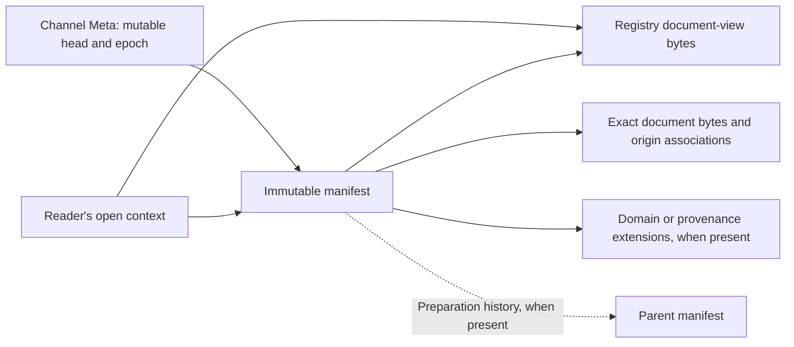
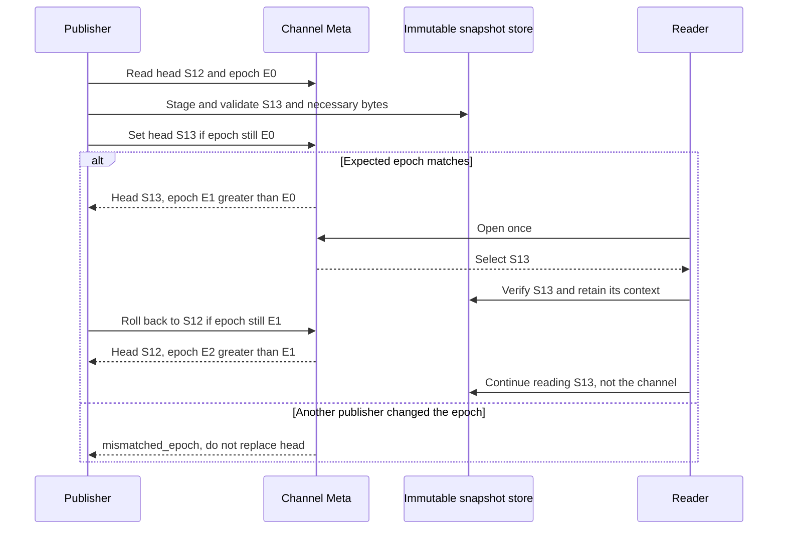

# xRegistry Publications: Channels and Snapshots

<!-- words: aba bytewise cas contenttype crlf etag etags jsonld namespace -->
<!-- words: offline readonly rebase rebasing readme subtrees walkthrough -->
<!-- words: versionid versionids xids xref xregistry -->
<!-- words: channelid originregistry originversion publicationstores -->
<!-- words: REQUIREDEXTENSIONS reserialization workflow workflows -->
<!-- words: workingdrafts -->
<!-- words: sequencediagram -->
<!-- words: viewversion -->

## Abstract

This working draft defines named publication streams and immutable snapshots
for any xRegistry domain. A channel selects a snapshot whose manifest fixes
the Registry view, model, metadata and selected document bytes. Readers can
retain that selection while the channel advances. Compatibility is checked
separately; neither a channel nor a snapshot asserts it.

The model and schemas here are proposed contracts. The executable examples
check synthetic publication state and integrity, not a deployed server.
They do not implement a production publisher, distributed transaction or
Git merge engine.

## Scope and Terminology

The key words "MUST", "MUST NOT", "REQUIRED", "SHOULD", "SHOULD NOT",
"MAY", and "OPTIONAL" are interpreted as described in
[RFC2119](https://www.rfc-editor.org/rfc/rfc2119).

Core defines entities, model interpretation, IDs and conditional writes.
[Federation](../federation/spec.md) defines Registry contexts, source selection,
reference bases, snapshot completeness and package interpretation.
This extension adds publication descriptors and named channel updates.
It does not require federation to publish a local Registry.

The [WoT companion](../models/wot/publication-design.md) defines domain
dependency bindings and compatibility acceptance over this contract.
Other domains define their own closure rules without changing channel
or snapshot identity.

| Term | Meaning |
| --- | --- |
| Scope | Absolute URI identifying a publication set and its authority. |
| Snapshot | Immutable captured Registry view as defined by Federation. |
| Manifest | Immutable descriptor binding that view to exact stored bytes. |
| Snapshot ID | SHA-256 digest of the exact manifest bytes. |
| Channel | Scoped name whose authoritative head references one manifest. |
| Open context | One selected snapshot and its checked access context. |

Channel names and snapshot IDs are not document Version IDs. Groups remain
organizational containers. A Group MUST NOT be interpreted as a channel,
snapshot, or compatibility declaration merely because it holds these Resources.

## Model and Placement

The [model](model.json) supplies reusable `channels` and `snapshots`
Resource types under an example organizational `publicationstores` Group
type. A deployment MAY import these Resource types into its existing
organizational Group types using Core
[`ximportresources`](../../core/model.md#reuse-of-resource-definitions).
It MUST preserve
the shared Resource definitions. Group IDs identify neither channels nor
publication scopes.

A channel is a metadata-only Resource. Its Resource Meta contains:

| Attribute | Meaning |
| --- | --- |
| `scope` | Immutable publication authority/set URI. |
| `head` | Manifest URL, SHA-256 digest and byte size, updated together. |
| Core [`epoch`](../../core/spec.md#epoch-attribute) | Expected-state token for conditional Meta updates. |

The name is the ordinary `channelid`. A snapshot Resource serves its manifest
as its sole document Version, with explicit Version ID `manifest`.
Its Resource ID is the 64 lowercase hexadecimal characters of its Snapshot
ID. A manifest MAY reference a manifest in another authorized store;
forks do not require copies of its document revisions.

Loading the model does not enforce publication immutability, conditional head
updates, retention, digest identity or authorization. A publication adapter
MUST enforce those behaviors. A Core-only store MUST NOT advertise publication
support merely because it loaded the model. Public APIs MAY be read-only.

The following graph shows references, not a storage layout. Only the
channel head moves. An open context retains the selected manifest and
Registry descriptors; parent history, when present, is not needed for reads.



## Manifest and Integrity

The [schema](schemas/publication.json) defines format
`xregistry-publication/1`. Every manifest has:

| Field | Meaning |
| --- | --- |
| `format` | Exact publication format discriminator. |
| `scope` | Publication scope URI. |
| `capture` | `assembled`, `source-snapshot`, or `live-observation`. |
| `completeness` | Federation `linked` or `offline-complete` classification. |
| `registry` | Descriptor of the complete Core document-view Registry JSON. |
| `documents` | View/origin Version XIDs, bases and byte descriptors. |
| `parent` | OPTIONAL descriptor of the preparation predecessor. |
| `extensions` | OPTIONAL URI-keyed domain closure/provenance descriptors. |
| `requiredExtensions` | OPTIONAL extension URIs needed for interpretation. |

A byte descriptor contains an absolute credential-free HTTP(S) `url`,
`digest` as `sha256:` followed by 64 lowercase hexadecimal characters, and
non-negative integer byte `size`. These are retrieval locations, not Core
XIDs or grants to contact the destination. Other access methods package the
same checked bytes through their binding's immutable references.

For example, this partial [sample manifest](samples/manifest.json) entry
associates one Version in the captured view with its source identity and
36 exact document bytes. It is a document association, not a channel head
or a complete manifest:

```json
{
  "viewVersion": "/sets/manual/documents/intro/versions/7",
  "originRegistry": "https://author.example.test/registry",
  "originVersion": "/sets/manual/documents/intro/versions/7",
  "base": "https://author.example.test/manual/intro.txt",
  "content": {
    "url": "https://content.example.test/intro.txt",
    "digest": "sha256:0a3fdd7ff022bd6a263d031e640fd0bc074fa877ed320a367784067b7a1d78e1",
    "size": 36
  }
}
```

Consumers MUST verify the exact size and SHA-256 of every descriptor they
use. Manifest identity covers exact UTF-8 bytes, not parsed JSON equality.
Whitespace changes can produce another ID. Producers SHOULD use deterministic
serialization; this format does not canonicalize arbitrary domain documents.

A manifest MUST NOT include its own digest. Consumers MUST reject unknown
formats or unknown mandatory extension semantics instead of ignoring them.

Every `requiredExtensions` entry MUST identify an included extension.
Unlisted extensions are OPTIONAL to generic readers; a caller requesting a
domain profile still requires that profile's extension and validation.

The Registry descriptor covers the model, available model source and
captured metadata. Registry JSON MUST use Core
[document view](../../core/spec.md#doc-flag). It MUST contain
a complete internal graph and sufficient model material, including immutable
model includes, as specified by Federation. Its enabled capabilities MUST
describe the captured view rather than the source server's write capabilities.

Each document association identifies:

- a Version XID in the view;
- `originRegistry` as its original absolute Registry-root URI;
- `originVersion` as that source's Version XID;
- `base` as its original absolute document URI base;
- `content` as a byte descriptor.

View Version XIDs
MUST be unique, including under Core's case-insensitive uniqueness rules.
The association MUST NOT change the document's authored identifiers.

An offline-complete manifest MUST supply every declared document in its
scope, except aliases whose Core document operation resolves to another
included Resource. Linked snapshots MAY leave explicit external document
locators, but MUST NOT claim those bytes are offline available.
Metadata-only types do not acquire documents by appearing in a manifest.
Domain bytes MUST be captured through raw reads or byte-preserving Core
[binary representation](../../core/spec.md#binary-flag), not JSON parsing
and reserialization.

Changing a model, captured metadata, document selection or extension changes
the manifest's checked graph and therefore its ID. A parent records preparation
history only. Reading a snapshot MUST NOT require reading its parent.
Parents do not establish compatibility, numeric order or a merge algorithm.

`capture` describes the origin of the selected state. `assembled` denotes an
intentionally constructed set; `live-observation` denotes source reads without
a source-wide consistency guarantee. `source-snapshot` is permitted only with
a source-provided immutable capture guarantee. For that claim, the producer
MUST retain its source identity and capture evidence in a provenance extension
under `requiredExtensions`. The capture classification
does not weaken the output's immutability or internal completeness.
A consumer requiring atomic source capture MUST reject `live-observation`.

## Publishing and Opening a Channel

An authorized publisher MUST:

1. Read the channel's Meta, retaining `scope`, `head` and `epoch`.
2. Publish/reuse the desired document revisions and captured metadata.
3. Construct a complete snapshot, validate its Core graph and applicable
   domain requirements, and persist the manifest and necessary content.
4. Atomically replace `head` through a conditional update to the same Meta,
   supplying the `epoch` from step 1.

For HTTP, step 4 uses Core's
[Meta update](../../core/http.md#patch-and-put-groupsgidresourcesridmeta).
The expected epoch belongs to that channel's
[Meta entity](../../core/spec.md#meta-entity), not the Registry root.
The sequence below illustrates one publisher and reader. S12 and S13 are
short labels for manifest descriptors, not literal snapshot IDs.



`scope` MUST equal the new manifest's scope. `head` MUST have no separate
default-Version alias maintained as a second authority. Core defaults on
the channel's metadata-only Version are not publication selection.

The adapter MUST validate the new head before making it visible. A stale
epoch MUST preserve the old head and return Core's
[`mismatched_epoch`](../../core/spec.md#mismatched_epoch).
Unconditional channel-head updates MUST be rejected by the adapter.
An implementation lacking atomic compare-and-update MUST NOT offer writes.
No transaction across document uploads is needed: unreferenced staged
objects are not part of the channel's published state.

Every successful head update MUST advance the Meta epoch, including a
rollback to a previously selected manifest. The same channel Resource
identity MUST NOT be reused after deletion. An authority MUST retain that
non-reuse history or use a distinct Resource identity. This avoids an old
epoch accidentally authorizing a write to a recreated channel.

A publisher cannot infer from a timeout whether its head update took effect.
Read back the head and epoch before retrying. A matching head can satisfy the
publication objective without proving which request set it; a different head
can reflect an intervening authorized update. Reconcile the observed state
before retrying with fresh state.
Anonymous document publication retains its own API's retry semantics.

An authorized reader opens a channel by reading its Meta once, verifying
the manifest at `head`, and establishing the immutable context below.
Every subsequent read/page uses that selected snapshot. It MUST NOT reread
the channel to fill missing members. Refresh is a new open operation.

These illustrative states summarize the sequence. Epochs increase; the
chosen values do not require increments of one.

| Operation | Expected epoch | Head after operation | Meta epoch | Reader already on S13 |
| --- | --- | --- | --- | --- |
| Initial state | Not an update | S12 | 12 | Not opened |
| Publish S13 | 12 | S13 | 17 | Opens S13 |
| Stale attempt to publish S14 | 12 | S13 | 17 | Remains on S13 |
| Roll back to S12 | 17 | S12 | 21 | Remains on S13 |
| Update times out | Previously read epoch | Unknown until read-back | Unknown until read-back | Remains on S13 |

## Context and HTTP Discovery

The schema also defines an `open` record containing `format`, `scope`,
`snapshot`, `registry`, `completeness`, OPTIONAL `channel` selection, and
OPTIONAL constituent `sources`. Here `format` is `xregistry-open/1`.
`snapshot` and `registry` MUST equal the selected manifest descriptor and its
Registry descriptor; `scope`/`completeness` MUST match the checked manifest.
The channel selection records its absolute Resource URL and observed epoch.

An open record is transport/access context, not a new Core entity or a
replacement for `self`. It supplies enough information to retrieve the
manifest and Core export. It MUST be available to the caller, not kept only
in logs.
Library and native bindings MUST return the equivalent schema-defined record
or report unsupported publication-context access.

A publication HTTP projection MUST serve a snapshot-specific Registry root
through Core HTTP. The root response MUST contain an HTTP `Link` with an
absolute `rel` URI of
`https://xregistry.io/workingdrafts/publication/context`, targeting the
associated open-record JSON. The root's metadata response and its open
record MUST describe the same snapshot. The link target is subject to the
same credential/redirect policy as any other destination.

A moving channel endpoint MAY redirect to that snapshot-specific root.
If it serves a response directly, navigation, pagination and the context
link MUST remain bound to the selected snapshot. A service unable to supply
this guarantee MUST report live behavior, not publication conformance.
The extension does not change ordinary non-publication HTTP endpoints.

A pin-aware consumer MUST obtain and validate the context/manifest before
claiming a pinned result. Snapshot-specific API `self` and navigation URLs
MUST be retrievable Core URLs; source identities remain in the manifest
associations. Contexts are not inferred from equal XIDs or root epochs.

For example, an HTTP adapter could project the checked
[open record](samples/open.json) as follows. This is a synthetic response
fragment, not traffic from an implemented adapter or a prescribed URL
layout:

```http
HTTP/1.1 200 OK
Content-Type: application/json
Link: <https://publisher.example.test/contexts/manual-12.json>; rel="https://xregistry.io/workingdrafts/publication/context"
```

Here the response is from a snapshot-specific Core root such as
`https://publisher.example.test/views/manual-12`. The context target
returns the sample open record, whose selected manifest descriptor is:

```json
{
  "url": "https://content.example.test/manifest.json",
  "digest": "sha256:00a2b9b3dba7ddaf97b9f8830b1bd07336d61936b63576e49625b68dfe734823",
  "size": 820
}
```

This is the `snapshot` field, not a complete open record. Its `registry`
descriptor fixes the captured graph. A second collection page follows the
snapshot-specific response's navigation rather than reopening `stable`.
The API's navigation URLs belong to the selected projection; original
document identities and bases remain in the manifest associations.

## Export, Federation and Binding Equivalence

Core [`GET /export`](../../core/http.md#get-export) remains the
[document-view](../../core/spec.md#doc-flag)/inlining operation. On a
publication root it MUST serialize only the already selected snapshot.
A publisher MAY also distribute the exact Registry descriptor bytes.
API serialization and exported JSON can have different bytes from the stored
Registry descriptor while representing the same captured graph. Only the
descriptor representation is checked with that descriptor's digest.

A byte-preserving offline export MUST include the manifest and all objects
needed by its completeness claim. Captured bytes MUST NOT be rewritten
when a package moves to another location.
Publication readers MUST NOT fetch external objects during offline replay.

The portable byte bundle is a directory with `publication-package.json`.
Its schema-defined `context` supplies the open record, and `objects` maps
each original descriptor URL to a portable relative file path.

Paths use `/`
between nonempty ASCII alphanumeric/underscore/hyphen segments and a final
file name with one extension. Absolute paths, `.`/`..`, backslashes and
percent encodings are prohibited. Readers MUST enforce resolved containment,
including symbolic links, and apply byte/traversal limits before reading.

The map MUST cover the selected manifest, Registry export, associated
documents and extensions needed for its completeness claim. Parent manifests
are not needed merely to read the selected snapshot.

The checked [sample bundle](samples/publication-package.json) consists of
four files. The URL-to-file map is local access context; it does not rewrite
the absolute URLs stored inside the manifest.

```text
bundle/
  publication-package.json
  manifest.json
  registry.json
  intro.txt
```

Its `objects` map is:

```json
{
  "https://content.example.test/manifest.json": "manifest.json",
  "https://content.example.test/registry.json": "registry.json",
  "https://content.example.test/intro.txt": "intro.txt"
}
```

For `intro.txt`, a reader obtains the 36 local bytes and checks them against
the document descriptor above. Moving the bundle preserves that check.
With networking disabled, removing the file produces `unavailable` in the
[example reader](samples/README.md); it does not cause a fetch from the
original URL.

This byte bundle is not another Federation native Registry layout. A bundle
can accompany a directory mapping or OCI layout. Native readers still need
their own format plus verified equivalence with the manifest before claiming
its publication ID. No OCI role or Git directory-mapping field is added by
this extension. A byte-bundle reader supports direct offline publication
access; it MUST NOT advertise unsupported native binding conformance.

A publication consumer MUST verify that any alternate Registry API or package
represents the model, metadata and byte associations fixed by the manifest.
An unchecked assertion that two endpoints share a Registry ID is insufficient.
Binding-specific Git commits, OCI digests and publication IDs remain distinct.
A binding without a checked mapping to the manifest MUST NOT claim that ID.

Federation MAY discover publication roots through existing HTTP advertisements,
or serve checked packages through its other bindings. No new advertisement
parameter is added. Existing bindings retain their own format/version rules.
A publication reader can use the manifest/Registry descriptors directly
without pretending to implement a native package binding.

When several sources form a view, each selected immutable source context,
the interpreted view model and the exact composition policy MUST be captured
to claim reproducible composition. The `sources` array records each source's
snapshot and Registry identity. Policy/model records use checked extension
descriptors; their semantics MUST be supported by the producer/consumer that
reconstructs the composition. A materialized producer-resolved snapshot can
instead be consumed directly under its own complete Registry descriptor.

Independently pinned sources do not establish one simultaneous capture.
Federation precedence selects whole Resources, not compatible Versions or
substitute channel heads. Source failures MUST retain Federation's no-silent-
fallback behavior. Publication writes remain outside Federation.

## Domain Closure and Compatibility

Generic completeness includes declared xRegistry content, not arbitrary links
embedded inside that content. A domain profile MAY define closure extensions
binding source Version/reference locations to exact target revisions.
It MUST name the recognized reference kinds, source bases, target identities,
mandatory validation and handling of cycles/external dependencies.

Consumers requesting such a profile MUST reject absent/unsupported closure
data. Exact selection and compatibility validation are separate operations.
A snapshot fixes what to evaluate. It does not waive an authored floor,
compatibility selector or caller acceptance policy.

One document revision MAY appear in several snapshots/channels. Channel
names such as `stable` or `preview` do not establish a compatibility class.
An incompatible channel head MUST fail a constrained request; readers
MUST NOT search older snapshots until they find a compatible result.
Raw exact retrieval remains distinguishable from validated consumption.

## Workflows and Lifecycle

- **Automated conversion.** Reuse unchanged Versions, store changed Versions,
  capture the complete set, then conditionally advance one head. Failure
  before advancement leaves the channel unchanged.
- **Server capture.** Record source revision/provenance. If the server lacks
  consistent capture, disclose live observation; a manifest alone does not
  prove simultaneous source reads.
- **Individual edit.** Derive S13 from S12 with one changed document and
  retained exact dependencies. Unchanged document Versions are reused.
- **Fork.** Create another channel pointing to S12 without creating snapshots
  or document revisions.
- **Promotion.** Conditionally move `stable` to the reviewed snapshot.
  Concurrent change produces conflict, not overwrite.
- **Reconciliation.** Produce another complete snapshot after explicit
  conflict resolution. No automatic JSON merge is specified.
- **Rollback.** Conditionally point the channel back to S12; increment its
  epoch. Existing operations stay on their previously selected snapshots.
- **Replay.** Open an exact manifest descriptor without consulting a channel.
  Missing/corrupt content fails, never refreshes automatically.
- **Export/offline.** Retain checked manifest, Registry graph and necessary
  bytes. Missing domain closure fails a domain-complete claim.
- **Retention/deletion.** Retain objects reachable from current heads and
  retained snapshots. Emergency revocation/deletion can make pins unavailable
  and MUST be reported explicitly.

Snapshot metadata and manifest bytes MUST NOT be overwritten under their
existing identity. Domain revisions used by a retained snapshot MUST be
captured immutably or served from retained checked bytes. A Core Version
ID alone does not ensure immutable content.

Access authorization and retention are deployment policy. Integrity does not
grant access or authenticate a publisher. Readers MUST apply Federation's
destination, credential, traversal and byte-limit policies. Model/schema
validation alone cannot authorize publication.

## Conformance and Examples

A read conformant implementation supports checked descriptors, open context,
scope/completeness, pinning and explicit failure. Write conformance additionally
requires durable conditional heads, non-reused channel identities, immutable
snapshot storage and retention behavior above.

[Examples and checks](samples/README.md) demonstrate format validation,
byte integrity, shared snapshots, conditional updates, stale/rollback epochs
and deletion non-reuse using in-memory state. They are not a Core server,
full Core graph validator, native package implementation or storage-durability
proof. Actual adapter and cross-binding conformance requires those integration
checks before writable/deployed support is claimed.

Automatic merging, rebasing and write-through federation are outside this
extension. It also does not define global document IDs, signature formats
or distributed transactions.
