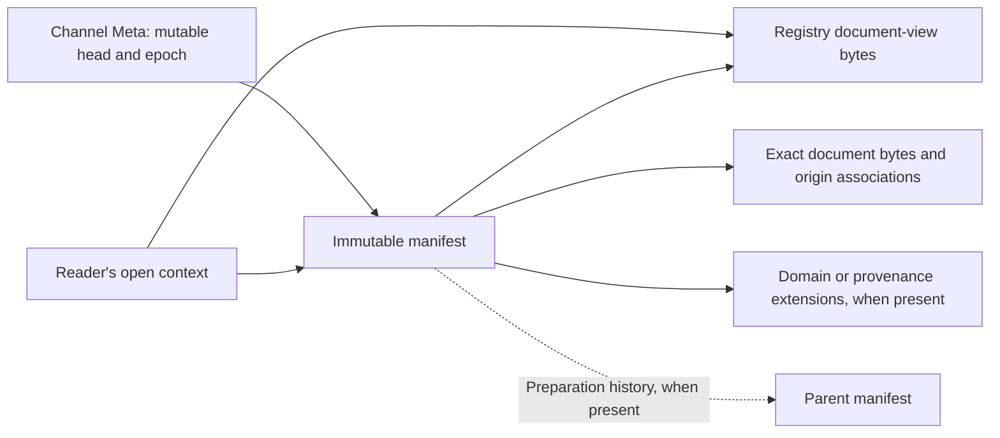
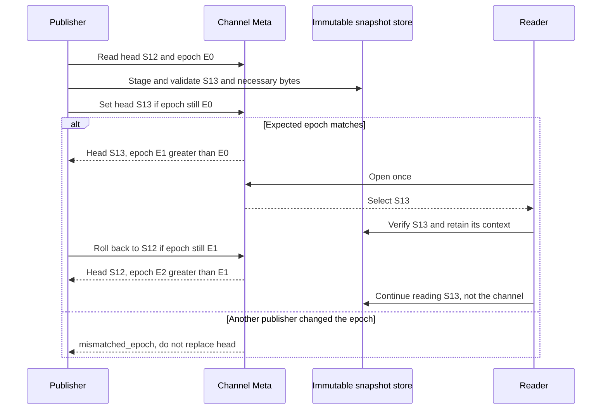

# xRegistry Publications: Channels and Snapshots

<!-- words: aba bytewise cas contenttype crlf etag etags jsonld namespace -->
<!-- words: offline readonly rebase rebasing readme subtrees walkthrough -->
<!-- words: versionid versionids xids xref xregistry -->
<!-- words: channelid originregistry originversion publications -->
<!-- words: REQUIREDEXTENSIONS reserialization workflow workflows -->
<!-- words: workingdrafts -->
<!-- words: sequencediagram -->
<!-- words: viewversion publication -->

## Abstract

This working draft defines publications for any xRegistry domain. A publication
is the set of snapshots and channels that a publisher maintains under one scope
URI. A snapshot is an immutable captured Registry view. Its manifest is an
immutable JSON document that binds the view to the exact bytes of its model,
metadata and selected documents. A channel is a mutable name, such as `stable`,
whose head selects one manifest.

All captured content is stored as xRegistry Version documents. A reader
retrieves an exact Version through its selected binding and checks its bytes.
An HTTP binding uses Core document operations; an OPC UA binding uses native
FileType reads. Publication does not require an HTTP facade or a separate
content download service.

A reader opens a channel once and retains the selected manifest while the
publisher advances or rolls back the channel. Compatibility is checked
separately. Neither a channel nor a snapshot asserts compatibility.

## Overview

Publication allows a publisher to replace a reviewed Registry state without
changing the state seen by readers that already selected it. For example, a
team can release a reviewed manual through `stable`, then publish an edit or
roll it back while a reader pages through the original state.

A live Registry serves its current state. That state is a poor release
artifact:

- Metadata and documents can change between two page requests, so a reader
  paging through a large Registry can combine two states.
- A Version ID names a Version, not its bytes. A Registry that permits
  document updates can serve other bytes under the same ID.
- Readers cannot tell a reviewed state from work in progress, and a
  publisher has no single switch to release, promote or roll back a state.
- An offline copy cannot show that it matches what the publisher released.

This extension separates preparing a state from releasing it. The publisher
stores everything a reader needs as immutable Version documents and records
their digests in a manifest. Releasing the state is one conditional update
of a channel's `head`. A reader follows `head` once, checks every byte it
reads against the manifest, and keeps using that manifest after the channel
moves.

Three responsibilities take part:

- The **publisher**, such as a release job, prepares content, stores the
  manifest and asks for the channel update.
- The **publication adapter**, in front of the Registry's store, keeps
  snapshots immutable, retains the bytes they reference and accepts only
  conditional head updates.
- The **reader** opens a channel or an exact manifest and checks what it
  reads.

A release follows the same steps for every domain:

1. Keep the exact domain Versions to release, or copy their bytes.
2. Capture the Registry model and metadata as JSON and store it as a
   Version document.
3. Write a manifest that references those Versions with their digests and
   sizes, and store it as a new snapshot.
4. Move the channel's `head` to the manifest if no other publisher moved it
   first.

[Model and Placement](#model-and-placement) describes the stored content,
[Publishing and Opening a Channel](#publishing-and-opening-a-channel) the
update and the reader, and
[Export, Federation and Binding Equivalence](#export-federation-and-binding-equivalence)
offline packages.

To apply the extension, a deployment adds the channel, snapshot and object
Resource types to its model, deploys an adapter that enforces their rules,
and chooses the bindings readers use. A Registry reachable only through
OPC UA serves the same publication through UA reads; HTTP is not needed.

## Scope and Terminology

The key words "MUST", "MUST NOT", "REQUIRED", "SHOULD", "SHOULD NOT",
"MAY", and "OPTIONAL" are interpreted as described in
[RFC2119](https://www.rfc-editor.org/rfc/rfc2119).

Core defines entities, model interpretation, IDs and conditional writes.
[Federation](../federation/spec.md) defines Registry contexts, source selection,
reference bases, snapshot completeness and package interpretation.
This extension adds publication descriptors and updates to named channels.
Publishing a local Registry does not require federation.

The examples use one local Registry, `publication-example`. Its `set` Group
`manual` holds the `document` Resource `intro`, whose Version `7` is a
36-byte `text/plain` document. The publisher releases this state under the
scope `urn:example:manual-publication` and selects it with the channel
`stable`. The [samples](samples/README.md) contain the exact bytes shown in
this document.

A generic snapshot fixes bytes without interpreting them. The example
snapshot captures the 36 bytes of `intro` without inspecting its references.
Domain interpretation can require additional information. A Web of Things
(WoT) Thing Description (TD) can reference a Thing Model (TM), and a WoT
consumer needs the exact TM Version that the publisher validated. The
[WoT companion](design/design.md#wot-channels-snapshots-and-dependency-bindings)
adds a manifest closure extension that binds each recognized reference to an
exact target Version. Its resolver checks whether the caller accepts that
target. Other domains define their own closure rules without changing channel
or snapshot identity.

| Term | Meaning |
| --- | --- |
| Publication | Snapshots and channels that a publisher maintains under one scope. |
| Scope | Absolute URI identifying a publication and its authority. |
| Snapshot | Immutable captured Registry view as defined by Federation. |
| Manifest | Immutable JSON document binding a snapshot's view to exact stored bytes. |
| Byte descriptor | `reference`, `digest` and `size` selecting and checking an exact Version's document bytes. |
| Snapshot ID | SHA-256 digest of the exact manifest bytes. |
| Channel | Scoped name whose authoritative head references one manifest. |
| Open context | One selected snapshot and its checked access context. |
| Open record | Schema-defined JSON representation of an open context. |
| Publication adapter | Component that enforces this extension over a Core store. |

Channel names and snapshot IDs are not document Version IDs. Groups remain
organizational containers. A Group that holds channel or snapshot Resources
MUST NOT be used or interpreted as a channel, a snapshot or a compatibility
declaration.

## Model and Placement

Publication state uses ordinary Core Resources:

- A channel Resource holds the mutable selection in its Meta.
- A snapshot Resource holds one immutable manifest.
- An object Resource stores captured Registry JSON, extension documents or
  copied domain bytes.

Existing domain Versions can also supply retained content. A publication
adapter enforces the behavior that a Core model cannot express.

### Responsibilities and Prepared Content

The publisher prepares the content and arranges for readers to retrieve it.
It can be an authorized application or a release job. The publication adapter
enforces snapshot immutability and conditional channel updates. The Registry
serves the captured bytes through its supported bindings. The publisher and
adapter can be part of the same deployment; they are responsibilities, not
a requirement for separate processes or hosts.

Before selecting a snapshot through a channel, the publisher prepares:

| Content | Prepared by the publisher | Purpose for the reader |
| --- | --- | --- |
| Domain documents | Retain exact domain Versions, or copy their bytes to object Versions. | Read the content associated with the selected Versions. |
| Captured Registry JSON | Capture or assemble the model and metadata in Core document view, then store those bytes as an object Version. The example calls the local file `registry.json`. | Interpret the selected entities, Versions and model without reading changing live metadata. |
| Manifest | Record descriptors for the captured Registry JSON and documents, then store those bytes as the snapshot's `manifest` Version. | Identify and check the exact bytes belonging to this snapshot. |

The captured Registry JSON is a stored representation of the selected view,
not the live Registry endpoint. It is an ordinary Version document. For
example, a publisher can obtain document-view JSON through Core export or
assemble it from the selected content. Its capture classification describes
how that state was obtained; exporting a live Registry does not by itself
establish atomic source capture.

The Registry JSON and manifest serve different purposes. The Registry JSON
describes the captured entities and their model. The manifest binds that
representation and the separately stored document bytes to their digests.
Reading only the live Registry could observe later metadata changes; reading
only the manifest would not supply the model and entity graph.

The captured view is the domain state being released. Its model need not
include the publication store's control Resources. The publisher prepares
that view before storing its manifest; the manifest does not describe itself.

### Storage Boundary

The publisher is responsible for storing the referenced Version documents,
directly or through its publication service. Setting `head` does not
generate, upload or copy them. The publication adapter validates the prepared
head before making it visible.

This extension defines the representations and their publication behavior,
not a general upload API for backing storage. An authorized publisher uses
the Registry's supported create/write operations or an internal publishing
process. The Registry can use a database, an object store or a file system
internally. The interoperable retrieval contract remains an exact xRegistry
Version document; an arbitrary downloadable file is not a publication
reference. A read-only binding can expose content prepared through another
interface without offering publication writes.

Loading the model does not enforce publication immutability, conditional head
updates, retention, digest identity or authorization. A publication adapter,
such as a server module or storage layer in front of a Core store, MUST
enforce those behaviors. A Core-only store MUST NOT advertise publication
support merely because it loaded the model. Public APIs MAY be read-only.

The executable samples implement none of these backing stores or upload
operations. They associate exact Version references with local bytes in
memory. Their `manifest.json` and `registry.json` names illustrate one
snapshot. Publishing another snapshot does not authorize replacing bytes
needed by retained snapshots or already-open readers; the retention rules in
[Workflows and Lifecycle](#workflows-and-lifecycle) still apply.

### Resource Types

The [model](model.json) defines `channels`, `snapshots` and `objects`, with
singular names `channel`, `snapshot` and `object`. It places them in an
example organizational Group type, `publications`, whose singular name is
`publication`. The sample channel `stable` belongs to the Group `team`, at
`https://publisher.example.test/publications/team/channels/stable`.
A deployment MAY import these Resource types into its existing organizational
Group types using Core
[`ximportresources`](../../core/model.md#reuse-of-resource-definitions).
It MUST preserve the shared Resource definitions. Group IDs identify neither
channels nor publication scopes.

The [generated model schemas](../tools/README.md) describe the Registry
metadata in JSON Schema, JSON Structure, Avro and OpenAPI. These schemas are
separate from the manifest and open-record schema below. Model loading and
schema validation do not enforce channel updates or snapshot retention.

A channel is a metadata-only Resource. Its name is the ordinary `channelid`.
Its Resource Meta contains:

| Attribute | Meaning |
| --- | --- |
| `scope` | Immutable publication scope URI. |
| `head` | Byte descriptor of the selected manifest. Its reference, digest and size are updated together. |
| Core [`epoch`](../../core/spec.md#epoch-attribute) | Expected-state token for conditional Meta updates. |

The sample [channel Meta](samples/channel.json) for `stable` contains these
attributes. Core's other Meta attributes are omitted:

```json
{
  "scope": "urn:example:manual-publication",
  "epoch": 12,
  "head": {
    "reference": {
      "registry": {
        "name": "http",
        "endpoint": "https://publisher.example.test"
      },
      "version": "/publications/team/snapshots/cdbc9f1ff5ba6dd31377af1f8a8f03840e7bf836939be384ff6f0c97fac56c2b/versions/manifest"
    },
    "digest": "sha256:cdbc9f1ff5ba6dd31377af1f8a8f03840e7bf836939be384ff6f0c97fac56c2b",
    "size": 1137
  }
}
```

A snapshot Resource serves its manifest as its sole document Version, with
explicit Version ID `manifest`. Its Resource ID is the 64 lowercase
hexadecimal characters of its Snapshot ID. The snapshot Resource for the
manifest selected above therefore has the ID given by `head.digest` without
the `sha256:` prefix.

An object Resource in the example uses the explicit Version ID `content`;
its document media type depends on the captured content. A publisher MAY
reuse existing exact Versions instead of copying their bytes, provided the
adapter ensures their immutability and retention. Changed captured bytes
need another object identity; `registry-capture` is not an overwrite target
for every release.

A manifest MAY reference a manifest in another authorized Registry. Forks
do not require copies of its document revisions.

The following graph distinguishes references from storage layout. Only the
channel head moves; an open context retains the selected manifest and Registry
descriptors. Reads do not depend on parent history, when present.



## Manifest and Integrity

A manifest defines one snapshot in JSON. It identifies the publication scope,
records how the state was captured, and lists byte descriptors for the
Registry JSON and every captured document. The digest of the exact manifest
bytes is the Snapshot ID. A change to the state described by a manifest
therefore produces another snapshot.

### Byte Descriptors

A reader needs to obtain the exact bytes that the publisher checked. A
Version reference alone cannot identify those bytes: its content can change,
while unchanged bytes can be shared by several snapshots or moved to another
location. A byte descriptor separates access from byte identity. Its
`reference` selects an exact Version, `digest` identifies the bytes and `size`
gives their exact length. The channel's `head`, the manifest's `registry`
field and each document's `content` use byte descriptors.

A byte descriptor MUST contain `reference`, `digest` as `sha256:` followed
by 64 lowercase hexadecimal characters, and non-negative integer byte `size`.
Its `reference` MUST contain `registry` and `version`:

- `registry` contains the selected binding's `name`, credential-free absolute
  `endpoint` and OPTIONAL `parameters`. Their meanings and validation follow
  Federation's [binding definitions](../federation/spec.md#discovery-and-binding-selection).
  This is one selected access context, not a catalog advertisement list.
  Priority and implicit HTTP access are not part of this reference.
- `version` is an exact Version XID in that Registry. A consumer MUST NOT
  substitute a Resource's default Version or interpret a NodeId as the XID.

A consumer MUST reject a descriptor that lacks these fields, such as one that
supplies only a URL.

The referenced Version MUST serve the stored document bytes, not a fresh
serialization of entity metadata. This applies to Registry JSON and JSON
manifests as well as binary documents. Snapshot manifests, captured Registry
JSON, captured domain bytes and extension documents MUST be stored as
Version documents.

Each binding selects an exact Version in its own way:

- Git references MUST select a complete commit object ID, not a branch or
  tag.
- OCI references, including File OCI layouts, MUST select a digest, not a
  tag.
- File document-tree reads retain that binding's containment and change
  checks.
- HTTP and UA references rely on the publication adapter's retained
  immutable Versions; the binding endpoint and Core Version ID do not prove
  immutability. The same applies when a Registry uses external physical
  storage: its Version document operation still supplies the retained
  checked bytes.

For HTTP, resolve the Registry-root endpoint and exact Version XID through
Core's document operation. For OPC UA, select and validate the endpoint,
application and `registryroot`, resolve the exact Version under that root,
then use its FileType Open/Read/Close lifecycle. Check raw bytes after bounded
reads and perform cleanup on failures, as specified by the
[UA binding](../bindings/opcua.md#5131-filetransfer-read-lifecycle).
The following reference selects a captured Registry JSON document without
HTTP:

```json
{
  "registry": {
    "name": "opcua",
    "endpoint": "opc.tcp://ua.example.test:4840",
    "parameters": {
      "registryroot": "nsu=urn:example:publication;s=Registry"
    }
  },
  "version": "/publications/team/objects/registry-capture/versions/content"
}
```

An unsupported binding, unavailable Version, denied destination or failed
integrity check MUST fail the read explicitly. A consumer MUST NOT retry
through another binding, a live export or a newer channel head as automatic
repair. Authorization and trust are supplied under caller policy, not by
the descriptor.

### Manifest Format

The [schema](schemas/publication.json) defines format
`xregistry-publication/1`. Every manifest has:

| Field | Meaning |
| --- | --- |
| `format` | Exact publication format discriminator. |
| `scope` | Publication scope URI. |
| `capture` | `assembled`, `source-snapshot`, or `live-observation`. |
| `completeness` | Federation `linked` or `offline-complete` classification. |
| `registry` | Descriptor of the complete Core document-view Registry JSON. |
| `documents` | View and origin Version XIDs, bases and byte descriptors. |
| `parent` | OPTIONAL descriptor of the preparation predecessor. |
| `extensions` | OPTIONAL URI-keyed domain closure and provenance descriptors. |
| `requiredExtensions` | OPTIONAL extension URIs needed for interpretation. |

The running example's complete [manifest](samples/manifest.json) is:

```json
{
  "format": "xregistry-publication/1",
  "scope": "urn:example:manual-publication",
  "capture": "assembled",
  "completeness": "offline-complete",
  "registry": {
    "reference": {
      "registry": {
        "name": "http",
        "endpoint": "https://publisher.example.test"
      },
      "version": "/publications/team/objects/registry-capture/versions/content"
    },
    "digest": "sha256:d7e50157645e98260f0fa754e6940c59ab5b4f2d36e79b8fa3b08130b4e7a3e6",
    "size": 790
  },
  "documents": [
    {
      "viewVersion": "/sets/manual/documents/intro/versions/7",
      "originRegistry": "https://author.example.test/registry",
      "originVersion": "/sets/manual/documents/intro/versions/7",
      "base": "https://author.example.test/manual/intro.txt",
      "content": {
        "reference": {
          "registry": {
            "name": "http",
            "endpoint": "https://publisher.example.test"
          },
          "version": "/sets/manual/documents/intro/versions/7"
        },
        "digest": "sha256:0a3fdd7ff022bd6a263d031e640fd0bc074fa877ed320a367784067b7a1d78e1",
        "size": 36
      }
    }
  ]
}
```

These 1137 bytes have the digest that the channel's `head` carries. The
`registry` descriptor selects the 790-byte Registry JSON Version document.
The one `documents` entry associates Version `7` of `intro` with its source
and its 36 bytes. This manifest records no preparation history, so it has no
`parent`.

Consumers MUST verify the exact size and SHA-256 of every descriptor they
use. Manifest identity covers exact UTF-8 bytes, not parsed JSON equality.
Whitespace changes can produce another ID. Producers SHOULD use deterministic
serialization. This format does not canonicalize arbitrary domain documents.

A manifest MUST NOT include its own digest. Consumers MUST reject unknown
formats or unknown mandatory extension semantics instead of ignoring them.

Every `requiredExtensions` entry MUST identify an included extension.
Unlisted extensions are OPTIONAL to generic readers. A caller requesting a
domain profile still requires that profile's extension and validation.

### Registry JSON and Document Associations

The Registry descriptor covers the model, available model source and
captured metadata. Registry JSON MUST use Core
[document view](../../core/spec.md#doc-flag). It MUST contain a complete
internal graph and sufficient model material, including immutable model
includes, as specified by Federation. Its enabled capabilities MUST describe
the captured view rather than the source server's write capabilities.

Each document association identifies one captured document:

| Field | Meaning |
| --- | --- |
| `viewVersion` | Version XID in the captured view. |
| `originRegistry` | Original absolute Registry identity URI; provenance, not a retrieval instruction. |
| `originVersion` | That source's Version XID. |
| `base` | Original absolute document URI base. |
| `content` | Byte descriptor of the exact document bytes. |

When a view is served from another location, the origin fields preserve the
document's source identity and `base` preserves the base for its relative
references. View Version XIDs MUST be unique, including under Core's
case-insensitive uniqueness rules. The association MUST NOT change the
document's authored identifiers.

An offline-complete manifest MUST supply every declared document in its
scope, except aliases whose Core document operation resolves to another
included Resource. Linked snapshots MAY reference exact Versions in another
Registry, but MUST NOT claim bytes omitted from their offline package are
offline available. An authored external link remains domain content. If its
bytes are captured by this publication, the publisher stores them as a
Version document too. Metadata-only types do not acquire documents by
appearing in a manifest. Domain bytes MUST be captured through raw reads or
byte-preserving Core [binary representation](../../core/spec.md#binary-flag),
not JSON parsing and reserialization.

A change to the model, captured metadata, document selection or extensions
changes the manifest's checked graph and therefore its ID. A parent records
preparation history only; it establishes neither compatibility nor numeric
order and defines no merge algorithm. Reading a snapshot MUST NOT require
reading its parent.

### Capture Classification

The `capture` classification describes how the selected state was obtained:

- `assembled` denotes an intentionally constructed set.
- `live-observation` denotes source reads without a source-wide consistency
  guarantee.
- `source-snapshot` is permitted only when the source provides an immutable
  capture guarantee. For this claim, the producer MUST retain its source
  identity and capture evidence in a provenance extension under
  `requiredExtensions`.

The classification does not weaken the output's immutability or internal
completeness. A consumer requiring atomic source capture MUST reject
`live-observation`.

## Publishing and Opening a Channel

An authorized publisher makes a prepared snapshot visible through a channel
by updating its `head`. A reader opens the channel once and keeps the
snapshot it selected, whatever the channel selects later.

### Publishing a Snapshot

The manifest and necessary content are written before the head update; they
become part of the channel's published state only when selected by `head`.
An authorized publisher MUST perform these steps:

1. Read the channel's Meta, retaining `scope`, `head` and `epoch`.
2. Publish or reuse the desired document revisions. Capture or assemble the
   Registry metadata and model as document-view JSON.
3. Construct a complete snapshot, validate its Core graph and applicable
   domain requirements, and store the necessary content as Version
   documents. Construct and store the manifest referencing that content as
   described under
   [Responsibilities and Prepared Content](#responsibilities-and-prepared-content).
4. Atomically replace `head` through a conditional update to the same Meta,
   supplying the `epoch` from step 1.

S12 and S13 below are short labels for manifest descriptors, not literal
snapshot IDs. S12 is the sample manifest, which `stable` selects at epoch 12.
It references the retained `intro` Version at
`/sets/manual/documents/intro/versions/7` and the captured Registry JSON at
`/publications/team/objects/registry-capture/versions/content`. An author
edits `intro`, and the publisher releases the edit as S13:

- Step 1 returns head S12 and epoch 12.
- Step 2 stores the edited `intro` bytes as a new Version. Unchanged Versions
  and their bytes are reused.
- Step 3 stores the new Registry JSON, under another object identity than
  S12's, and any newly captured document bytes as Version documents. The
  publisher constructs a manifest with descriptors for those Versions and
  stores it as the `manifest` Version of a new snapshot Resource. Its digest
  is S13's Snapshot ID. The content is available before the publisher
  attempts to move `stable`.
- Step 4 sets `head` to S13 if the epoch is still 12. The adapter advances the
  epoch, to 17 in the [state table](#opening-a-channel).

The reference in the new `head` selects the snapshot's exact `manifest`
Version through a supported Registry binding. Its digest and size identify
the bytes independently of their storage location.

For HTTP, step 4 uses Core's
[Meta update](../../core/http.md#patch-and-put-groupsgidresourcesridmeta).
The expected epoch belongs to that channel's
[Meta entity](../../core/spec.md#meta-entity), not the Registry root.

A failure before step 4 leaves the channel unchanged. In the example, an
upload or validation failure in step 2 or 3 leaves `head` selecting S12.
Unreferenced staged objects are not part of the channel's published state,
so no transaction across document uploads is needed.

### Head Update Rules

The following rules govern step 4:

- `scope` MUST equal the new manifest's scope.
- `head` MUST have no separate default-Version alias maintained as a second
  authority. Core defaults on the channel's metadata-only Version are not
  publication selection.
- The adapter MUST validate the new head before making it visible.
- A stale epoch MUST preserve the old head and return Core's
  [`mismatched_epoch`](../../core/spec.md#mismatched_epoch).
- Unconditional channel-head updates MUST be rejected by the adapter.
- An implementation lacking atomic compare-and-update MUST NOT offer writes.

For example, a second publisher that also read epoch 12 cannot replace S13
with its own S14. Its update supplies epoch 12, the adapter returns
`mismatched_epoch`, and `head` stays S13.

Every successful head update MUST advance the Meta epoch, including a
rollback to a previously selected manifest. Rolling `stable` back from S13 to
S12 moves the epoch from 17 to 21, not back to 12. The same channel Resource
identity MUST NOT be reused after deletion. An authority MUST retain that
non-reuse history or use a distinct Resource identity. This avoids an old
epoch accidentally authorizing a write to a recreated channel.

After a timeout, the publisher cannot determine from the timeout alone whether
its head update took effect. The publisher reads back the head and epoch and
reconciles the observed state before retrying with fresh state. A matching
head can satisfy the publication objective without proving which request set
it; a different head can reflect an intervening authorized update. Anonymous
document publication retains its own API's retry semantics.

### Opening a Channel

An authorized reader opens a channel by reading its Meta once, verifying the
manifest at `head`, and establishing the immutable context described in
[Open Context and Discovery](#open-context-and-discovery). Every subsequent
read and page request uses that selected snapshot. It MUST NOT reread the
channel to fill missing members. Refresh is a new open operation.

A reader opening `stable` after step 4 reads head S13 and epoch 17. It fetches
the manifest through the exact Version reference in `head` and checks its
size and digest. It then fetches and checks the Registry JSON through the
manifest's `registry` descriptor, and the document bytes it needs through
their `content` descriptors. If any of these bytes are missing or fail their
check, the read fails. The reader does not reopen the channel to repair it.

The reader retains the manifest and Registry descriptors in its open record.
Later reads and offline replay use that record instead of reopening the
channel.

The sequence below illustrates one publisher and reader:



These illustrative states summarize the sequence. Epochs increase. The chosen
values do not require increments of one.

| Operation | Expected epoch | Head after operation | Meta epoch | Reader already on S13 |
| --- | --- | --- | --- | --- |
| Initial state | Not an update | S12 | 12 | Not opened |
| Publish S13 | 12 | S13 | 17 | Opens S13 |
| Stale attempt to publish S14 | 12 | S13 | 17 | Remains on S13 |
| Roll back to S12 | 17 | S12 | 21 | Remains on S13 |
| Update times out | Previously read epoch | Unknown until read-back | Unknown until read-back | Remains on S13 |

## Open Context and Discovery

An open record carries the reader's snapshot selection beyond the request
that opened the channel. It allows a later page request, another process or
an offline replay to use the same snapshot without consulting the channel
again.

### Open Record

The schema defines the `open` record with `format`, `scope`, `snapshot`,
`registry`, `completeness`, OPTIONAL `channel` selection, and OPTIONAL
constituent `sources`. Here `format` is `xregistry-open/1`. The channel
selection records its selected Registry access, Resource XID and observed
Meta epoch. Unlike a byte descriptor, its `reference` has `resource` instead
of `version`, because a channel selection belongs to Resource Meta. The sample
[open record](samples/open.json) for a reader that opened `stable` at epoch 12
is:

```json
{
  "format": "xregistry-open/1",
  "scope": "urn:example:manual-publication",
  "snapshot": {
    "reference": {
      "registry": {
        "name": "http",
        "endpoint": "https://publisher.example.test"
      },
      "version": "/publications/team/snapshots/cdbc9f1ff5ba6dd31377af1f8a8f03840e7bf836939be384ff6f0c97fac56c2b/versions/manifest"
    },
    "digest": "sha256:cdbc9f1ff5ba6dd31377af1f8a8f03840e7bf836939be384ff6f0c97fac56c2b",
    "size": 1137
  },
  "registry": {
    "reference": {
      "registry": {
        "name": "http",
        "endpoint": "https://publisher.example.test"
      },
      "version": "/publications/team/objects/registry-capture/versions/content"
    },
    "digest": "sha256:d7e50157645e98260f0fa754e6940c59ab5b4f2d36e79b8fa3b08130b4e7a3e6",
    "size": 790
  },
  "completeness": "offline-complete",
  "channel": {
    "reference": {
      "registry": {
        "name": "http",
        "endpoint": "https://publisher.example.test"
      },
      "resource": "/publications/team/channels/stable"
    },
    "epoch": 12
  }
}
```

`snapshot` and `registry` MUST equal the selected manifest descriptor and its
Registry descriptor. `scope` and `completeness` MUST match the checked
manifest. In the sample, `snapshot` equals the channel's `head`, and
`registry` equals the manifest's `registry` field.

An open record is transport and access context. It is neither a new Core
entity nor a replacement for `self`. The record supplies the information
needed to retrieve the manifest and captured Registry JSON Version document.
It MUST be available to the caller rather than kept only in logs. Library
and native bindings MUST return the equivalent schema-defined record or
report unsupported publication-context access.

### OPC UA Access

For OPC UA, the caller reads `scope`, the complete `head` and `MetaEpoch` on
the selected channel Resource through the binding's Meta representation.
The adapter MUST return a coherent selection: a mixed head or a head paired
with another update's epoch is not an open result. The reader then resolves
the retained references through the selected bindings. The open record is
returned as caller-visible context; no HTTP Link, standard UA context node
or new companion Method is implied.

An adapter offering UA publication writes MUST atomically replace the complete
head under the expected Meta epoch and enforce this extension's validation
and retention rules. A native Meta extension update can be used only when it
provides those guarantees. Separate UA Property writes or a batch of Write
requests do not establish atomicity. Otherwise publication writes MUST be
reported as unsupported; native read support does not imply write support.

### HTTP Projection

A publication HTTP projection MUST serve a snapshot-specific Registry root
through Core HTTP. The root response MUST contain an HTTP `Link` with an
absolute `rel` URI of
`https://xregistry.io/workingdrafts/publication/context`, targeting the
associated open-record JSON. The root's metadata response and its open
record MUST describe the same snapshot. The link target is subject to the
same credential and redirect policy as any other destination.

A moving channel endpoint MAY redirect to that snapshot-specific root.
If it serves a response directly, navigation, pagination and the context
link MUST remain bound to the selected snapshot. A service unable to supply
this guarantee MUST report live behavior, not publication conformance.
The extension does not change ordinary non-publication HTTP endpoints.

A pin-aware consumer MUST obtain and validate the open record and manifest
before claiming a pinned result. In an HTTP projection, snapshot-specific
API `self` and navigation URLs MUST be retrievable Core URLs. Native
projections use their binding's addressing and selected context. Source
identities remain in the manifest associations. Contexts are not inferred
from equal XIDs or root epochs.

The following synthetic response fragment illustrates how an HTTP adapter
could expose the checked open record. It is neither traffic from an
implemented adapter nor a prescribed URL layout:

```http
HTTP/1.1 200 OK
Content-Type: application/json
Link: <https://publisher.example.test/contexts/manual-12.json>; rel="https://xregistry.io/workingdrafts/publication/context"
```

Here the response is from a snapshot-specific Core root such as
`https://publisher.example.test/views/manual-12`. The context target
returns the open record above. Its `registry` descriptor fixes the captured
graph. A second collection page follows the snapshot-specific response's
navigation rather than reopening `stable`. The API's navigation URLs belong to
the selected projection. Original document identities and bases remain in the
manifest associations.

## Export, Federation and Binding Equivalence

### Export

Export remains a binding operation over the selected view. For HTTP,
Core [`GET /export`](../../core/http.md#get-export) remains the
[document-view](../../core/spec.md#doc-flag) and inlining operation. On a
publication root it MUST serialize only the already selected snapshot.
Native bindings use their own export operations; this extension does not
require them to issue HTTP requests.

A publisher MAY also expose the exact captured Registry JSON Version document.
API serialization and exported JSON can have different bytes from the stored
Registry descriptor while representing the same captured graph. Only the
descriptor representation is checked with that descriptor's digest.

### Offline Packages

A byte-preserving offline export MUST include the manifest and all objects
needed by its completeness claim. Captured bytes MUST NOT be rewritten
when a package moves to another location. Publication readers MUST NOT fetch
external objects during offline replay.

The portable byte bundle is a directory with `publication-package.json`.
Its schema-defined `context` supplies the open record. `objects` is an array
of entries with an exact Version `reference` and a portable relative `path`.
Each entry maps a stored document reference to its local bytes without
rewriting that reference inside the manifest.

Paths use `/` between nonempty segments of ASCII letters, digits, underscores
and hyphens, and end in a file name with one extension. Absolute paths,
`.`/`..`, backslashes and percent encodings are prohibited. Readers MUST
enforce resolved containment, including symbolic links, and apply byte and
traversal limits before reading.

The `objects` array MUST cover the selected manifest, captured Registry
JSON, associated documents and extensions needed for its completeness
claim. Parent manifests are not needed merely to read the selected snapshot.

The checked [sample bundle](samples/publication-package.json) consists of
five files. It includes both HTTP and UA manifest examples over the same
Registry JSON and document bytes. The local map does not replace the
original references or claim that a local file implements either network
binding.

```text
bundle/
  publication-package.json
  manifest.json
  opcua-manifest.json
  registry.json
  intro.txt
```

One entry in its `objects` array is:

```json
{
  "reference": {
    "registry": {
      "name": "http",
      "endpoint": "https://publisher.example.test"
    },
    "version": "/sets/manual/documents/intro/versions/7"
  },
  "path": "intro.txt"
}
```

For `intro.txt`, a reader obtains the 36 local bytes and checks them against
the document's `content` descriptor in the manifest. Moving the bundle
preserves that check. With networking disabled, removing the file produces
`unavailable` in the [example reader](samples/README.md). It does not cause a
network read through the referenced Registry.

The byte bundle provides direct offline publication access; it does not
define another Federation native Registry layout. A bundle can accompany a
directory mapping or OCI layout. Before claiming its Snapshot ID, native
readers still need their own format and verified equivalence with the
manifest. This extension adds no OCI role or Git directory-mapping field.
A byte-bundle reader MUST NOT advertise unsupported native binding
conformance.

### Reference Comparison

Reference comparison MUST use the binding name, endpoint, validated parameters
and decoded Version XID:

- Object-member order has no significance.
- Absent parameters equal an empty object.
- Git's omitted format path equals its defined default, and hexadecimal
  commit IDs compare in lowercase.
- Equivalent URI encodings in XIDs compare after one decoding step.
- Core's case-insensitive entity-name rules apply, while Version IDs retain
  their case-sensitive identity.
- Endpoint spelling and other parameter values remain explicit access
  context, not guessed aliases.

A package MUST reject duplicate equivalent references, even if they name
different local files.

### Binding Equivalence

A publication consumer MUST verify that any alternate Registry API or package
represents the model, metadata and byte associations fixed by the manifest.
An unchecked assertion that two endpoints share a Registry ID is insufficient.
Binding-specific Git commits, OCI digests and Snapshot IDs remain distinct.
A binding without a checked mapping to the manifest MUST NOT claim that ID.

Binding access fields inside a manifest contribute to its exact-byte identity.
Changing HTTP references to UA references creates another manifest and
Snapshot ID, even if the captured graph and document bytes agree. To expose
one unchanged manifest through another binding, a caller needs an explicit
access mapping with checked equivalence to the original exact Version
references. This extension does not define an alternate-endpoint discovery
protocol. Readers MUST NOT infer such a mapping from equal Registry IDs or
silently substitute bindings.

### Federated Sources

Federation MAY discover publication roots through existing HTTP
advertisements, or serve checked packages through its other bindings. No new
advertisement parameter is added. Existing bindings retain their own format
and version rules. A publication reader can use the manifest and Registry
descriptors directly without pretending to implement a native package
binding.

When several sources form a view, each selected immutable source context,
the interpreted view model and the exact composition policy MUST be captured
to claim reproducible composition. The `sources` array records each source's
snapshot and selected Registry access context. Policy and model records use
checked extension descriptors. Their semantics MUST be supported by the
producer or consumer that reconstructs the composition. A materialized
producer-resolved snapshot can instead be consumed directly under its own
complete Registry descriptor.

Independently pinned sources do not establish one simultaneous capture.
Federation precedence selects whole Resources, not compatible Versions or
substitute channel heads. Source failures MUST retain Federation's
no-silent-fallback behavior. Publication writes remain outside Federation.

## Domain Closure and Compatibility

Generic completeness covers declared xRegistry content. It does not cover
arbitrary links embedded in that content. A domain profile MAY define closure
extensions that bind source Version and reference locations to exact target
revisions. It MUST identify the recognized reference kinds, source bases,
target identities, mandatory validation and handling of cycles and external
dependencies.

Consumers requesting such a profile MUST reject absent or unsupported closure
data. Exact selection and compatibility validation are separate operations.
A snapshot fixes what to evaluate. It does not waive an authored floor,
compatibility selector or caller acceptance policy.

One document revision MAY appear in several snapshots and channels. A channel
name such as `stable` or `preview` does not establish a compatibility class.
When a selected channel head is incompatible with a constrained request, that
request MUST fail. Readers MUST NOT search older snapshots for a compatible
result. Raw exact retrieval remains distinct from validated consumption.

## Workflows and Lifecycle

The rules above combine into the following workflows:

- **Automated conversion.** Reuse unchanged Versions, store changed Versions,
  capture the complete set, then conditionally advance one head. Failure
  before advancement leaves the channel unchanged.
- **Server capture.** Record source revision and provenance. If the server
  lacks consistent capture, disclose live observation. A manifest alone does
  not prove simultaneous source reads.
- **Individual edit.** Derive S13 from S12 with one changed document and
  retained exact dependencies. Unchanged document Versions are reused.
- **Fork.** Create another channel pointing to S12 without creating snapshots
  or document revisions.
- **Promotion.** Conditionally move `stable` to the reviewed snapshot.
  Concurrent change produces conflict, not overwrite.
- **Reconciliation.** Produce another complete snapshot after explicit
  conflict resolution. No automatic JSON merge is specified.
- **Rollback.** Conditionally point the channel back to S12 and advance its
  epoch. Existing operations stay on their previously selected snapshots.
- **Replay.** Open an exact manifest descriptor without consulting a channel.
  Missing or corrupt content fails and never refreshes automatically.
- **Export and offline use.** Retain the checked manifest, Registry graph and
  necessary bytes. Missing domain closure fails a domain-complete claim.
- **Retention and deletion.** Retain objects reachable from current heads and
  retained snapshots. Emergency revocation or deletion can make pins
  unavailable and MUST be reported explicitly.

Snapshot metadata and manifest bytes MUST NOT be overwritten under their
existing identity. Domain revisions used by a retained snapshot MUST be
captured immutably or served from retained checked bytes. A Core Version
ID alone does not ensure immutable content.

Access authorization and retention are deployment policy. Integrity does not
grant access or authenticate a publisher. Readers MUST apply Federation's
destination, credential, traversal and byte-limit policies. Model or schema
validation alone cannot authorize publication.

## Conformance and Examples

A read-conformant implementation supports checked descriptors, open context,
scope and completeness, pinning and explicit failure. Write conformance also
needs durable conditional heads, non-reused channel identities, immutable
snapshot storage and the retention behavior above.

[Examples and checks](samples/README.md) use in-memory state to demonstrate
format validation, byte integrity, shared snapshots, conditional updates,
stale and rollback epochs and deletion non-reuse. They do not implement a Core
server, full Core graph validator or native package binding, and they do not
prove storage durability. Adapter and cross-binding integration checks are
needed before claiming writable or deployed support.

Automatic merging, rebasing and write-through federation are outside this
extension. It also does not define global document IDs, signature formats
or distributed transactions.
